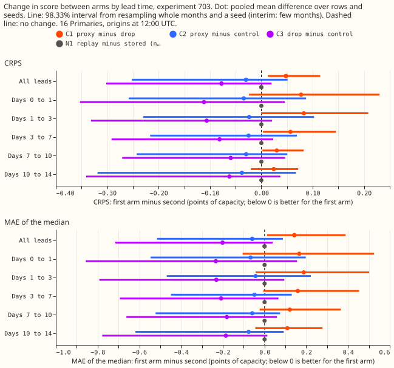
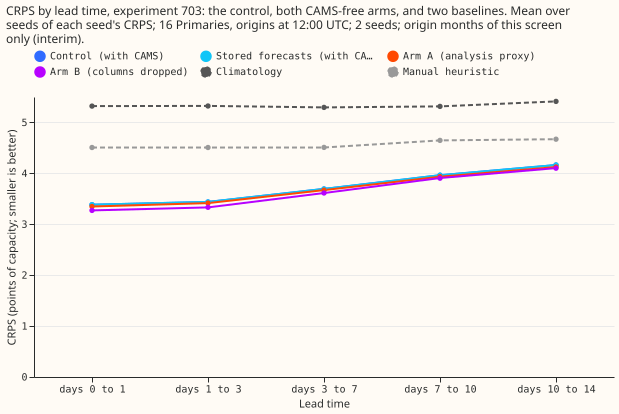
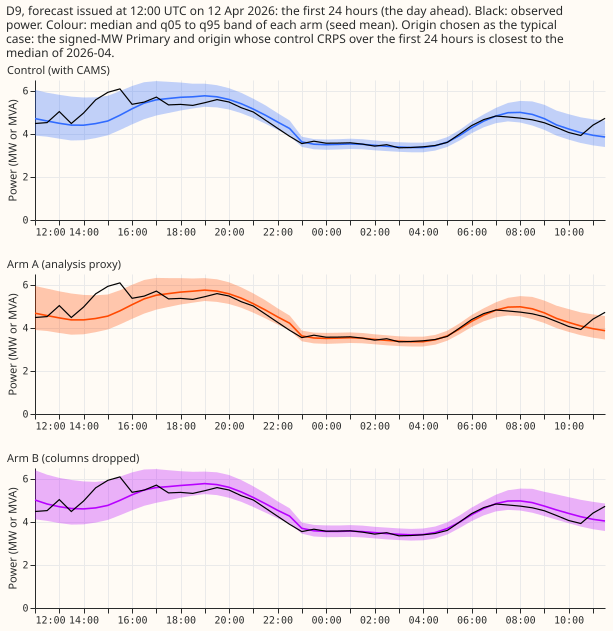
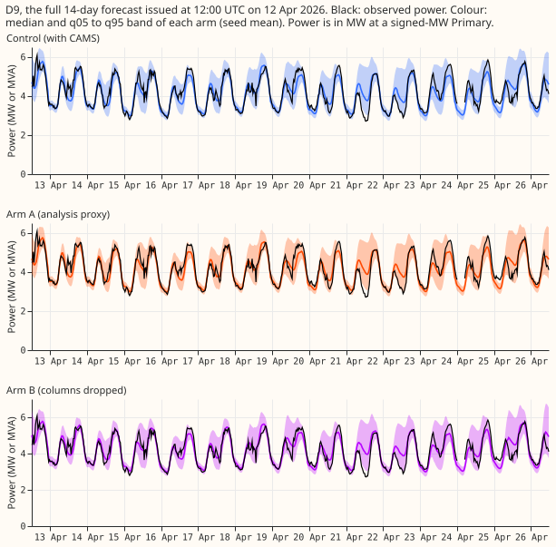
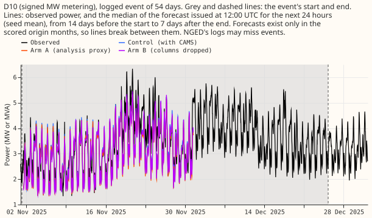
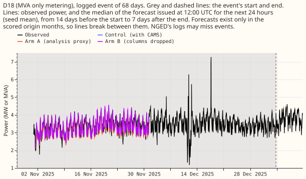
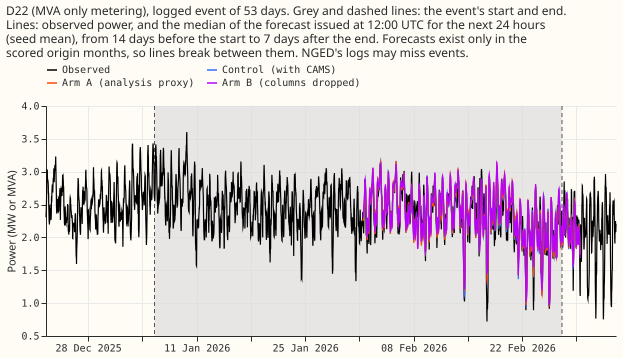
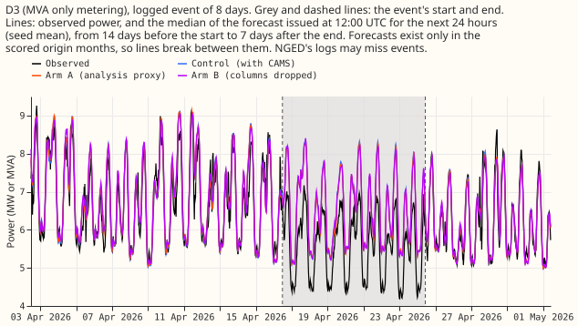
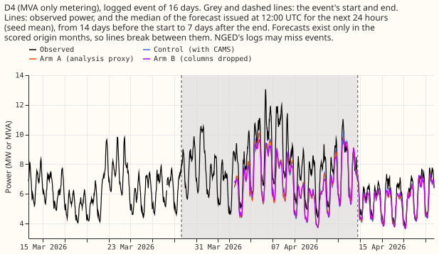
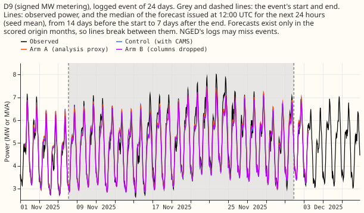

**We asked whether the Candidate, the demand neural network with the most inputs for the 16
Primaries (primary substations), gets worse when two inputs that production cannot supply are
removed.** The two inputs describe yesterday's sunshine, taken from the Copernicus Atmosphere
Monitoring Service (CAMS) satellite-based irradiance product, which production will not read when it
makes a forecast. We retrained the Candidate neural network three times on four test months: once
unchanged (the control), once with yesterday's sunshine taken from the ensemble weather forecast of
the European Centre for Medium-Range Weather Forecasts (ECMWF ENS) instead (arm A), and once with
the two inputs set to zero (arm B). The forecast was not detectably worse without the two inputs, so
production can drop them. Rebuilding them from the weather forecast was worse than dropping them,
but only at one Primary, D15. [Experiment
704](../00704-cams-free-inference-for-the-primaries-step-5-network/result.md) asked the same
question of the simpler step-5 neural network and also chose arm B, with a wider bound on the
possible loss (about 1.3%).

**Verdict: supported; arm B (the two columns dropped) is chosen by the pre-registered rule.** Scores
are the continuous ranked probability score (CRPS) and the mean absolute error (MAE) of the median,
each as a percentage of the Primary's effective capacity ("points of capacity"). The decision
contrast C1, arm A minus arm B in CRPS, is +0.048 points, with a 98.33% interval of +0.013 to +0.115
(interim: four months), so arm A is worse than arm B. To choose arm A, the rule needed an interval
wholly below zero, a point estimate of at most −0.01, and every seed's C1 below zero in every month.
C2 (arm A minus control) is −0.030 [−0.252, +0.051] and C3 (arm B minus control) is −0.078 [−0.302,
+0.020]. The 98.33% interval of C3 allows a loss of at most 0.02 points, about 0.5% of the
control's CRPS. Without D15, C3 is −0.016 [−0.152, +0.039], a bound of about 1.0%. At the six
signed-MW Primaries, arm B is not better than the control: C3 is +0.026 [−0.025, +0.100], about
0.9% of their CRPS of 2.89, and its upper bound is about 3.5%. The pooled MAE moves the same way as
the pooled CRPS in every contrast (C1 +0.143, C2 −0.059, C3 −0.202). Scored as the seed-averaged
forecast that experiment 667 published, arm A is worse than the control (CRPS 3.735 against 3.720)
and arm B scores 3.683, so the sign of C2 depends on how the seeds are combined.

**Two of the four predictions failed (P2 and P4). P1 held for both arms on the point estimates and
for arm B at the interval level.**

- P1 (each arm changes CRPS by less than +0.03 against the control) held on the point estimates
  (−0.030 and −0.078), but not for arm A at the interval level: the upper bounds are +0.051 and
  +0.020.
- P2 (|C1| below 0.01 with an interval including zero) failed: the point estimate is +0.048 and the
  interval excludes zero. The predicted outcome of the rule, arm B, held.
- P3 (MAE moves with CRPS) held for the pooled contrasts and for C2 and C3 in every split, and
  failed for C1 in three splits (see Checks).
- P4 (the replay reproduces the stored forecasts to within 1e-5 of capacity) failed, as below.

## Results

**Arm B has the lowest CRPS at every lead band and the lowest MAE over all leads, by CRPS margins
smaller than the gap between the control's two seeds (0.119).** CRPS and
normalised MAE of the median, points of capacity, mean over seeds of each seed's score, four months
(interim); lower is better.

| Lead band | Control | Arm A (proxy) | Arm B (drop) | Climatology | Manual heuristic |
|---|---|---|---|---|---|
| CRPS, all leads | 3.816 | 3.786 | **3.738** | 5.338 | 4.582 |
| CRPS, days 0 to 1 | 3.384 | 3.350 | **3.273** | 5.320 | 4.508 |
| CRPS, days 1 to 3 | 3.439 | 3.415 | **3.333** | 5.324 | 4.508 |
| CRPS, days 3 to 7 | 3.694 | 3.670 | **3.613** | 5.295 | 4.510 |
| CRPS, days 7 to 10 | 3.965 | 3.935 | **3.905** | 5.316 | 4.648 |
| CRPS, days 10 to 14 | 4.163 | 4.125 | **4.101** | 5.413 | 4.670 |
| MAE, all leads | 6.907 | 6.848 | **6.706** | 9.779 | 8.160 |
| q05–q95 coverage (%) | 85.0 | 85.2 | 85.2 | 90.1 | 80.7 |
| q05–q95 band width | 26.04 | 26.36 | 26.27 | 40.03 | 28.09 |

**The control is a refit of experiment 667's unchanged chain, not experiment 667's stored
forecasts.** The refit did not reproduce the stored forecasts to 1e-5 of capacity (prediction P4).
The largest difference per month, as a fraction of capacity, was 4.9e-5 (2025-11), 7.2e-5
(2026-02), 2.85e-4 (2026-04), and 5.2e-5 (2026-06), because pre-training on the GPU is not
bit-deterministic. As the plan pre-registered, the control was therefore refitted in all four
months. N1, the refit's CRPS minus the stored forecasts' CRPS, is about 1e-6 points, far below
every contrast.

**One Primary, D15, accounts for the whole difference between arm A and arm B, and for arm B's lead
over the control, which the seeds can explain.** The Primaries fall into three metering groups: D15
and D18 (short histories), eight metered only as apparent power in megavolt-amperes ("MVA-only"),
and six metered as signed active power in megawatts ("signed-MW"). C1 is +0.478
[+0.008, +1.327] for D15 and D18, −0.010 for the MVA-only eight, and −0.005 for the signed-MW six.
D15's CRPS is 11.085 for the control, 10.888 for arm A, and 9.950 for arm B, so arm A is better
than the control at D15 and C1 is positive there because arm B scores well. D18's CRPS moves by less
than 0.05. The audit found that without D15, C1 is −0.004 [−0.044, +0.038] and C3 is −0.016
[−0.152, +0.039].

**C1 by month and seed, CRPS in points of capacity.** Arm A is worse than arm B in every cell.

| Month | Seed 0 | Seed 1 |
|---|---|---|
| 2025-11 | +0.056 | +0.032 |
| 2026-02 | +0.070 | +0.030 |
| 2026-04 | +0.019 | +0.141 |
| 2026-06 | +0.010 | +0.006 |

**The control's two seeds differ from each other by more than arm B differs from the control.** The
control's pooled CRPS is 3.875 and 3.756 for seeds 0 and 1, a gap of 0.119, against gaps of 0.007
for arm A and 0.022 for arm B. C3 per month and seed ranges from −0.377 (2025-11, seed 0) to +0.021.
Weighting the eight cells equally, the 2025-11 seed-0 cell alone gives about 60% of arm B's pooled
gain over the control.

**Scenario scores, CRPS in points of capacity.** The arms differ little in or after load-shift
events.

| Scenario | Control | Arm A | Arm B | C1 (A − B) | C3 (B − control) |
|---|---|---|---|---|---|
| All rows | 3.816 | 3.786 | 3.738 | +0.048 [+0.013, +0.115] | −0.078 [−0.302, +0.020] |
| Outside events, 7+ days after | 3.804 | 3.777 | 3.706 | +0.071 [+0.009, +0.213] | −0.098 [−0.322, −0.003] |
| Inside a logged event | 4.204 | 4.167 | 4.176 | −0.009 [−0.082, +0.069] | −0.027 [−0.355, +0.203] |
| 7 days after an event ends | 3.082 | 3.043 | 3.028 | +0.015 [−0.080, +0.088] | −0.054 [−0.287, +0.068] |
| Cold winter nights | 3.463 | 3.371 | 3.379 | −0.008 [−0.136, +0.230] | −0.083 [−0.359, +0.135] |

C3's interval outside events lies just below zero (upper bound −0.003). That interval is one of
five scenario intervals that were not pre-registered as decision contrasts, so it is not read as a
gain.

**The coverages agree, but arm B's upper tail is slightly worse, and the curtailment cost does not
separate the arms beyond seed noise.** The q01, q05, q95, and q99 coverages of all three networks
agree to within about 0.003 (control 0.021, 0.078, 0.928, and 0.981). Arm B's pinball loss is
higher than the control's at every lead band, at q95 (0.996 against 0.969 over all leads, about
+3%) and at q99 (0.281 against 0.268, about +5%). Those two differences were not tested against the
seed spread. The avoidable-curtailment cost is summed over the six signed-MW Primaries, with
each Primary's limit at 90% of its largest flow before the scored period, using the seed-averaged
forecast. The cost is £550,000 for the control, £527,000 for arm A, and £579,000 for arm B, against
£916,000 for climatology. The two seeds of arm B alone give £523,000 and £663,000. With the limit
at 50%, the costs are £23.13 million, £23.43 million, and £22.96 million.

**C3 spans zero at every lead band; C1 excludes zero at days 3 to 7 and 7 to 10 only.**

**The three Candidate variants give near-identical day-ahead and 14-day forecasts, and the bands
widen with lead in all three.**

**The three Candidate variants respond to each of six logged load-shift events in the same way.**
The six plots show the day-ahead median of each variant around six logged events, across the
metering groups, with each event's start and end marked. NGED's logs may miss events. The rows
"outside every logged event" may therefore hold events that no label covers, so the loss from
dropping the columns measured in those rows may be understated, and some real events are missing
from the sets.

## Checks

- **Median minus mean forecast per Primary:** within ±0.5 points of capacity at 12 of the 16
  Primaries in every variant. The four others are D15 (control −5.35, arm A −6.36, arm B −6.23),
  D12, D8, and D10, where the three variants agree to within 1.1 points.
- **MAE beside CRPS:** C2 and C3 agree in direction on both metrics in every split, but C1 does not
  in three, so this page reads audit trigger 3 (CRPS and MAE disagree) as fired. The audit read the
  trigger on the pooled contrasts, which agree, and found the trigger not fired. The splits that
  disagree are C1 inside a logged event (CRPS −0.009, MAE +0.033), at the signed-MW six (−0.005,
  +0.004), and on cold winter nights (−0.008, +0.103). Each sits inside an interval that spans zero.
  The per-lead-band and per-group contrasts are in `score/contrasts.csv`, and the per-Primary scores
  are in `score/scores_long.csv`.
- **Standardisers and tables:** table T is K1's forecast with its lags masked, which the Candidate
  reads as an input, and a standardiser is the stored per-column mean and standard deviation. Arm
  B's two columns are exactly 0 in every table, and its standardiser holds mean 0 and standard
  deviation 1e-6 for both columns in all four months. The control's statistics equal experiment
  667's. Every Candidate step (table T, fine-tune, prediction) logged the arm's own table folder,
  and each arm's table T came from the arm's own K1.
- **Arm A's columns are finite on 99.79% of rows and causal**, as experiment 704 reports for the
  arm tables the two experiments share (`e00704_tables.py`). Neither page reports the planned
  bit-equality check of the other 12 columns or the printed example row.
- **No arm wrote under experiment 667's data folder.** The runner warns on any such write, and none
  appeared.
- **Audit triggers that fired:**
    - 1: a control failed (the replay differed from the stored forecasts by more than 1e-5 of
      capacity).
    - 2: a result contradicted its prediction (P2).
    - 3: CRPS and MAE disagree in direction (the C1 splits above).
    - 4: leaving one Primary out flips a sign (D15, in the audit below).
    - 5: a nested arm beats the arm that contains it (arm B, with less input, scores better than
      the control).
    - 7: later work depends on the result (the Candidate's port).

### Audit

**A fresh Claude agent, which wrote its own code, reproduced every printed number, and the verdict
stands.** The report is `data/ml-experiments/briefs/e703_audit/report.md`. All of its findings are
accepted, except that the page keeps its split-level reading of trigger 3, above.

**D15 alone makes C1's interval exclude zero.** On D15's rows, C1 is +0.939 and C3 is −1.136.
Without D15, C1 is −0.004 [−0.044, +0.038], and C3 shrinks by 80% to −0.016 [−0.152, +0.039].
Leaving out any other Primary keeps C1 between +0.048 and +0.058. In no split the audit checked is
C1 at most −0.01, so the rule chooses arm B either way.

**Arm A's proxy clear-sky ratio runs high at D15, but arm A does not score worse than the control
there.** On D15, the proxy's clear-sky ratio averages 0.666 against 0.642 for CAMS, with a maximum
of 1.08 against 1.00, so the weather encoder that was frozen after pre-training on CAMS sees shifted
values at fine-tune and inference time. D15 and D18 have the shortest histories (cut before
2025-03-01), and D15 has the noisiest fits. The audit found no missing proxy rows and no table-path
leak at D15, so the shifted ratio is not a bug, and the page does not show that the ratio causes the
gap. At D15, experiment 704's C1 is +0.685.

**Arm B's lead over the control cannot be distinguished from seed noise (trigger 5).** Per-seed C3
is −0.126 and −0.029, and −0.056 and +0.027 without D15 and D18. On D15 in 2025-11, the control's
two seeds score 14.65 and 9.84.

**The headline row set leaves out 13,889 rows that have truth.** A row is one Primary, origin, and
half-hour of lead, for one seed. The scorer drops rows where the climatology is missing (at D15 and
D18) for every system. On all 1,191,391 rows with truth, CRPS is 3.881, 3.852, and 3.797 for the
control, arm A, and arm B, C1 is +0.054 [+0.013, +0.119], and C3 is −0.083 [−0.308, +0.010], with
the same direction and verdict.

**The replay difference is too small to move a contrast (trigger 1).** The largest difference from
the stored forecasts is 2.85e-4 of capacity (2026-04, q25), and the CRPS and MAE of the refit and
the stored forecasts differ by at most 1e-6 points.

## Method

**Architecture (arm B, the chosen arm).** The Candidate is the network of
[experiment 667](../00667-one-year-backtest-of-the-two-output-demand-network-at-primaries/result.md)
(arm `P7+D50`), and this experiment scores only its normal-running (NRA) quantiles, one of its two
outputs. The bullets on K1 and table T follow experiment 704 and `e00667_cand.py`.

- K1 is experiment 677's step-5 network, as refitted in experiment 704: a weather encoder (29
  inputs: the ENS ensemble means of seven weather variables, the 8-wide Primary embedding, and the
  14 thermal-lag and solar-gain columns, two of which are the CAMS columns), a date-time encoder, a
  shared lag encoder that reads the day and week lags with the expected weather at each lag's time,
  and a mixer that outputs a mixture of three Gaussians.
- Table T is K1's forecast with its lags masked, which the Candidate reads as an input.
- The Candidate's fine-tune is grafted onto K1 and adds neighbour power summaries with 50% signal
  dropout. The 11 quantiles come from the mixture's distribution function, averaged over the two
  seeds and sorted.
- Arm B's two CAMS columns are 0 in every row of every stage, including K1's pre-training, table T,
  and the Candidate.
- The forecast reads no power newer than 24 hours before its 09:00 UTC native origin, three hours
  before the 12:00 UTC contract origin, and the
  expected weather comes only from runs issued before each lag's time.

**Training regime.**

- The chain runs pre-training on ERA5 reanalysis weather and CAMS pseudo-runs, K1's step 2 (a fresh
  mixer, encoders frozen, 3-day embargo), table T, then the Candidate's daily fine-tune on ENS
  forecasts (7-day embargo, 90-day recency half-life), and the prediction pass with table T rebuilt.
- Monthly refits with the cut-off at 00:00 UTC on the first day of each test month; seeds 0 and 1;
  12 chains (three variants on four months, each fitting both seeds) at about 12 minutes each on one
  RTX A6000, about 2.4 GPU-hours in total, against the 35 minutes per fold that the plan took from
  experiment 667.

**Measurement.** The experiment measures as experiment 704 does: four test months (2025-11, 2026-02,
2026-04, 2026-06), one forecast per day at the 12:00 UTC contract origin over 672 half-hours of
lead, 1,177,502 scored rows per seed, rows with a valid time on or after 2026-07-01 dropped,
month-block and seed bootstrap intervals at 98.33% with 20,000 draws, and the climatology and
manual-heuristic baselines. CRPS is twice the mean pinball loss over the 11 levels, divided by
effective capacity, times 100. The dropped half-hours per fold are 6, 11, 0, and 0 flagged by
`substation_zero`, and 55, 0, 221, and 28 absent from the power file.

### Why the experiment was run

**Production will not have CAMS irradiance at inference, so the Candidate's two previous-day CAMS
columns need a replacement or have to go.** The Candidate is the demand neural network that
forecasts the 16 Primaries in the one-year backtest of [experiment
667](../00667-one-year-backtest-of-the-two-output-demand-network-at-primaries/result.md). Its
weather encoder reads 14 thermal-lag and solar-gain columns from [experiment
437](../00437-neural-demand-thermal-lag-solar-gain-and-tariff-feature-bundles/result.md) and
[experiment
569](../00569-modular-network-inputs-through-matching-encoders-in-pretraining-and-fine-tuning-run-1/result.md).
Two of those columns read CAMS (the Copernicus Atmosphere Monitoring Service) at fine-tune and
inference time: `cams_prev_day_mean`, the mean CAMS global horizontal irradiance over the last
complete UTC day before the origin, in W/m2, and `cams_prev_day_csi`, that day's summed irradiance
over its summed CAMS clear-sky irradiance. The maintainer has decided that production reads no CAMS
at inference, and that the production forecast runs once a day at the 12:00 UTC origin on that day's
00Z ENS run (the ECMWF 51-member ensemble), as the Candidate was trained. The experiment measures
how much skill the Candidate loses without those two columns, and chooses between two replacements.

**CAMS may stay in pre-training.** Pre-training on ERA5 (ECMWF's reanalysis) and CAMS pseudo-runs
is training-only, so the two columns of the pre-training rows may still come from CAMS.

### Arms

- **Control.** As planned: the stored per-seed NRA forecasts of experiment 667 (the Candidate as
  backtested). As run: the replay refit in all four months, because the replay check below failed;
  the stored forecasts are the reference row `stored`.
- **Replay (check, then the control).** The unchanged chain of experiment 667, refitted from
  pre-training onwards for the 2026-04 fold, into experiment 704's data folder. [Experiment
  684](../00684-backtest-positive-demand-output-distributions-and-physical-solar-night-zero/result.md)
  found the chain from step 2 onwards deterministic, but no experiment has replayed the pre-training
  step. The replay tests prediction P4. If any quantile of the replay differs from the stored
  forecast by more than 1e-5 of capacity, the control is refitted on all four months and the refit
  replaces the stored forecasts as the control, because the arms would otherwise carry a re-run
  difference the control does not. The replay-against-stored difference is reported as the noise
  floor whether or not P4 holds. As run, P4 failed in the 2026-04 replay, so the control was
  refitted in all four months, and the refits differ from the stored forecasts by more than 1e-5 in
  every month.
- **Arm A, the analysis-proxy columns.** The same two columns, computed from shortwave instead of
  CAMS. `cams_prev_day_mean` becomes the mean shortwave over the 48 half-hours of the last complete
  UTC day before the origin (half-hour stamps from 00:30 of that day to 00:00 of the origin day, as
  period ends). `cams_prev_day_csi` becomes that day's summed shortwave over its summed Haurwitz
  clear-sky irradiance, evaluated at the middle of each half-hour at the Primary's coordinates
  (`f437.clear_sky_on_grid`, as experiment 437's clear-sky index already uses). At fine-tune and
  inference time the shortwave is experiment 437's analysis proxy: for each half-hour before the
  origin, the ensemble mean of the freshest run with a positive lead that covers the half-hour. A
  run's rows start at its 09:00 UTC native origin, so the proxy holds leads of 0.5 to 24 hours after
  that origin, which are 9.5 to 33 hours after the 00Z initialisation. The previous UTC day
  therefore comes from the run of the day before the origin (09:30 to 00:00) and the run two days
  before (00:30 to 09:00), both published before the origin. The plan review found all 48 half-hours
  finite for every run and every Primary from 2024-04-01 to 2026-06-30, except the first two origins
  of the archive. In pre-training the shortwave is the dense CAMS stand-in that every other
  pre-training shortwave column already uses, so the two columns have one definition in every stage.
  That stand-in is CAMS hourly irradiance copied onto both half-hours of each hour, so arm A's mean
  column equals the control's in pre-training, and only the clear-sky ratio changes there. The
  ensemble mean is smoother than CAMS (on one Primary, April to June 2025, the daily proxy mean
  correlates 0.80 with the CAMS day mean, with a standard deviation of 53 against 60 W/m2), so the
  frozen weather encoder sees compressed values at fine-tune time, which is a reason arm A may
  under-deliver. A day with fewer than 48 finite half-hours gives a missing value, which the
  standardiser sets to 0, as a missing CAMS day does in the control.
- **Arm B, the columns dropped.** Both columns are set to the constant 0 in every stage, in
  pre-training rows and in fine-tune, table, and scoring rows. The standardiser then maps them to 0
  as well, so the weights that read them never see a non-zero input and the forecast cannot depend
  on them. The network keeps its 29-input weather encoder and uses the same seeds. The arm is
  therefore the same function class as a network with the two columns removed, and a port may drop
  the two columns and their weights.

**Both arms refit the whole chain from pre-training onwards.** The chain is experiment 667's
`chain.sh` (steps `pretrain`, `step2`, `table`, `fit`, `ptable`, and `pfit`): K1 pre-trained on
ERA5 and CAMS, K1's step 2 with a fresh mixer, table T from K1 with its lags masked, the
Candidate's fine-tune grafted onto K1, then table T and the Candidate's prediction pass over the
scored window. Arm A's pre-training rows change because their clear-sky ratio uses Haurwitz instead
of CAMS clear-sky, and arm B's change because the two columns are zero. Each arm runs both seeds, 0
and 1, as experiment 667 did.

### Rows, folds, and seeds

- **Four test months, one per season:** 2025-11 (autumn), 2026-02 (winter), 2026-04 (spring), and
  2026-06 (summer). Each month is one monthly refit with its cut-off at 00:00 UTC on the first day
  of the month, a 730-day fine-tune history, and the embargoes of experiment 667 (3 days at step 2,
  7 days at the fine-tune).
- **Scored rows:** the NRA output at the 12:00 UTC contract origin of every day of the month, 672
  half-hours of lead per origin, at the 16 Primaries. Rows with a valid time on or after 2026-07-01
  are dropped, which shortens the leads of the last 14 origins of the 2026-06 fold. The actuals are
  the cleaned power with the `substation_zero` half-hours dropped, and D15 and D18 are cut before
  2025-03-01. The page reports the dropped half-hours per fold.
- **Seeds:** 0 and 1, paired across arms by seed. The tables use the mean over seeds of each
  seed's score. The seed-averaged forecast (the mean of the two seeds' quantiles, sorted within the
  row), which experiment 667 published, gives the curtailment cost and one sentence under the
  verdict.

### How the contrasts are read

- **C1, arm A minus arm B** (the decision). **C2, arm A minus the control. C3, arm B minus the
  control** (the loss).
- **Interval.** `experiment_store.losses_for_bootstrap` pairs the rows, and
  `studies.bootstrap.bootstrap_difference_at_level` resamples whole months and a seed, at 98.33%
  (Bonferroni over three contrasts), with 20,000 resamples. Four months is below the bootstrap
  module's six-month minimum for evidence, so every number is labelled interim, and an interval
  that includes zero is the expected outcome. That is why the rule sends a win for arm A to the
  other four months before it counts.
- **Beside every CRPS contrast** the page gives the same contrast in normalised MAE of the median,
  by lead band, and per Primary. A contrast whose CRPS and MAE point in different directions fires
  audit trigger 3.
- **Per month and per seed**, the page tables C1, because with four months an interval wholly below
  zero means in practice that arm A wins in every month.
- **Climatology** is the month, half-hour, and weekend-flag quantiles of `ClimatologyForecaster`,
  recomputed from the cleaned power with the D15 and D18 cut and trained on the history before each
  fold, with its rows repeated once per seed. The manual heuristic is recomputed the same way.
- **The predict phase reads actuals after 2026-07-01** when it rebuilds table T for the June fold,
  and the scorer drops every row with a valid time on or after 2026-07-01.
- **Absolute scores** of every arm, of the control, of climatology, and of the manual heuristic, by
  lead band, on the same rows.

### Reporting for load-shift events

**Every arm and both baselines are scored on four sets of rows:** all rows; rows outside every
logged event and at least 7 days after one; rows inside a logged event; and the 7 days after a
logged event ends. The events are those `e00668_slices_primaries.py` uses (the table of experiment
653, plus the verified transfer between D5 and D16 from 2025-12-29 to 2026-01-14) that overlap the
four months. The page plots one day-ahead forecast and one full 14-day forecast against the observed
power, and at least six time series around logged events across the metering groups, from 14 days
before each event to at least 7 days after it, with its start and end marked. NGED's logs may miss
events, so the rows "outside every logged event" may hold events no label covers, the loss shown
there may be understated, and some real events are missing from the sets. No generator appears on
the page.

### Checks planned before the first scored run

- **Causality of arm A's columns.** Rebuild one Primary's table with every run after a sampled
  origin deleted, and require the two new columns to be unchanged at that origin (experiment 437's
  `check`, applied to the new columns).
- **Every other column is unchanged.** The 12 other thermal-lag and solar-gain columns of each
  arm's table are bit-equal to experiment 667's stored table on every key.
- **Arm B's columns are zero** in the standardised pre-training, fine-tune, and scoring matrices.
- **The replay**, as under "Arms".
- **Arm B's standardiser**, stored in `chains/<month>/work/stats/B1/`, holds mean 0 and standard
  deviation 1e-6 for the two columns.
- **The arm tables are the ones read.** `e00667_fold.redirect_to_extended_inputs` sets
  `f437.TRAILING_DIR` to experiment 667's tables, so the arm patch wraps that function and points
  `f437.TRAILING_DIR` at the arm's tables after it runs. A printed example row proves the switch.
- **Arm A's table builder** relaxes the no-missing assertion of `e00667_tables.build` for the two
  new columns only.
- **The held-out power stays hidden** in the train phase, as experiment 667's `e00667_fold.py`
  enforces.

### Compute as planned

**Nine to 20 chains: two arms on four months and the replay, plus 8 more if arm A advances to eight
months and 3 more if the replay fails.** A fold of experiment 667's chain took about 35 minutes on
the workstation's RTX A6000, as one GPU process capped at 8 GB of host memory. The runner checks
`nvidia-smi`, `uptime`, and the running processes first, runs at most three chains at once inside
the free GPU memory and cores, and never stops another session's process.

### Standing practices

- **Followed:** monthly refits; cleaned data everywhere, with the dropped half-hours per fold; the
  D15 and D18 cut; every fitted network saved under experiment 704's data folder; the stored
  predictions of experiment 667 as the control; a four-month screen with a pre-registered advance
  rule, every number labelled interim; tails, cold winter nights, and the avoidable-curtailment
  cost from `e00677_tails.py` and `e00677_protocol.py`; example forecasts and load-shift plots with
  the unlogged-event caveat; a draft pull request.
- **Not applicable:** no XGBoost model is fitted. The calendar control is not needed, because the
  date-time encoder is the Candidate's own and identical in every arm.
- **Advice followed:** experiment 677's monthly refit and its advice to judge a lag change on
  event-free error as well as on all rows (the four scenarios); experiment 684's use of a
  deterministic replay in place of a re-run noise floor, extended here to the pre-training step;
  experiment 699's reporting of band width beside CRPS. None of the `advice` items of experiments
  437, 569, 667, 668, 677, 684, and 699 argues against this design.

## Files

- The code lives in the folder of
  [experiment 704](../00704-cams-free-inference-for-the-primaries-step-5-network/result.md):
  `chain667.sh` runs the Candidate's chain for one arm and month through experiment 667's
  `chain.sh`, `e00704_arm.py` installs the arm, `e00704_tables.py` built the arm tables (shared with
  experiment 704), and `e00704_score.py --experiment 703` and `e00704_figures.py --experiment 703`
  print every number and draw every figure on this page.
- `data/ml-experiments/00704-cams-free-inference-for-the-primaries-step-5-network/arms/<arm>/P7_D50_<month>/`
  and `arms/<arm>/chains/<month>/` (written): each arm's K1 and Candidate weights, tables T, and
  per-seed forecasts (`work/fits/P5/<month>_d0_s<seed>.parquet`). `chain667.sh` writes them beside
  experiment 704's arms, and `inputs/trailing437_<arm>/` holds the shared arm tables.
- `data/ml-experiments/00703-cams-free-inference-for-the-primaries-candidate/score/` (written): the
  score tables. The scorer's printout is
  `data/ml-experiments/00704-cams-free-inference-for-the-primaries-step-5-network/runner_logs/score_703.out`.
- Read: experiment 667's stored forecasts and B1 statistics, its `inputs/trailing437/` tables, and
  the truth and baselines of experiment 677's `e00677_score.py`.
