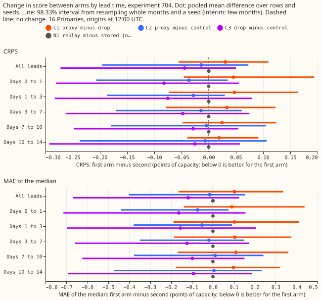
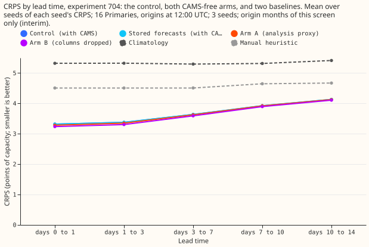
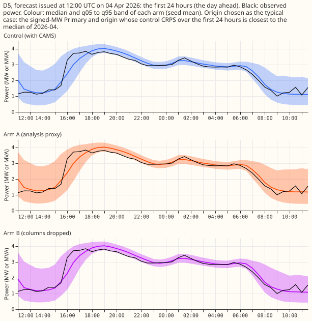
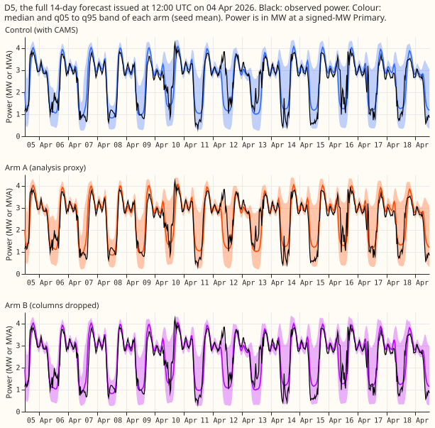
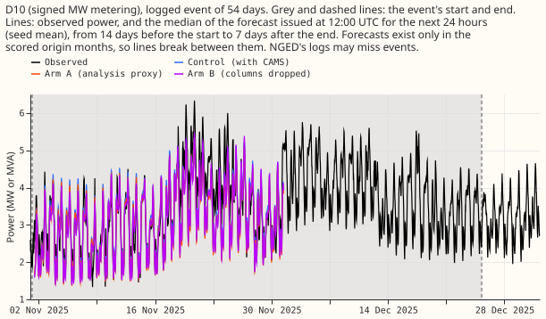
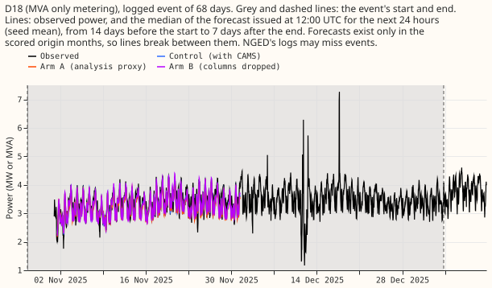
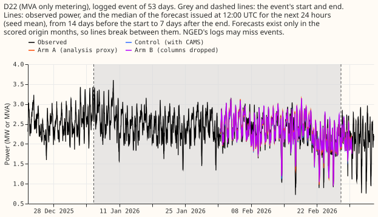
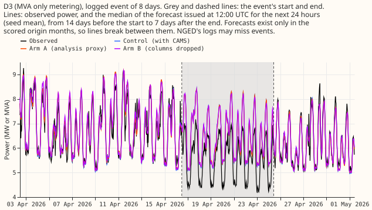
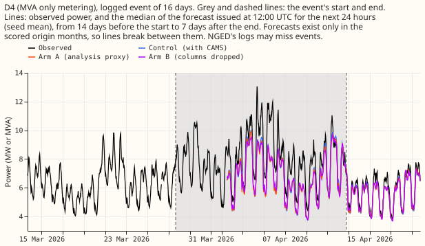
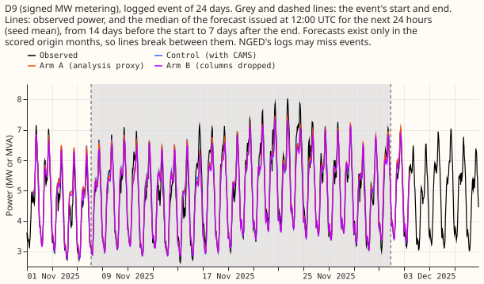

**We asked whether the first production demand forecast for the 16 Primaries (primary
substations) gets worse when two inputs that production cannot supply are removed.** The two inputs
describe yesterday's sunshine, taken from the CAMS satellite-based irradiance product, which
production will not read when it makes a forecast. We retrained the step-5 neural network three
times on four test months: once unchanged, once with yesterday's sunshine taken from the ECMWF
ensemble weather forecast instead (arm A), and once with the two inputs set to zero (arm B). The
forecast did not get worse without the two inputs: arm B scored 0.045 points of capacity better
than the unchanged network, an amount well inside the run-to-run noise between random seeds. Arm A
did not beat arm B, so production can drop the two inputs and needs no code for them.

**Verdict: supported; arm B (the two columns dropped) is chosen by the pre-registered rule.** The
decision contrast C1, arm A minus arm B in CRPS, is +0.031 points of capacity, with a 98.33%
interval of −0.056 to +0.110 (interim: four months). The rule needed an interval wholly below zero
and a point of at most −0.01 to choose arm A, so arm A does not advance to the other four months.
Neither arm loses skill against the refitted control: C2 (arm A minus control) is −0.014 [−0.196,
+0.073] and C3 (arm B minus control) is −0.045 [−0.272, +0.050]. The MAE of the median moves the
same way in every contrast (C1 +0.103, C2 −0.015, C3 −0.118).

## Results

**CRPS and normalised MAE of the median, points of capacity, seed average of scores, four months
(interim).** Lower is better.

| Lead band | Control | Arm A (proxy) | Arm B (drop) | Climatology | Heuristic |
|---|---|---|---|---|---|
| CRPS, all leads | 3.769 | 3.755 | **3.724** | 5.338 | 4.582 |
| CRPS, days 0 to 1 | 3.319 | 3.283 | **3.237** | 5.320 | 4.508 |
| CRPS, days 1 to 3 | 3.379 | 3.351 | **3.304** | 5.324 | 4.508 |
| CRPS, days 3 to 7 | 3.638 | 3.624 | **3.590** | 5.295 | 4.510 |
| CRPS, days 7 to 10 | 3.924 | 3.920 | **3.896** | 5.316 | 4.648 |
| CRPS, days 10 to 14 | 4.133 | 4.127 | **4.108** | 5.413 | 4.670 |
| MAE, all leads | 6.792 | 6.777 | **6.675** | 9.779 | 8.160 |
| q05–q95 coverage (%) | 85.4 | 85.7 | 85.3 | 90.1 | 80.7 |
| q05–q95 band width | 26.30 | 26.56 | 26.28 | 40.03 | 28.09 |

**The control is a refit, not experiment 677's stored forecasts.** The replay of experiment 677's
unchanged chain did not reproduce its stored forecasts to 1e-5 of capacity (prediction P4): the
largest difference per month was 8.1e-5 (2025-11), 1.1e-4 (2026-02), 5.0e-4 (2026-04), and 1.6e-5
(2026-06), because pre-training on the GPU is not bit-deterministic. As the plan pre-registered,
the control was refitted in all four months. The refit and the stored forecasts score the same to
1e-6 points (N1), so the replay difference is far below every contrast.

**The seeds disagree more than the arms do.** C1 per month and seed ranges from −0.084 to +0.133
points of CRPS, and its sign changes between seeds in three of the four months. C3 ranges from
−0.347 (2025-11, seed 0) to +0.066, so most of arm B's pooled gain comes from one month of one
seed. By metering group, C3 is −0.343 [−1.929, +0.514] at D15 and D18, −0.020 at the eight MVA-only
Primaries, and +0.013 at the six signed-MW Primaries, so the gain sits at the two short-history
Primaries. The pooled point favours arm B, but the four-month screen cannot tell arm B from the
control.

| Scenario | Control | Arm A | Arm B | C1 (A − B) | C3 (B − control) |
|---|---|---|---|---|---|
| All rows | 3.769 | 3.755 | 3.724 | +0.031 [−0.056, +0.110] | −0.045 [−0.272, +0.050] |
| Outside events, 7+ days after | 3.751 | 3.743 | 3.683 | +0.060 [−0.097, +0.222] | −0.068 [−0.343, +0.114] |
| Inside a logged event | 4.153 | 4.138 | 4.171 | −0.033 [−0.181, +0.063] | +0.017 [−0.238, +0.269] |
| 7 days after an event ends | 3.077 | 3.030 | 3.055 | −0.025 [−0.159, +0.106] | −0.021 [−0.073, +0.065] |
| Cold winter nights | 3.409 | 3.390 | 3.342 | +0.047 [−0.151, +0.231] | −0.067 [−0.379, +0.117] |

**The tails and the curtailment cost do not separate the arms.** The q01, q05, q95, and q99
coverages of all three networks agree to within 0.003 (control 0.020, 0.076, 0.930, and 0.981). The
avoidable-curtailment cost at the 90% limit, summed over the six signed-MW Primaries, is £582,000
for the control, £488,000 for arm A, and £540,000 for arm B (seed-averaged forecast), against
£916,000 for climatology; the three seeds of the control alone range from £581,000 to £715,000.

**Load-shift events.** The six plots below show the day-ahead median of each network around six
logged load-shift events, across both metering groups, with each event's start and end marked. The
three networks respond to each event in the same way. NGED's logs may miss events, so the rows
"outside every logged event" may hold events no label covers, the harm shown there is optimistic,
and the real-event sets undercount.

## Checks

- **Median minus mean forecast per Primary:** within ±0.5 points of capacity at 12 of the 16
  Primaries in every network. The four others are D15 (control −5.50, arm A −5.49, arm B −6.37),
  D12, D8, and D10, where the three networks agree to within 1 point.
- **MAE beside CRPS:** every contrast moves in the same direction on the two metrics (C1, C2, C3,
  by lead band and pooled), so audit trigger 3 did not fire.
- **Arm B's standardiser** holds mean 0 and standard deviation 1e-6 for both columns in all four
  months; arm A's standardiser is finite; the control's statistics equal experiment 677's exactly in
  all four months; arm A's pre-training mean column equals CAMS exactly on 20,000 rows at each of
  D2, D3, and D4.
- **No arm wrote under experiment 677's or experiment 667's data folders** (the runner warns on any
  such write, and none appeared).
- **Audit triggers that fired:** 1 (the replay control failed), 2 (prediction P2, |C1| < 0.01,
  failed with a point of +0.031), 5 (arm B, with less input, scores better than the control), and 7
  (experiment 703 and production depend on the verdict). AUDIT_PLACEHOLDER

## Method

**Architecture (arm B, the chosen arm).**

- The network is experiment 677's step 5 (class `AuxLagMdn`, kind `shared`), with three encoders and
  a mixer. The weather encoder reads 29 inputs (the ENS ensemble means of 7 weather variables, the
  8-wide Primary embedding, and the 14 thermal-lag and solar-gain columns of experiment 437, two of
  which are the CAMS columns this experiment replaces). Each encoder has two linear layers, 64 then
  32 wide, with a GELU between them.
- The date-time encoder reads 21 calendar and solar-position columns plus the embedding, with the
  same widths.
- One shared lag encoder (83 inputs) reads the day lag and the week lag of power, each with a
  missing flag and an age code, together with the weather and date-time encodings of the expected
  weather at the lag's own time (the freshest ENS run issued before that time), the embedding, and
  a learned 8-wide identity per lag.
- The mixer (145 inputs: the three encodings, the lead, the ensemble spread of the 7 variables, and
  the embedding) has layers 64, 64, and 9 wide and outputs a mixture of 3 Gaussians. A per-Primary
  offset, interpolated between monthly knots, shifts the component means. The 11 quantiles come
  from bisecting the mixture's distribution function.
- Arm B's two CAMS columns are 0 in every row and every stage, so the weights that read them never
  see a non-zero input.
- The forecast reads no data after its origin: lags are at least 24 hours old at the origin, and the
  expected weather comes only from runs issued before each lag's time.

**Training regime.**

- Pre-training on ERA5 reanalysis weather and CAMS pseudo-runs, then step 2 (a fresh mixer with the
  encoders frozen, 3-day embargo), then a daily fine-tune on ENS forecasts with a 7-day embargo, the
  7 days after it half-weighted, a 90-day recency half-life, a 730-day window, and injected lag-only
  load shifts (experiment 581). One week in 12 is held out of the fine-tune, purged 15 days before and
  9 after.
- Monthly refits with the cut-off at 00:00 UTC on the first day of each test month; seeds 0, 1, and
  2; 12 chains (three networks on four months) at about 10 minutes each on one RTX A6000, about 2
  GPU-hours in total.

**Measurement.**

- Four test months, 2025-11, 2026-02, 2026-04, and 2026-06, one forecast per day at the 12:00 UTC
  contract origin over 672 half-hours of lead, at the 16 Primaries. Rows with a valid time on or
  after 2026-07-01 are dropped, leaving 1,177,502 scored rows per seed after the dropped
  half-hours (`substation_zero`: 6, 11, 0, and 0 per month; absent from the power file: 55, 0, 221,
  and 28).
- CRPS is twice the mean pinball loss over the 11 levels, divided by effective capacity, times 100.
  The MAE of the median uses the same normalisation.
- Intervals resample whole months and a seed at 98.33% (Bonferroni over three contrasts), 20,000
  draws, through `studies.bootstrap.bootstrap_difference_at_level` on pairs from
  `experiment_store.losses_for_bootstrap`.
- Baselines: the month, half-hour, and weekend-flag climatology and the manual heuristic, trained on
  the history before each fold.

### Why the experiment was run

**The first production model for the Primaries is the step-5 network, and it reads two
previous-day CAMS columns that production will not have.** The step-5 network is step 5 of the
ladder of [experiment
677](../00677-building-up-the-candidate-demand-network-one-component-at-a-time/result.md), refitted
monthly (the ladder's step 9a). It has a date-time encoder, a weather encoder, and one shared lag
encoder that reads a day lag and a week lag of power with the expected weather at each lag's time.
It has no gap columns, no lag-free table T, and no neighbour signals. Its weather encoder reads 14
thermal-lag and solar-gain columns from [experiment
437](../00437-neural-demand-thermal-lag-solar-gain-and-tariff-feature-bundles/result.md) and
[experiment
569](../00569-modular-network-inputs-through-matching-encoders-in-pretraining-and-fine-tuning-run-1/result.md)
(`e00677_k1.py` builds the network with `n_b1=e.N_B1`, and the arm's `Spec` has `b1="B1"`). Two of
those columns read CAMS (the Copernicus Atmosphere Monitoring Service) at fine-tune and inference
time: `cams_prev_day_mean`, the mean CAMS global horizontal irradiance over the last complete UTC
day before the origin, in W/m2, and `cams_prev_day_csi`, that day's summed irradiance over its
summed CAMS clear-sky irradiance. The maintainer has decided that production reads no CAMS at
inference, and that the production forecast runs once a day at the 12:00 UTC origin on that day's
00Z ENS run (the ECMWF 51-member ensemble), as the network was trained. The experiment measures how
much skill the step-5 network loses without those two columns, and chooses between two
replacements. [Experiment 703](../00703-cams-free-inference-for-the-primaries-candidate/result.md)
asks the same question of the full Candidate.

**CAMS may stay in pre-training.** Pre-training on ERA5 (ECMWF's reanalysis) and CAMS pseudo-runs
is training-only, so the two columns of the pre-training rows may still come from CAMS.

### Arms

- **Control.** As planned: the stored per-seed forecasts of experiment 677's arm `k1_5w_sp1` (step
  5, monthly refits, injected lag-only load shifts in the fine-tune). As run: the replay refit in
  all four months, because the replay check below failed; the stored forecasts are the reference
  row `stored`.
- **Replay (check only).** The unchanged step-5 chain of experiment 677, refitted from pre-training
  onwards for the 2026-04 fold, into this experiment's data folder. [Experiment
  684](../00684-backtest-positive-demand-output-distributions-and-physical-solar-night-zero/result.md)
  found the Candidate's chain from step 2 onwards deterministic, but no experiment has replayed the
  pre-training step. The replay tests prediction P4. If any quantile of the replay differs from the
  stored forecast by more than 1e-5 of capacity, the control is refitted on all four months and the
  refit replaces the stored forecasts as the control, because the arms would otherwise carry a
  re-run difference the control does not. The replay-against-stored difference is reported as the
  noise floor whether or not P4 holds. A pass in 2026-04 is assumed to hold in the other three
  months.
- **Arm A, the analysis-proxy columns.** The same two columns, computed from shortwave instead of
  CAMS. `cams_prev_day_mean` becomes the mean shortwave over the 48 half-hours of the last complete
  UTC day before the origin (half-hour stamps from 00:30 of that day to 00:00 of the origin day, as
  period ends). `cams_prev_day_csi` becomes that day's summed shortwave over its summed Haurwitz
  clear-sky irradiance, evaluated at the middle of each half-hour at the Primary's coordinates
  (`f437.clear_sky_on_grid`, as experiment 437's clear-sky index already uses). At fine-tune and
  inference time the shortwave is experiment 437's analysis proxy: for each half-hour before the
  origin, the ensemble mean of the freshest run with a positive lead that covers the half-hour. A
  run's rows start at its 09:00 UTC native origin, so the proxy holds leads of 0.5 to 24 hours after
  that origin, which are 9.5 to 33 hours after the 00Z initialisation. The previous UTC day
  therefore comes from the run of the day before the origin (09:30 to 00:00) and the run two days
  before (00:30 to 09:00), both published before the origin. The plan review of experiment 703
  found all 48 half-hours finite for every run and every Primary from 2024-04-01 to 2026-06-30,
  except the first two origins of the archive. In pre-training the shortwave is the dense CAMS
  stand-in that every other pre-training shortwave column already uses, so the two columns have one
  definition in every stage. That stand-in is CAMS hourly irradiance copied onto both half-hours of
  each hour, so arm A's mean column equals the control's in pre-training, and only the clear-sky
  ratio changes there. The ensemble mean is smoother than CAMS (on one Primary, April to June 2025,
  the daily proxy mean correlates 0.80 with the CAMS day mean, with a standard deviation of 53
  against 60 W/m2), so the frozen weather encoder sees compressed values at fine-tune time, which is
  a reason arm A may under-deliver. A day with fewer than 48 finite half-hours gives a missing value,
  which the standardiser sets to 0, as a missing CAMS day does in the control.
- **Arm B, the columns dropped.** Both columns are set to the constant 0 in every stage, in
  pre-training rows and in fine-tune and scoring rows. The standardiser then maps them to 0 as well,
  so the weights that read them never see a non-zero input and the forecast cannot depend on them.
  The network keeps its 29-input weather encoder and uses the same seeds. The arm is therefore the
  same function class as a network with the two columns removed, and a port may drop the two
  columns and their weights.

**Both arms refit the whole step-5 chain from pre-training onwards.** The chain is experiment
677's `chain.sh` for step `5w` at a span of one month (commands `pretrain`, `step2`, `fit`, and
`pfit`): the encoders pre-trained on ERA5 and CAMS, step 2 with a fresh mixer and frozen encoders,
the daily fine-tune with the 7-day embargo and the injected lag-only load shifts of experiment 581,
then the prediction pass over the scored window. Arm A's pre-training rows change because their
clear-sky ratio uses Haurwitz instead of CAMS clear-sky, and arm B's change because the two columns
are zero. Each arm runs seeds 0, 1, and 2, as experiment 677's monthly refits did.

### Rows, folds, and seeds

- **Four test months, one per season:** 2025-11 (autumn), 2026-02 (winter), 2026-04 (spring), and
  2026-06 (summer). Each month is one monthly refit with its cut-off at 00:00 UTC on the first day
  of the month, a 730-day fine-tune history, and the embargoes of experiment 677 (3 days at step 2,
  7 days at the fine-tune).
- **Scored rows:** the forecast at the 12:00 UTC contract origin of every day of the month, 672
  half-hours of lead per origin, at the 16 Primaries. Rows with a valid time on or after 2026-07-01
  are dropped, which shortens the leads of the last 14 origins of the 2026-06 fold. The actuals are
  the cleaned power with the `substation_zero` half-hours dropped, and D15 and D18 are cut before
  2025-03-01. The page reports the dropped half-hours per fold.
- **Seeds:** 0, 1, and 2, paired across arms by seed. The headline table also gives the
  seed-averaged forecast (the mean of the three seeds' quantiles, sorted within the row).

### How the contrasts are read

- **C1, arm A minus arm B** (the decision). **C2, arm A minus the control. C3, arm B minus the
  control** (the loss).
- **Interval.** `experiment_store.losses_for_bootstrap` pairs the rows, and
  `studies.bootstrap.bootstrap_difference_at_level` resamples whole months and a seed, at 98.33%
  (Bonferroni over three contrasts), with 20,000 resamples. Four months is below the bootstrap
  module's six-month minimum for evidence, so every number is labelled interim, and an interval
  that includes zero is the expected outcome. That is why the rule sends a win for arm A to the
  other four months before it counts.
- **Beside every CRPS contrast** the page gives the same contrast in normalised MAE of the median,
  by lead band, and per Primary. A contrast whose CRPS and MAE point in different directions fires
  audit trigger 3.
- **Per month and per seed**, the page tables C1, because with four months an interval wholly below
  zero means in practice that arm A wins in every month.
- **Climatology** is the month, half-hour, and weekend-flag quantiles of `ClimatologyForecaster`,
  recomputed from the cleaned power with the D15 and D18 cut and trained on the history before each
  fold, with its rows repeated once per seed. The manual heuristic is recomputed the same way.
- **Absolute scores** of every arm, of the control, of climatology, and of the manual heuristic, by
  lead band, on the same rows.

### Reporting for load-shift events

**Every arm and both baselines are scored on four sets of rows:** all rows; rows outside every
logged event and at least 7 days after one; rows inside a logged event; and the 7 days after a
logged event ends. The events are those `e00668_slices_primaries.py` uses (the table of experiment
653, plus the verified transfer between D5 and D16 from 2025-12-29 to 2026-01-14) that overlap the
four months. The page plots one day-ahead forecast and one full 14-day forecast against the
observed power, and at least six time series around logged events across both metering groups,
from 14 days before each event to at least 7 days after it, with its start and end marked. NGED's
logs may miss events, so the rows "outside every logged event" may hold events no label covers, the
harm shown there is optimistic, and the real-event sets undercount. No generator appears on the
page.

### Checks planned before the first scored run

- **Causality of arm A's columns.** Rebuild one Primary's table with every run after a sampled
  origin deleted, and require the two new columns to be unchanged at that origin (experiment 437's
  `check`, applied to the new columns).
- **Every other column is unchanged.** The 12 other thermal-lag and solar-gain columns of each
  arm's table are bit-equal to experiment 667's stored table on every key (experiment 677 reads
  experiment 667's tables).
- **The replay**, as under "Arms".
- **Each arm derives its own B1 standardiser.** Experiment 677's `chain.sh` points `STATS677` at
  step 3b's chain folder, so step 5's fine-tune and prediction read the statistics stored there.
  Each arm's runner points `STATS677` at the arm's own chain folder, so the arm's pre-training
  writes the statistics its later steps read. The replay's statistics must equal experiment 677's
  `chains/3b/<month>/work/stats/B1/<month>.npz` exactly, which the runner checks, because
  `check_stats` is disabled for the fold month.
- **Arm B's standardiser** holds mean 0 and standard deviation 1e-6 for the two columns.
- **Arm A's pre-training mean column** equals the control's on a sample of pre-training rows.
- **No arm writes under experiment 677's or experiment 667's data folders.** Every output root is
  `arms/<arm>/` under this experiment's data folder.
- **The arm tables are the ones read.** `e00677_fold.redirect_to_extended_inputs` sets
  `f437.TRAILING_DIR` to experiment 667's tables, so the arm patch wraps that function and points
  `f437.TRAILING_DIR` at the arm's tables after it runs. A printed example row proves the switch.
- **Arm A's table builder** relaxes the no-missing assertion of `e00667_tables.build` for the two
  new columns only.
- **The held-out power stays hidden** in the train phase, as experiment 677's `e00677_fold.py`
  enforces.

### Standing practices

- **Followed:** monthly refits; cleaned data everywhere, with the dropped half-hours per fold; the
  D15 and D18 cut; every fitted network saved under this experiment's data folder; the stored
  predictions of experiment 677 as the control; a four-month screen with a pre-registered advance
  rule, every number labelled interim; tails, cold winter nights, and the avoidable-curtailment
  cost from `e00677_tails.py` and `e00677_protocol.py`; example forecasts and load-shift plots with
  the unlogged-event caveat; a draft pull request.
- **Not applicable:** no XGBoost model is fitted. The calendar control is not needed, because the
  date-time encoder is the network's own and identical in every arm.
- **Advice followed:** experiment 677's monthly refit and its advice to judge a lag change on
  event-free error as well as on all rows (the four scenarios); experiment 684's use of a
  deterministic replay in place of a re-run noise floor, extended here to the pre-training step;
  experiment 699's reporting of band width beside CRPS. None of the `advice` items of experiments
  437, 569, 667, 668, 677, 684, and 699 argues against this design.

## Files

- `ml-experiments/00704-cams-free-inference-for-the-primaries-step-5-network/`:
    - `e00704_tables.py` builds each arm's copy of experiment 667's `inputs/trailing437/` tables with
      the two columns replaced, and checks their causality.
    - `e00704_arm.py` installs an arm into the pipelines of experiments 667 and 677 (pre-training rows,
      table folder, standardiser), and `e00704_run.py` runs one step under it.
    - `chain677.sh` runs one step-5 chain for one arm and month; `chain667.sh` runs the Candidate's
      chain for experiment 703.
    - `e00704_checks.py` runs the standardiser and pre-training checks; `e00704_common.py` holds the
      previous-day column builder.
    - `e00704_score.py` scores the arms and prints every number on this page; `e00704_figures.py`
      draws the figures.
- The code imports experiments 437, 562, 569, 667, and 677 and runs the chains of
  [experiment 677](../00677-building-up-the-candidate-demand-network-one-component-at-a-time/result.md).
- `data/ml-experiments/00704-cams-free-inference-for-the-primaries-step-5-network/` (written):
  `inputs/trailing437_<arm>/` (the arm tables), `arms/<arm>/chains/5/<month>/` (weights,
  standardisers, and per-seed forecasts), `score/` (the score tables), and `runner_logs/`.
- Read: experiment 677's stored step-5 forecasts and B1 statistics, experiment 667's
  `inputs/trailing437/` tables, and the truth and baselines of `e00677_score.py`.
