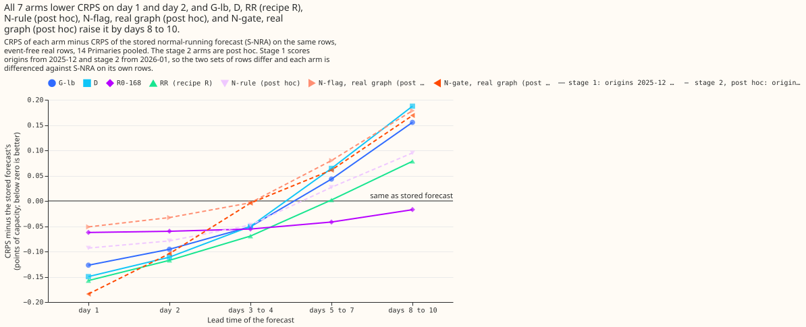
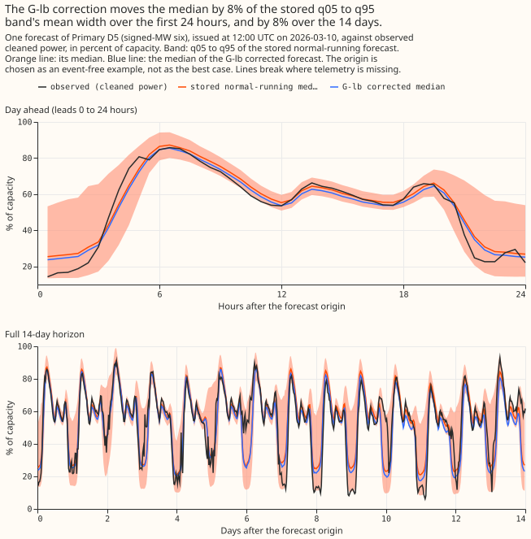
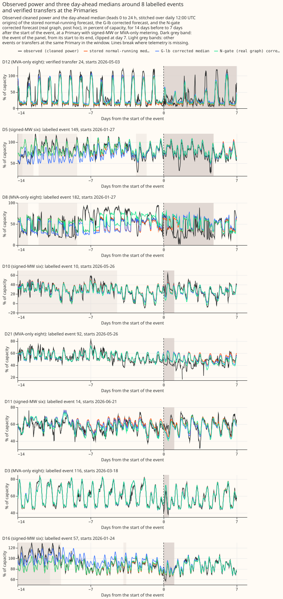
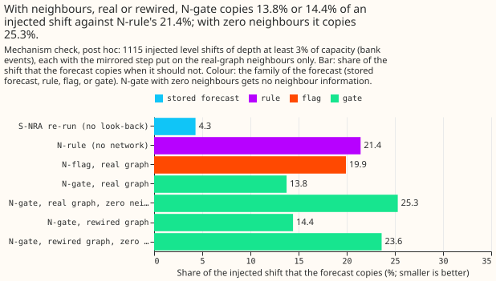

**The verdict is inconclusive: a look-back offset helps for the first two lead days and hurts from
lead day 5.**
We asked whether the slow drift in a Primary substation's net demand can be corrected at forecast
time, from the forecast errors of the last 14 days, without refitting the forecast. At each forecast
origin (12:00 UTC daily) we took the errors that the stored normal-running forecast made over the
last 14 days, averaged them, and added 0.75 times that average to the forecast. The stored forecast
is the one that the one-year backtest of [experiment
668](../00668-documentation-of-the-one-year-backtest-files-models-training-and-performance/result.md)
saved. We also averaged the errors separately for hours of strong sunshine and for cold hours, to
see whether solar-photovoltaic (PV) drift and cold-night drift need separate corrections. We scored
the corrected forecasts against what happened at 14 Primary substations from 2025-12 to 2026-06,
using the continuous ranked probability score (CRPS) in percentage points of the series' capacity.
The method follows recipe R of [experiment
115](../00115-differentiable-physics-w1-diurnal-shape-state-on-ens/result.md), which is 0.75 times
the 14-day mean error by half-hour of day. The question follows the advice of [experiment
690](../00690-slow-level-state-on-primaries-13-and-16-july-august/result.md) to estimate the slow
level only from data available at the forecast origin.

**In stage 1, the lead-band global offset (G-lb) scored +0.026 CRPS worse than the stored forecast
(99.17% interval -0.070 to +0.179, pooled over 14 Primaries).** G-lb is the 14-day offset computed
separately for each range of forecast lead times. The pre-registered requirement was a gain of at
least 0.05, so the experiment does not pass. Against the stored forecast, G-lb gained 0.127 points
on lead day 1 and 0.096 on lead day 2, and lost 0.043 on lead days 5 to 7 and 0.155 on lead days 8
to 10. The interval is too wide to rule out either a small gain or a small loss, because the
smallest difference this test could detect is 0.164.

**Stage 2 ran post hoc.** Stage 2 was pre-registered to run only if stage 1 gained at least 0.02
points. Stage 1 did not, and the maintainer chose to run stage 2 anyway, so every stage 2 result is
post hoc. Stage 2 trained two small neural networks on synthetic load shifts (a step or a ramp added
to the real series) to decide how much of each offset to apply.

**Key to the arm and contrast labels.**

- **G-lb, G-sl, G-refit:** the global offset, computed per lead band, from the smallest lead, and
  refitted by month.
- **D:** the driver split, an offset regressed on sunshine and cold.
- **P-7d, P-cp:** prevailing-conditions arms that follow recent errors faithfully.
- **N-rule, N-flag, N-gate:** stage 2 arms that decide how much offset to apply (N for
  neighbour-aware). N-rule is a fixed rule, N-flag uses a switching probability, and N-gate uses a
  learned gate with no flag.
- **C1 to C6:** the pre-registered contrasts, defined where each is scored below.
- **Signed-MW six and MVA-only eight:** the six Primaries whose telemetry is signed megawatts and
  the
  eight whose telemetry is apparent power in megavolt-amperes (MVA), which has no sign.

## Results

**Stage 1: the pre-registered global offset and driver split do not beat the stored forecast.** CRPS
is in points of capacity, origins 2025-12 to 2026-06, and a negative difference favours the first
arm. "Event-free" rows are rows whose valid time lies outside every labelled or verified event. They
include the 7 days after an event and rows whose 14-day look-back window overlaps an event (14.2% of
rows). C5 uses all rows, from 2026-01.

| Contrast | Pooled 14 | Signed-MW six | MVA-only eight |
|---|---|---|---|
| C1: G-lb minus stored forecast | +0.026 (-0.070 to +0.179) | +0.029 (-0.225 to +0.350) | +0.023 (-0.060 to +0.104) |
| C2: driver split (D) minus G-lb | +0.012 (-0.047 to +0.080) | -0.016 (-0.095 to +0.063) | +0.032 (-0.019 to +0.095) |
| G-lb minus recipe R (95% interval) | +0.044 (+0.011 to +0.077) | +0.077 (+0.048 to +0.111) | +0.021 (-0.019 to +0.061) |

- **Absolute scores (CRPS):** stored forecast 3.235, G-lb 3.260, D 3.272,
  month-by-half-hour climatology 4.772, manual heuristic 4.051. The normalised mean absolute error
  of the median is 5.838 for the stored forecast, 5.862 for G-lb, and 5.887 for D.
- **The gain sits at short lead.** [Figure 1](fig1_lead_bands.svg) shows every arm below zero on
  lead days 1 and 2 and most arms above zero by lead days 8 to 10; only the decayed offset R0-168
  stays below zero. [Figure 3](fig3_examples.svg) shows a day-ahead forecast and a 14-day forecast
  with and without the offset.
- **Recipe R beat G-lb.** Recipe R (0.75 times the 14-day mean error by half-hour of day) scored
  0.044 better than G-lb (interval +0.011 to +0.077 on G-lb minus recipe R).
- **C5 (faithful prevailing arm minus stored prevailing rows)** is +0.150 (+0.026 to +0.417, pooled
  14), so the 7-day look-back is no better than the stored prevailing forecast. The prediction was 0
  to
  +0.1, so the result is worse than predicted. The bootstrap interval excludes zero, and the t test
  on monthly differences does not.

**The offset appears to copy a load shift forward.** These are point estimates without intervals. On
rows that follow a labelled event by up to 7 days (97,840 rows),
G-lb scored 4.20 against 3.49 for the stored forecast. On the 7 days after the 4 verified
transfers G-lb scored 6.21 against 4.07. Inside a labelled event itself, G-lb scored slightly
better,
7.73 against 7.98.
[Figure 2](fig2_events.svg) shows 8 events at Primaries with both metering types.

**Stage 2 (post hoc): the learned heads do not beat the no-network rule on real rows.** Origins
2026-01 to 2026-06, event-free rows, pooled 14, CRPS: stored forecast 3.255, N-rule 3.264, N-gate
(learned gate, no switching flag) 3.293, N-flag (switching probability) 3.322.

| Contrast (post hoc, 99.17%) | Difference (pooled 14) |
|---|---|
| C3: N-gate minus N-rule, real rows | +0.029 (-0.101 to +0.121) |
| C3: N-flag minus N-rule, real rows | +0.058 (+0.007 to +0.204; the monthly t test does not exclude zero) |
| C4: N-gate real minus rewired graph, real rows | -0.015 (-0.055 to +0.030) |
| C4: N-flag real minus rewired graph, real rows | +0.006 (-0.017 to +0.025) |
| C3 on injected shifts: copied share, N-gate minus N-rule | -0.077 (-0.104 to -0.051) |
| C3 on injected shifts: copied share, N-flag minus N-rule | -0.015 (-0.034 to +0.006) |
| C6: copied share, N-gate minus N-flag | -0.062 (-0.094 to -0.032) |

- **On injected shifts the gate copies less than the rule.** The copied share was 21.4% for N-rule,
  19.9% for N-flag, and 13.8% for N-gate (14.4% on the rewired graph). With the neighbour inputs
  zeroed N-gate copied 25.3%. [Figure 4](fig4_copied_share.svg) shows the shares.
- **This is a mechanism check, not evidence for neighbours.** The generator puts the mirrored step
  on the real-graph neighbours only, so the neighbour inputs hold the answer by construction. On
  real rows the real and rewired graphs differ by 0.015 or less (C4) pooled over 14 Primaries. In
  the MVA-only
  eight, N-gate on the real graph scored 0.033 better than on the rewired graph (interval -0.050 to
  -0.008), which the bootstrap counts but the monthly t test does not.
- **The switching probability separates injected steps only weakly.** The switching probability of
  N-flag had an area under the receiver operating characteristic (ROC) curve of 0.60 on real rows
  and
  0.68 on injected-shift rows from the bank of [experiment
  667](../00667-one-year-backtest-of-the-two-output-demand-network-at-primaries/result.md) (0.61 and
  0.69 on the rewired graph).

## Checks

- **Median minus mean forecast, pooled over 14 Primaries:** the offsets shift all 11 quantiles by
  one amount, so no
  arm changes the shape of the forecast distribution. The audit found the median-minus-mean gap of
  -0.64 for both the stored forecast and G-lb (-0.51 at the signed-MW six and -0.72 at the MVA-only
  eight).
- **Error of the median beside every CRPS contrast:** the mean absolute error of the median points
  the same way as CRPS for G-lb (+0.024), D minus G-lb (+0.025), and every stage 2 arm, so trigger 3
  did not fire.
- **Triggers that fired, and the audit.**
    - A control failed (trigger 1): the ramp known-answer gate (copied share at least 0.6) failed
      for every arm (0.41 to 0.52). The audit computed that a 0.75 times 14-day offset reaches at
      most 0.57 on the 60-day ramp, so the gate could not be passed by construction and does not
      separate the arms.
    - Leaving one Primary out flips the sign of C1 (trigger 4): dropping D16 turns +0.026 into
      -0.014. January alone makes the pooled mean positive (+0.327 in January, and about -0.024 for
      the
      pooled mean without January).
    - A nested arm beats the arm that contains it (trigger 5): G-lb beats D in the MVA-only group
      (+0.032 for D), and the smallest-lead offset (G-sl) beats G-lb by 0.041 (interval -0.083 to
      -0.001), so the lead-band offset chosen before scoring was worse than the smallest-lead
      offset.
    - An independent audit by a second Claude Sonnet session re-derived C1, C2, and the stage 2
      real-row contrasts from the
      stored predictions and reproduced every real-row number within bootstrap noise. It did not
      re-run the bank contrasts or the stage 1 known-answer tests. Its three requested reports
      (clean-window C1, the D16 and January drivers, and the ramp ceiling) are in this section.
- **Clean-window C1.** On rows whose 14-day look-back window holds no event, G-lb minus the stored
  forecast is -0.026 (interval -0.079 to +0.020, pooled 14). On rows whose window holds an event it
  is +0.337 for G-lb minus the stored forecast. The pre-registered verdict uses the all-event-free
  reading above.
- **Known-answer (KA) tests that passed:** KA1a (the offset removes 98.4% of an additive step at 14
  days
  and 48.4% at 7 days, against an exact 0.984 and 0.484), and KA2 (the driver split removes 87% of a
  PV-shaped injected error at midday and leaves 0.3 points at night). The injection sizes were
  raised from 10
  to 30 points (step), 20 points (PV), and 3 points per unit (cold) after the readability check
  showed most of them under 5 times the noise, and before any contrast was read.
- **Placebo (PL) tests.** PL1 (a non-neighbour Primary's window) scored +0.453 worse than the stored
  forecast,
  so a wrong-series offset hurts. PL2 (shuffled drivers within each 14-day window) scored +0.048,
  against +0.038 for D.
- **Weather look-ahead.** Target weather comes from the 00:00 UTC ensemble run of the origin's day,
  available at 09:00 UTC, and the look-back window ends 6 hours before the origin.
  `e00706_residuals.py`
  asserts this row by row. Example: Primary 17 (D5), origin 2026-03-10 12:00 UTC, valid time
  2026-03-15 13:00 UTC, lead 121 h from the origin and 133 h from the 00:00 UTC run, window
  2026-02-24 06:30 to 2026-03-10 06:00 UTC.
- **Unlogged-event caveat.** NGED's logs may miss events, so the event-free rows may hold events no
  label covers, and the real-event slices undercount.
- **Not done.** The hindsight ceilings of experiments 690 and 688, the survival-curve variant
  P-surv, the curtailment cost, and bootstrap intervals for the lead-band and day-of-month splits
  were planned in the design and not implemented. The scored prediction sets carry a `dirty` flag in
  their manifests because the scoring fixes were committed after the fits; the fitted code is the
  committed code of the next commit.

## Method

Architecture:

- **G-lb:** for each forecast origin, the mean of the residuals (cleaned power minus the stored
  normal-running median) over the 14 days that end 6 hours before the origin, taken per lead band
  from the forecasts issued for those half-hours, times 0.75, added to all 11 quantiles at every
  lead.
- **D:** a ridge regression of the window residuals on the ensemble-mean shortwave radiation over
  800 W/m2 and the cold index max(0, 5 C minus temperature) over 5 K; the correction at the target
  time uses the target's ensemble-mean drivers; a slope is dropped to zero when fewer than 24 window
  half-hours have its driver above 0.25.
- **P-7d, P-cp:** the same form with factor 1.0, a 7-day window (P-7d) or a change-point split of a
  28-day window (P-cp), with the window ending at 03:00 UTC to match the stored prevailing rows.
- **N-rule:** G-lb's offset times a weight that is 0 when a step larger than 3 noise units arrived
  within 24 hours, else 1.
- **N-flag:** a neural network with 2 hidden layers of 32 units outputs a switching probability p
  (trained
  with a binary cross-entropy term of weight 0.05 against the generator's transfer flag) and applies
  the slow level in full and (1 minus p) times the step part.
- **N-gate:** a neural network with 2 hidden layers of 32 units outputs one gate in [0, 1] for each
  of 16 look-back offsets, with the lead time as an input, and applies the sum of gate times offset.
  The loss is CRPS only. The 16 offsets are the global, irradiance, cold, and neighbours' offsets,
  each over windows of 1, 3, 7, and 14 days, exponentially weighted.
- **Neighbours:** the interconnection list of National Grid Electricity Distribution (NGED) as coded
  in experiment 400, or a degree-preserving
  rewired graph.

Training regime:

- **Stage 1 has no training.** Stage 2 trained on the injected-shift bank of [experiment
  667](../00667-one-year-backtest-of-the-two-output-demand-network-at-primaries/result.md) and real
  rows of the months before each test month, with a 7-day embargo, 10 seeds, folds 2026-01 to
  2026-06, and early stopping on valid-time weeks inside the training period. Half the steps use
  own-only additive ramps of 10 points over 60 days.
- **Compute:** 240 fits (2 arms, 2 graphs, 6 folds, 10 seeds) took 37 minutes on 2 CPU cores and one
  GPU share at 0.7 to 1.5 GB; stage 1 needed about 5 minutes on CPU.

Measurement:

- **Scored rows:** origins 12:00 UTC daily, 2025-12 to 2026-06 (stage 1) and 2026-01 to 2026-06
  (stage 2), leads 0 to 240 h, valid times before 2026-07-01, cleaned power, event-free rows, 14
  Primaries in two groups (signed-MW six and MVA-only eight; D15 and D18 are among the 14 and are
  report-only).
- **Metrics:** CRPS as twice the mean pinball loss over the 11 quantiles, mean absolute error of the
  median, q01 to q99 coverage and pinball loss, against cleaned power (clean power without the
  injected shift on the bank).
- **Intervals:** month-block bootstrap with 20,000 resamples at 99.17% (six contrasts), plus a t
  test on the monthly paired differences; bank contrasts resample (month, Primary) clusters with
  seeds inside.
- **Decision rule:** see the front matter. C1 needed its interval wholly below -0.05 in both groups.

## Files

- `e00706_common.py` (in this experiment's folder under `ml-experiments/`): loaders, dense layout,
  ridge by cumulative sums,
  residual tables, group and event masks.
- `e00706_residuals.py`: stage 0; builds the residual table, runs the look-ahead assertions, prints
  the example.
- `e00706_arms.py`: stage 1; writes the prediction sets `g`, `g-sl`, `g-refit`, `d`, `d-pv`,
  `d-cold`, `d-plus`, `p`, `p-7d`, and the window variants.
- `e00706_known_answer.py`: KA1a, KA1b, KA2, PL1, PL2, the perturbation test, and event counts.
- `e00706_score.py`: stage 1 contrasts and tables, written to
  `data/ml-experiments/00706-.../tables/`.
- `e00706_s2_data.py`, `e00706_s2_models.py`, `e00706_s2_fit.py`, `e00706_s2_score.py`: stage 2
  caches, networks, fits, and scoring.
- `e00706_figures.py`: the four figures beside this page.
- `data/ml-experiments/00706-.../predictions/`: private stored forecasts (stage 1 and stage 2 sets)
  and `s2/models/` (state files); read from the one-year backtest files of [experiment
668](../00668-documentation-of-the-one-year-backtest-files-models-training-and-performance/result.md).
- Audit and design notes: `data/ml-experiments/briefs/level_tracking/`.
