**Status: finished. Verdict: small gain at the six signed-MW Primaries, no detectable difference at
the eight MVA-only Primaries. The pre-registered known-answer gate failed and the maintainer waived
it, so every statement about following level shifts is unsupported by a passing known-answer test.**

We asked whether a neural network that reads the last 14 days of power, weather, and calendar as a
grid of days by half-hours, with attention across days and within a day, forecasts the demand of 16
primary substations (Primaries) better than the Candidate, the two-output demand neural network that
[experiment 667](../00667-one-year-backtest-of-the-two-output-demand-network-at-primaries/result.md)
backtested over a year. We also asked whether any gain comes from those 14 recent days, by comparing
the neural network with an identical copy whose 14 history days are random past days (the placebo).
We scored 8 test months (2025-11 to 2026-06) at lead times of 24 to 240 hours, in continuous ranked
probability score (CRPS, lower is better) expressed in points of capacity, where one point is 1% of
a Primary's capacity. The counted readings keep two groups apart: the six signed-MW Primaries, whose
telemetry records power in megawatts with its sign, and the eight MVA-only Primaries, whose
telemetry records only apparent power in megavolt-amperes. The remaining two Primaries, D15 and D18,
are report-only.

**At the six signed-MW Primaries the neural network was better than the Candidate by 0.147 points,
and at the eight MVA-only Primaries it was not detectably different.** The 98.75% interval of the
six signed-MW difference is -0.262 to -0.020. The neural network beat the placebo in both groups, so
the recent days carry information a random past day does not. The result is a research result with
limits that matter (see "Limitations disclosed"): the neural network is worse than the Candidate at
D15 and D18, the interval at the six signed-MW Primaries fails the pre-registered t test on monthly
differences, and the history rows use weather analyses that a live service could not build for the
days 2 to 5 before the origin.

## Verdict

**The verdict is "small gain", read from the scorer's pre-registered rule: a small gain at the six
signed-MW Primaries and no detectable difference at the eight MVA-only Primaries.** Every number is
the neural network `M1` (the arm with frozen pre-trained weather and date-time encoders, selected on
the screen folds as `M*`) minus the reference, in points of capacity, over the 24 to 240 h band,
from 5 seeds and 8 test months, with a 98.75% interval from resampling whole months. The 98.75%
level is the pre-registered Bonferroni correction across the four counted readings.

| Reading | Group | Difference | 98.75% interval | Reading of the rule |
|---|---|---|---|---|
| H1: `M1` minus the Candidate `C` | the six signed-MW Primaries | -0.147 | -0.262 to -0.020 | small gain |
| H1: `M1` minus `C` | the eight MVA-only Primaries | +0.022 | -0.092 to +0.112 | no detectable difference |
| H2: `M1` minus the placebo `P` | the six signed-MW Primaries | -0.140 | -0.253 to -0.033 | upper limit below zero |
| H2: `M1` minus `P` | the eight MVA-only Primaries | -0.135 | -0.360 to -0.0001 | upper limit just below zero |

**The failed t guard is why the six signed-MW Primaries read "small gain" and not "gain".** The
point estimate (-0.147) is below -0.05 and the upper limit is below zero, but the t interval on the
8 monthly differences at 98.75% (-0.325 to +0.043) covers zero. The bootstrap interval resamples
only 8 months, which the Method section shows is too narrow, so the gain at the six signed-MW
Primaries is not secured by the more cautious interval. The t guard also fails for the other three
counted readings, and H2 at both groups is therefore not secured either.

**The mean CRPS of the three headline arms differs by at most 0.2 points within each group.** From
seeds 0 and 1 on all 8 folds (one per test month), the mean of the monthly means at the six
signed-MW Primaries is 3.175 for `C`, 3.030 for `M1`, and 3.178 for `P`. At the eight MVA-only
Primaries the mean CRPS is 3.694 for `C`, 3.724 for `M1`, and 3.891 for `P`. Pooled over rows, the
six signed-MW means are 3.203, 3.053, and 3.203, and the eight MVA-only means are 3.704, 3.731, and
3.893.

**The pre-registered prediction failed for H1 at the six signed-MW Primaries and held for H2.** The
prediction was "not supported or inconclusive", with H1 within ±0.06 at the six signed-MW Primaries
and within ±0.16 at the eight MVA-only Primaries, and H2 at most -0.10. H1 at the six signed-MW
Primaries (-0.147) is outside its range, and the verdict "small gain" is outside the predicted
verdict. H1 at the eight MVA-only Primaries (+0.022) is inside its range. Both H2 point estimates
(-0.140 and -0.135) are below -0.10.

**Every pre-registered guard that applies to a gain holds at the six signed-MW Primaries except the
t guard.** The same sign holds for each of the 5 seeds and the noise floor holds. The four guards
for a `supported` verdict also hold: leaving out one Primary or one month keeps the sign, the q01
and q99 pinball losses are within 0.05 points of the Candidate's, the median error moves with CRPS,
and swap (a) keeps the sign of H1. At the eight MVA-only Primaries, leaving out one Primary flips
the sign of H1, the t guard and the noise-floor guard fail, and the upper bound of the q99
pinball-loss difference from the Candidate is 0.071 points, above the limit of 0.05.

**At the eight MVA-only Primaries the pooled difference from the Candidate rests on two Primaries,
D8 and D12, in the 2-seed recomputation.** The 5-seed pooled difference is +0.0221 and the 5-seed
leave-one-Primary-out guard flips the sign (both in `score/headline.json`), but the file does not
name the Primary whose removal flips it. A recomputation from the stored forecasts for seeds 0 and 1
only (24 to 240 h, rows pooled; not stored in a score file) gives a pooled difference of +0.0274.
Leaving out D8 turns that 2-seed difference to -0.004, and leaving out D12 turns it to -0.028. The
neural network is therefore not shown to help the other seven MVA-only Primaries, and no pooled
reading of the eight MVA-only Primaries should be read as an effect on all of them.

**The neural network is worse than the Candidate at the two report-only Primaries.** From seeds 0
and 1, the mean CRPS over all 16 Primaries is 4.037 for `C`, 4.191 for `M1`, and 4.218 for `P`.
Combined with the group results, `M1` minus `C` at D15 and D18 together is roughly +1.6 points
(a derived difference from the row-weighted group differences, with no interval and not scored
separately). The two short-history
Primaries are 2 of 16, and this loss is the reason `production_status` is `not-for-production`.

**The secondary era readings R1 to R3 score the forecasts on experiment 709's injected worlds, and a
passing known-answer test does not back them, so the page treats them as descriptive.** Era
weighting is by pass (one injection run over the panel of 16 Primaries), not by event as experiment
709 does. The era prediction was that `M1` reads a lasting change and is vetoed on a temporary move.
`M1` reads the lasting change (-3.23 against the Candidate in the 7 to 28 days after the onset,
below the -1.0 threshold), and the veto fires: after a temporary move ends, `M1` is worse than the
Candidate by +1.28 (threshold +0.1). The convolution stem `E` does not add to `M1` in the 7 to 28
day slice (-0.02 against a threshold of -0.30). The neural network therefore follows any level
change, a lasting one or a temporary one, and the pre-registered reading is that the era hypothesis
is not supported as stated.

## What the results mean

**The 14 recent days carry information that a random past day does not, and the attention in the
trunk adds little beyond a learned read-out over those 14 days.** `M1` beats the placebo at both
groups (H2), though the t guard fails for H2 and the placebo is itself weaker than the Candidate at
the eight MVA-only Primaries. Arm `K` has no attention in the trunk and keeps only the similar-day
read-out (a learned weighting of the 14 same-half-hour readings) and the output head. `M1` minus `K`
in CRPS is -0.058 [-0.114, +0.006] at the six signed-MW Primaries and -0.010 [-0.118, +0.106] at the
eight MVA-only Primaries (95%, seeds 0 and 1). The median error of the same contrast at the six
signed-MW Primaries is -0.129 [-0.230, -0.016], so the trunk attention does improve the median
there. Arm `A`, which removes only the within-day attention, is not worse than `M1`: `M1` minus `A`
is +0.016 and +0.032, and both intervals cover zero. Arm `N`, which reads only the target day's row
with no history rows and no power, is much worse (`M1` minus `N` is -0.364 and -0.486).

**On experiment 709's injected worlds, the Candidate does not follow a lasting step, and `M1`, `E`,
and `K` beat it by about the same amount.** The worlds cover 4 test months and seeds 0 and 1. In the
7 to 28 days after a lasting step begins, CRPS minus the Candidate's is -3.23 for `M1`, -3.25 for
`E`, and -2.75 for `K`. Experiment 709's forecasts with nothing injected (`none`) match the stored
Candidate forecasts to within 4.7e-06 on the 4 bank folds, so the Candidate's era scores are its
ordinary forecasts. The placebo does not beat the Candidate on this bank (`P` minus `C` is about
+0.29 in the same slice). On a temporary move, from the switch to 7 days after the move ends, the
sign reverses: the arms that follow their history are worse than the Candidate (+1.28 for `M1`).

| Era contrast (CRPS, points of capacity, mean over injection passes) | Lasting step, 0 to 7 d after onset | Lasting step, 7 to 28 d after onset | Temporary move, switch to 7 d after its end |
|---|---|---|---|
| `M1` minus `C` | -0.575 [-0.867, -0.283] | -3.23 [-3.741, -2.723] | +1.28 [+1.08, +1.491] |
| `E` minus `C` | -0.722 [-1.029, -0.414] | -3.25 [-3.745, -2.764] | +1.179 [+0.989, +1.378] |
| `K` minus `C` | -0.704 [-1.069, -0.344] | -2.753 [-3.163, -2.348] | +0.895 [+0.735, +1.061] |
| `M1` minus `P` | -0.719 [-0.944, -0.503] | -3.521 [-3.898, -3.146] | +1.167 [+0.954, +1.393] |
| `E` minus `M1` | -0.146 [-0.247, -0.047] | -0.02 [-0.157, +0.126] | -0.101 [-0.151, -0.053] |

Era reading R1 at D8, the Primary with logged real events in the era set, is `M1` minus `C` +0.249
[-0.025, +0.582] and `E` minus `M1` -0.091 [-0.228, +0.036], in the same units.

**Replacing the history weather with forecast-like weather keeps the gain at the six signed-MW
Primaries.** The three history-weather swaps (95%, seeds 0 and 1) are prediction-only checks that
change an input and report H1 again. Swap (a), which gives every history row the ensemble forecast
weather and keeps the 14 trailing-temperature and solar-gain columns, gives `M1` minus `C` of -0.152
[-0.258, -0.048] at the six signed-MW Primaries and +0.028 [-0.070, +0.125] at the eight MVA-only
Primaries. Swap (b), which also zeroes those 14 columns, gives -0.109 [-0.236, +0.010] and +0.234
[+0.079, +0.365], so zeroing the columns raises the neural network's CRPS by about 0.04 points at
the six
signed-MW Primaries and 0.21 at the eight MVA-only Primaries, and the neural network was not trained
for either swap. Swap (c), the Candidate given reanalysis weather at its lag times, changes the
Candidate's CRPS by +0.006 [0.000, +0.012] and +0.001 [-0.002, +0.005].

## Figures

**The per-Primary and per-fold charts keep the six signed-MW Primaries apart from the eight MVA-only
Primaries.** The charts use seeds 0 and 1, so their dots differ from the 5-seed headline. The
per-Primary intervals resample the 8 months. The per-fold intervals resample origin days, whose
24-to-240-hour forecast windows overlap, so the per-fold intervals are too narrow.

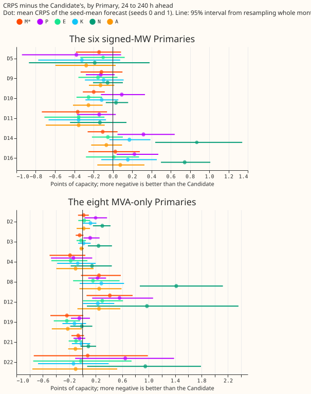

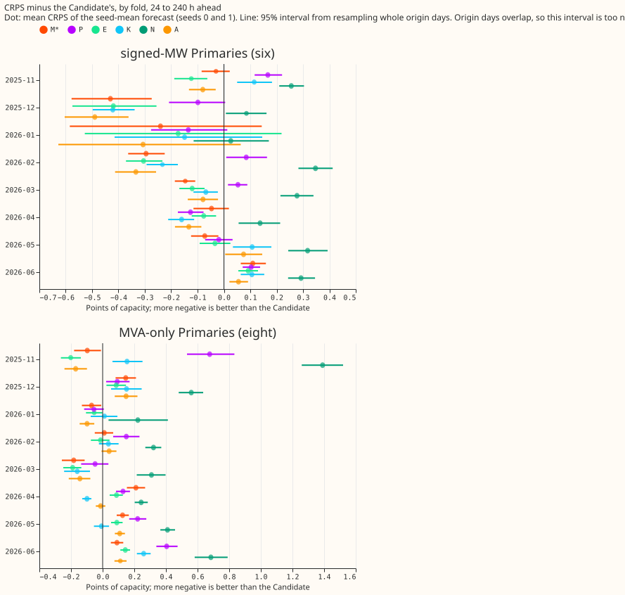

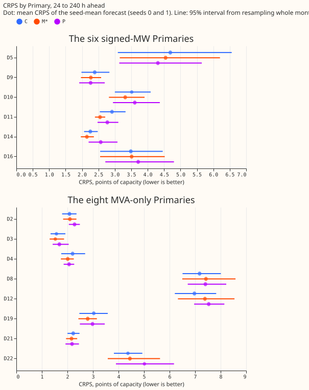

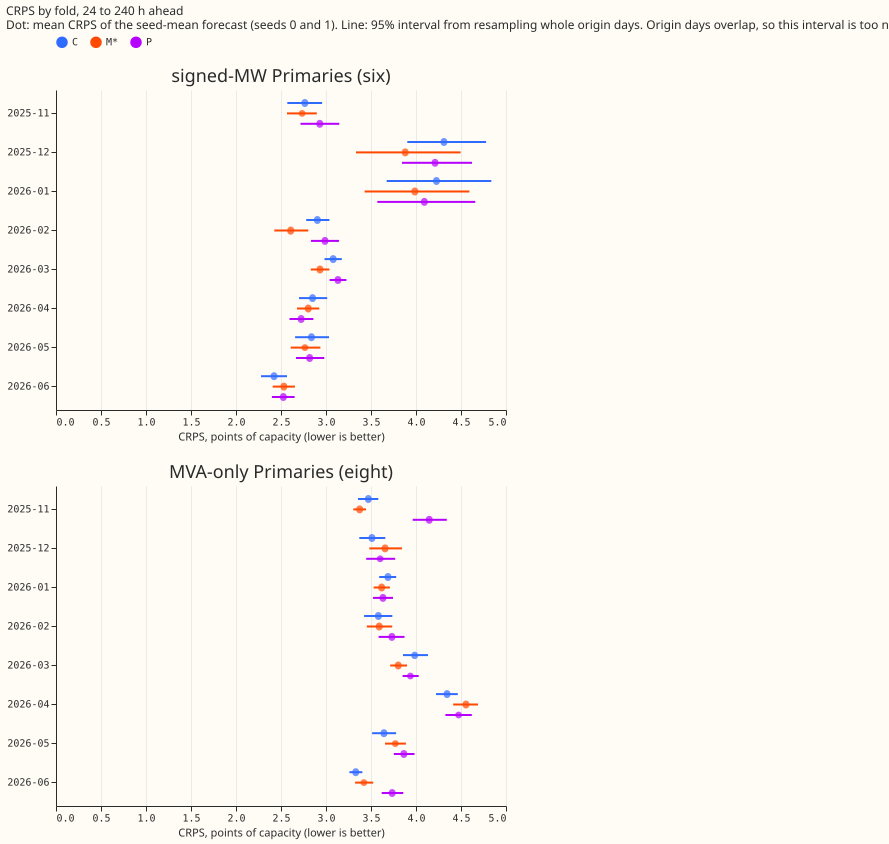

**Day-ahead and 14-day forecasts of a winter origin at D5, a signed-MW Primary, and of a summer
origin at D12, an MVA-only Primary, show the bands widening with lead time.**

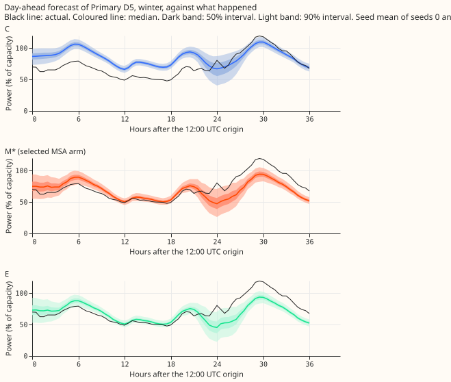

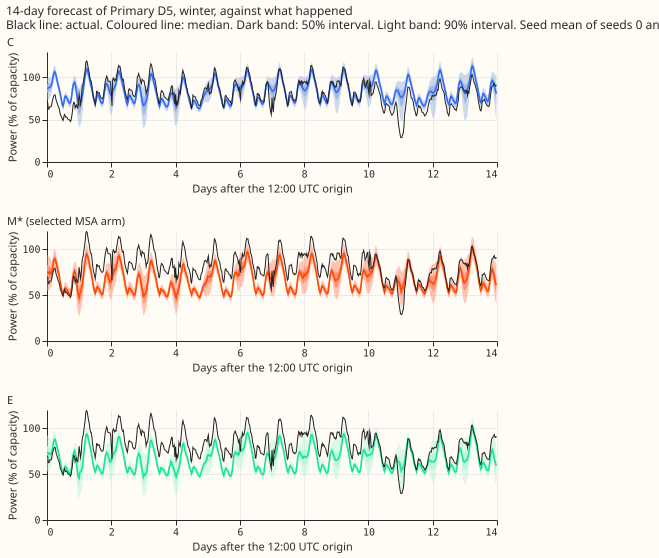

**Three load shifts in NGED's logs at signed-MW Primaries and three at MVA-only Primaries show the
forecasts of `M*` and the Candidate for the next 24 hours from each origin day against the measured
power.**

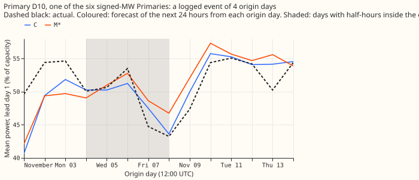

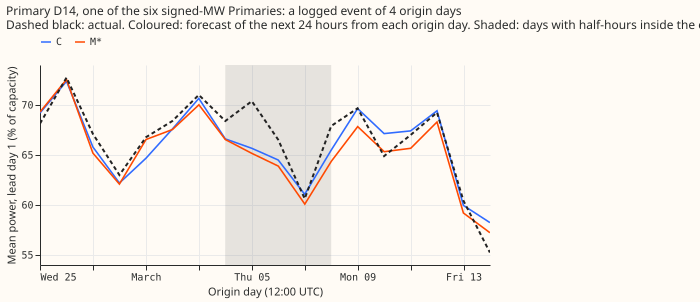

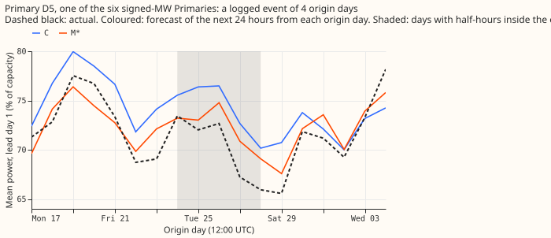

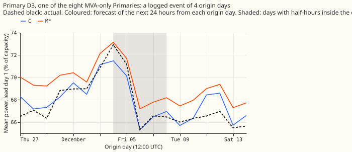

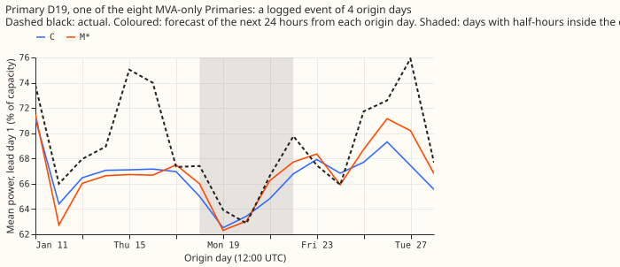

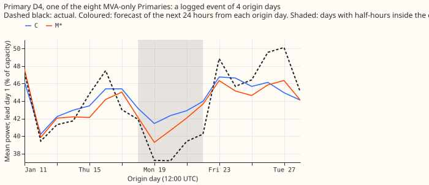

**Injected worlds show the neural-network arms and the Candidate on a lasting step and on a
temporary move, with the onset marked.**

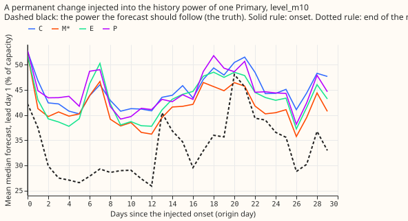

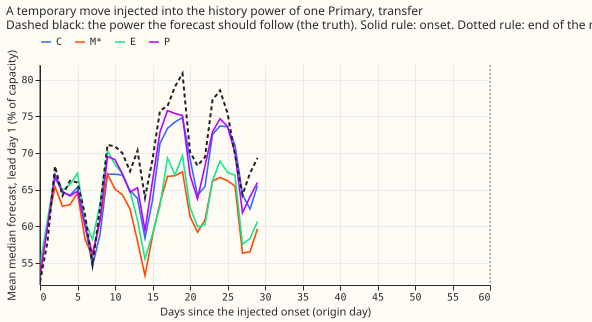

**In the 2026-01 fold at seed 0, the across-day attention of `M1` and `E` does not favour rows that
share the target's weekday, and `P` shows the same lack of preference.** These charts read the saved
weights of `M1`, `E`, and `P` with the forecast unchanged, on one fold (the 2026-01 test month) and
seed 0. The weight on the target row itself is 0.048 for `M1`, 0.084 for `E`, and 0.039 for `P` at
lead day 1. Averaged over all 16 Primaries (including D15 and D18, which the scoring leaves out),
every test origin, every half-hour, and the 4 heads, each of the 14 history slots takes between 0.05
and 0.09 of the weight (a uniform spread over the 15 rows would give 0.067). The rows with the
target's weekday take 13.7% of the history weight in `M1` at lead day 1 (14.5% at lead day 7), 12.8%
in `E` (14.4%), and 14.3% in `P` (14.3%). Two of 14 rows is 14.3%, so none of the three networks
puts extra weight on the rows with the target's weekday.

**`M1` and `E` give the most recent rows the most weight, and the weekday rows differ from their
neighbours by at most 0.007 at lead day 1.** At lead day 1, `M1` falls from 0.083 at slot 1 to
0.056 at slot 12, and `E` from 0.085 to 0.054, whereas `P`, whose slots are placebo rows with no
age order, runs from 0.058 to 0.077. Because of that gradient, the comparison with neighbouring
slots is firmer than the comparison with a uniform spread. In `M1`, slot 6 (the first weekday row)
takes 0.0725 against 0.0732 and 0.0684 at slots 5 and 7, and slot 13 (the second) takes 0.0582
against 0.0562 and 0.0651 at slots 12 and 14. In `E`, slot 6 takes 0.0642 against 0.0667 and
0.0647, and slot 13 takes 0.0535 against 0.0535 and 0.0605.

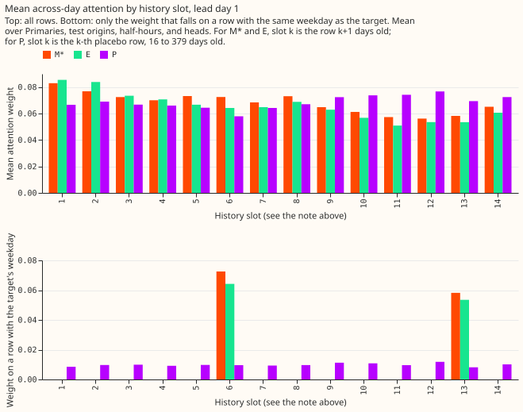

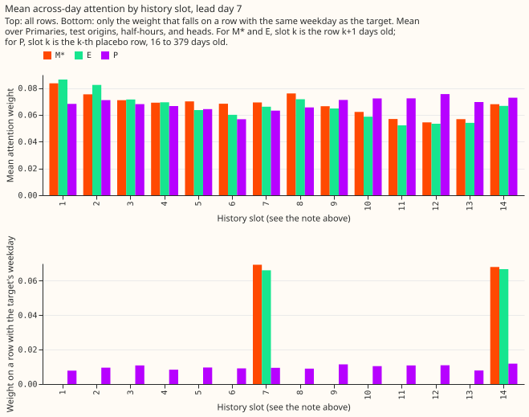

**Single cases show more structure than the average, and the structure differs between cases.**
Each case is one origin and one Primary, chosen for display only on outcomes the network never
reads: an origin whose next-day actual has a large half-hour change (case A), and the origins with
the highest (case B) and the lowest (case C) mean reanalysis shortwave over the target day at D5.
On the clear day (case B), `M1` and `E` put their largest weights on slots 2 and 6 over the first
12 half-hours of the target day (0.20 on slot 2 in both, and 0.24 and 0.21 on slot 6). Slot 6 is
the row with the target's weekday, so this one forecast does favour it, while the average over
origins does not. `P` puts its largest weights on slots 3, 14, and 7 over the first 12 half-hours
of case B, and over the whole day on slots 11, 3, and 8. In case A the largest `M1` weights fall
on slots 3, 8, and 5, and in the dull day (case C) on slots 14, 11, and 12, so no single row
dominates across cases. The cases are three origins, and each is a single forecast.

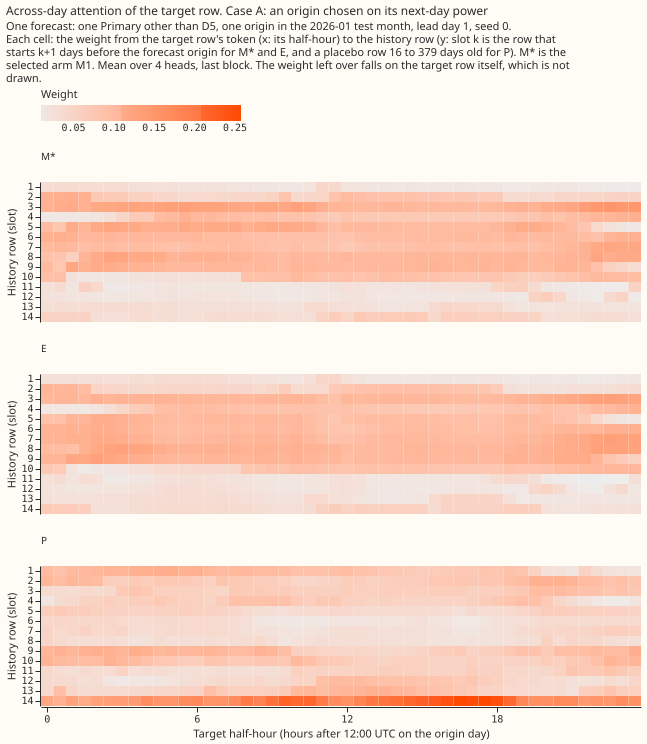

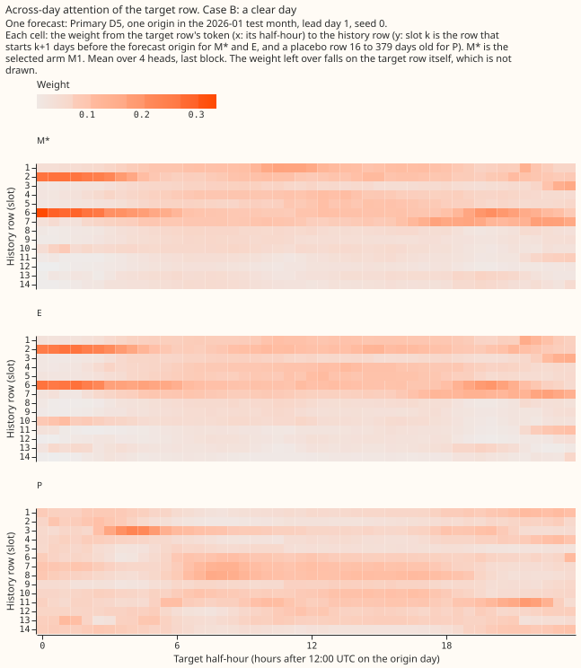

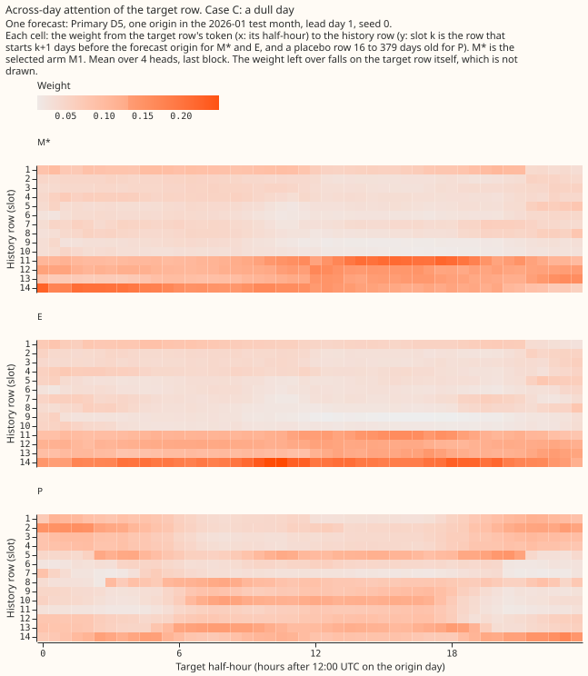

## Checks

- **The attention extract reproduces the scored forecast.** For each of the 3 cases of `M1`, `E`, and
  `P`, the extract's quantiles (the 11 quantile columns) differ from the stored forecast of the same
  arm, Primary, origin, and valid times by at most 1.6e-06 (the largest of 9 differences; limit
  1e-4), and the forecast with the attention returned is bit-identical to the forecast without it.
  The runner logs are `attention_extract_{M1,E,P}_2026-01_s0.log` under `work/logs/` in the private
  data folder. A smoke test with an untrained network ran before the one-line device-index fix of
  the GPU memory cap was committed, so it ran on uncommitted code. The real extract of `M1` also ran
  just before that commit, and the real extracts of `E` and `P` ran after it. The fix changes only
  the function that sets the GPU memory cap, and the 1.6e-06 match includes the `M1` extract.
- **Median minus mean forecast, per site.** For `M1` at seed 0, averaged over all leads of 0 to 14
  days, the median sits between 0.96 points of capacity below and 0.20 above the mean forecast at
  the 14 scored Primaries, and 1.99 below at D15. The report script prints 10 of the 16 Primaries;
  D12 (-0.96) and D15 (-1.99) are among the hidden rows. The spread shifts the median at D12 and
  D15, so their CRPS may be affected.
- **CRPS and the error of the median disagree at two contrasts.** `E` minus `M1` at the six
  signed-MW Primaries is 0.000 in CRPS and -0.009 in normalised median error. `M1` minus `C` at the
  eight MVA-only Primaries is +0.027 in CRPS and -0.035 in median error (95%, seeds 0 and 1): the
  median is slightly
  better and the upper tail is worse, which matches the failed q99 guard.
- **Audit triggers.** Audit triggers 1 to 5 fired. The Opus audit
  (`briefs/msa_architecture/audit_713.md`, in the private data folder) found no implementation fault
  that changes a headline number, a reading, or the verdict. Trigger 1 (a control fails) fired
  because the known-answer gate was waived after its checks KA3 (arm `M` must follow an injected
  level step) and KA12 (arm `G` must follow the step within 0.05 of arm `M`) failed. Trigger 2 (a
  result contradicts its prediction) fired for H1 at the six signed-MW Primaries. Trigger 3 (CRPS
  and the error of the median point in different directions) fired at the two contrasts above.
  Trigger 4 (leaving one Primary out flips a sign) fired at the eight MVA-only Primaries. Trigger 5
  (a nested arm beats the arm that contains it) fired because arm `A`, which lacks the within-day
  attention, scores better than `M1` (`M1` minus `A` is +0.016 and +0.032). Trigger 6 needs a
  by-hand comparison with the interval widths of experiments 667 and 709, which was not done, and
  trigger 7 (a later experiment's design depends on this unreplicated result) waits on a decision by
  the maintainer.
- **No weather look-ahead.** `e00713_weather_lookahead.py` lists, for one origin, the weather source
  and issue time of every row. The target row uses the 00Z run of the European Centre for
  Medium-Range Weather Forecasts (ECMWF) ensemble issued before the origin. No history row carries
  weather valid after the contract origin. The audit found no look-ahead and no power leakage across
  the cutoff. The history rows use the ERA5 reanalysis and Copernicus Atmosphere Monitoring Service
  (CAMS) analyses, and the history rows of ages 2 to 5 days could not be built in a live service, so
  every H1 reading is a ceiling for a live forecast.
- **Scorer edits after the audit.** Three edits followed the audit: the tail guard takes each row's
  month inside each join; the swap-(a) guard flag and the median-error guard flag compare with the
  sign of H1 rather than with a gain; and the scorer appends the Candidate's era reference once per
  pass. The era, swaps, and headline scorers were rerun after an Opus code review. No interval,
  reading, or verdict changed, and two guard flags at the eight MVA-only Primaries changed (swap (a)
  keeps the sign of H1, and the median error does not move with CRPS).
- **Seed reproduction.** The Candidate's seed 0 refitted for 2025-11 reproduces the stored forecast
  to a maximum absolute difference of 7.4e-05 against a threshold of 1e-3. No other fold was
  checked.
- **Capped reruns.** Arm `P` hit the 60-pass stage-1 cap in 4 of its 40 fits and was rerun at the
  120-pass cap, which makes H2 conservative and leaves H1 untouched.

## Limitations disclosed

- **The known-answer gate failed and was waived.** KA3 failed: the follow share of arm `M`, the
  fraction of an injected level step by which `M` moved its median, is 0.142 against the 0.75
  needed. KA12 failed on arm `G`. Every statement about following level shifts, and the era readings
  R1 to R3, is unsupported by a passing known-answer test.
- **The neural network is worse than the Candidate at D15 and D18, and the page does not score those
  two Primaries separately.** The 16-Primary pooled means are given in the Verdict section.
- **The comparison of follow shares between the Candidate and `M1` on experiment 581's bank of
  injected level steps was planned and could not be run.** The Candidate's stored files under
  experiment 667 hold experiment 650's random events, not experiment 581's bank. On 6 of 8 folds the
  forecasts of `M1` on that bank also include origin days before the fold's first day, so the two
  follow shares would not be on the same origins. A new inject job that passes experiment 581's bank
  through the Candidate's saved weights would make the comparison, and is a possible later
  experiment. The follow share of `M1` on that bank is not scored on this page. The filter that
  drops origins with no ensemble row drops 24 to 48 of 160 origins per pass on all 8 folds.
- **Era weighting is by pass, not by event.** Experiment 709 weights by event. The audit argues the
  point estimates agree whenever no pass has an empty slice, and did not compute both weightings.
- **Several pre-registered report-only readings are not on this page.** These are the climatology,
  manual heuristic, and BG2 rows; the four load-shift scenarios (all rows, outside events, inside
  events, and the 7 days after an event); coverage at q01, q05, q95, and q99; mean band width; the
  day-1 and days 11 to 14 lead bands; the cold-winter-night, winter, and time-of-day slices;
  threshold-weighted CRPS; avoidable curtailment cost; and the actual GPU hours. The median error
  appears beside CRPS for the report-only contrasts in `report_only.json` and for the two contrasts
  named under Checks.
- **The design's read-out of the across-day attention weights before and after an injected permanent
  change (design section 6.5) was not built.** The attention maps above cover one fold (2026-01),
  seed 0, and the arms `M1`, `E`, and `P`. They do not show attention on injected worlds, and the
  mean weights cannot tell whether the attention of a single origin follows a step.
- **The input sets differ.** The Candidate reads neighbour summaries and a table of expected inputs
  that the MSA neural network lacks, and the neural network reads 14 days of power and reanalysis
  history weather. The difference between the groups may come from inputs rather than architecture.
- **Further scorer limitations.** (1) The headline scorer needs about 20 GB of host memory. (2) No
  normalised median-error or band-width contrast stands beside H1 and H2 at the pre-registered
  level. (3) Audit triggers 1 and 5 print only in part, and `swaps.json` is not printed by the
  report script. (4) The hash print of design section 5.3 for the Candidate's seeds 2 to 4 is
  missing. (5) The 17 to 28 day slice of design section 1.10 is not implemented. (6) The era scorer
  does not enforce the known-answer check KA11, though KA11 passed for all 4 bank folds (maximum
  difference 0.0). (7) The leave-one-Primary-out and leave-one-month-out tests read "does the sign
  stay negative", which is the right test for a gain and the wrong label for a loss. (8) Arm `G` was
  not fitted on the real folds.
- **Seed counts.** Arms `A`, `K`, `N`, and `E` have seeds 0 and 1 only, and their contrasts are at
  95%. The headline arms `M1`, `P`, and `C` have 5 seeds.

## Lessons

- **Score a learned read-out over the history rows, with no trunk attention, before crediting
  attention.** Arm `K` is within 0.06 points of `M1` at both groups in CRPS, though the trunk
  attention improves the median error at the six signed-MW Primaries.
- **Score changes at the eight MVA-only Primaries per Primary before pooling.** In a 2-seed
  recomputation, two
  Primaries, D8 and D12, hold the sign of the pooled difference (seeds 0 and 1).
- **Do not credit attention for a lasting-step gain until the control arms are scored.** `K` and `E`
  gain about as much as `M1` on the era bank.
- **Diagnose a known-answer gate that the neural network keeps failing before running the real
  folds.** The follow share of arm `M` stayed at 0.01 to 0.14 against 0.75 through four gate runs.
- **Score the two short-history Primaries, D15 and D18, beside the groups.** Their loss is hidden by
  the group readings.

## The known-answer gate has failed four times

**The gate trains networks on a synthetic world with a known answer, and arm `M` must follow a level
step that appears in the history rows.** The check is KA3: in synthetic world W1, arm `M` must move
its median by at least 0.75 of a step of 0.30 of capacity (the follow share). Arm `M` has never come
near that figure. All four results stay on this page, each with the commit that produced it. An
earlier attempt at fd76ccb09 crashed at KA6 (a CUDA index error in the canary, before any check
produced a result), so it is not a gate result. Commit 3ac110652 fixed the canary.

| Run | Commit | Failed checks | Numbers | Cause found |
|---|---|---|---|---|
| First gate run (J1) | 3ac110652 | KA2, KA3, KA10, KA12 | Arm `N` mean absolute error 0.0476 against a limit of 0.02; follow share of `M` 0.0348; \|`M` − `P`\| 0.0166 against 0.005; follow share of `E` −0.0197 | The read-out's two query and key maps both started at zero, so neither trained |
| Rerun 2 | eb1942601 | KA3 | Follow share of `M` 0.0099 | The trained network barely read the lead day |
| Rerun 3 | 90b9de2c8 | KA3 | `M` 0.0186, `E` 0.1268, `G` 0.0005, `P` −0.00007, `N` 0 | KA2, KA4, KA5, KA6, KA10, and KA12 passed |
| Amended gate | 94dfb9652 | KA3, KA12 | `M` 0.1418 at the best-validation state; `G` 0.0395 against the KA12 limit of `M` − 0.05 = 0.0918 | KA2, KA4, KA5, KA6, and KA10 passed |

**The first fault was a bug, which the first gate run found and amendment 1 fixed.** The read-out's
query map `W_q` and key map `W_k` both started at zero, so each gradient (proportional to the other
map) stayed zero and the read-out never trained. The query map now has the default random
initialisation, the key map stays at zero, and the untrained network is unchanged (KA1 holds). A new
check fails on the old initialisation. The fix changes every real fold's network, because the
read-out now trains there too.

**The second fault was a weak lead-day path, which amendment 2 (`design_amendment_2.md`) addressed
after an audit.** The lead day entered only as an embedding on the target row's tokens. In the
audit, the embedding shrank to a mean length of 0.08, and moving the lead day from 1 to 14 changed
the median by 0.012 standardised units against a step of 2.1. Amendment 2 adds the one-hot lead day
to the read-out query and to the head's input, 1,344 parameters in all, with no effect at the start.
Rerun 3 followed, with a follow share of `M` of 0.0186.

**Amendment 3 (`design_amendment_3.md`) raised the budget of the synthetic fits only, and the
amended gate still failed.** The synthetic fits ran at most 400 passes with a patience of 30, where
they had run 150 and 8. The real folds' budgets and every threshold were unchanged. The amendment
came from a diagnostic on the same synthetic world W1 that the gate uses, so it was a post-hoc
change of the gate's budget. The amended gate stopped every fit by early stopping before the cap: W1
`M` at pass 193, `P` at 205, `N` at 257, `E` at 175, `G` at 199, and W0 `M` at 350. It took 67
minutes on one GPU, with a peak of 5,090 MiB.

**Scored at the pre-registered state, the best-validation state of each fit, the amended gate fails
KA3 and KA12.** The follow share of arm `M` is 0.1418 against 0.75. In KA12, arm `G` reaches 0.0395,
below `M` minus 0.05 = 0.0918, so the check fails. **Experiment 713 therefore failed its
pre-registered known-answer gate.**

**Secondary readings, which never gate.** The final-pass follow shares of the W1 fits are 0.1117 for
`M`, 0.2154 for `E`, and 0.0297 for `G`. The follow share of `M`, read every 20 passes, ranged from
0.005 to 0.189 with no trend, so a single reading is weak evidence either way. These readings were
recorded before the run as labelled secondary readings, and none of them is used for the pass or
fail decision. The best of them, 0.2154 for `E`, is also below 0.75.

**The audit of the gate found no implementation fault.** `ka3_audit.md` (in
`data/ml-experiments/briefs/msa_architecture/`, an Opus audit) checked the gate and its scorer with
oracles: a hand-set read-out on the newest history row scores 0.936, and rules that follow the step
score 1.000 through the same scorer, so the follow share can reach 1. The audit found that the
history path trains and that the network can read the step. The trained network learns to follow the
step late, and the validation loss does not reward following: arm `M` reaches a worse validation
loss than the placebo `P` in W1. So the failure is a finding about what this network learns on this
training budget, and the test is correctly specified.

### Diagnostics after the failed gate, which are not a gate result

**Six diagnostic fits and four replications followed the failed gate. They are diagnostics only,
they gate nothing, and they support no claim that the gate is passed.** Each run is a single
trajectory of arm `M` in synthetic world W1, with the code hash e85b84e2ea04b3cb, a cap of 400
passes, and no confidence interval. The variants changed the gradient-clip norm (1.0 or 10) and the
learning rate of the lead-day parameters only (the lead-day map `w_lead`, the lead embedding, and
the head's 14 lead-day input columns), by a factor of 1 or 10. The first six rows ran at training
seed 0 on world seed 0, the world that amendment 3 was derived from. V0 reproduces the amended gate.

**The multiplier of 10 was chosen on that same world and seed, after seeing its result, so the first
V2 figure is an optimistic selection.** The four replications changed the training seed or drew a
fresh world (world seed 1000, never used before and not used to choose the multiplier). The fixed
table of weekday-by-half-hour effects kept its own seed in every run.

| Run | Change from the amended gate | Training seed | World seed | Follow at the best-validation state | Follow at the final pass |
|---|---|---|---|---|---|
| V0 | None (the amended gate) | 0 | 0 | 0.142 | 0.112 |
| V1 | Clip norm 10 | 0 | 0 | 0.024 | 0.276 |
| V2 | Lead-day learning rate × 10 | 0 | 0 | 0.806 | 0.685 |
| V3 | Clip norm 10 and lead-day learning rate × 10 | 0 | 0 | 0.586 | 0.787 |
| V0N | None, no early stopping (400 passes) | 0 | 0 | 0.129 | 0.236 |
| V2N | Lead-day learning rate × 10, no early stopping (400 passes) | 0 | 0 | 0.820 | 0.395 |
| Rep1 | As V2 | 1 | 0 | 0.857 | 0.815 |
| Rep2 | As V2 | 2 | 0 | 0.377 | 0.649 |
| Rep3 | As V2 | 0 | 1000 | 0.454 | 0.368 |
| Rep4 | As V0 | 0 | 1000 | 0.063 | 0.185 |

**Arm `M` reached the 0.75 threshold at the best-validation state on 2 of the 4 runs that used the
lead-day multiplier (V2 and Rep1), and missed it on the other 2 (Rep2 and Rep3).** The follow share
at the
best-validation state varied from 0.377 to 0.857 across training seeds and worlds, and the
unmodified baseline gave 0.142 and 0.063. The no-early-stopping runs followed more than 0.9 at some
passes (0.912 for V0N, 0.929 for V2N), but their best-validation states stayed at 0.129 and 0.820,
so the state that validation loss picks is a noisy selector of the follow share.

**No amendment was made, and the gate remains failed. The maintainer's decision follows below.**
The diagnostics concern one family of synthetic worlds, one fold, and single runs, so
they say nothing about the real folds. The options that follow from them, with the reasons, are in
`gate_options.md` and the two diagnostic reports (`diag_option5/README.md` and
`diag_option5/replication/README.md`), in `data/ml-experiments/briefs/msa_architecture/`.

### The maintainer waived the gate

**On 2026-11-23 the maintainer decided, in these words: "Go ahead with option 1".** Option 1 of
`gate_options.md` is to waive KA3 for the real folds and disclose the failure. **The waiver changes
no threshold.** The gate file `work/known_answers_passed.json` is written by a separate script,
`e00713_waive_gate.py`, with `waived: true`, the failed checks (KA3 and KA12, with their values at
the
amended gate, commit 94dfb9652), the passed checks (KA2, KA4, KA5, KA6, and KA10), the decision
quoted above, the date, the code record, and the sha256 of `e00713_known_answer.py`. The script
refuses to write the file unless the stored last-run results show exactly KA3 and KA12 failing and
the code hash equals e85b84e2ea04b3cb, and the sha256 of the last-run file and of
`e00713_known_answer.py` equal the values pinned in the script. The fit scripts still check the code
record of the gate file, so a waived gate written under one code hash is refused under another. The
report script prints the waiver and fires audit trigger 1 (a control fails).

**Option 1 as written covers KA3 only, and the waiver covers KA12 as well.** KA12 also failed at the
amended gate: arm `G` followed 0.0395 against the limit of arm `M` minus 0.05 = 0.0918, so the stem
of arm `G` did not follow a step within 0.05 of arm `M`, which bears on the stem readings of R2 and
R3. The manager relayed the maintainer's verbatim "Go ahead." in answer to a question that included
KA12 (`G` 0.039 against 0.092). The quoted decision above is unchanged, and the waiver record
carries both statements.

**Option 1 carries its own risk: a null result on the real folds may come from the slow learning the
gate found.** The gate and the option-5 diagnostics showed that early stopping on validation loss
can end training before arm `M` learns to read a step. An H2 near zero then cannot separate "the
recent days carry little" from "the training budget stops before the read-out learns to use them",
as the gate and the option-5 diagnostics showed in synthetic world W1. The waiver does not remove
that ambiguity, and a null H2 therefore does not close the line without this caveat.

**Operator caution: a full rerun of `e00713_known_answer.py` deletes the gate file, waived or not.**
The waiver script must be run again after a rerun, and it refuses when the last-run results are not
those of the amended gate.

**The known-answer gate was waived by the maintainer on 2026-11-23 (design amendment 4), after it
failed KA3 and KA12. The era secondary set R1 to R3 and any statement about following level shifts
are therefore reported as unsupported by a passing known-answer test, and every verdict, headline,
and take-home message of this experiment carries that fact.**

## Pre-registered contrasts

**There are two counted contrasts, each at two groups of Primaries, so four counted readings, each
read at 100 × (1 − 0.05 / 4) = 98.75%.** Each contrast is the treatment minus the reference in CRPS
on the headline band, with seeds 0 to 4 of both arms. The six signed-MW Primaries are D5, D9, D10,
D11, D14, and D16. The eight MVA-only Primaries are D2, D3, D4, D8, D12, D19, D21, and D22, and
every number for them carries the label "reactive power assumed zero".

| Id | Contrast | Question |
|---|---|---|
| H1 | `M*` minus `C` | Does the MSA network beat the Candidate? |
| H2 | `M*` minus `P` | Do the 14 most recent days carry the gain (real minus placebo)? |

**Report-only readings, at 95%, on seeds 0 and 1 of both arms:**

- `M*` minus `A` (named H3: does the within-day attention matter?).
- `M*` minus `K`, `K` minus `N`, and `M*` minus `N`.
- `E` minus `M*`, and `G` minus `M*` when arm `G` is fitted.
- The pairwise differences among `M1`, `M2`, and `M3` on the screen folds.
- Every contrast for all 16 Primaries pooled, and for D15 with D18.
- Every contrast by lead band, by Primary, with one Primary left out, and with one month left out.
- The normalised mean absolute error (MAE) of the median beside every CRPS contrast.

## Arms

| Arm | What the arm is | Fitted or stored | Seeds |
|---|---|---|---|
| `C` | The Candidate `P7+D50` of experiment 667: two power lags, neighbour summaries, table T, mixture head | Seeds 0 and 1 stored; seeds 2 to 4 refitted into a new root | 0 to 4 |
| `M1` | MSA network; weather and date-time encoders loaded from the Candidate chain's pre-training and frozen in every stage | Fitted | 0, 1 (screen folds) |
| `M2` | As `M1`, with the loaded encoders trained in every stage | Fitted | 0, 1 (screen folds) |
| `M3` | As `M1`, with the encoders initialised at random and trained in every stage | Fitted | 0, 1 (screen folds) |
| `M*` | The arm among `M1`, `M2`, and `M3` with the lowest held-out validation loss | Selected, then fitted on all 8 folds | 0 to 4 |
| `P` | `M*` with its 14 history rows replaced by 14 random past days of the same Primary (the placebo) | Fitted | 0 to 4 |
| `A` | `M*` without the within-day attention (across-day attention and read-out kept) | Fitted | 0, 1 |
| `K` | `M*` with both trunk attentions replaced by the identity: the read-out and the head only, a learned kernel over the 14 same-half-hour readings | Fitted | 0, 1 |
| `N` | `M*` with the top row only: no history rows, no power | Fitted (about 2 minutes) | 0, 1 |
| `E` | `M*` with a 1-D convolution stem over the 48 half-hours of each history row; secondary | Fitted | 0, 1 |
| `G` | `M*` with a recurrent stem in place of the convolution stem; secondary and optional | Fitted only if the compute plan allows | 0, 1 |

**This page says "within-day attention" and "across-day attention" and not AlphaFold's "row
attention" and "column attention", because the two names are easy to swap.** Within-day attention
lets the 48 tokens of one day attend to each other. Across-day attention lets the 15 tokens at one
half-hour attend to each other across days.

**Removing the trunk's across-day attention does not give arm `N`.** The similar-day read-out
(Method, architecture) is itself a path across days, so a network whose trunk does nothing is still
a learned kernel over 14 same-half-hour readings with a weekday prior. Arm `K` is that network.
`M*` minus `K` says what the axial trunk adds to the read-out, and `K` minus `N` says what the
read-out adds to the top row alone.

**Reference rows, never refitted:** the month-by-half-hour climatology
(`baseline_forecasters.climatology.ClimatologyForecaster`, trained on each fold's training window),
and the manual heuristic and BG2 where stored rows cover the scored keys. The scorer states which
reference rows are missing.

## Decision rule

**Each group is read on H1, with D the point estimate and [L, U] the 98.75% bootstrap interval. The
group's reading is the first row that holds.** The three guards are the t guard (the t interval on
the 8 monthly differences of the seed-averaged forecasts, at 98.75% with 7 degrees of freedom,
excludes zero on the side the bootstrap interval does), the seed guard (the contrast has the same
sign for each of the 5 seeds taken alone), and the noise-floor guard (the point estimate is at least
twice the seed-noise standard error at 5 seeds, 0.034 at the six signed-MW Primaries and 0.090 at
the eight MVA-only Primaries).

| Order | Group reading | Condition |
|---|---|---|
| 1 | clear loss | L > +τ, and all three guards hold |
| 2 | loss | L > 0, and all three guards hold |
| 3 | gain | U < 0, D ≤ −τ, and all three guards hold |
| 4 | small gain | U < 0, and the seed guard holds for at least 4 of the 5 seeds |
| 5 | no detectable difference | L > −δ and U < +δ, with δ = 0.06 at the six signed-MW Primaries and 0.16 at the eight MVA-only Primaries |
| 6 | cannot tell | anything else |

**The smallest gain worth porting is τ = 0.05 points of CRPS.** The protocol's highest tier is 0.03,
for a new head. The MSA neural network replaces the Candidate's whole neural network and its input
pipeline, and a live
service would need a replacement for ERA5 on the 4 newest history rows, so the threshold is set
above that tier. The experiment is `kind: other`, because the Candidate is not the Primary demand
research default, so the threshold belongs to this plan.

**The experiment's verdict is the first row that holds.**

| Order | Verdict | Condition |
|---|---|---|
| 1 | `refuted` | "clear loss" in either group |
| 2 | `not supported` | "loss" in either group; or "no detectable difference" in both groups |
| 3 | `supported` | "gain" in both groups, H2's upper limit below 0 in both groups, and every `supported` guard holds |
| 4 | `partly supported` | "gain" in one group and no "loss" in the other; or "gain" in both groups with H2's upper limit at or above 0 in a group, or with a `supported` guard failing |
| 5 | `small gain` | "small gain" in at least one group, with no "gain" and no "loss" in either group |
| 6 | `inconclusive` | anything else |

**Reading 4 follows the `ml-experiment` skill:** an interval that excludes zero in the predicted
direction but falls under the threshold, or is not secured at the threshold, is `small gain` and
never `inconclusive`. **Reading 5 uses the detectable difference δ and not τ**, because an interval
inside ±0.05 is out of reach with 5 seeds and 8 months. The write-up words reading 5 as "a
difference larger than 0.06 (0.16 at the eight MVA-only Primaries) is ruled out; a gain of 0.05 is
not".

**The guards for `supported`** are these four: the sign of H1 holds with each Primary left out in
turn and with each month left out in turn; the q01 and q99 pinball loss of `M*` is within 0.05 of
the Candidate's in each group (one-sided 95%); the normalised MAE of the median moves the same way
as CRPS; and H1 keeps its sign in swap (a) of "Three checks on history weather".

**H3, `M*` minus `K`, and `K` minus `N` change no verdict.** They say which part of the network did
the work, and they choose the follow-up.

**Stop rule for the line.** A verdict of `not supported` or `refuted` closes the last-14-days axial
line, so the 28-row layout (a follow-up with 14 target rows and 14 history rows) does not run. A
retrieval follow-up, which picks the 14 history rows by similarity to the target day, may still run
after `not supported`, but only when H2 is clearly negative and `M*` is not clearly worse than `C`,
because retrieval tests a different source of information.

**What the design cannot do.** τ is below the detectable difference δ in both groups. A true gain
of exactly τ will most often read `small gain` or `inconclusive`, and a tie can be read as "no
difference larger than δ", never as "no difference larger than τ".

## Detectable effect

**With 5 seeds per arm, the design can detect a difference from the Candidate of about 0.06 points
of
CRPS at the six signed-MW Primaries and 0.07 to 0.16 at the eight MVA-only Primaries, and no
smaller.** The two stored seeds of the Candidate alone would resolve only 0.09 at the six signed-MW
Primaries and 0.11
to 0.25 at the eight MVA-only Primaries, which is why the Candidate is refitted for seeds 2 to 4. A
gain of the size
that experiments 699, 709, and 711 failed to resolve (0.03 to 0.07) may still end `inconclusive` or
`small gain` here.

**The calculation scores the Candidate's two stored seeds over the 8 folds, on the headline band,
with valid times from 2026-07-01 dropped.** The seed-noise standard error of a contrast between two
arms with n seeds each, over 8 months, is the monthly standard deviation of seed 0 minus seed 1
divided by √(8n). The detectable difference δ is 3.48 standard errors (99.17% two-sided, 80%
power). It assumes the MSA arm is as noisy as the Candidate.

| Group | CRPS of the seed-mean forecast, pooled over rows | The same, mean of the 8 monthly means | Mean over months of seed 0 minus seed 1 | Standard deviation of that difference over 8 months | Half-hours |
|---|---|---|---|---|---|
| The six signed-MW Primaries | 3.203 | 3.175 | +0.001 | 0.108 | 611,055 |
| The eight MVA-only Primaries | 3.704 | 3.694 | +0.059 | 0.285 (0.136 without 2025-11) | 816,768 |
| D15 and D18 | 8.106 | 8.002 | +0.127 | 0.974 | 203,040 |

| Seeds per arm | Standard error, six signed-MW Primaries | Standard error, eight MVA-only Primaries | Detectable δ, six signed-MW Primaries | Detectable δ, eight MVA-only Primaries |
|---|---|---|---|---|
| 2 | 0.027 | 0.071 (0.034) | 0.094 | 0.25 (0.12) |
| 5 | 0.017 | 0.045 (0.022) | 0.059 | 0.16 (0.07) |

**One seed of the Candidate failed in fold 2025-11 at the eight MVA-only Primaries** (CRPS 3.955
against 3.263 for the
other seed, seeds 0 and 1 over 24 to 240 h), which doubles the eight MVA-only Primaries' seed noise.
The stored arm is used as it
is. The figures are
lower bounds, because they leave out the month-to-month variation of the true difference, which the
month-block bootstrap and the t guard add. The decision rule uses δ = 0.06 at the six signed-MW
Primaries and 0.16 at
the eight MVA-only Primaries. Known-answer check KA8 requires the implementer's scorer to reproduce
the first table.

## Screen, and the choice of `M*`

**The screen follows the standing practice: four folds first, every number labelled interim.** The
screen folds are 2025-11, 2026-01, 2026-03, and 2026-06, with seeds 0 and 1, for `M1`, `M2`, and
`M3`. The Candidate's stored forecasts match the screen's folds and recipe exactly.

- **Choice of `M*`, without reading any scored forecast.** `M*` is the arm with the lowest mean
  held-out validation loss, where the loss is the unweighted mixture negative log-likelihood of the
  stage 3 state on the stage 3 validation samples (held-out origin days, all before the fold's
  cutoff, at lead days 1, 2, 4, 7, 10, and 14), averaged over the 4 screen folds and 2 seeds. An
  arm within 0.005 of the best loses to the simpler arm, in the order `M1`, `M2`, `M3`. The
  selection script reads the fit logs only and runs before any MSA forecast is scored.
- **Result of the selection.** `M*` is `M1`. The mean stage 3 validation loss is 0.4145 for `M1`,
  0.4121 for `M2`, and 0.4132 for `M3`, all within 0.005 of the best, so the simplest arm wins. The
  sanity rule and the stop rule did not fire.
- **Caveat on the selection.** A later fold's validation days fall inside earlier scored months
  (fold 2026-03 holds out days in 2025-11 to 2026-02). Those days are training-window data of the
  later fold, used as every early-stopping set in the recipe uses them. No scored forecast of any
  arm enters the selection.
- **Order of work after the selection.** The fits ran in this order: `P` on the screen folds; apply
  the sanity rule and the
  stop rule; then fit `M*` on the other four folds (2025-12, 2026-02, 2026-04, 2026-05), `P` on
  those four, `A`, `K`, `N`, and `E` on all 8, seeds 2 to 4 of `M*` and `P`, and arm `G` last if the
  compute plan allows.
- **Sanity rule.** If `M*` minus `P` is positive in both groups on the screen folds, stop and audit
  (audit trigger 1), because a network that gains nothing from real recent days over random days is
  either broken or indifferent to its history rows.
- **Stop rule.** Stop if `M*` minus `C` (seeds 0 and 1) on the screen folds is above +0.15 in both
  groups, or above +0.10 in both groups and positive in at least 3 of 4 folds in both groups. The
  result is then written up from the screen as `not supported`, labelled as a screen. The scorer
  prints the reading a second time with fold 2025-11 left out, because the Candidate's failed seed
  sits in that fold; the rule itself uses all four folds.
- **No tuning on the scored folds.** Width, depth, heads, and learning rates are fixed in the Method
  section. A change after the screen is labelled post hoc and leaves the pre-registered contrasts
  unchanged.

## Method

**Every setting below was fixed before the real folds were scored, and none was tuned on the scored
folds.**

### Architecture

- **The sample is one Primary, one origin day, and one lead day k (1 to 14).** The matrix has 15
  rows of 48 half-hours: row 0 is the target row (valid times `c + 24 (k − 1) h + 0.5 j h`, where
  `c` is the contract origin) and rows 1 to 14 are the history rows of ages 2 to 15 days, newest
  first (valid times `c − 24 a h + 0.5 j h`). That is 720 tokens per sample (48 for arm `N`).
- **Rows are 24-hour blocks that start at 12:00 UTC**, so 14 target rows tile the 672 contract
  half-hours exactly, and column `j` of every row has the same time of day. A half-hour is stamped
  with its period end. The contract origin is 12:00 UTC on day D, the native origin is 3 h earlier
  (09:00 UTC), and the weather run is the ECMWF ENS 00Z run of day D, available at 09:00 UTC.
- **A row holds two local calendar days**, so the day type is set per token, not per row: the local
  weekday (0 to 6, Europe/London) of the token's own half-hour, or 7 where that local day is a bank
  holiday in England. Columns are UTC half-hours, so a history row on the other side of a clock
  change is offset by one hour of local time, which the write-up states as a limitation.
- **Every target token has exactly two history tokens of its own weekday in its column**, because
  the history token of age a is 24 (a + k − 1) h before the target token, and that is a multiple of
  7 days for two ages in 2 to 15.
- **The inputs per batch of B samples** are: `top_weather` (B, 48, 21), 7 ENS-mean weather columns
  and 14 B1 columns (B1 is the set of 14 trailing-temperature and solar-gain columns of experiment
  569); `top_spread` (B, 48, 7), the ENS spread (zero in stage 1); `top_datetime` (B, 48, 21), 21
  solar-geometry, calendar, and holiday columns; `hist_weather` (B, 14, 48, 21) and `hist_datetime`
  (B, 14, 48, 21) at the token's own time; `hist_power` (B, 14, 48), power over capacity
  standardised per Primary with the fold's target mean and standard deviation, clipped at ±5, and 0
  where not visible; `hist_visible` (B, 14, 48); `row_exists` (B, 14); `day_type_top` (B, 48) and
  `day_type_hist` (B, 14, 48); the Primary index and `lead_day` (B,); and the `target` and `weight`
  (B, 48). The weather columns, B1 columns, and their standardisation are the Candidate's.
- **Token construction.** Width is 64. The weather encoder (29 → 64 → 32) and the date-time encoder
  (29 → 64 → 32) are the Candidate's, each reading an 8-wide Primary embedding. Every token is
  `P_w e_w + P_d e_d + tok_emb(primary) + col_emb(j) + row_part`, where `P_w` and `P_d` are linear
  maps 32 → 64 without bias, `tok_emb` is a new 16 × 64 Primary embedding, and `col_emb` is a
  learned 48 × 64 time-of-day embedding. The target row's `row_part` is a lead-day embedding (14 ×
  64), a map of the 7 spread columns (initialised at zero), and a learned masked-power token. A
  history row's `row_part` is an age embedding (14 × 64) plus `u z + b` where the token is visible
  (`z` is the standardised power) and a learned vector where it is not.
- **Two axial blocks**, pre-LayerNorm, residual, dropout 0.1. Each block applies within-day
  attention (4 heads, width 64, over the 48 tokens of each row), then across-day attention (4
  heads, over the 15 tokens of each column, with a learned bias per head and key row, and rows with
  `row_exists` False excluded as keys), then a transition network 64 → 128 → 64 with GELU (the
  Gaussian error linear unit). The output projection of each attention and the last layer of each
  transition start at zero, so an untrained trunk is the identity.
- **The similar-day read-out** is an addition to the maintainer's sketch, made so that an untrained
  network gives a weighted mean of similar days, and the maintainer kept it. For the target token at
  column `j`, a logit for each visible history row is a scaled dot product of two 64 → 32 maps of
  the layer-normalised tokens, plus a table `β_day[day type of the target token, day type of the
  history token]` (8 × 8) and a per-age bias `β_age`. A softmax over the visible rows gives weights
  `α`, a weighted mean `base`, and a weighted spread `s`; with no visible row, `base = 0`, `s = 0`,
  and a flag `no_history = 1`. The key map and `β_age` start at zero. The query map has PyTorch's
  default random initialisation, because with both maps at zero each gradient is proportional to the
  other map and neither map would ever train. `β_day` starts at 3.0 for the
  same day type, 1.5 for two different Monday-to-Friday day types and for Sunday with a bank
  holiday, and 0 otherwise. A Monday-morning target token therefore starts with about 50% of the
  weight on the two Monday mornings, 45% on the eight other working-day mornings,
  and 5% on the
  four weekend mornings. The read-out query also takes a map `w_lead` (14 → 32, no bias, default
  random initialisation) of the one-hot lead day, added to `W_q h_0` (amendment 2).
- **The head is the Candidate's mixture.** A network `[h_0 (64), base, s, no_history, one-hot lead
  day
  (14)] → 64 → 9` gives 3 mixture weights, 3 means, and 3 log standard
  deviations, initialised as the Candidate's
  head is (output weights zero, means at −0.5, 0, and +0.5), with `base` added to the 3 means. The
  loss is the mixture negative log-likelihood on the standardised target, and the 11 quantiles
  (0.01, 0.05, 0.1, 0.25, 0.4, 0.5, 0.6, 0.75, 0.9, 0.95, 0.99) come from the mixture, then are
  rescaled by the target standard deviation and mean into shares of capacity. No widening factor is
  applied to any arm. KA1 asserts that an untrained network forecasts a 3-component mixture centred
  on the day-type-weighted mean of the last 14 days at the same half-hour.
- **Parameter count.** The built module is about 129,999 parameters (the encoders 8,128, the token
  maps and embeddings 10,688, two axial blocks 100,600, the read-out 4,750, and the head 5,833);
  `M1` trains 121,871 of them. Arm `A` has 33,536 fewer parameters than `M1` (33,280 attention
  weights and 256 in the two LayerNorms of the removed within-day sublayers), and arm `K` has 67,192
  fewer (66,560 attention weights, 120 key-bias values, and 512 in the removed LayerNorms). Both
  counts are those of the built modules.
  The Candidate's lag network has about 30,000 parameters. A check script asserts every count, and
  the count of the built module is the reference.
- **Arm differences.** `M1`, `M2`, and `M3` differ only in the encoders: `M1` and `M2` load the
  weather, date-time, and embedding weights from the Candidate chain's pre-training for the same
  fold and seed (trained on data before the fold cutoff), `M1` freezes them, and `M3` starts them at
  random. `A` replaces the within-day attention of both blocks with the identity, `K` replaces both
  attentions, `P` changes the batch only, and `N` builds the target row only (`base = 0`,
  `no_history = 1`).
- **Arms `E` and `G` add a stem** on the history rows, before the first block. The stem reads two
  channels per half-hour (the standardised power, 0 where not visible, and the visibility flag).
  Arm `E` uses two 1-D convolutions of kernel 5 with zero padding (2 → 16 → 16 channels) and a
  linear layer 16 → 64, 2,560 parameters, each output seeing 9 half-hours (4.5 h). Arm `G` uses a
  bidirectional gated recurrent unit of hidden width 16 per direction and a linear layer 32 → 64,
  4,032 parameters. The last layer of each stem starts at zero, so an untrained `E` or `G` equals an
  untrained `M*`. Both stems read only the history power and visibility, which KA5 poisons.
- **A free read-out:** every fitted `M*` is also scored with all history power masked at prediction,
  which shows how the forecast degrades when telemetry is missing.
- **No monthly offset knots.** The Candidate's offset tracks slow level changes; the history rows do
  that for the MSA network. Arm `N` has neither.

### Training regime

- **Data.** The 16 Primaries, with cleaned power (the half-hours the `substation_zero` rule flags
  are dropped and counted per fold) and the D15 and D18 rows before 2025-03-01 cut, everywhere:
  training rows, history rows, and actuals. Stage 1 uses ERA5 and CAMS weather estimates; stages 2
  and 3 use ENS forecasts. Calendar columns are present, as in the Candidate, which departs from the
  skill's advice of a control without them. Arm `N` and the climatology row show what the calendar
  and the weather give alone.
- **Three stages, as experiment 667.** Stage 1 trains on daily origins from 2019-09 to the cutoff
  with ERA5 and CAMS target weather, spread zero, targets cut at the cutoff minus 3.5 h, weight 1,
  and learning rate 5e-4 (2e-4 for the loaded encoders of `M2`). Stage 2 trains on daily origins in
  the 730 days before the cutoff (from 2024-04-01) with the ENS 00Z run, targets cut a further 3
  days, weight 1, and learning rate 2e-4 (5e-4 for the spread map). Stage 3 fine-tunes with
  targets cut a further 7 days (half weight for the 7 days before), weight 0.5 to the power of age
  in days over 90, learning rate 2e-4, and synthetic lag-only shifts of experiment 581 added to the
  history power and never to a target.
- **One stated departure: the trunk is kept from stage 1 into stage 2.** The Candidate attaches a
  fresh mixer in stage 2, because its fine-tuning mixer has more inputs. The MSA trunk has the same
  inputs in both stages apart from the spread map, so it keeps what 6 years of ERA5 taught it. A
  second departure is 300 warm-up steps before a constant rate, because of the attention layers.
- **A third departure: the MSA network trains on fewer target rows than the Candidate.** The matrix
  holds the target half-hours from the contract origin (12:00 UTC) to the 672nd half-hour after it.
  On fold 2026-03 the Candidate's training rows include 37,381 rows before the contract origin
  (leads
  0.5 to 2.5 hours) and 175,925 rows after the 672nd half-hour, and the MSA network never trains on
  them. The 730-day window of stages 2 and 3 is cut by origin day, where the Candidate cuts by valid
  time, which removes up to 14 origin days for the folds whose window starts after 2024-04-01
  (2026-05
  and 2026-06). The scored rows are identical, so no scored number depends on this difference, and
  nothing leaks.
- **A fourth departure, made after two failed gate runs: the lead day has two more paths (amendment
  2).** The original design gave the lead day one path, the embedding `lead_emb` added to the
  tokens of the target row. The first known-answer gate run (J1) failed because the read-out's
  `W_q` and `W_k` both started at zero and never trained (amendment 1). The second J1 run failed
  KA3 alone, with a follow share of 0.0099 for arm `M` against the 0.75 threshold. An audit found
  no implementation fault. The trained network was blind to the lead day: `lead_emb` shrank to a
  mean length of 0.08, and setting the lead day to 14 moved the median by 0.012 standardised units
  against a step of 2.1. A visible step persists to lead day 1 with probability 0.835 but averages
  0.28 over the 14 lead days, so a lead-blind network does best by ignoring the step. The amendment
  adds the one-hot lead day to the read-out query through `w_lead` (448 weights) and to the head's
  input (896 weights). Both paths start with no effect, so KA1 holds for every arm. No threshold,
  budget, arm, or decision rule changes. The amendment was made after the audit, and the three
  failing J1 results (the dead read-out, then KA3 at 0.0099) stay on this page as the reason for it.
- **A fifth departure, made after three failed gate runs: a larger budget for the synthetic fits
  (amendment 3).** The gate has now failed three times, and all three results stay on this page.
  The first run (commit 3ac110652) failed KA2 (arm `N` 0.0476 against 0.02), KA3 (arm `M` 0.0348
  against 0.75), KA10, and KA12, because the read-out's `W_q` and `W_k` were both zero. The second
  run (eb1942601) failed KA3 alone, at 0.0099, because the network ignored the lead day. The third
  run (90b9de2c8), with the lead-day path, failed KA3 alone again: arm `M` 0.0186, arm `E` 0.1268,
  arm `G` 0.0005, arm `P` −0.00007, arm `N` 0, with KA2, KA4, KA5, KA6, KA10, and KA12 passing.
  A diagnostic on the same synthetic world W1 then suggested that the synthetic fits were stopping
  early. **The amended gate raises the synthetic fits to at most 400 passes with a patience of 30.**
  The amendment therefore came from a look at the very world that the gate uses, and the page says
  so. KA3 is still scored at the pre-registered state, the best-validation state of each fit, with
  the threshold of 0.75. The follow share at the final pass, and every 20 passes, is recorded as a
  secondary reading that never gates. If the amended gate fails KA3 at the pre-registered state,
  experiment 713 is reported as failing its gate. Every threshold, the real folds' budgets, and the
  arm list are unchanged. The amended gate failed KA3 and KA12 (see the section on the known-answer
  gate above).
- **Shared by all stages.** AdamW with weight decay 1e-3 and gradient clipping at 1.0; batch of 256
  samples; at most 60 passes with patience 8; loss `(weight × nll).sum() / weight.sum()` over finite
  targets. A pass visits every (Primary, origin day) once, with one lead day drawn uniformly,
  seeded by (seed, pass). Block dropout masks every history power token on 25.5% of origin days and
  the newest history row on 4.5%.
- **Under-training is checked and not assumed away.** One lead day per pair means a pass shows one
  fourteenth of the target half-hours a pass of the Candidate shows. Every fit logs, per stage, the
  pass at which early stopping fired and whether the cap was hit. A stage that ends at the 60-pass
  cap is rerun from its starting state at 120 passes before any score of that arm is read, and the
  report lists every rerun. A rerun repeats the 60 passes of the first attempt, so a capped stage
  costs
  up to 180 passes of GPU time in total, and phase 12 of the compute plan covers those reruns.
  Drawing more lead days per pair is not adopted, because it changes the sample weights within an
  origin.
- **Embargo and validation.** Every training process runs with the cleaned power set to NaN from the
  fold month's start, and prediction runs in a separate process. Early stopping uses held-out
  origin days (7 days in every 42, with a purge of 15 days before and 9 days after), grouped by
  origin day so that the 14 lead days of one origin sit on one side. A training sample in the 6 days
  after a purge reads a held-out block's power as history; this touches early stopping and the
  choice of `M*` only, never a scored forecast.
- **Folds and refits.** One refit per month, with the cutoff at 00:00 UTC on the first day of the
  month and no refit inside the month. The synthetic shifts of stage 3 are drawn over a range
  that starts 16 days (768 half-hours) before the first target, so that the oldest history rows of
  the first targets also get shifts.
- **Seeds.** Seeds 0 to 4 as the arm table lists. A seed sets the initialisation, the pass order,
  the lead-day draws, and the dropout draws.
- **Saved.** The state after each stage, in this experiment's data folder, and the per-seed
  forecasts with the Candidate's columns plus `seed`, `actual`, `lead_hours`, and `nwp_init_time`.
- **GPU hours.** About 39 GPU-process-hours without arm `G` and about 44 with it (the Compute
  section). The first fit times stage 3 of one fold once on the GPU and once on one CPU thread, and
  the finished page records both.

### Measurement

- **Scored rows.** The 8 monthly folds 2025-11 to 2026-06, one contract origin per day at 12:00 UTC
  (672 half-hours per origin), under the row set id in the front matter. Valid times on or after
  2026-07-01 are dropped for every arm, because that period is kept for a finalist. The four folds
  2026-07 to 2026-10 of experiment 667 are not used.
- **Actuals.** Cleaned power divided by the capacity in the series-capacity table. A join assertion
  checks that every arm holds identical (series, forecast origin, valid time) keys before any score
  is read.
- **Headline band.** Leads from 24 h up to but not including 240 h after the 12:00 UTC origin
  (target rows 2 to 10). Day 1 (0 to 24 h), days 11 to 14, and the protocol's days 1 to 10 band
  (0 to 240 h) were planned as report-only readings and are not on this page.
- **Groups.** The six signed-MW Primaries and the eight MVA-only Primaries, separately. All 16
  pooled,
  and D15 with D18, are report-only.
- **Metrics.** CRPS, the normalised MAE of the median, coverage and pinball loss at q01, q05, q95,
  and q99, q05 to q95 coverage and mean band width, threshold-weighted CRPS, and the avoidable
  curtailment cost (report-only), by lead band, by Primary, and in the cold winter night, winter,
  and time-of-day slices. The climatology, manual heuristic, and BG2 rows were planned beside them
  and are not on this page.
- **Intervals.** Each contrast uses seed-averaged forecasts (seed mean, then sorted quantiles, as in
  experiment 667), a per-row loss frame paired on run and valid time, and a month-block bootstrap
  with whole origin months as blocks and 100,000 resamples. The bootstrap pairs arms on seed, so
  each seed-averaged arm enters with one pseudo-seed, and the three guards carry the seed noise. A
  percentile bootstrap over 8 month blocks is too narrow: its "98.75%" half-width is about 2.3
  standard errors of the monthly mean where a t distribution with 7 degrees of freedom needs 3.3,
  and experiment 710's 99.17% interval excluded zero while a t test on the same monthly differences
  gave p = 0.077. The t guard uses the t quantile directly.
- **Load shifts.** Because the MSA network reads 14 days of power, the page reports the era set on
  experiment 709's injected worlds (R1 to R3) for `M*`, `E`, `P`, `K`, and the Candidate, and the
  follow share of `M*` on experiment 581's bank. The follow share of the Candidate on the same bank
  and origins was not computed (see the limitations). Real logged-event charts for three Primaries
  of each group show the lead-day-1 forecast of the Candidate and `M*`. NGED's logs may miss events,
  so the real-event slices undercount. Every statement about following level shifts carries the
  waiver sentence (unsupported by a passing known-answer test; amendment 4).
- **Figures.** A day-ahead forecast and a full 14-day forecast of one origin, winter and summer, at
  a signed-MW Primary and an MVA-only Primary, for `M*`, `E`, and `C`; per-Primary and per-fold
  charts of CRPS and of CRPS
  minus the Candidate's, split by Primary group; logged-event charts; and the injected-world charts.
  The training-log table of mean stopping pass per stage and the count of reruns at the cap is
  printed by `e00713_report.py`.
- **Anonymisation.** Scores and forecasts are of Primaries. The page may say that a gas generator
  and
  a solar farm connect at D8, as experiment 709's page does. It never names either generator and
  never plots or tabulates a metered generator's own time series.
- **Standing practices followed:** monthly refits, cleaned data, the D15 and D18 cut, saved models,
  reused stored predictions, a four-fold screen, tails, example plots, load-shift plots, and a
  draft pull request. **Earlier advice followed:** experiment 710's leave-one-Primary-out reading,
  experiment 632's injected-shift read-out for any network that reads lags, and experiment 709's
  advice to score injected permanent changes and temporary moves together and against a placebo.
  **Earlier advice departed from:** experiment 710 advises selecting the fine-tune on a
  recency-weighted held-out set; this design keeps experiment 667's unweighted selection so that the
  MSA arms and the Candidate share one recipe.

## Files

**Code, in `ml-experiments/00713-msa-axial-attention-demand-network-part-1/`** (each script carries
the id as `e00713_`):

- `e00713_layout.py` is pure index arithmetic: sample to grid indices of the 15 rows, the visibility
  mask, per-token day types, and the placebo draw.
- `e00713_model.py` holds the network, the axial blocks, the two stems, the read-out, the head, and
  the arm switches.
- `e00713_inputs.py` adapts the Candidate chain's inputs: cleaned power, fold statistics, dense ERA5
  and CAMS arrays, ENS target-row arrays, and the validation split.
- `e00713_batch.py` assembles batches and runs the per-batch assertions and the poisoned-copy check;
  `e00713_check_batch.py`, `e00713_check_inputs.py`, `e00713_check_layout.py`, and
  `e00713_check_model.py` are the matching checks.
- `e00713_arms.py`, `e00713_variants.py`, `e00713_train.py`, `e00713_fit.py`, and
  `e00713_predict.py` define the arms and run the three stages and the prediction;
  `e00713_select.py` chooses `M*` from the fit logs.
- `e00713_bank.py`, `e00713_swap_c.py`, and `e00713_era.py` run the prediction-only read-outs: the
  injected banks, the three weather swaps, and the era set.
- `e00713_known_answer.py` builds the synthetic world and runs KA1 to KA12; `e00713_waive_gate.py`
  writes the waiver record; `e00713_token_diagnostic.py` is the report-only token diagnostic.
- `e00713_smoke.py` is a smoke job of one tiny fit that exercises a crash, a resume, a rebuilt log,
  a prediction, and a score before the first real fit.
- `e00713_score.py`, `e00713_protocol.py`, and `e00713_report.py` compute every contrast, interval,
  and guard, and print the numbers of this page; `e00713_weather_lookahead.py` prints the look-ahead
  check.
- `e00713_figures.py` and `e00713_attention.py` draw the figures from stored forecasts and, for
  attention, from a forward pass of the saved weights.
- `run.sh` is the memory-capped wrapper, and `chain_seeds.sh` is the copy of experiment 667's chain
  script for seeds 2 to 4.

**Data, never committed, under
`data/ml-experiments/00713-msa-axial-attention-demand-network-part-1/`:**

- `work/models/<arm>/` holds the saved state after each stage, and `work/fits/<arm>/` the per-seed
  forecasts (written by this experiment).
- `work/logs/<arm>/` holds the per-fit stage logs, including the stopping pass of each stage and the
  GPU peak.
- `candidate_seeds/` holds the refitted Candidate chains for seeds 2 to 4 (written by this
  experiment).
- `bank713/` and `work/bank581/` hold the prediction-only read-outs on experiment 709's injected
  worlds and on experiment 581's bank; `swap_c/` holds the swap (c) forecasts.
- `score/` holds `headline.json`, `report_only.json`, `swaps.json`, `era_r1.json`, `era_r2_r3.json`,
  `screen.json`, and `candidate.json`.
- `work/known_answers_passed.json` records the waived gate.
- Briefs and reviews, in the private `data/ml-experiments/briefs/msa_architecture/`: `design.md`,
  the code reviews, `run_log_713.md`, and `audit_713.md`.

**Earlier experiments' files read:** the stored Candidate forecasts, pre-trained encoders, fold
statistics, and extended inputs of [experiment
667](../00667-one-year-backtest-of-the-two-output-demand-network-at-primaries/result.md); the
injected worlds and the `none` bank of [experiment
709](../00709-era-signal-in-the-candidate-part-1/result.md); the injected bank of experiment 581;
and the code of experiments 397, 422, 428, 510, 558, 559, 560, 572, 574, 578, 581, 606, 610, 632,
and 710, imported without edits.
