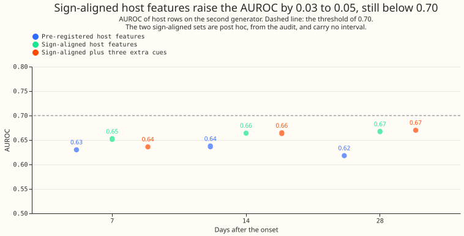

**Six summary numbers computed from one substation's last 14 days of power did not tell a permanent
level change from a temporary load move well enough, and the experiment cannot say whether better
summaries would.** We injected both kinds of change into the power history of a substation (the
host), and tested the summaries on events from a second generator of injected events that the
classifier never saw. The area under the receiver operating characteristic curve (AUROC) was 0.63 at
7 days after the onset (the day the change begins) and 0.64 at 14 days. An AUROC of 0.50 is chance
and 1.00 is perfect, and we had set 0.70 as enough. Verdict: **inconclusive**.

**The result does not support the claim that these six summaries are enough, and it narrows the
search in two ways.** First, most of the separation comes from temporary moves that had already
ended before the forecast origin (a post hoc reading): on moves still in force at the origin, the
AUROC was 0.53 at 14 days, close to chance. Second, the error of the weather-only estimate of normal
demand is as large as many of the injected changes (a median absolute error of 3.0 to 3.5 points of
capacity), and the same host summaries computed without that error scored 0.81 at 7 days and 0.86 at
14 days (0.92 with the neighbour summaries added).

**A next experiment could test a better estimate of normal demand, neighbour rows read while a move
is in force, and era labels ([experiment 712](../00712-clean-era-labels-part-1/result.md)) before a
neural network is trained on a single substation.** The era labels are a lean and the neighbour rows
a hypothesis, not findings. The frozen probe named in the title was not run, because [experiment
713](../00713-msa-axial-attention-demand-network-part-1/result.md) stored no vectors for the probe
to read.

**We asked whether the 14 most recent days of a substation's own power show if a level change will
last.** The substation is a Primary, one of the 16 primary substations ("Primaries") that the
project forecasts for National Grid Electricity Distribution (NGED), an electricity distribution
network operator. We call the Primary that receives an injected event the host. A permanent change,
such as a large generator or solar farm connecting, starts a new era in the Primary's demand, and a
forecast should follow the new era. A temporary load move transfers demand between Primaries for
days or weeks and then reverts, and a forecast should not carry the temporary move forward. In
[experiment 709](../00709-era-signal-in-the-candidate-part-1/result.md), the era signals that helped
most after an injected permanent change also hurt most after an injected temporary move. The planned
experiment 713 feeds the last 14 days of one Primary to an attention neural network (an MSA neural
network, named after the multiple sequence alignment that [Jumper et al.
(2021)](https://doi.org/10.1038/s41586-021-03819-2) used in AlphaFold 2) and reads whether the
network separates the two classes in its secondary readings R2 (the gain after injected permanent
changes) and R3 (the harm after injected temporary moves). Follow-ups F3 and F4, planned experiments
that read this result, test older rows and neighbour rows in that network.

**The test builds a small classifier by hand, fits no neural network, and reads only injected
events.** For each event, a logistic regression turns summaries of the host's 14 days before the
forecast origin into a score. The AUROC is the chance that a randomly chosen permanent change scores
higher than a randomly chosen temporary move. The events come from two sources: experiment 709's
stored bank of injected passes (a pass is one injection run over the panel of 16 Primaries), and a
second generator of events. A set of injected events from one source is a world. By host rows we
mean six summaries of the host's last 14 days, by older rows four summaries of 6 earlier single
days, and by neighbour rows two summaries of the electrical neighbours' summed change. A summary
read alone is a cue.

## Figures

**Host rows alone score 0.63 to 0.64 on the second generator at 7 and 14 days, and the intervals
straddle the 0.70 bar.** The bank scores higher at 7 and 14 days, because its score comes largely
from the sign of the change and from which Primary hosts the event (Headline numbers, sign and
Primary routes).

**On temporary moves still in force at the origin (not yet reverted), host rows score close to
chance.** The headline therefore mostly detects reversion. By the 14-day origin, 53% of the second
generator's temporary moves have ended (41% at 7 days, 68% at 28 days), and host rows separate those
ended moves from permanent changes with an AUROC of 0.73 (post hoc).

**Sign-aligned features raise the AUROC by between 0.006 and 0.052 and still fall short of 0.70.**
The two sign-aligned sets are post hoc and come from the audit.

**No raw cue separates every kind of permanent change from temporary moves.** The flat step is
flatter than the average temporary move, so the flatness cue points the wrong way for that kind, and
the quantised step scores between 0.43 and 0.59 on every cue. The intermittent kind comes from a
separate, smaller world, and the readings of that kind are secondary.

**The six example hosts show the signal the classifier has to find.** The orange dashed line marks
the onset, the axis counts days (never calendar dates), and the hosts are anonymised.

**Each kind of permanent change has a different daily profile, and the temporary moves follow the
donor's profile in part.** Each profile is divided by its own daily mean, so a constant change plots
at 1.

## Arms and design

- **Arms.** Three input sets, each fitted by its own logistic regression with a ridge (L2) penalty:
  host rows, host rows plus older rows, and host rows plus neighbour rows. The controls are a
  depth-2 boosted tree on the same summaries, shuffled labels, neighbours rewired to an unlinked
  Primary, a no-event placebo on the real panel, and a known-answer reading that replaces the
  reference level by the real power.
- **Design.** Each event is read at 7, 14, and 28 days after its onset, with whole fold months held
  out in turn. The classifier is given the true onset day.
- **Second generator.** The generator reuses [experiment
  660](../00660-shared-generator-of-injected-load-transfer-events/result.md)'s generator for the
  temporary moves, with new seeds and a new draw of hosts, neighbours, and durations. It adds three
  permanent kinds that experiment 709 lacks: a step that follows the host's daily profile, a
  daylight-only step, and a quantised step in 2 or 3 levels. Step sizes come from a grid of -15%,
  -5%, +8%, and +30% of capacity.
- **Mirror.** A temporary move takes demand from a donor Primary and gives a share to a receiver
  Primary, which is the mirror. The mirror is full when the metered receiver gets 0.9 to 1.0 of the
  donor's loss, partial when it gets 0.3 to 0.7, and hidden when the receiver is not metered.
- **Load-shift assumption.** A load shift is assumed to be a roughly constant decrease in megawatts
  at the donor and a matching increase at the receiver. A switched circuit that behaves like a
  generator or a solar farm is not modelled, and the classifier would misread it as a permanent
  change.

## Row set

- **Second generator.** 128 passes (32 for each of the fold months 2025-11, 2026-01, 2026-04, and
  2026-06), each with 2 permanent changes and 2 temporary moves: 256 permanent and 256 temporary
  events, and 1,536 table rows at three origins. A fold month is a month held out of fitting in
  turn. The passes were chosen from 512 candidates to balance the Primaries across the classes
  (Method).
- **Experiment 709's bank.** 64 passes (16 for each fold month), 128 permanent and 128 temporary
  events, read only and not rebalanced.
- **Intermittent world.** 32 passes (8 for each fold month) with 64 permanent changes of a fifth
  kind and 64 temporary moves, used for secondary results only. The code names this world `gas`.
- **Host panel.** 13 of the 16 Primaries host events, because D8, D15, and D18 are excluded (D8
  keeps its real eras unmixed with injected ones, and D15 and D18 have no climatology). The cleaned
  power table already has the `substation_zero` half-hours missing. The cut of D15 and D18 before
  2025-03-01, from [`data-processing.md`](../data-processing.md), drops no row, because every scored
  month falls later.

## Headline numbers

- **Pre-registered contrasts (99.17% intervals, second generator).** C1, the host-row AUROC at 7
  days, is 0.630 (0.554 to 0.705). C2, at 14 days, is 0.637 (0.546 to 0.726). C3, at 28 days, is
  0.618 (0.510 to 0.760).
- **Verdict by the pre-registered rule, read literally.** "Enough" needs the lower ends of C1 and C2
  at 0.70 or more, and they are 0.554 and 0.546. "Not enough" needs the upper end of C1 or C2 below
  0.70, and they are 0.705 and 0.726. Neither holds, so the stated outcome is "neither enough nor
  not enough on the second generator; F4 stopped". The 7-day upper end clears the bar by 0.005,
  which is about the bootstrap's noise between two seeds (a fresh reviewer's own bootstrap gave
  0.704).
- **Outside the rule.** In the bootstrap, 0.6% of draws reach 0.70 at 7 days and 4.0% at 14 days.
  The 14-day host AUROC by fold month is 0.642 (2025-11), 0.583 (2026-01), 0.700 (2026-04), and
  0.655 (2026-06), so the lower ends sit about 0.04 to 0.05 below the worst fold month. The depth-2
  boosted tree scores 0.621, 0.634, and 0.655 at the three origins, and refitting without the
  temporary moves of 60 to 120 days gives 0.623, 0.646, and 0.636.
- **Older rows (C4).** Adding older rows lowers the 14-day AUROC by 0.029 (-0.068 to +0.001), in 3
  of 4 fold months.
- **Neighbour rows (C5).** Adding neighbour rows raises the 14-day AUROC on events with a metered
  mirror by 0.052 (-0.014 to +0.130), to 0.690 (0.596 to 0.781). On events with a hidden mirror the
  change is -0.028 (-0.148 to +0.062). The rule stops F4 because the lower end is below +0.05.
- **Bank against second generator (C6).** The bank's host-row AUROC at 14 days is 0.766, which is
  0.129 above the second generator (-0.007 to +0.272), so an injector artefact is neither confirmed
  nor excluded. At 7 and 28 days the bank scores 0.735 and 0.570.
- **Sign and Primary routes.** The sign of the change alone scores 0.547, 0.541, and 0.527 on the
  second generator and 0.672, 0.691, and 0.605 on the bank, because all of the bank's temporary
  moves are decreases. The Primary alone, from the other fold months' labels, scores 0.472 on the
  second generator and 0.671 on the bank. Ranking only pairs at the same Primary gives 0.641, 0.649,
  and 0.640 on the second generator and 0.731, 0.775, and 0.589 on the bank.
- **In force and ended.** These results use 99.17% intervals from 2,000 bootstrap draws in
  `e00714_posthoc_figures.py`, not the stored 95% secondary intervals. Against moves still in force
  the AUROC is 0.589 (0.504 to 0.677), 0.530 (0.446 to 0.627), and 0.490 (0.376 to 0.664) at 7, 14,
  and 28 days. Against moves that had ended (post hoc) it is 0.690 (0.596 to 0.775), 0.732 (0.599 to
  0.853), and 0.679 (0.581 to 0.803).
- **By kind at 14 days (secondary).** Second generator: daylight-only 0.693, flat 0.657,
  profile-following 0.638, quantised 0.559. Bank: a step of -10% scores 0.767, -25% scores 0.569,
  +15% scores 0.949, and the solar-shaped reduction scores 0.778. The +15% step is the only bank
  kind that raises power.
- **Post hoc readings from the audit.** The sign-aligned host set scores 0.652, 0.664, and 0.667,
  and the aligned set plus three extra cues scores 0.636, 0.664, and 0.670, against 0.630, 0.637,
  and 0.618. The known-answer set (noiseless host and neighbour features) scores 0.916 and 0.924 at
  7 and 14 days, and the noiseless host features alone score 0.805 and 0.857. A depth-2 tree on the
  true size and the noiseless flatness scores 0.999, 0.996, and 0.984, an artefact of the generator
  (Caveats).
- **Predictions that held.** The 7-day and 14-day host predictions (0.60 to 0.70 and 0.60 to 0.72),
  the bank minus second generator at 14 days (+0.05 to +0.15), the rewired placebo, and the
  shuffled-label placebo.
- **Predictions that failed, with post hoc explanations from the audit.** Each explanation is a
  likely cause that the audit measured, with no decision rule.
    - **28-day host AUROC (predicted 0.65 to 0.78, observed 0.618).** By 28 days, 68% of temporary
      moves have ended, signed features cannot express "the change is still there", and the 14-day
      window no longer holds the onset.
    - **C4 (predicted +0.02 to +0.08, observed -0.029).** The older single days have twice the noise
      of the reference level, and the four extra features add estimation noise to a fit on about 384
      rows.
    - **Neighbour AUROC on mirrored events (predicted 0.85 or more, observed 0.690).** The reference
      noise of two or more neighbours enters the summed change, and 53% of mirrored moves have ended
      by 14 days. The noiseless mirror features alone score 0.989, and on in-force mirrored events
      the neighbour rows lift the AUROC from 0.511 to 0.686.
    - **Hidden-mirror change (predicted under 0.02, observed -0.028).** The change exceeds the
      prediction in absolute terms, and the interval is wide.
    - **Bank minus second generator at 28 days (predicted +0.05 to +0.15, observed -0.048).** Signed
      features cannot place the bank's -10% and -25% steps once the temporary moves sit near zero,
      and the aligned features raise the bank to 0.778.
- **Intermittent kind, predictions written before the full run (secondary).** Steps per day against
  moves still in force scores 0.718, 0.781, and 0.784, which meets the predicted 0.70 or more. Four
  predictions missed: flatness for that pair (predicted 0.40 to 0.60, observed 0.769, 0.814, and
  0.846), the flat kind and the profile-following kind on flatness at 14 days (0.28 and 0.37,
  predicted 0.40 to 0.60 and 0.65 or more), and the mirror cue against hidden-mirror moves
  (predicted 0.50 within 0.10, observed 0.544, 0.610, and 0.563). No explanation of these misses has
  been tested.
- **Real events.** The 82 labelled real events in the load-transfer logs are not scored, and no cue
  value of them is printed.

## Checks

- **Forecast checks.** The median forecast minus the mean forecast per site, and the error of the
  mean or median forecast beside each quantile-score contrast, do not apply, because no forecast is
  scored.
- **Controls.** Shuffled labels score 0.500 on the second generator and 0.510 on the bank. The
  no-event placebo scores 0.505 and 0.546. The rewired-neighbour AUROC minus the host-only AUROC at
  14 days is +0.002 (-0.021 to +0.020) and +0.013 (-0.027 to +0.088). The bank's known-answer AUROC
  is 0.964 to 0.973, and the second generator's is 0.916, 0.924, and 0.951, below the 0.95 that the
  plan applies to the bank. The intermittent world's site-prior gate (0.349) fails its non-gating
  band, so every reading of that world is weak.
- **Audit triggers, with the findings in the private file `briefs/msa_architecture/f1_audit.md`.**
  Triggers 2, 5, and 7 fired. Triggers 1, 3, 4, and 6 did not (trigger 1 with the disclosures in the
  Controls bullet). Leaving one site out leaves the 14-day host AUROC in 0.623 to 0.645, C4 in
  -0.034 to -0.027, and C6 in +0.114 to +0.156.
    - **Trigger 2 (a result contradicts its prediction).** Five predictions failed, plus four of the
      intermittent kind. The audit explained the five post hoc, and the explanations stay untested.
    - **Trigger 5 (a nested arm beats the arm that contains it).** Host rows beat host plus older
      rows at all three origins. The audit's cause is noisy older rows, so the result does not
      decide F3.
    - **Trigger 7 (a later design depends on the result).** F3, F4, experiment 712, and experiment
      713 read the result. Nothing replicates C1 to C6, and each later design is told not to cite C4
      or C5 as an effect.
- **Reviews that ran.** Four fresh code reviews ran before the first full run, each triaged. A fresh
  result review re-derived every headline number (the AUROCs agree to 3 decimals, the interval ends
  within 0.004). A fresh Opus agent audited the result, found no bug, leak, or row-order fault, and
  raised three should-fix items (S1 to S3, in Caveats). Two further fresh reviews checked this
  write-up's numbers and prose, and the page applies their findings. There was no plan review or
  design review.
- **Leakage.** A test scrambles the power, the reference level, and the weather at and after the
  data cut, and every feature stays identical. Folds hold out whole fold months, and the
  standardising statistics and the penalty come from the training months only.
- **Rows.** The panel read 325,953, 331,803, 340,140, and 329,042 half-hours for the four fold
  months (summed over the Primaries in each data window), of which 15,807, 9,957, 1,620, and 1,198
  are missing and none is an exact zero. No event is dropped, except that two of the bank's 256
  events and one of the second generator's 512 have no rewired neighbour set.
- **Unlogged events.** NGED's load-transfer logs may miss real events, so the real panel under the
  injected events may hold changes that no label covers. The unlogged events cannot change a score,
  because only injected events are scored, but they matter for the background: two host-months carry
  reference errors of about 13 to 26 points of capacity that look like real, unlogged changes.

## Caveats

- **The reference level's error limits every reading.** The weather-only reference level has a
  median absolute error of 3.0 to 3.5 points of capacity at the host (standard deviation 5.5 to 8.4
  points), against injected steps of median size 11 points. The standard deviation by fold month at
  14 days is 5.3, 9.8, 7.6, and 5.4 points. Centring each host on its own 14 pre-onset days lowers
  the AUROC to 0.609 at 7 days and 0.573 at 14 days, so the error drifts and is not a fixed offset.
  Every AUROC here is conditional on this reference level, and a neural network that reads the same
  14 rows has no better one (audit S1).
- **Signed features hide class information.** In a world balanced by sign, a logistic regression
  cannot form the product of a feature with the sign of the change, which is where several cues lie
  (audit S2).
- **Flatness hardly responds to a profile-following step.** The correlation of the post-onset change
  with the host's own pre-onset profile separates that kind from all temporary moves with an AUROC
  of 0.78 to 0.82 (post hoc), so the weak score of that kind (0.638 for host rows, 0.37 for the
  flatness cue) is a feature gap and not an identifiability limit (audit S3).
- **A quantised step is an identifiability limit for this generator.** The step is constant within
  each day, like a temporary move, and differs only in day-to-day levels of 1.7 to 2.5 points for a
  -5% step, below the daily reference noise. The claim holds for this generator's kinds, which are
  guesses from the memo behind the plan.
- **Most of the headline detects moves that have ended.** Durations are log-uniform from 1 to 112
  days, so 53% of temporary moves have ended by 14 days. The in-force reading is the better guide to
  a sustained move.
- **Two lab shortcuts make the AUROC optimistic, and one makes it pessimistic.** The classifier is
  told the true onset, so the AUROC is an upper bound on what an online detector could reach. The
  ERA5 reanalysis (the European Centre for Medium-Range Weather Forecasts' estimate of past weather)
  stands in for the weather analysis that a live forecast reads at the origin, and the reanalysis
  arrives about 5 days late in live use, so the last 5 days are read more accurately than a live
  forecast could read them. The features are six hand-built summaries and not a neural network,
  which makes the AUROC pessimistic for a neural network that may find signatures the summaries
  miss.
- **Departures from the plan.** The first three follow from code reviews and not from a classifier
  AUROC, except that the site-prior band was set after the kept value was known.
    - **Balanced selection.** 128 passes are selected from 512 candidates (site-prior AUROC 0.589 to
      0.472), and half of the temporary moves are scored at the receiving Primary (Method).
    - **Neighbour features.** The features are centred on each site's own 14 pre-onset days, which
      leaves no-event medians of -0.10 to -0.23 and puts 10% to 20% of `mirror_share` rows at the
      clip, equally in both classes.
    - **Site-prior band.** The 0.10 band cannot fail on the kept passes, and it is two-sided because
      balanced selection biases the leave-one-month-out reading downwards.
    - **No plan review.** The plan said that a plan review would settle the reference level, and
      none ran.
    - **Six host summaries.** The plan listed four host summaries, and the page uses six (adding
      flatness and the change of the last 3 days), plus four older-row and two neighbour summaries
      that the plan did not itemise.
    - **Intermittent world.** The world and its predictions entered after the plan commit and a
      smoke run, so "pre-registered" for those predictions means written before the full run.
- **The tree ceiling is a generator artefact.** A depth-2 tree on the true size and noiseless
  flatness scores 0.984 to 0.999 because permanent sizes lie on a grid of four values and flat and
  quantised steps are exactly constant within a day. The artefact is not evidence that the classes
  are separable given the generator. The realistic ceiling lies between the noisy 0.63 and the
  noiseless 0.81 to 0.92.
- **The bank cannot be rebalanced, and the second generator is one draw.** The bank's site prior is
  0.671 and its temporary moves are decreases only, so every bank reading is read beside the
  sign-only and Primary-stratified numbers. The second generator has one seed, four fold months, 128
  passes, and 13 host Primaries.
- **What the result does not say.** The result does not show that host rows are "not enough", that
  no loss or input stem can pass R2 and R3 together, that neighbour rows do not help, that the
  bank's classes are an injector artefact, that older rows cannot help a neural network that adjusts
  them for weather, or that the classes are separable given the generator.
- **F4 runs despite the stop rule.** The pre-registered rule stops F4, and the maintainer asked for
  F4 by name on 2026-11-20 after reading this result, so the rule is overridden. The result is not
  evidence for or against F4, and F4 should not cite C5's +0.052 as its expected effect.

## What to try next

- **Improve the reference level before reading cues.** Test a reference level whose error is well
  below the injected steps, such as a lag-free forecast at the Primary, and re-read the host-row
  AUROC on in-force moves.
- **Read neighbour rows from one metered neighbour while a move is in force (a hypothesis for F4).**
  F4 could score in-force and ended moves separately, and a best-single-neighbour mirror may cut the
  noise of the neighbours' summed change.
- **Prefer era labels to a single-Primary loss (a lean, not a verdict).** The host-only AUROC stayed
  below 0.70 under every variant tried, so [experiment
  712](../00712-clean-era-labels-part-1/result.md)'s era labels are the next result to read.
- **Read experiment 713's R2 and R3 on the second generator, by kind.** The bank separates the
  classes by sign, so a neural network could pass R2 on the bank by sign alone.
- **Test weather-adjusted older rows (F3).** The result says nothing about the 364-day row alone.

## Method

**Architecture (no neural network).**

- **Rows.** Each event at each origin (7, 14, or 28 days after the onset day, at 09:00 UTC) gives
  one table row of summaries computed from the 14 days of power that end 6 hours before the origin
  (the data cut), as shares of capacity.
- **Reference level.** A weather-only linear fit per Primary and per fold month, on real uninjected
  power. Experiment 667's stored forecasts cannot serve, because they start on 2025-11-01 and read
  lags. The fit regresses power on 96 calendar dummies (half-hour of the day, weekday or weekend),
  daily mean ERA5 temperature and its square, ERA5 shortwave radiation and its square, and the
  annual cycle, with ridge penalty 0.001, over the 730 days that end 28 days before the start of the
  fold month. The fit reads the daily mean temperature of the UTC day, so the 6 half-hours from
  00:00 to 02:30 on the data-cut day read temperatures after the origin.
- **Host features (six).** The median change against the reference level; the shape-flatness of the
  change (the absolute mean of the daily profile over its root mean square, 1 for a constant number
  of megawatts); the night-to-midday contrast; the correlation across days of the daily change with
  daily mean shortwave; the share of days with the change at the sign of the median; and the change
  of the last 3 days minus the median change.
- **Older-row features (four).** The change against the median of 6 single same-weekday days at ages
  21, 28, 42, 63, 91, and 364 days before the origin (left out when the day ends after the onset),
  their spread, the ratio of the two, and the shape-flatness of the change against their median.
- **Neighbour features (two).** Each site is measured against its own mean change at each half-hour
  of the day over the 14 days before the onset. With `h` the host's median post-onset step in
  megawatts (MW), `n` the median post-onset step of the neighbours' summed change in MW, `s_h` the
  standard deviation of the host's daily means before the onset, and `s_n` the same for the
  neighbours' sum, `mirror_share` is `-n * h / (h^2 + s_h^2)` clipped to plus or minus 2, and
  `mirror_z` is `-sign(h) * n / s_n` clipped to plus or minus 10. The neighbours of an event are the
  host's electrical neighbours without the sites of other events of the pass, and D8, D15, and D18
  stay in the neighbour sets. With no event, the medians of both features are slightly negative
  (-0.10 to -0.23 and -0.09 to -0.24 in most cells of the second generator), because centring does
  not remove the drift of the reference level's shared error. A partial mirror scored at the
  receiver has a true donor loss of 1.835 MW for each 1 MW of recipient gain, so noise dominates:
  the feature has a median of 0.21 at 14 days, and 22% of those events sit at the clip.
- **Step features (two, secondary).** Steps per day and the fraction of half-hours at the high
  level.

**Training regime.**

- **Classifier.** A logistic regression with a ridge (L2) penalty (numpy and scipy, because
  scikit-learn is not a declared dependency), fitted separately for each origin. The penalty comes
  from leaving one training fold month out at a time, over 0.01, 0.1, 1, 10, and 100. The
  standardising statistics and the fill value for a missing feature come from the training passes. A
  split by pass would put the same real background on both sides, because every pass of a fold month
  has its onset on day 1 or 2 of that month.
- **Boosted tree (sensitivity).** XGBoost, with depth 2, 80 trees, and learning rate 0.1, on the
  host and host-plus-neighbour features.
- **Worlds.** The 64 bank passes are read, never written, from experiment 709's stored files. The
  second generator's 128 passes use seeds 714,100,000 and up, onsets at a random half-hour on day 1
  or 2 of the month, and a random order of the 2 temporary moves and 2 permanent changes of a pass.
  No event of a pass sits in the neighbour set of another event. The gain of a recipient in a
  flipped metered move is capped at 60% of its capacity.
- **Balancing the Primaries across the classes.** A Primary that hosts mostly permanent changes lets
  a classifier recognise the Primary instead of the event: with the temporary moves placed before
  the permanent changes, the share of permanent changes at a Primary in the other 3 fold months has
  an AUROC of 0.70 on the second generator's truth tables and 0.67 on the bank. The builder
  therefore generates 4 times as many candidate passes (128 for each fold month) and keeps the 32
  for each fold month that minimise the squared difference between permanent and temporary events at
  each Primary, replacing a candidate only with one of the same mirror states, kinds, and step
  sizes. The site-prior AUROC is 0.589 for the candidates and 0.472 for the kept passes, and the
  analysis prints it beside a site-stratified AUROC, which ranks only pairs at the same Primary. The
  intermittent world is balanced the same way, but 8 passes for each fold month leave little to
  choose from (0.585 and 0.349), and its value does not gate. The second generator's gate (within
  0.10 of 0.50) was set when 0.472 was known, and it is two-sided because balanced selection pushes
  the leave-one-month-out prior below 0.5. The bank cannot be rebalanced, so every bank reading is
  read beside the bank's site-stratified AUROC, and a companion C6 within each Primary (secondary,
  95% interval) is printed.
- **Which Primary is scored in a temporary move.** In the bank the scored Primary is always the
  donor, so the change is a decrease, while 25% of its permanent changes are increases, so a
  classifier that read only the sign would score above 0.5. In the second generator, half of the
  temporary moves are scored at the receiving Primary, so the sign mix matches the permanent
  changes. The analysis prints a sign-only AUROC beside C1 to C3 and C6.
- **Splits.** Leave one fold month out. The cross-generator reading fits on one world's other 3 fold
  months and scores the other world's fourth fold month. Both worlds share the same real panel, so
  the reading shows only whether the shape of the host rows transfers, and the bank's site
  preferences pull the reading down.
- **Cleaned data.** The cleaned power table has the `substation_zero` half-hours already set to
  missing, and the feature build prints the missing half-hours and exact zeros for each data window.
- **Compute.** CPU only, 2 cores, one linear-algebra thread, an 8 GB memory cap with no swap, and no
  GPU. The three feature builds took 14, 24, and 9 seconds, the analysis 3 minutes 47 seconds, and
  the figures 8 seconds, with a peak resident memory of 0.61 GB. The `generate` step of the second
  generator was not run in the logged session. The frozen probe was not run.

**Measurement.**

- **Metric.** The AUROC for the label "permanent" against "temporary", pooled over the out-of-fold
  predictions of the four fold months.
- **Intervals.** A bootstrap that resamples whole passes within fold months and then fold months,
  10,000 draws, at 99.17% for the six planned contrasts (C1 to C6), with the predictions not
  refitted per draw. Secondary results use 95% intervals unless the page says otherwise. Resampling
  four fold months with replacement repeats one fold month 4 times in 1.6% of draws, which is more
  than the 0.42% of each tail.
- **Secondary results.** The sign of the change alone; C6 on decreases only; C1 to C3 and C6 on the
  permanent changes and the temporary moves still in force at the data cut; and each raw cue in the
  direction the plan states (a higher score means a permanent change: more steps, a lower high-level
  share, a less flat profile, no mirror). The negatives are all temporary moves, those still in
  force, or those with a metered or a hidden mirror. C5 and its companions use one subset each: the
  mirrored subset (every permanent change plus the temporary moves with a full or partial mirror) or
  the hidden subset.
- **Placebos.** Class labels shuffled within each pass (20 permutations); neighbours rewired to
  those of an unlinked Primary, leaving out the host, the host's own neighbours, and every site of
  an event of the pass (mean rewired set size 2.17 on the second generator and 2.14 on the bank);
  the no-event placebo, which scores the classifier on the real panel at the same hosts and onsets;
  and the known-answer, which replaces the reference level by the real power.
- **Decision flags.** Each world is audited by its own placebos: shuffled labels within 0.03, the
  rewired-neighbour AUROC within 0.03 of the host-only AUROC at 14 days, and the no-event placebo
  within 0.05 of 0.50. The second generator's audit also needs the site-prior AUROC within 0.10 of
  0.50. A failed audit makes that world's contrasts inconclusive, and the bank's no-event placebo
  never gates the second generator. "Enough" needs both worlds to clear 0.70 with clean audits. A
  failed known-answer control (AUROC not above 0.95) makes the stated outcome "uninterpretable". The
  injector-artefact outcome needs C6's interval above +0.10 and a second generator below 0.70. The
  neighbour-row stop is the complement of C5's lower end being at least +0.05.
- **Audit check.** A test scrambles the power, the reference level, and the weather at and after the
  data cut and requires every feature to stay identical.

## Files

- `ml-experiments/00714-msa-era-identifiability-audit-and-frozen-probe/` holds `e00714_common.py`
  (constants, the bank loader, the reference level), `e00714_generator2.py` (the second generator
  and the intermittent world `gas`, built on experiment 660's generator), `e00714_features.py`,
  `e00714_build.py` (generates the passes and builds the feature tables), `e00714_model.py`
  (logistic regression, boosted tree, cross-validation, bootstrap), `e00714_analyse.py` (contrasts,
  placebos, secondary results, outcome table), `e00714_threads.py` (one thread per library), and
  `test_e00714.py` (unit and known-answer tests on synthetic data).
- `e00714_figures.py` draws the first three figures. `e00714_posthoc_figures.py` draws the other
  three: in force versus ended (computed from the stored out-of-fold probabilities, 2,000 draws),
  sign-aligned (post hoc constants from the audit), and raw cues.
- `data/ml-experiments/00709-era-signal-in-the-candidate-part-1/worlds/bank_<month>_p<pass>.pkl`
  (read only, private): experiment 709's 64 injected passes. See the [experiment 709
  write-up](../00709-era-signal-in-the-candidate-part-1/result.md).
- `data/ml-experiments/00714-msa-era-identifiability-audit-and-frozen-probe/` (private): the second
  generator's passes (`worlds/`), the feature tables (`features/{bank,g2,gas}.parquet`), and
  `results/` with `primary_contrasts.json`, `placebos.json`, `sensitivity.json`,
  `coefficients.json`, `calibration.csv`, `raw_cues_by_kind.csv`, `secondary_cues_by_kind.csv`,
  `outcome_table.md`, and `oof_{bank,g2}_k{7,14,28}.parquet`.
- `data/ml-experiments/briefs/msa_architecture/` (private): `era_and_extensions.md` and
  `followup_queue.md` (the memo and queue that define follow-up F1), the reviews
  (`f1_code_review_{1..4}.md` with triage, `f1_result_review.md`, `f1_audit.md`,
  `f1_writeup_numbers_review.md`, `f1_writeup_prose_review.md`), `run_log_714.md`, and
  `f1_audit_scripts/` (the audit's own scripts for its post hoc readings).
