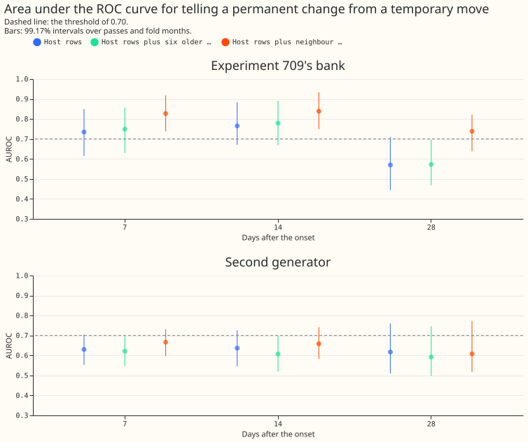
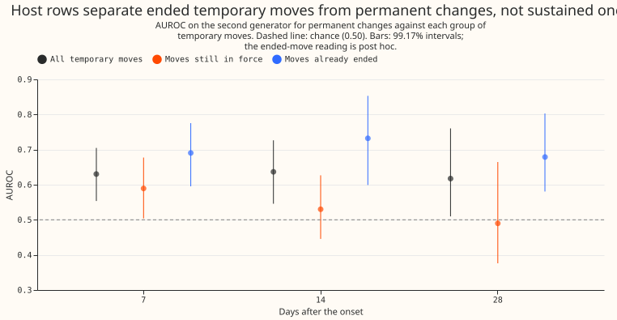
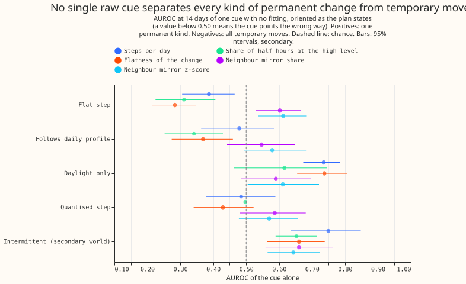
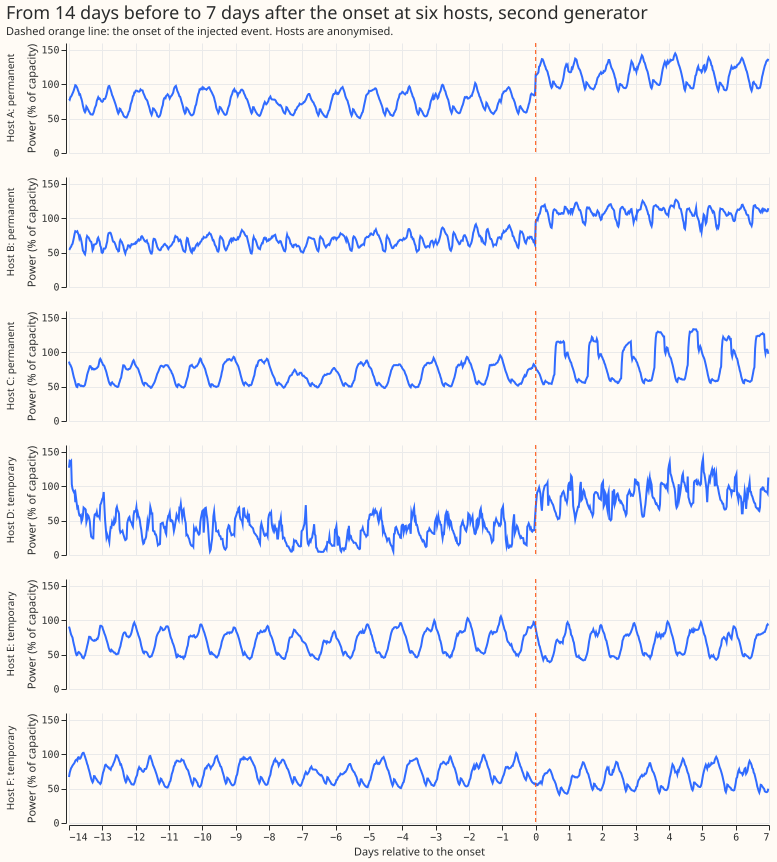
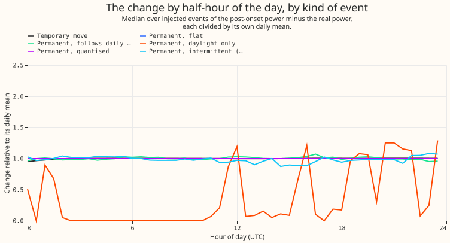

**Six summary numbers computed from one substation's last 14 days of power did not tell a permanent
level change from a temporary load move well enough, and the experiment cannot say whether better
summaries would.** On events from a second generator that the classifier never saw, the area under
the receiver operating characteristic curve (AUROC) was 0.63 at 7 days after the change began and
0.64 at 14 days. An AUROC of 0.50 is chance and 1.00 is perfect, and we had set 0.70 as enough. The
result rules out the claim that these six summaries are enough, and it narrows the search in two
ways. First, most of the separation comes from temporary moves that had already ended before the
forecast origin: on moves still in force the AUROC was 0.53 at 14 days, close to chance. Second, the
error of the weather-only estimate of normal demand is as large as many of the injected changes (a
median absolute error of 3.0 to 3.5 points of capacity), and the same host summaries computed
without that error scored 0.81 at 7 days and 0.86 at 14 days (0.92 with the neighbour summaries
added). The next experiments should therefore try a better estimate of normal demand, neighbour rows
read while a move is in force, and era labels ([experiment
712](../00712-clean-era-labels-part-1/result.md)) before they train a loss on a single substation.
The maintainer queued the neighbour-row follow-up (F4) after reading this result, although the
pre-registered rule stops it. Verdict: **inconclusive**.

**We asked whether the 14 most recent days of a substation's own power show if a level change will
last.** The substation is a Primary, one of the 16 Primary substations ("Primaries") of one
electricity network operator. A permanent change, such as a large generator or solar farm
connecting, starts a new era in the Primary's demand, and a forecast should follow it. A temporary
load move transfers demand between Primaries for days or weeks and then reverts, and a forecast
should not carry it forward. In [experiment
709](../00709-era-signal-in-the-candidate-part-1/result.md), the learned era signals that lowered
the error most after an injected permanent change also raised the error most after an injected
temporary move. The planned [experiment
713](../00713-msa-axial-attention-demand-network-part-1/result.md) feeds the last 14 days of one
Primary to an attention network (an MSA network, named after the multiple sequence alignment that
[Jumper et al. (2021)](https://doi.org/10.1038/s41586-021-03819-2) used in AlphaFold 2) and reads
whether the network separates the two classes in its secondary readings R2 (the gain after injected
permanent changes) and R3 (the harm after injected temporary moves).

**The test builds a small classifier by hand, fits no neural network, and reads only injected
events.** For each injected event, the classifier computes six summary numbers from the host's 14
days before the forecast origin: the size of the change against a reference level, how constant the
change is across the day, the change at night against midday, the correlation of the daily change
with shortwave irradiance, the share of days with the change at the same sign, and the change of the
last 3 days against the median change. A logistic regression turns the summaries into a score, and
the AUROC is the chance that a randomly chosen permanent change scores higher than a randomly chosen
temporary move. The events come from two sources: [experiment
709](../00709-era-signal-in-the-candidate-part-1/result.md)'s stored bank of injected passes, and a
second generator of events that the classifier never saw in fitting. The page reports the AUROC of
host rows, of host rows plus six older rows, and of host rows plus the rows of the electrical
neighbours, at 7, 14, and 28 days after the onset.

## Figures

**The host rows alone score 0.63 to 0.64 on the second generator at 7 and 14 days, and the intervals
straddle the 0.70 bar.** The bank scores higher at 7 and 14 days, and the page shows below that the
bank's score comes largely from the sign of the change and from which Primary hosts the event.

**On temporary moves still in force at the origin, host rows score close to chance, so the headline
mostly detects moves that have ended.** By the 14-day origin, 53% of the second generator's
temporary moves have ended (41% at 7 days, 68% at 28 days), and the host rows separate those moves
from permanent changes with an AUROC of 0.73.

**Sign-aligned features raise the AUROC by 0.03 to 0.05 and still fall short of 0.70.** The two
sign-aligned sets are post hoc and come from the audit.

**No raw cue separates every kind of permanent change from temporary moves.** The flat step is
flatter than the average temporary move, so the flatness cue points the wrong way for that kind, and
the quantised step scores near chance on every cue. The intermittent kind comes from a separate,
smaller world of 128 events, and its readings are secondary.

**The six example hosts show the signal the classifier has to find.** The orange dashed line marks
the onset, the axis counts days (never calendar dates), and the hosts are anonymised.

**Each kind of permanent change has a different daily profile, and the temporary moves follow the
donor's profile in part.** Each profile is divided by its own daily mean, so a constant change plots
at 1.

## Arms and design

- **Arms.** Three nested input sets, each fitted by its own logistic regression with an L2 penalty:
  host rows (six summaries), host rows plus older rows (four more summaries from six single
  same-weekday days at ages 21, 28, 42, 63, 91, and 364 days), and host rows plus neighbour rows
  (two more summaries of the neighbours' summed change). Controls are a depth-2 boosted tree on the
  same summaries, shuffled labels, neighbours rewired to an unlinked Primary, a no-event placebo on
  the real panel, and a known-answer reading that replaces the reference level by the real power.
- **Design.** Each event is read at 7, 14, and 28 days after its onset, with whole fold months held
  out. The classifier is given the true onset day, so each reading is an upper bound on what an
  online detector could see from these rows.
- **Second generator.** The generator reuses [experiment
  660](../00660-shared-generator-of-injected-load-transfer-events/result.md)'s generator for the
  temporary moves, with new seeds and a new draw of hosts, neighbours, and durations, and adds three
  permanent kinds that experiment 709 lacks: a step that follows the host's daily profile, a
  daylight-only step, and a quantised step in 2 or 3 levels. Step sizes come from a grid of -15%,
  -5%, +8%, and +30% of capacity.
- **Load-shift assumption.** A load shift is assumed to be a roughly constant decrease in megawatts
  at the donor and a matching increase at the receiver. A switched circuit that behaves like a
  generator or a solar farm is not modelled, and the classifier would misread it as a permanent
  change.

## Row set

- **Second generator.** 128 passes (32 for each of the fold months 2025-11, 2026-01, 2026-04, and
  2026-06), each with 2 permanent changes and 2 temporary moves, which gives 256 permanent and 256
  temporary events and 1,536 rows at three origins. Passes were chosen from 512 candidates to
  balance the Primaries across the classes.
- **Experiment 709's bank.** 64 passes (16 for each fold month), 128 permanent and 128 temporary
  events, read only and not rebalanced.
- **Intermittent world.** 32 passes (8 for each fold month), 64 permanent changes of a fifth kind
  and 64 temporary moves, used for secondary readings only.
- **Host panel.** 13 of the 16 Primaries host events. The `substation_zero` half-hours are already
  missing in the cleaned power table, and the build prints no exact zeros. The cut of D15 and D18
  before 2025-03-01 drops no row, because every scored month falls later.

## Headline numbers

- **Pre-registered contrasts (99.17% intervals, second generator).** C1, the host-row AUROC at 7
  days, is 0.630 (0.554 to 0.705). C2, at 14 days, is 0.637 (0.546 to 0.726). C3, at 28 days, is
  0.618 (0.510 to 0.760).
- **Verdict by the pre-registered rule, read literally.** "Enough" needs the lower ends of C1 and C2
  at 0.70 or more, and they are 0.554 and 0.546. "Not enough" needs the upper end of C1 or C2 below
  0.70, and they are 0.705 and 0.726. Neither holds, so the stated outcome is "neither enough nor
  not enough on the second generator; F4 stopped". The 7-day upper end clears the bar by 0.005,
  which is about the bootstrap's noise between two seeds (a fresh reviewer's own bootstrap gave
  0.704).
- **Outside the rule.** In the bootstrap, 0.6% of draws reach 0.70 at 7 days and 4.0% at 14 days.
  The unadjusted 95% intervals are 0.574 to 0.684 at 7 days and 0.571 to 0.706 at 14 days. The
  depth-2 boosted tree scores 0.621, 0.634, and 0.655 at the three origins, no better than the
  logistic regression. Dropping the temporary moves of 60 to 120 days gives 0.623, 0.646, and 0.636.
- **Fold months.** The 14-day host AUROC by fold month is 0.642 (2025-11), 0.583 (2026-01), 0.700
  (2026-04), and 0.655 (2026-06). Resampling 4 fold months with replacement puts each lower end near
  the worst fold month, so "enough" would have meant enough in every fold month.
- **Older rows (C4).** Adding six older rows lowers the 14-day AUROC by 0.029 (-0.068 to +0.001), in
  3 of 4 fold months.
- **Neighbour rows (C5).** Adding neighbour rows raises the 14-day AUROC on events with a metered
  mirror by 0.052 (-0.014 to +0.130), to 0.690 (0.596 to 0.781). On events with a hidden mirror the
  change is -0.028 (-0.148 to +0.062). The rule stops F4 because the lower end is below +0.05.
- **Bank against second generator (C6).** The host-row AUROC at 14 days on the bank is 0.766, which
  is 0.129 above the second generator (-0.007 to +0.272). The interval includes 0, so an injector
  artefact is neither confirmed nor excluded. The bank's AUROC at 7, 14, and 28 days is 0.735,
  0.766, and 0.570.
- **Sign and Primary routes.** The sign of the change alone scores 0.547, 0.541, and 0.527 on the
  second generator and 0.672, 0.691, and 0.605 on the bank, because all of the bank's temporary
  moves are decreases. The Primary alone, from the other fold months' labels, scores 0.472 on the
  second generator and 0.671 on the bank. Ranking only pairs at the same Primary gives 0.641, 0.649,
  and 0.640 on the second generator and 0.731, 0.775, and 0.589 on the bank.
- **In force and ended (post hoc for the ended reading).** On permanent changes against moves still
  in force, the AUROC is 0.589 (0.504 to 0.677), 0.530 (0.446 to 0.627), and 0.490 (0.376 to 0.664)
  at 7, 14, and 28 days. Against moves that had ended it is 0.690, 0.732, and 0.679. The share of
  temporary moves that had ended is 41%, 53%, and 68%.
- **By kind at 14 days (host rows against all temporary moves, secondary).** Second generator:
  daylight-only 0.693, flat 0.657, profile-following 0.638, quantised 0.559. Bank: a step of -10%
  scores 0.767, -25% scores 0.569, +15% scores 0.949, and the solar-shaped reduction scores 0.778.
  The +15% step is the only bank kind that raises power.
- **Sign-aligned features (post hoc, audit).** The aligned host set scores 0.652, 0.664, and 0.667,
  and the aligned set plus three extra cues scores 0.636, 0.664, and 0.670, against 0.630, 0.637,
  and 0.618 for the pre-registered set.
- **Ceiling readings (audit).** The known-answer set (noiseless host and neighbour features) scores
  0.916 and 0.924 at 7 and 14 days with a logistic regression, and the noiseless host features alone
  score 0.805 and 0.857. A depth-2 tree on the true size and the noiseless flatness scores 0.996 or
  more, which is an artefact of the generator (see Caveats).
- **Predictions that held.** The 7-day and 14-day host predictions (0.60 to 0.70 and 0.60 to 0.72),
  the bank minus second generator at 14 days (+0.05 to +0.15), the rewired placebo, and the
  shuffled-label placebo held.
- **Predictions that failed, with post hoc explanations from the audit.** Each explanation is a
  likely cause that the audit measured, and none has a decision rule. The 28-day host prediction
  (0.65 to 0.78) failed at 0.618, because 68% of temporary moves have ended by then and signed
  features cannot express "the change is still there", and the 14-day window no longer holds the
  onset. C4 (+0.02 to +0.08 predicted, -0.029 observed) failed because the older single days have
  twice the noise of the reference level and the four extra features add estimation noise to a fit
  on about 384 rows. The neighbour AUROC on mirrored events (0.85 or more predicted, 0.690 observed)
  failed because the reference noise of two or more neighbours enters the summed change and 53% of
  mirrored moves have ended by 14 days. The noiseless mirror features alone score 0.989, and on
  in-force mirrored events the neighbour rows lift the AUROC from 0.511 to 0.686. The bank minus
  second generator at 28 days (+0.05 to +0.15 predicted, -0.048 observed) failed because signed
  features cannot place the bank's -10% and -25% steps once the temporary moves sit near zero, and
  the aligned features raise the bank to 0.778.
- **Intermittent kind, pre-registered predictions (secondary).** Steps per day against moves still
  in force scores 0.718, 0.781, and 0.784, which meets the prediction of 0.70 or more at the three
  origins. The flatness cue, predicted at 0.40 to 0.60 for that pair, scores 0.769, 0.814, and
  0.846. The flat kind and the profile-following kind score 0.28 and 0.37 on flatness at 14 days,
  below the predicted 0.40 to 0.60 and 0.65 or more. No explanation of these gas-kind misses has
  been tested.
- **Real events.** The 82 labelled real events in the load-transfer logs are not scored and no cue
  value of them is printed, so the comparison with the injected events is not made.

## Checks

- **Median forecast minus mean forecast, per site.** Not applicable, because no forecast is scored.
- **Error of the mean or median forecast beside each quantile-score contrast.** Not applicable, for
  the same reason.
- **Controls.** Shuffled labels score 0.500 on the second generator and 0.510 on the bank. The
  no-event placebo scores 0.505 and 0.546. The rewired-neighbour AUROC minus the host-only AUROC at
  14 days is +0.002 (-0.021 to +0.020) and +0.013 (-0.027 to +0.088). The bank's known-answer AUROC
  is 0.964, 0.968, and 0.973. The second generator's is 0.916, 0.924, and 0.951, below the 0.95 that
  the plan applies to the bank. The intermittent world's site-prior gate (0.349) fails its
  non-gating band, so every reading of that world is weak.
- **Audit triggers.** Triggers 2, 5, and 7 fired. Trigger 2 (a result contradicts its prediction)
  fired for the four failed predictions above, and the explanations above are post hoc. Trigger 5 (a
  nested arm beats the arm that contains it) fired because host rows beat host plus older rows at
  all three origins. Trigger 7 (a later design depends on the result) fired because follow-ups F3
  and F4, experiment 712, and experiment 713 read the result. Triggers 1, 3, 4, and 6 did not fire.
  Leaving one site out leaves the 14-day host AUROC in 0.623 to 0.645, C4 in -0.034 to -0.027, and
  C6 in +0.114 to +0.156.
- **Reviews that ran.** Four Opus code reviews before the first full run, each triaged; a fresh
  result review that re-derived every headline number (the AUROCs agree to 3 decimals and the
  interval ends within 0.004); and an Opus audit of the result, which found no bug, leak, or
  row-order fault and three should-fix items (S1 to S3, in Caveats). There was no design review. The
  prose review has not run, and the pull request stays a draft until it has.
- **Leakage.** A test scrambles the power, the reference level, and the weather at and after the
  data cut, and every feature stays identical. Folds hold out whole fold months, and the
  standardising statistics and the penalty come from the training months only.
- **Rows.** The panel read 325,953, 331,803, 340,140, and 329,042 half-hours for the four fold
  months, of which 15,807, 9,957, 1,620, and 1,198 are missing and none is an exact zero. No event
  is dropped. Two of the bank's 256 events and one of the second generator's 512 have no rewired
  neighbour set, and their rewired features are missing.
- **Unlogged events.** NGED's logs may miss real events, so the real background panel may hold
  changes that no label covers. This experiment scores injected events only, so the check bears on
  the background: two host-months carry reference errors of about 13 to 26 points of capacity that
  look like real, unlogged changes.

## Caveats

- **The reference level's error limits every reading.** The weather-only reference level has a
  median absolute error of 3.0 to 3.5 points of capacity at the host (standard deviation 5.5 to 8.4
  points), against injected steps of median size 11 points, and the -5% and +8% steps fall within
  one or two standard deviations of the error. By fold month at 14 days the standard deviation is
  5.3, 9.8, 7.6, and 5.4 points. Centring each host on its own 14 pre-onset days leaves the error at
  7.5 to 7.7 points and lowers the AUROC to 0.609 and 0.573, so the error drifts and is not a fixed
  offset. Every AUROC on this page is conditional on this reference level, and a network that reads
  the same 14 rows has no better one (audit S1).
- **Signed features hide class information.** In a world balanced by sign, a logistic regression
  cannot form the product of a feature with the sign of the change, which is where several cues lie
  (audit S2).
- **Flatness hardly responds to a profile-following step.** The correlation of the post-onset change
  with the host's own pre-onset profile separates that kind from all temporary moves with an AUROC
  of 0.78 to 0.82 (post hoc), so the near-chance score for that kind is a feature gap and not an
  identifiability limit (audit S3).
- **A quantised step is an identifiability limit for this generator.** The step is constant within
  each day, like a temporary move, and differs only in its day-to-day levels, which for a -5% step
  are 1.7 to 2.5 points and fall below the daily reference noise. The claim holds for this
  generator's kinds, which are guesses from the memo behind the plan.
- **Most of the headline detects moves that have ended.** Durations are log-uniform from 1 to 112
  days, so 53% of the temporary moves have ended by 14 days. The in-force reading (0.59, 0.53, and
  0.49) is the better guide to a sustained move.
- **Lab shortcuts make the AUROC an upper bound in one way and optimistic in two.** The classifier
  is told the true onset. The features are six hand-built summaries, not a neural network. ERA5
  reanalysis stands in for the weather analysis that a live forecast reads at the origin, so the
  weather of the last 5 days before the origin is read more accurately than a live forecast could
  read it, and the 6 half-hours before the data cut read a daily-mean temperature that includes
  later hours.
- **Departures from the plan.** After the second code review, the builder selects 128 passes from
  512 candidates to balance the Primaries across the classes (site-prior AUROC 0.589 to 0.472). The
  0.10 band on the site-prior AUROC was set after 0.472 was known, so it cannot fail on the kept
  passes, and it is two-sided because balanced selection biases the leave-one-month-out reading
  downwards. Half of the second generator's temporary moves are scored at the receiving Primary, so
  the sign mix matches. The neighbour features are centred on each site's own 14 pre-onset days,
  which leaves no-event medians of -0.10 to -0.23 and puts 10% to 20% of `mirror_share` rows at the
  clip, equally in both classes. The three changes follow from code reviews and not from any AUROC.
- **The tree ceiling is a generator artefact.** The 0.98 to 1.00 AUROC of a depth-2 tree on the true
  size and noiseless flatness comes from permanent sizes on a grid of four values and from flat and
  quantised steps being exactly constant within a day. The artefact is not evidence that the classes
  are separable given the generator. The realistic ceiling lies between the noisy 0.63 and the
  noiseless 0.81 to 0.92.
- **The bank cannot be rebalanced.** Its site prior is 0.671, and it has decreases only among
  temporary moves, so every bank reading is read beside the sign-only and the Primary-stratified
  numbers.
- **The second generator is one draw.** It is a single seed with 4 fold months and 128 passes, and
  the host panel is 13 Primaries.
- **The frozen probe was not run.** Experiment 713 stored no vectors for the probe to read.
- **What the result does not say.** The result does not show that host rows are "not enough", that
  no loss or input stem can pass R2 and R3 together, that neighbour rows do not help, that the
  bank's classes are an injector artefact, that older rows cannot help a network that adjusts them
  for weather, or that the classes are separable given the generator.
- **F4 was queued after the stop.** The pre-registered rule stops F4, and the maintainer asked for
  it by name on 2026-11-20 after reading this result, so the stop rule is satisfied by that
  instruction. The result is not evidence for or against F4, and F4 should not cite C5's +0.052 as
  its expected effect.

## What to try next

- **Improve the reference level before reading signatures.** Test a reference level whose error is
  well below the injected steps, such as the Candidate's lag-free forecast at the Primary, and
  re-read the host-row AUROC on in-force moves.
- **Read the neighbour rows from one metered neighbour while a move is in force.** F4 should score
  in-force and ended moves separately, and a best-single-neighbour mirror may cut the noise of the
  neighbours' summed change. The idea is a hypothesis for F4, not a finding.
- **Prefer labels to a single-Primary loss, as a lean and not a verdict.** The host-only reading
  stayed below 0.70 under every variant tried, including the post hoc fixes, so [experiment
  712](../00712-clean-era-labels-part-1/result.md)'s era labels are the next step to read.
- **Report experiment 713's R2 and R3 on the second generator, by kind.** The bank separates the
  classes by sign, so a network could pass R2 on the bank by sign alone, and 713 should keep the
  +15% step apart.
- **Test older rows separately.** Follow-up F3 should weather-adjust the older rows, and the result
  says nothing about the 364-day row alone.

## Method

**Architecture (no neural network).**

- Each event at each origin (7, 14, or 28 days after the onset day, at 09:00 UTC) becomes one row of
  summary numbers computed from the 14 days of power that end 6 hours before the origin (the
  Candidate's data cut), as shares of capacity.
- **Reference level for the size of a change: a weather-only linear fit, fitted per Primary and per
  fold month.** Experiment 667's stored forecasts cannot serve as the reference. They start on
  2025-11-01, so the 14 days before the onset of the 2025-11 fold are not stored. Their
  normal-running-arrangement output reads the Candidate's lags, so it is not lag-free. The fit
  regresses the Primary's power on 96 calendar dummies (half-hour of the day, weekday or weekend),
  daily mean ERA5 temperature and its square, ERA5 shortwave radiation and its square, and the
annual
  cycle, ridge penalty 0.001, over the 730 days that end 28 days before the start of the fold month.
  It reads real, uninjected power only.
- **Host features (six).** The median change against the reference level; the shape-flatness of the
  change (the absolute mean of the daily profile over its root mean square, 1 for a constant
  number of megawatts); the night-to-midday contrast; the correlation across days of the daily
  change with daily mean shortwave; the share of days with the change at the sign of the median; and
  the change of the last 3 days minus the median change.
- **Older-row features (four).** Six single same-weekday days at ages 21, 28, 42, 63, 91, and 364
  days before the origin, left out when the day ends after the onset: the change against their
  median, their spread, the ratio of the two, and the shape-flatness of the change against their
  median. Experiment 709's injected panels hold the 364-day rows, because each stored panel covers
  the whole grid of 119,760 half-hours from 2019-09-01 to 2026-06-30.
- **Neighbour features (two).** Each site (the host and each neighbour) is measured against its own
  mean change at each half-hour of the day over the 14 days before the onset, which removes the
  reference level's error that neighbouring Primaries share. With `h` the median post-onset step of
  the host in MW, `n` the median post-onset step of the neighbours' summed change in MW, `s_h` the
  standard deviation of the host's daily means before the onset, and `s_n` the same for the
  neighbours' sum, `mirror_share` is `-n * h / (h^2 + s_h^2)`, clipped to plus or minus 2, and
  `mirror_z` is `-sign(h) * n / s_n`, clipped to plus or minus 10. Both are continuous: no step size
  below a fixed number of megawatts is set to 0. `mirror_z` reads the neighbours and only the sign
  of the host's step, so a large unmirrored step does not raise it. The neighbours of an event are
  the host's electrical neighbours, without the sites of other events of the same pass. A statistic
  built from the correlation before the onset minus the correlation over the whole span is not
  used, because a unit test shows that it rises with the size of an unmirrored step. D8, D15, and
  D18 stay in the neighbour sets, so real level shifts at those Primaries enter the neighbours'
  sum. With no event, the medians of `mirror_share` and `mirror_z` are slightly negative
  (-0.10 to -0.23 and -0.09 to -0.24 in most cells of the second generator), because centring does
  not remove the drift of the reference level's shared error after the onset, and 10% to 20% of the
  no-event rows of `mirror_share` sit at the clip. Both effects are the same in the two classes. A
  partial mirror that is scored at the receiving Primary carries a true ratio of the donor's loss to
  the recipient's gain of 1.835 in MW (the median of 1 over the mirrored fraction is 1.84), but
  the host's gain is small (median 0.41 MW), so noise dominates: the feature has a median of 0.21 at
  14 days, and 22% of those events sit at the clip. The analysis prints the share of rows at 0 and
  at the clip, by class.
- **Step features (two, secondary).** Steps per day and the fraction of half-hours at the high
  level.

**Training regime.**

- **Classifier.** A logistic regression with an L2 penalty (numpy and scipy, because scikit-learn is
  not a declared dependency), fitted separately for each origin. The penalty comes from leaving one
  training fold month out at a time, over 0.01, 0.1, 1, 10, and 100. A split by pass would put the
  same real background on both sides, because every pass of a fold month has its onset on day 1 or
  day 2 of that month. The standardising statistics
  and the fill value for a missing feature come from the training passes.
- **Boosted tree (sensitivity).** XGBoost, which is a declared dependency, with depth 2, 80 trees,
  and
  learning rate 0.1, on the host and host-plus-neighbour features.
- **Worlds.** Experiment 709's 64 bank passes (read only; the unpickler allows four globals, and
  `e00709_signal.Signal` is replaced by a stub, because importing it needs the chain
  `e00709_classify`, `e00687_features`, `e00598_signals` and further modules) and 128 passes of the
  second generator, 32 for each fold month, with seeds 714,100,000 and up. The second generator's
  passes have onsets at a random half-hour on the first or second day of the month. No event of a
  pass sits in the neighbour set of another event of the pass. The builder places the 2 temporary
  moves and the 2 permanent changes of a pass in a random order.
- **Balancing the Primaries across the classes.** A Primary that hosts mostly permanent changes
  lets a classifier recognise the Primary instead of the event. With the 2 transfers placed before
  the 2 permanent changes, the score "this Primary's share of permanent changes in the other 3 fold
  months" has an AUROC of 0.70 from the truth tables of the second generator alone, and 0.67 on
  experiment 709's stored bank, where the pass design cannot change. A random placement order alone
  gives 0.57 (random draws that keep the design cells give 0.568 with a standard deviation of
  0.031). The builder generates 4 times as many candidate passes (128 for each fold month) and
  keeps the 32 for each fold month that minimise the squared difference between the permanent and
  the temporary events at each Primary, over all months and within each month. A kept pass
  replaces only a candidate with the same mirror states, kinds, and step sizes. This design change
  follows from the second code review and not from any classifier AUROC. The builder prints the
  site-prior AUROC of the candidates (0.589) and of the kept passes (0.472), and the analysis
  prints the site-prior AUROC of both worlds and a site-stratified AUROC, which ranks only pairs
  of a permanent and a temporary event at the same Primary, beside C1 to C3. The stored bank
  cannot be rebalanced, so its reading is secondary. The gas world's 32 passes are balanced in the
  same way, but 8 passes for each fold month leave little to choose from (site-prior AUROC 0.585
  for the candidates, 0.349 for the kept passes). The balanced selection and the site-prior gate
  are departures from the pre-registration, made after the second code review. The gate was set
  when the kept value, 0.472, was already known, so it checks the build and cannot fail on the
  kept passes. It is two-sided: the second generator's site-prior AUROC must lie within 0.10 of
  0.50, because a balanced selection pushes the leave-one-month-out prior below 0.5 (a classifier
  fitted on the other 3 months learns site preferences that are reversed in the scored month,
  which biases the reading downwards). The gas world's value is printed beside every gas reading
  and does not gate. The bank's site route is known (0.671), so every bank reading is read beside
  the bank's site-stratified AUROC, and C6 includes the bank's site route. A companion C6 computed
  within each Primary (the bank's site-stratified AUROC minus the second generator's, secondary,
  95% interval) is printed beside C6.
- **Which Primary is scored in a temporary move.** In experiment 709's bank the scored Primary of a
  temporary move is always the donor, so its change is always a decrease, and 25% of its permanent
  changes are increases. A classifier that read only the sign of the change would therefore score
  above 0.5 on the bank. In the second generator, half of the temporary moves are scored at the
  receiving Primary (a gain), so the sign mix of the temporary moves matches the sign mix of the
  permanent changes (half increases). This design change follows from a code review and not from
  any AUROC. The page prints a sign-only AUROC beside C1 to C3 and C6, and a secondary C6 on the
  events with a decrease only.
- **Splits.** Leave one fold month out, so no pass and no fold month seen in fitting is scored.
  The cross-generator reading fits on one world's other 3 fold months and scores the other world's
  fourth fold month. Both worlds share the same real panel, the same fold months, and the same
  Primaries, so the reading shows only whether the shape of the host rows transfers.
- **Compute.** CPU only, 2 cores. `e00714_threads.py` sets the BLAS and OpenMP thread counts to 1
  before numpy loads, and XGBoost runs with one thread.

- **Compute.** CPU only, 2 cores, one BLAS thread, under a memory cap of 8 GB with no swap; no GPU.
  The three feature builds took 14, 24, and 9 seconds, the analysis 3 minutes 47 seconds, and the
  figures 8 seconds, with a peak resident memory of 0.61 GB. `e00714_threads.py` limits BLAS and
  OpenMP to one thread.
- **Frozen probe.** Not run, because experiment 713 stored no vectors.

**Measurement.**

- **Metric.** The AUROC for the label "permanent" against "temporary", pooled over the out-of-fold
  predictions of all four fold months.
- **Intervals.** A bootstrap that resamples whole passes within fold months and then fold months,
  10,000 draws, at 99.17% for the six planned contrasts (C1 to C6). The predictions are not refitted
  per draw. Secondary readings use 95% intervals, labelled secondary. With 4 fold months resampled
  with replacement, 1.6% of draws repeat one fold month four times, which is more than the 0.42% of
  each tail, so the lower ends of C1 and C2 sit close to the worst single fold month's AUROC.
  "Host rows are enough" is therefore a statement about every fold month.
- **Readings beside the six contrasts (secondary).** The AUROC of the sign of the change alone; C6
  on the events with a decrease only; C1 to C3 and C6 on the permanent changes and the temporary
  moves still in force at the data cut (a move that has ended before the cut shows only the
  reference level's error); the AUROC of each raw cue in the direction the plan states.
- **C5 and its companions** are computed, point estimate and interval, on the one subset that each
  names (the mirrored subset, or the hidden subset).
- **Mirror subsets.** The mirrored subset holds every permanent change and the temporary moves with
  a
  full or partial mirror. The hidden subset holds every permanent change and the temporary moves
  with a hidden mirror.
- **Placebos.** Class labels shuffled within each pass (20 permutations); neighbours rewired to
  those of an unlinked Primary, leaving out the host, the host's own neighbours, and every site of
  an event of the pass (the builder prints the number of events with no valid set, which is 1 of
  512 on the second generator and 2 of 256 on the bank, and their rewired features are missing;
  the analysis prints the mean rewired set size); the no-event placebo, which scores the
  classifier on the real panel at the same hosts and onsets; and the noiseless known-answer, which
  replaces the reference level by the real power so that the change is the injected change
  exactly.
- **Decision flags.** The analysis prints a flag for each part of the decision rule, and a stated
  outcome computed by this precedence. Each world is audited by its own placebos: the shuffled-
  label placebo within 0.03, the rewired-neighbour AUROC within 0.03 of the host-only AUROC at 14
  days, and the no-event placebo within 0.05 of 0.50. The second generator's audit also needs the
  site-prior AUROC within 0.10 of 0.50. A failed second-generator audit makes C1 to C5 and
  outcomes 1, 2, and 4 inconclusive. A failed bank audit makes the bank readings and C6 (outcome
  3) inconclusive, and the bank's no-event placebo never gates the second generator's result,
  because on the bank the no-event features are a function of the host and the fold month, so that
  placebo follows the bank's known site imbalance. Outcome 2 is stated only when the second
  generator and the bank both clear 0.70 with clean audits. When the second generator clears 0.70
  alone, the stated outcome says so, and says either that the bank half is inconclusive pending a
  bank audit or that the bank does not clear 0.70 (no pre-registered outcome). If the known-answer
  control fails (AUROC not above 0.95), the stated outcome is "uninterpretable" in place of
  outcome 1 or outcome 2. The stated outcome also says when C5 fails (the neighbour-row stop, or a
  gain on hidden mirrors of 0.02 or more). C6 alone decides outcome 3. Outcome 3 applies only when
  the second generator does not clear 0.70 (`bank_inflated_g2_enough` names the case where C6 is
  above +0.10 and the second generator does clear it). The neighbour-row stop is the complement of
  the clause that C5's lower end is at least +0.05. The cross-generator reading fitted on the bank
  carries the bank's site preferences into the balanced second generator, which pulls it down.
- **Cleaned data.** The panel comes from the cleaned power table, in which the `substation_zero`
  rule
  has already set its flagged half-hours to missing. The feature build prints, for each fold
  month's data window, the number of missing half-hours and the number of exact zeros (none are
  expected).
- **Weather look-ahead.** The reference level reads the daily mean temperature of the UTC day. The
  6 half-hours from 00:00 to 02:30 on the day of the data cut therefore read a daily mean that
  includes temperatures after the origin. The effect is the same for both classes.
- **Recipient gain cap.** The gain of a recipient in a flipped metered move is capped at 60% of its
  capacity.
- **Audit checks.** A test scrambles the power, the reference level, and the weather at and after
  the
  data cut and requires every feature to stay identical.

## Files

- `ml-experiments/00714-msa-era-identifiability-audit-and-frozen-probe/e00714_common.py`: constants,
  the bank loader, the weather-only reference level.
- `.../e00714_generator2.py`: the second generator (worlds `g2` and `gas`), built on experiment
  660's
  generator.
- `.../e00714_threads.py`: sets the BLAS and OpenMP thread counts to 1 before numpy loads.
- `.../e00714_features.py`: the host, step, older-row, and neighbour features.
- `.../e00714_build.py`: generates the second generator's passes and builds the feature tables.
- `.../e00714_model.py`: the logistic regression, the boosted tree, the cross-validation, and the
  bootstrap.
- `.../e00714_analyse.py`: the six contrasts, the placebos, the secondary readings, and the outcome
  table.
- `.../e00714_figures.py`: the three figures.
- `.../e00714_posthoc_figures.py`: draws the in-force versus ended figure (it computes the ended
  reading from the stored out-of-fold probabilities, with 2,000 bootstrap draws), the sign-aligned
  figure (post hoc constants from the audit), and the raw-cue figure.
- `.../test_e00714.py`: unit and known-answer tests on synthetic data.
- `data/ml-experiments/00709-era-signal-in-the-candidate-part-1/worlds/bank_<month>_p<pass>.pkl`
  (read only, private): experiment 709's 64 injected passes, 16 for each of the months 2025-11,
  2026-01, 2026-04, and 2026-06. See the [experiment 709
  write-up](../00709-era-signal-in-the-candidate-part-1/result.md).
- `data/ml-experiments/00714-msa-era-identifiability-audit-and-frozen-probe/` (private): holds
  the second generator's passes (`worlds/`), the feature tables (`features/{bank,g2,gas}.parquet`),
  and `results/` with `primary_contrasts.json`, `placebos.json`, `sensitivity.json`,
  `coefficients.json`, `calibration.csv`, `raw_cues_by_kind.csv`, `secondary_cues_by_kind.csv`,
  `outcome_table.md`, and the out-of-fold probabilities `oof_{bank,g2}_k{7,14,28}.parquet`.
- `data/ml-experiments/briefs/msa_architecture/era_and_extensions.md` and `followup_queue.md`
  (private): the memo and the queue that define this experiment as follow-up F1.
- `data/ml-experiments/briefs/msa_architecture/f1_result_review.md`, `f1_audit.md`,
  `f1_code_review_{1..4}.md`
  with their triage files, and `run_log_714.md` (private): the reviews, the audit, and the run log.
  The audit's post hoc readings come from its own scripts, which are kept in the private folder
  `briefs/msa_architecture/f1_audit_scripts/`.
