**We asked whether a neural network that forecasts a Primary substation's electricity demand becomes
more accurate when each of its 14 history rows also carries an estimate of the solar power generated
behind the substation.** Unmetered PV is the photovoltaic generation behind a Primary that no NGED
meter records separately, so the Primary's meter reads demand minus that generation. The estimate is
the as-of capacity of the Primary times a yield curve between 0 and about 1 that is driven by the
CAMS satellite irradiance of the history token's own half-hour. The network is the axial-attention
network of [experiment 713](../00713-msa-axial-attention-demand-network-part-1/result.md). This page
is part 1 of follow-up F7, and part 2 is [experiment
717](../00717-msa-unmetered-pv-part-2-target-row-forecast/result.md), which adds an explicit PV
forecast to the target row.

**Five arms are compared, each on 8 monthly test periods (2025-11 to 2026-06) and 5 random seeds.**
Arm `M*` is experiment 713's selected network with no PV input. Arm `H` is the same network with the
PV estimate in the history rows. Arm `H-S` is the placebo: it has the same estimate built from the
sky of the date 28 days earlier, so it has the same parameters and capacity as `H` and none of the
actual sky. Arm `Z` is a refit of `M*` by this experiment's training loop, which tests whether the
refit alone changes a score. Arm `H-X`, a report-only placebo with another Primary's estimate, has 2
seeds.

**The metric is the continuous ranked probability score (CRPS) in points of capacity, averaged over
leads from 24 h up to 240 h, and a lower number is better.** A negative difference favours the first
arm of a contrast. The two counted contrasts are A1 (`H` minus `M*`) and A2 (`H` minus `H-S`). Each
is read separately for the six signed-MW Primaries (D5, D9, D10, D11, D14, and D16, metered in
signed megawatts) and for the eight MVA-only Primaries (D2, D3, D4, D8, D12, D19, D21, and D22,
metered only in megavolt-amperes). D15 and D18 form a third group with no solar estimate, which no
counted reading covers.

**The result is a tie within the limits the design could resolve, so the verdict is `not
supported`.** A1 is -0.0167 [-0.0415, +0.0076] at the six signed-MW Primaries and -0.0184 [-0.0426,
+0.0107] at the eight MVA-only Primaries, at 98.75%. A2 is -0.0070 [-0.0216, +0.0022] and -0.0167
[-0.0370, +0.0004]. Every interval includes zero and lies inside plus or minus 0.06 (six) or 0.16
(eight) points of capacity.

**Two caveats limit what the verdict means.** First, two known-answer gates were waived: experiment
713's (KA3 and KA12 failed) and this experiment's (KF9 failed), so no conclusion about era
recognition or following level shifts is backed by a passing known-answer test, and the page cannot
say whether the history path learned to use the estimate. Second, the as-of capacity of the eight
MVA-only Primaries in the seven folds 2025-11 to 2026-05 looks ahead of the fold's cutoff, so A1
at those Primaries is not clean, and the maps and forecast examples of D19 and D21 in the fold
2026-05 use capacity factors from the future (section "Capacity look-ahead at the eight MVA-only
Primaries").

## Result

**The verdict is `not supported`, taken from the pre-registered mapping and applied as written.**
Each of the four counted readings is "no detectable difference", because its 98.75% interval lies
inside plus or minus 0.06 points of capacity (six signed-MW Primaries) or 0.16 (eight MVA-only
Primaries). The verdict function (`e00716_score.py`, copied from experiment 713's mapping with A1 in
place of H1 and A2 in place of H2) maps four such readings to `not supported`, and `closes_line` is
true, so the verdict adds one to the stop-rule count of this idea. The pre-registered prediction
held: A1 lies inside its ranges, and the interval of A2 includes zero in both groups, although the
upper end at the eight MVA-only Primaries is only +0.0004. Every number in this section comes from
`score/part1.json`, `score/secondary_part1.json`, `score/zrule.json`, or `score/baseline.json` in
the data folder of this experiment.

| Contrast | Group | Point | Interval (98.75%) | Seeds with the sign of the point |
|---|---|---|---|---|
| A1: `H` minus `M*` | six signed-MW | -0.0167 | -0.0415 to +0.0076 | 4 of 5 |
| A1: `H` minus `M*` | eight MVA-only | -0.0184 | -0.0426 to +0.0107 | 4 of 5 |
| A2: `H` minus `H-S` | six signed-MW | -0.0070 | -0.0216 to +0.0022 | 4 of 5 |
| A2: `H` minus `H-S` | eight MVA-only | -0.0167 | -0.0370 to +0.0004 | 5 of 5 |
| Control: `H-S` minus `M*` | six signed-MW | -0.0097 | -0.0387 to +0.0231 | 4 of 5 |
| Control: `H-S` minus `M*` | eight MVA-only | -0.0016 | -0.0313 to +0.0430 | 2 of 5 |

**Differences are in points of capacity, a negative number favours the first arm, and the intervals
come from resampling whole months.** The 99.375% sensitivity reading (eight readings across both
parts) changes no verdict: A1 is [-0.0436, +0.0096] and [-0.0445, +0.0144], and A2 is [-0.0230,
+0.0028] and [-0.0391, +0.0016]. For A1 the guard that the point estimate must reach 0.034 (six) or
0.090 (eight) fails in both groups, and so does the t interval on the 8 monthly differences
(-0.0536 to +0.0186 at the six, -0.0580 to +0.0203 at the eight) and the guard that every seed has
the same sign. A `gain` reading was therefore unreachable. The control `H-S` minus `M*` is not a
"loss" in either group, so the placebo guard of `small gain` does not matter here.

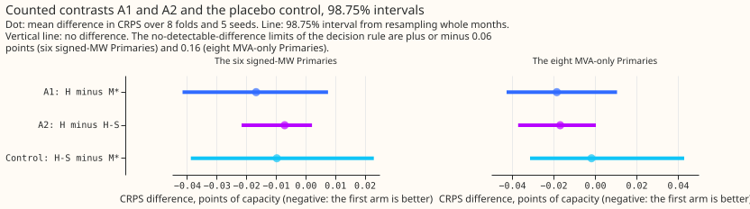

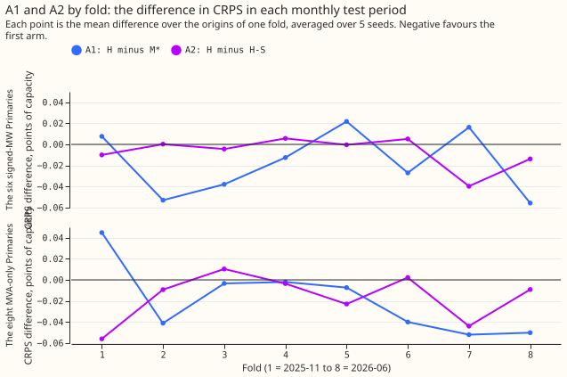

**By fold, A1 is negative in 5 of the 8 folds at the six signed-MW Primaries and in 7 of 8 at the
eight MVA-only Primaries, and A2 is negative in 5 and 6 folds.** The first fold of the eight
MVA-only Primaries (2025-11) is the one positive A1 month there, at +0.045 (`monthly` in
`part1.json`). The seed differences of A1 are all negative except one seed in each group.

**The 95% report-only readings are consistent with a tie, with exceptions that change no verdict.**
Report-only readings are not corrected for the number of readings.

| Reading (95%) | Six signed-MW | Eight MVA-only |
|---|---|---|
| `H` minus `M*`, mean absolute error of the median | -0.0175 [-0.0508, +0.0156] | -0.0195 [-0.0544, +0.0207] |
| `H-S` minus `M*`, 5 seeds | -0.0097 [-0.0336, +0.0163] | -0.0016 [-0.0270, +0.0318] |
| `H` minus `H-X`, 2 seeds | -0.0003 [-0.0196, +0.0222] | -0.0081 [-0.0215, +0.0057] |
| `H` minus `Z`, 5 folds, 2 seeds | -0.0016 [-0.0525, +0.0584] | -0.0133 [-0.0750, +0.0351] |
| `Z` minus `M*`, 5 folds, 2 seeds | 0.0000 [0.0000, 0.0000] | 0.0000 [0.0000, 0.0000] |
| `H` minus the Candidate, 5 seeds | -0.1638 [-0.2655, -0.0622] | +0.0037 [-0.0773, +0.0668] |
| `H-S` minus the Candidate, 5 seeds | -0.1568 [-0.2638, -0.0495] | +0.0205 [-0.0628, +0.0888] |
| `H-X` minus the Candidate, 2 seeds | -0.1546 [-0.2653, -0.0567] | +0.0179 [-0.0586, +0.0849] |
| `Z` minus the Candidate, 5 folds, 2 seeds | -0.0638 [-0.1648, +0.0331] | +0.0501 [-0.0542, +0.1546] |

**The Candidate is P7+D50 of experiment 667, and arms `H`, `H-S`, and `H-X` beat it at the six
signed-MW Primaries and tie it at the eight MVA-only Primaries.** The difference of `H` from the
Candidate is as large as the difference of `H-S` from the Candidate, so the gain over the Candidate
comes from the network and not from the estimate. `Z` minus `M*` is exactly 0.0, so the rule on arm
`Z` did not fire (`score/zrule.json`, `audit_trigger_1_fires` false). The `H` minus `Z` and `H-X`
readings cover fewer folds and seeds than the counted readings, and the scorer reads them on the
cells that both arms hold (`extra_contrasts` in `part1.json`).

**A1 by lead band is flat and negative in every band.** At the six signed-MW Primaries, A1 is -0.0211
[-0.0448, +0.0028] at leads of 24 h to 72 h, -0.0162 [-0.0365, +0.0055] at 72 h to 120 h, and
-0.0150 [-0.0351, +0.0035] at 120 h to 240 h. At the eight MVA-only Primaries the three bands give
-0.0171 [-0.0373, +0.0076], -0.0165 [-0.0375, +0.0069], and -0.0196 [-0.0407, +0.0029]. All six
intervals include zero.

**Mean CRPS of the references, from `score/baseline.json`, is 3.0575 for `M*` and 3.2046 for the
Candidate at the six signed-MW Primaries, and 3.7036 and 3.6815 at the eight MVA-only Primaries.** At
D15 and D18 the figures are 9.1779 and 7.9869. The file stores no absolute CRPS for `H`, `H-S`, the
climatology, the manual heuristic, or BG2, and this page reports none. The file also holds `M*`'s
CRPS on the solar block and on the whole band for each month and group, which this page does not
tabulate.

**At the two Primaries with no solar estimate, `H` still differs from `M*`.** A1 at D15 and D18 is
-0.1779 [-0.4098, -0.0037] (95%, `pooled:other`), with D15 at -0.3448 [-0.7854, -0.0123] and D18 at
-0.0121 [-0.0468, +0.0246]. The estimate is zero and flagged absent at those Primaries, so a
difference there cannot come from the estimate. The page does not explain it. It shows that a
difference between the refit `H` and the stored `M*` can arise without any PV signal, and the pooled
reading over all 16 Primaries (-0.0376 [-0.0652, -0.0115], 95%) is driven partly by D15 and D22.

| Primary | Group | A1: `H` minus `M*` (95%) | A2: `H` minus `H-S` (95%) |
|---|---|---|---|
| D5 | six signed-MW | -0.0263 [-0.0747, +0.0191] | -0.0010 [-0.0266, +0.0274] |
| D9 | six signed-MW | -0.0049 [-0.0226, +0.0208] | -0.0104 [-0.0398, +0.0103] |
| D10 | six signed-MW | -0.0302 [-0.0554, -0.0089] | -0.0089 [-0.0168, +0.0003] |
| D11 | six signed-MW | -0.0164 [-0.0405, +0.0035] | -0.0243 [-0.0628, +0.0015] |
| D14 | six signed-MW | -0.0127 [-0.0568, +0.0357] | +0.0058 [-0.0118, +0.0280] |
| D16 | six signed-MW | -0.0096 [-0.0523, +0.0336] | -0.0032 [-0.0321, +0.0204] |
| D2 | eight MVA-only | -0.0123 [-0.0352, +0.0112] | +0.0013 [-0.0167, +0.0210] |
| D3 | eight MVA-only | +0.0113 [-0.0031, +0.0263] | -0.0168 [-0.0463, -0.0002] |
| D4 | eight MVA-only | +0.0126 [+0.0003, +0.0259] | -0.0056 [-0.0195, +0.0048] |
| D8 | eight MVA-only | -0.0239 [-0.0654, +0.0133] | -0.0178 [-0.0579, +0.0082] |
| D12 | eight MVA-only | +0.0001 [-0.0841, +0.0999] | -0.0436 [-0.1030, +0.0127] |
| D19 | eight MVA-only | -0.0253 [-0.0448, -0.0109] | -0.0124 [-0.0321, +0.0011] |
| D21 | eight MVA-only | -0.0196 [-0.0340, -0.0088] | -0.0067 [-0.0176, +0.0028] |
| D22 | eight MVA-only | -0.0899 [-0.1887, -0.0068] | -0.0323 [-0.0655, -0.0020] |
| D15 | other | -0.3448 [-0.7854, -0.0123] | -0.0408 [-0.2077, +0.0977] |
| D18 | other | -0.0121 [-0.0468, +0.0246] | -0.0075 [-0.0321, +0.0135] |

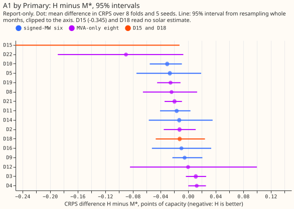

**Of the 16 Primaries, A1 is negative at 13, and its 95% interval excludes zero at D10, D19, D21,
D22, and D15 on the negative side and at D4 on the positive side.** D19 and D21 use look-ahead
capacity, and A2 at those two Primaries includes zero, so their A1 may reflect the leaked capacity
that A2 cancels. These are 16 readings at 95%, so about one interval in 20 would exclude zero by
chance alone.

**Leaving one Primary or one month out leaves the sign of A1 negative in both groups.** At the six
signed-MW Primaries, the point stays between -0.0139 (D10 out) and -0.0190 (D9 out) over the
Primaries and between -0.0120 (2026-06 out) and -0.0231 (2026-03 out) over the months. At the eight
MVA-only Primaries it stays between -0.0082 (D22 out) and -0.0228 (D4 out) over the Primaries and
between -0.0141 (2026-05 out) and -0.0280 (2025-11 out) over the months. The guards of `supported`
that concern tails, cold nights, the mean absolute error, and masks all hold (`guards` in
`part1.json`), but `supported` was unreachable because no group read "gain".

**Secondary readings S1 to S5 (95%, 14 in all, so one false positive is likely) change no verdict.**
S1 and S2 are A1 and A2 on the solar block (06:00 to 14:30 UTC) of the three sunny folds, 2026-04
to 2026-06. S4 is A1 on the whole band of the four dark folds, 2025-11 to 2026-02.

| Reading | Six signed-MW | Eight MVA-only | Stored `holds` flag |
|---|---|---|---|
| S1: `H` minus `M*`, solar block, sunny folds | -0.0263 [-0.0463, -0.0015] | -0.0775 [-0.1107, -0.0322] | No, Yes |
| S2: `H` minus `H-S`, solar block, sunny folds | -0.0187 [-0.0483, +0.0167] | -0.0247 [-0.0654, +0.0080] | No, No |
| S4: `H` minus `M*`, dark folds | -0.0244 [-0.0454, -0.0020] | -0.0007 [-0.0316, +0.0325] | Yes, Yes |

**S1 at the eight MVA-only Primaries is the largest secondary reading, and its placebo contrast
includes zero.** S1 is -0.0775 [-0.1107, -0.0322] with all 5 seeds sharing the sign, and its stored
flag reads Yes. S2, the same rows against `H-S`, is -0.0247 [-0.0654, +0.0080]. The capacity
look-ahead at these Primaries enters S1 and cancels in S2. S1 is a report-only reading at 95% among
14, so it changes no verdict and supports no claim about the actual sky. S3 (the gap between the
dull and the sunny third of days, 90 origin days, `score/secondary_part1.json`) is -0.0056 [-0.0296,
+0.0165] at the six signed-MW Primaries and +0.0174 [-0.0018, +0.0347] at the eight MVA-only
Primaries, and holds in neither group. S5, the Spearman correlation between the per-Primary A1 and
the photovoltaic (PV) share, is -0.358 [-0.772, +0.258] over 14 Primaries.

**A post hoc reading, labelled as such and after the pre-registered one: both counted contrasts
have negative points of about 0.017 in both groups, and the design cannot resolve them.** The
smallest gain worth porting is 0.02 points of capacity, and the design resolves differences of 0.06
and 0.16 with 80% power, so a gain of 0.017 would read as a tie even if it were real. The negative
points of the placebo contrast (control: -0.0097 and -0.0016) and the by-Primary table
(D15 at -0.345 without a solar estimate) say that the sign of A1 is not evidence for the estimate.
This reading changes no verdict and no advice.

## Loss curves, attention maps, and forecast examples

**All fits of the plan are stored: 40 fits of
arm `H`, 40 of `H-S`, 16 of `H-X`, and 10 of `Z`, and every one stopped by patience.** Arms `H` and
`H-S` cover 8 folds and seeds 0 to 4, arm `H-X` covers 8 folds and seeds 0 and 1, and arm `Z` covers
5 folds and seeds 0 and 1. The fit logs (`work/logs/<arm>/<fold>_s<seed>_fit.json`) hold the
validation loss of every pass of stages 2 and 3, and hold no training loss. No training-loss curve
is drawn, because none was stored. The two figures below plot the validation loss of every seed of
`M*` (the stage 2 and stage 3 passes stored in experiment 713's fit logs), `H`, and `H-S`, one panel
for each fold.

**The rule on arm `Z` did not fire: `Z` minus `M*` is 0.0 at both groups.** The point estimate,
and both ends of its interval, are 0.0 at the six signed-MW Primaries and at the eight MVA-only
Primaries (`score/zrule.json`), so the refit by this experiment's training loop reproduces `M*`.

| Arm | Fits | Stage 2 passes: mean (min to max) | Stage 3 passes: mean (min to max) | Fits at the pass cap |
|---|---|---|---|---|
| `H` | 40 | 13.3 (10 to 19) | 15.2 (9 to 33) | 0 |
| `H-S` | 40 | 13.2 (10 to 19) | 15.2 (10 to 27) | 0 |
| `H-X` | 16 | 14.1 (12 to 26) | 16.2 (10 to 31) | 0 |
| `Z` | 10 | 13.4 (11 to 16) | 16.7 (10 to 23) | 0 |

**The table counts the passes that each stage ran before patience stopped it**, from the `stages`
entries of the fit logs (`e00716_writeup_figures.py tables`). No stage hit the 60-pass cap, and no
stage was rerun, so the null result is not a training-budget artefact at the cap.

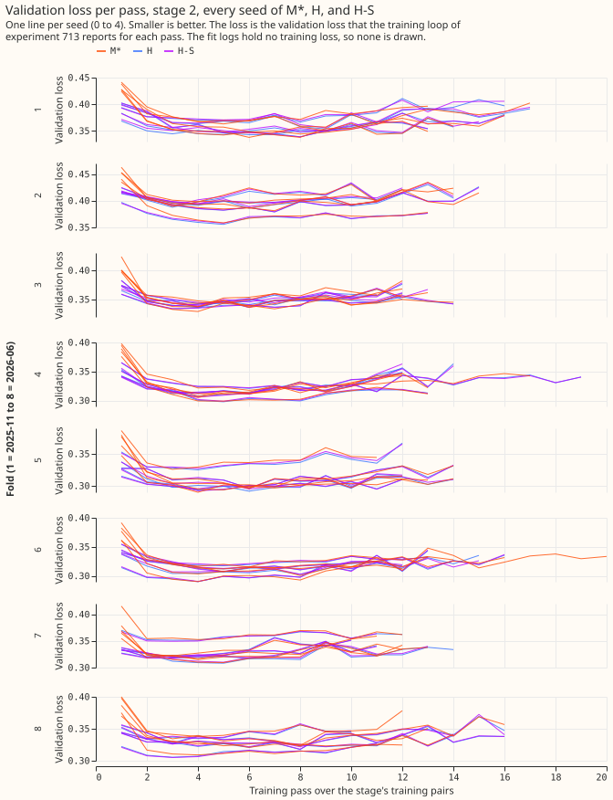

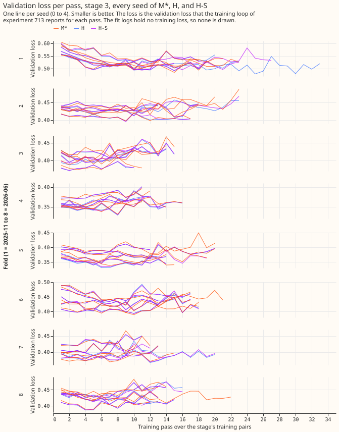

**The attention maps show no visible difference between `M*` and `H` in fold 2026-05, seed 0.**
`e00716_attention_extract.py` stored them (`work/attention/Mstar_2026-05_s0.npz` and
`H_2026-05_s0.npz`). Its forecast from each arm matches the stored forecast file to 7.2e-07 of
capacity. Averaged over the 496 Primary-and-origin pairs of the fold, the across-day weight of every
history row differs between the two arms by at most 0.0009, and the weight of the target row falls
from 0.0286 to 0.0243 at lead day 1 and from 0.0265 to 0.0216 at lead day 7
(`summary_lead1` and `summary_lead7`, key `mean_weight`). In the read-out weights, both arms put
their largest weight on the history rows 7 and 14 days old, which have the target day's weekday.
At D19 on the clear target day, the two rows together carry a mean weight of 0.266 in `M*` and
0.270 in `H`.

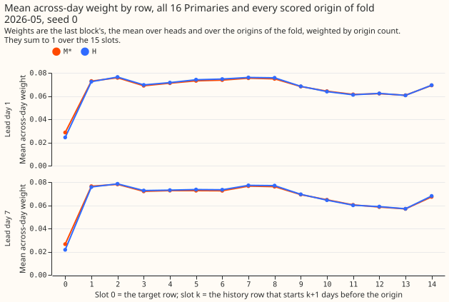

**D19 and D21 read capacity factors from the future, so their maps in fold 2026-05 are not clean.**
The as-of capacity factors of the eight MVA-only Primaries come from data to 2026-06, and the log
of the extraction (`capacity: 2026-05 ... factors look ahead: True`) marks D19, D21, and the other
MVA-only Primaries of experiment 662 that way. D11 is a signed-MW Primary with no look-ahead. The
figures show hosts D11, D19, and D21, each on a clear target day and on a dull target day that
follows a sunny window. The case is chosen from the realised sky of the target day, which no input
sees. The forecast figures further down show the same three hosts.

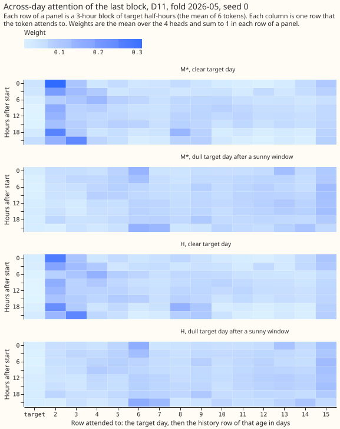

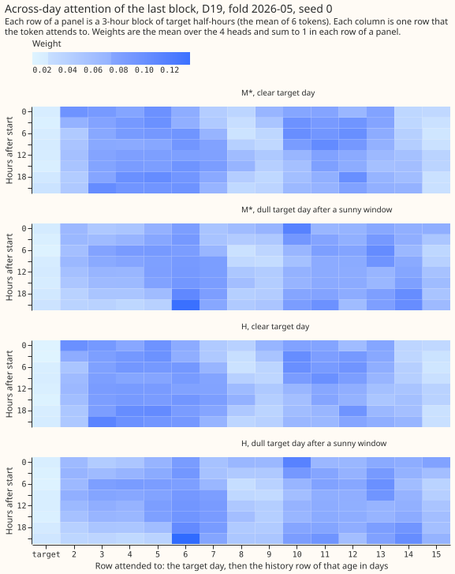

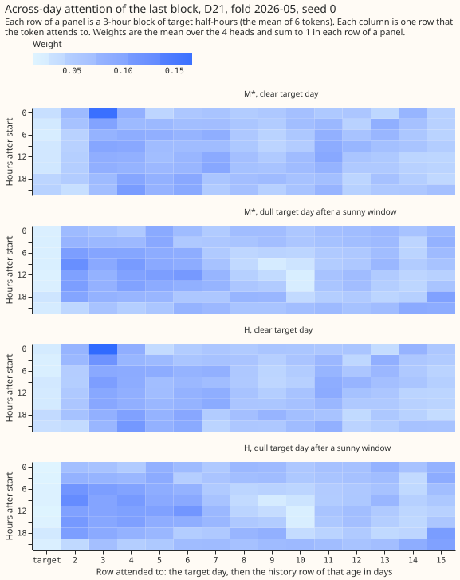

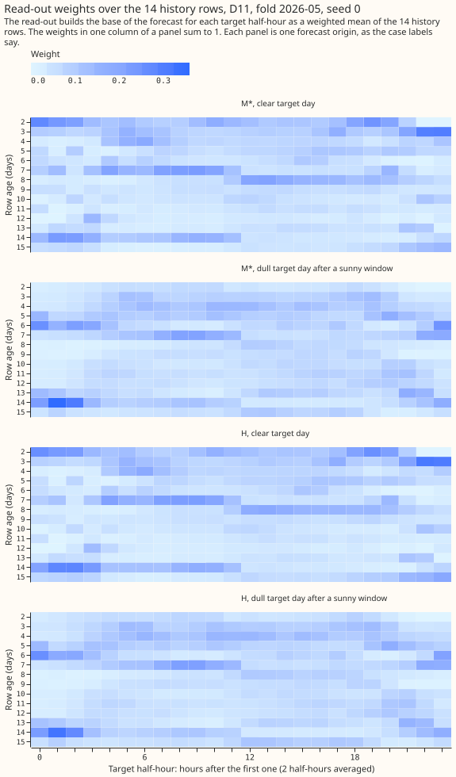

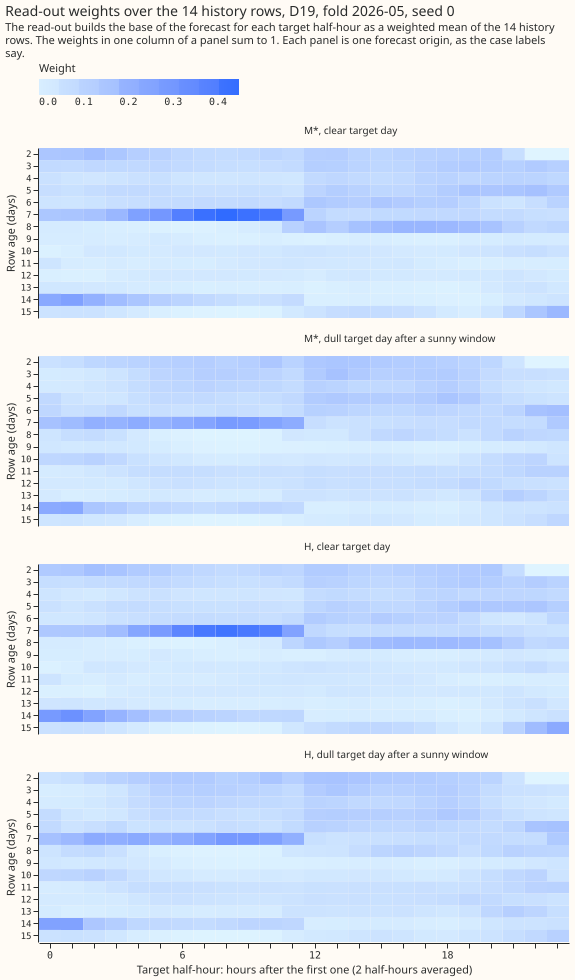

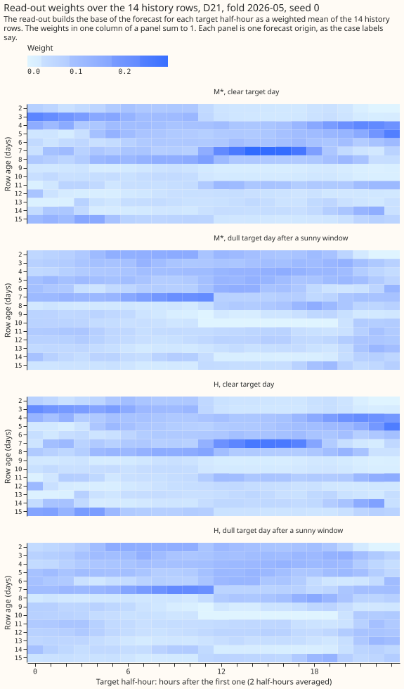

**The first-day and full-horizon forecasts of `M*` and `H` are nearly the same at D11, D19, and D21.**
The figures draw the stored forecast of fold 2026-05, seed 0, against the cleaned demand, with the
5% to 95% band of `M*` and of `H`. D8, D12, and D22 are not shown, because their capacity looks ahead
too. The demand axis is in shares of capacity and the page gives no capacity in megawatts. Neither
figure measures which arm is better.

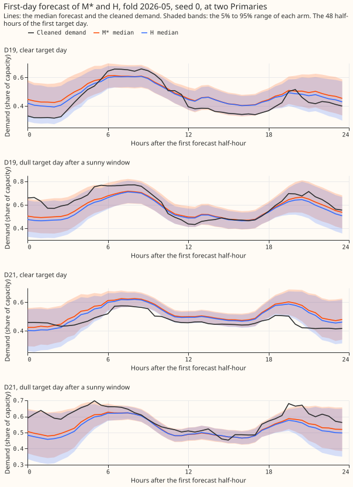

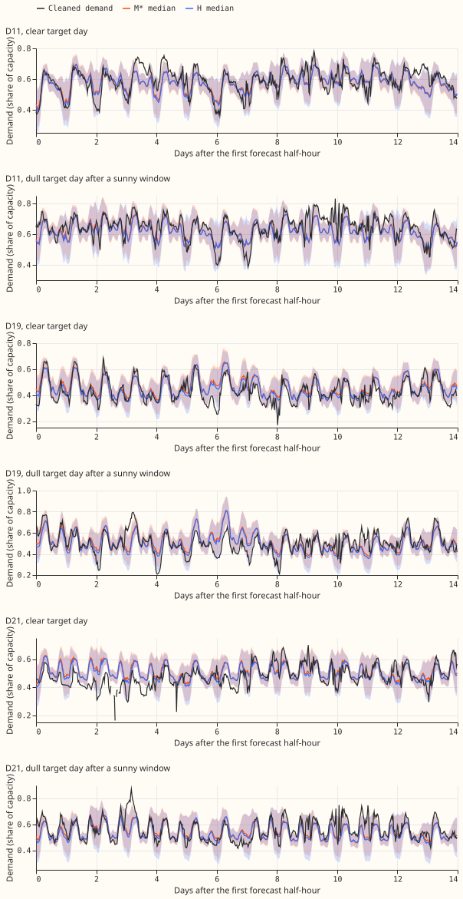

**The no-refit read-out contrasts of arm `H` were not run.** The command
`e00716_readouts.py contrasts H` fails, because line 190 of `e00716_readouts.py` calls
`score.available_seeds`, which `e00716_score.py` no longer defines. The reading is a secondary
read-out that changes no verdict, and it is not in the pre-registered verdict mapping. The seed sets
also differ: `H-cams` and `H-convention` have 40 forecast files each (8 folds, seeds 0 to 4), and
`H-lookahead`, `H-nopv`, `H-scale0.7`, and `H-scale1.3` have 8 files each (8 folds, seed 0). The
command needs a decision on the seed set before it can run, and no script was edited. The two mask
read-outs that the scorer reads (`mask_points` in `part1.json`) give A1 of -0.0161 (CAMS-rule mask)
and -0.0119 (mask of ages 2 to 5, called `convention`) at the six signed-MW Primaries, and -0.0162
and -0.0111 at the eight MVA-only Primaries, so A1 keeps its sign under both masks.

## Checks

- **The median forecast minus the mean forecast, per site, is not stored.** `part1.json` has no
  table of it, so the page does not report it. This is a gap against the plan.
- **The error of the median beside the CRPS contrast.** At the six signed-MW Primaries the
  normalised mean absolute error contrast is -0.0175 [-0.0508, +0.0156] (95%) against a CRPS
  contrast of -0.0167, and at the eight MVA-only Primaries it is -0.0195 [-0.0544, +0.0207] against
  -0.0184. Both pairs point in the same direction, so audit trigger 3 does not fire.
- **Audit triggers that hold.** Trigger 1 fires, and trigger 6 fires on its wording for two
  readings. Triggers 2, 3, 4, and 5 do not fire, and trigger 7 was not assessed. The manager runs
  the read-only audit of these triggers after this page is pushed, and this page ran none.
- **Trigger 1 fires.** Check KF9 of this experiment failed (0.00070 against the 0.00729 needed) and
  the maintainer waived it, the same kind of waived known-answer check that experiment 713 counted
  as trigger 1. The placebo and the control arm `Z` did not fail.
- **Trigger 2 does not fire.** The result matches its prediction (A1 inside its ranges, A2 including
  zero in both groups), and no earlier finding is contradicted: experiments 703 and 704 had found
  that CAMS columns can be dropped with no detectable loss.
- **Trigger 4 does not fire.** Leaving out any one Primary or any one month leaves the point of A1
  negative in both groups (-0.0082 to -0.0280, section "Result"), and the guards of leave-one-out
  hold. The stored file keeps points and not intervals for the left-out readings.
- **Trigger 5 does not fire.** The scorer's `audit_trigger_5` is false for the counted groups: `H-S`
  does not beat `H` (A2 is negative in both groups). The control `H-S` minus `M*` is -0.0097 and
  -0.0016, and its half-widths at 98.75% are 0.031 and 0.037, so the control moves the score by less
  than its own interval's half-width. `Z` minus `M*` is exactly 0.0.
- **Trigger 6 fires on its wording for two readings and not for the headline contrasts.** The sister
  experiment is [experiment 717](../00717-msa-unmetered-pv-part-2-target-row-forecast/result.md), on
  the same rows, and the widths are those of the 98.75% intervals in `score/part2.json` of
  experiment 717 and `score/part1.json` here. The first contrast (A1 against B1, `HT` minus `H`) has
  widths 0.0491 and 0.0542 at the six signed-MW Primaries (ratio 1.10) and 0.0532 and 0.0806 at the
  eight MVA-only Primaries (ratio 1.52), so the trigger does not fire. The placebo contrast (A2
  against B2) has 0.0238 and 0.0745 at the six signed-MW Primaries (ratio 3.13, fires) and 0.0375 and
  0.0666 at the eight MVA-only Primaries (ratio 1.78). The control has 0.0618 and 0.0521 (ratio
  0.84) and 0.0743 and 0.0303 at the eight MVA-only Primaries (ratio 0.41, fires). The contrasts
  differ in their arms, so the same contrast is only loosely the same: A2 compares `H` with a
  placebo that reads the sky of 28 days earlier in the history rows, and B2 compares `HT` with a
  placebo that reads the ENS run issued 28 days earlier. The comparison is the manager's to audit.
- **Trigger 7 was not assessed.**
- **Cold nights.** The difference `H` minus `M*` on cold winter nights is -0.0300 at the six
  signed-MW Primaries and -0.0481 at the eight MVA-only Primaries (`cold_night_difference` in
  `part1.json`), so `H` is not worse than `M*`, and the cold-night guard holds.
- **Tails.** The upper limits of the 95% intervals of the q01 and q99 pinball-loss contrasts
  (`H` minus `M*`) are 0.0053 and 0.0027 at the six signed-MW Primaries and 0.0008 and 0.0013 at
  the eight MVA-only Primaries, all below the limit of 0.05 (`guards.<group>.tails`). Coverage
  tables for q01, q05, q95, and q99 were not produced.

## Planned tables that do not exist

**Several tables of the plan were not produced, and this page does not invent them.** The stored
files have no table of each arm's absolute CRPS beside the manual heuristic and BG2, no q01, q05,
q95, and q99 coverage table, no avoidable-curtailment cost, and no four load-shift scenarios. The
plan's reading of cold winter nights is the single difference above, with no per-arm score. **The
report script `e00716_report.py` stops with a `TypeError` if this page reads the report-only
contrasts from it:** line 125 indexes a list as a dictionary. The report-only contrasts on this
page (`H` minus `H-X`, `H-S` minus `M*`, `H` minus `Z`, every arm minus the Candidate, the lead
bands, the per-Primary table, and the pooled readings) were taken from `score/part1.json`
directly. The script was reviewed and was not edited.

## The waived known-answer gate

**Known-answer check KF9 failed and the maintainer waived it, so the gate is a waived known-answer
check and not a passed one.** KF9 asks arm `H` to beat arm `H-S` on the solar block of world WH by
half the `gap`. Its value is 0.00070 against the need of 0.00729, and its secondary readings (days 1
to 60, days 61 to 236, and pass 60) fail as well. KF10, KF11, and KF12 pass. No threshold and no
verdict rule changed. An audit of the failure found no implementation fault and two method findings.
First, the patience-8 rule scored arm `H` at passes 4, 23, and 5 of seeds 0, 1, and 2, against
global bests at passes 43, 55, and 32, because the history path learns slowly. Second, the pass mark
forces arm `H` below the oracle ridge: arm `H-S` scores 0.0394 on the solar block and arm `Z`
0.0397, the naive ridge reference 0.0470, and the oracle ridge 0.0324, so arm `H` must score 0.0321
or better, below the oracle ridge's 0.0324. Every statement that the history path recovers the
hidden sky from the PV estimate is therefore unsupported by a passing known-answer test.

**The early-stopping pre-check of the known-answer worlds read one seed of three, and the other
seeds of arm `M` in world WH are noisier than its limit.** The pre-registered pre-check reads arm
`M` of seed 0 only. At rung 4 it passed in both worlds, with a last-10 validation-loss noise of
0.0109 in world WH against the limit of 0.0225, and 0.0121 in world WT against the limit of 0.134.
Seeds 1 and 2 of arm `M` in WH have a last-10 noise of 0.029 and 0.031, above the WH limit, so the
rung-4 pass in WH depended on seed 0. In WT, seeds 1 and 2 have 0.038 and 0.016, below the WT limit.
The numbers review checks this reading.

**The pre-registered expectation was a tie, and the result matches it.** Each history token already
carries CAMS shortwave irradiance and solar geometry, so the estimate adds a capacity scale, a
physical shape, and units that match the power. Six earlier experiments found that an explicit PV
term built on forecast weather did not help net demand, and experiments 703 and 704 found that the
two previous-day CAMS columns can be dropped from the Candidate with no detectable loss. With 5
seeds the design detects, with 80% power, a CRPS difference of 0.06 points of capacity at the six
signed-MW Primaries and 0.16 points at the eight MVA-only Primaries, and a smaller difference is
likely to read as a tie.

## GPU time

**For parts 1 and 2 together, 23.6 GPU-process-hours are counted, and up to 26.0 if two unrecorded
runs used the GPU; part 1's own fits and checks took 15.28.** The 23.6 hours are the figure on the
page of [experiment 717](../00717-msa-unmetered-pv-part-2-target-row-forecast/result.md): the
start-to-end times of the GPU jobs in the F7 run logs (22.4 hours, after leaving out the CPU
baseline-scoring run of `f7w_chain.log`, about 0.1 hours), the two known-answer fits of arm `M` in
worlds WH and WT at seed 0 (1.13 hours, from file times), the check `KF7` (0.02 hours), and the
attention extraction (0.02 hours). Part 1's share of 15.28 hours is the sum of the gating fits,
`KF7`, the fits and predictions of arms `H`, `H-S`, `H-X`, and `Z`, the no-refit read-outs of `H`,
and the attention extraction, from the same logs and from the `seconds` field of the fit logs (the
106 fits of part 1's arms took 4.94 of those hours). Two further items are not counted, because
their device is unconfirmed: the four runs of the known-answer world ladder (1.22 hours, from the
seconds stored in `world_rung/rung1.json` to `rung4.json`) and the rebuild of that ladder (about 1.2
hours of wall time). Neither run log records a device, and the code of the ladder
(`e00716_world_rung.py` and `e00716_worlds.py`) names none, so both are taken to run on the CPU. If
both ran on the GPU, the total is 23.6 + 1.22 + 1.2 = 26.0 hours, so the range is 23.6 to 26.0
hours. The counted total stays under the manager's stop line of 26, and the upper end of the range
equals it. The run logs live in the workstation's `/tmp`, not in the data folder, and the figures
are sums over them.

## Why this runs although the stop rule counts earlier verdicts

**The maintainer asked for follow-up F7 by name and confirmed the scope on 2026-11-23 ("I
confirm."), relayed through the experiment manager. That instruction is the approval that the
demand protocol requires for an idea that is past its fourth counted verdict.** The protocol's stop
rule counts the verdicts `not supported` and `refuted` on one idea, resets the count at `supported`
or `small gain`, and from the fourth experiment requires the maintainer's approval and scoring at
every Primary. This part scores all 16 Primaries.

The idea of part 1 (realised or recent satellite sunshine as an input that explains the past) has
one counted experiment, experiment 504 (`not supported`: CAMS days at least 36 hours old, as
summary columns, in a neural network without history rows). Experiment 480 (`supported`) is a weak
reset, because it gave the forecast the realised sunshine of the target half-hour. Experiments 039,
289, 639, and 661 found that realised CAMS explains past net demand, and their verdicts neither
count nor reset. Part 2's idea (an explicit embedded-PV forecast in a net-demand forecast) has 6
counted experiments on a strict reading: 409, 477, 501, 644, 655, and 664. Counting experiment 661,
experiments 350 and 351, and experiments 329 and 419 as well gives 7, 9, and 11. Whether part 1
shares part 2's idea for the count is a decision for the manager.

| Experiment | What the experiment gave the forecast | Verdict | Counted for scope (b) |
|---|---|---|---|
| 409 | An explicit solar term in the pooled mixture density network | `not supported` | Yes |
| 477 | An explicit PV module in the net demand neural network | `not supported` | Yes |
| 501 | An explicit solar-output column from an as-of capacity | `refuted` | Yes |
| 644 | An explicit solar-capacity term with ENS weather | `refuted` | Yes |
| 655 | A member-level solar curve with cell temperature | `refuted` | Yes |
| 664 | Net demand as gross demand minus a sampled ENS solar curve | `refuted` | Yes |
| 661 | Whether the ENS time step explains experiment 644, and a bias adapter | `refuted` | Borderline (gives 7) |
| 350, 351 | A capacity-free irradiance curve and a capacity read-out in the GAM stack | `not supported`, twice | Arguably (gives 9) |
| 329, 419 | A 3-member solar distribution; a solar summary in the mixture density network | `not supported`, twice | Borderline (gives 11) |
| 031, 349, 405, 416 | PV features in XGBoost and the GAM stack; explicit term with learned capacity or 5 seeds | `inconclusive` | No |
| 352, 639, 643 | Explicit terms scored with recorded weather | `partly supported` | No: neither counts nor resets |

**This page departs from three items of earlier advice, on the maintainer's instruction.**
Experiments 644 and 655 advise against any explicit solar term in the ENS demand network.
Experiment 504 advises against satellite irradiance columns at least 36 hours old. Experiment 501
advises keeping the irradiance input and the Primary embedding as the network's way of
representing solar output. This experiment follows experiment 504's advice to score cold winter
nights separately, experiment 661's advice to keep production's window-mean resampler for ENS
shortwave, and experiment 501's advice to judge a capacity by a known-answer or placebo test.

**What differs from the counted experiments:** no earlier neural network held 14 aligned days of
net power beside the sunshine of each day, so no earlier experiment could use a PV estimate to
separate demand from solar in the past.

**Experiment 713's screen stop rule binds this experiment.** If the stop rule of experiment 713's
design fires on its eight folds (the selected network is 0.10 to 0.15 points worse than the
Candidate), an increment on that network has no route to production, and the work stops to ask.

## Experiment 713's known-answer gate was waived, and this limits the conclusions

**Experiment 713's known-answer gate failed KA3 and KA12 and the maintainer waived it on 2026-11-23
(713's design amendment 4).** Every warm-start state here comes from that waived gate. This
experiment therefore makes no claim about era recognition or about following level shifts, and every
verdict, headline, and take-home message of this experiment says so. The gate of this experiment
(KF1 to KF15 below) is its own and is not waived.

## Capacity look-ahead at the eight MVA-only Primaries

**The as-of capacity of the eight MVA-only Primaries in the seven folds 2025-11 to 2026-05 uses
information from after the fold's cutoff, in two ways.** The probes' neural networks that experiment
662 stored were trained to 2026-03, so folds 2025-11 to 2026-02 look ahead by up to 4 months. The
calibration factors of all seven folds come from data to 2026-06 (experiment 662's page says "the
calibration at 2026-03 reuses the 2026-06 factors", and the rescale of 0.7858 of experiment 673 is
measured at the 2026-06 cutoff). Only fold 2026-06 is clean at the eight MVA-only Primaries. The six
signed-MW Primaries are clean in every fold, because experiment 649 stores one calibration factor
per cutoff. The leak is one constant per Primary and fold, and carries no day-level information. A2
cancels the constant, because both arms of the contrast read the same capacity, and A1 does not. A
read-out at the six signed-MW Primaries, where the honest capacity is known, measures the effect of
a look-ahead of the same kind.

## What is compared

| Arm | PV input | Seeds | Role |
|---|---|---|---|
| `M*` | None | Stored, 0 to 4 | Control of A1; never refitted |
| `Z` | None; this experiment's code with every PV path absent | 0 and 1 on 5 folds | Repeat of `M*`; measures run-to-run noise |
| `H` | CAMS `PV̂` in the 14 history rows | 0 to 4 | Treatment |
| `H-S` | History `PV̂` with the sky of the date 28 days earlier | 0 to 4 | Counted placebo |
| `H-X` | History `PV̂` of another Primary | 0 and 1 | Report-only placebo |

Part 2's arms `HT`, `HT-S`, and `T` use the code of this folder and are scored in [experiment
717](../00717-msa-unmetered-pv-part-2-target-row-forecast/result.md). Every counted contrast is read
with 5 seeds. With 2 seeds the design would have a noise floor of 0.054 at the six signed-MW
Primaries and 0.142 at the eight MVA-only Primaries, and a detectable difference of 0.094 and 0.25.
Each placebo keeps the parameters, the training recipe, and the
capacity of its treatment and changes one property of the PV input. `H` minus `H-S` is what the
actual sky of each history day adds. `H-S` minus `M*` is what the capacity, the season, and the
added parameters add. `H` minus `H-X` is what the Primary's own capacity adds.

## The PV estimate

**`PV̂(i, t) = C(i, f) × u(i, t)`, where `C` is the as-of AC capacity of Primary `i` for fold `f`
in megawatts and `u` is the yield curve.** The network reads `p = PV̂ / capacity / target_std`,
clipped to 0 to 10, in the units of its power input, with `target_std` from the Candidate chain's
stored fold statistics and no mean subtracted. The yield curve is the repository's physics curve,
`e00405_pv.unit_shape` divided by `u99()` (0.879): the Erbs split of global horizontal
irradiance, a fixed plane (tilt 35 degrees, azimuth 180 degrees), a DC-to-AC ratio of 1.15, and a
derate of 0.4% per kelvin of cell temperature. History rows use the CAMS shortwave and ERA5 2 m
temperature of the dense table that experiment 713 reads. One orientation stands for every roof,
and the curve has no export limit.

| Primaries | Table | Value | Cutoff rule |
|---|---|---|---|
| The six signed-MW Primaries (D5, D9, D10, D11, D14, D16) | experiment 649's `capacity_table.parquet`, probe year 2025 | `cal_p50` | The latest stored cutoff at or before the fold's cutoff |
| D2, D3, D4, D19, D21 | experiment 662's `capacity_table.csv`, method `L0` | `cal_p50 × factor / 0.7858` (experiment 673's rescale) | Cutoff 2026-03 before the 2026-06 fold: look-ahead |
| D8, D22 | The same table, method `L0` | `cal_p50` | As above |
| D12 | The same table, method `FA` | `cal_p50` | As above |
| D15, D18 | None | `p` is zero and flagged absent | |

## How the estimate enters the network

**Each new path starts at exactly zero, with a random partner, so a network that loads a stored
state of `M*` gives the output of `M*` bit for bit.** The token path is `γ_h ⊙ (W2_h GELU(W1_h
[p·ok, ok]) / r_h)`, added to each history token before the first axial block. `W1_h` is 2 to 32
with bias, `W2_h` is 32 to 64 without bias, `γ_h` is a 64-element gain initialised at zero, and
`r_h` is a stored constant (the root mean square of the path's output at initialisation over the
arm's training tokens), not a per-token LayerNorm, because a per-token LayerNorm discards the length
of a vector that is a function of one scalar (median cosine similarity 0.98 between `p` of 2 and 3).
The read-out path computes, from the attention weights `α` that build `base`, `pbar` (the PV inside
`base`) and `cover`, and adds `a[primary] × pbar × cover` to each mixture mean through a 16-entry
table `a` initialised at zero, and adds `[pbar, cover, p0_mean, p0_sd, top_ok]` to the head's
first-layer pre-activation through a zero-initialised linear map. New parameters: 2,560 in arm `H`
(2.0% more than the 129,999 of `M*`). Every new module is built from a dedicated generator seeded by
the network seed, so the global torch stream is untouched.

## Training recipe

**Every arm skips stage 1 and runs stages 2 and 3 of experiment 713's recipe from the stored stage 1
state of `M*` of the same fold and seed.** Stage 1 trains on 2019-09 onward, where a constant
as-of capacity would overstate `PV̂` by up to 30%, and a shared stage 1 state pairs each fit with
the `M*` fit of the same seed. The parameters of `M*` train exactly as in experiment 713 (2e-4,
5e-4 for `proj_s` in stage 2, a 300-step warm-up, and a gradient clip over the parameters of `M*`
alone). **The new parameters form their own optimiser group, with no warm-up, their own clip, and
no weight decay on the gains.** The stored logs of experiment 713 put the best state of stage 2 at
66 to 224 optimiser steps and of stage 3 at 22 to 644 steps, inside the 300-step warm-up at 2e-4,
so a zero-initialised gain at the trunk's rate would move by about 0.0015 to 0.017 against a
working value near 1. The rates are 1e-2 for `a`, 3e-3 for `γ_h`, and 2e-3 for `W1`, `W2`, and the
head map; the reachable range is 0.88 for `a` and 0.26 per element for `γ` in the shortest stored
fit. Mask dropout hides the PV estimate of the age-2 row and part of the age-3 row on 10% of
training samples, and of ages 2 to 5 on another 10%, from a generator of its own.

## Counted contrasts and the decision rule

**Part 1 has four counted readings, A1 and A2 at the six signed-MW Primaries and at the eight
MVA-only Primaries, so each interval is read at 98.75%.** Each contrast is treatment minus reference
in CRPS on experiment 713's row set, headline band, and 8 folds, from seed-averaged forecasts,
through 713's scorer.

| Id | Contrast | Question |
|---|---|---|
| A1 | `H` minus `M*` | Does a historical PV estimate in the history rows improve the network? |
| A2 | `H` minus `H-S` | Does the gain come from the actual sky of each history day? |

The verdict mapping is the one in the front matter. The verdict `supported` also needs the sign of
A1 to hold with each Primary and each month left out in turn, the q01 and q99 pinball loss of `H`
within 0.05 of `M*`, the normalised MAE of the median to move the same way as CRPS, `H` not worse
than `M*` by more than 0.05 on cold winter nights, and A1 to keep its sign under both masks of the
read-outs below. **A rule on arm `Z`:** if `Z` minus `M*` on its 5 folds exceeds 0.054 at the six
signed-MW Primaries or 0.142 at the eight MVA-only Primaries in absolute value, audit trigger 1
fires before any A1 is read. **Report-only, at 95%:** `H` minus `H-X`, `H-S` minus `M*`, `H` minus
`Z`, every arm minus the Candidate, every contrast at all 16 Primaries, by lead band, by Primary,
with one Primary left out, and with one month left out. Each page also reports its contrasts at
99.375% (eight readings across both parts) as a labelled sensitivity reading that changes no
verdict. **A gain that the placebo matches is not evidence for the PV estimate.** Part 1 screens on
four folds (2025-11, 2026-01, 2026-05, 2026-06): the stop rule is experiment 713's (`H` minus `M*`
above +0.15 in both groups, or above +0.10 in both and positive in at least 3 of 4 folds in both),
and every screen number is labelled interim.

**Secondary readings, read at 95% and changing no verdict (14 in all, so one false positive among
them is likely):** S1 (A1 helps in the solar block of the sunny folds 2026-04 to 2026-06), S2 (the
same for A2), S3 (A1 removes the copied dip on days duller than their history window, compared with
a control that shifts `M*`'s quantiles by `H`'s mean median difference), S4 (no harm in the dark
folds), and S5 (dose response against experiment 673's PV share). Read-outs at prediction with no
refit: a CAMS-rule mask, a mask of ages 2 to 5, a look-ahead sensitivity at the six signed-MW
Primaries, PV absent, capacity scale of 0.7 and 1.3, the learned gains as a share of their reachable
range, and the four load-shift scenarios.

**Seeds 2 to 4 ran because a counted treatment contrast gave a reason to continue.** After the
8-fold, 2-seed reading of the counted contrasts, seeds 2 to 4 run only if, for at least one counted
treatment contrast, the point estimate is below zero in at least one group (the six signed-MW
Primaries, the eight MVA-only Primaries). If every counted treatment contrast has a point estimate
at or above zero in both groups, the experiment is written up at 2 seeds with the pre-registered
two-seed values, and the page states that the futility rule fired. A reading with a point estimate
below zero is the only one that opens seeds 2 to 4, and the ablation contrasts (A2 and B2) never
open them. At 2 seeds, the counted points of A1 (-0.0045 and -0.0177) were below zero in both
groups, so the rule opened seeds 2 to 4. This rule was added before any treatment score was read. No
threshold or verdict rule changed. The fit logs of phase 3 already held validation-loss lines when
this rule was added (five at the time of the edit), and they were not read before the edit.

**Fits run in the order of phases 3, 4, and 5 before phase 6, and the fit logs are read for stopping
passes only.** Every fit's log summary reports its stopping pass: the stage, the pass number, and
whether the 60-pass cap or the patience ended the stage. The implementer reports that table to the
manager, and reads no validation loss and no treatment score from the logs before the two-seed
scores are read.

## Known-answer checks

**Every threshold is fixed now and no threshold is tuned to pass.** The wiring checks KF1 (zero
start), KF2 (poisoned PV after the origin), KF3 (placebo donors), KF4 (the estimate against
`e00634_common.unit_curve` and an independent NumPy computation), KF5 (as-of capacity, with a
reproduction of experiment 673's `probe` column to 1e-9), KF6 (weather look-ahead statement), KF7
(prediction against the stored forecast of `M*` to 1e-6), KF8 (gradients and optimiser groups), KF13
and KF13b (the copied training loop equals 713's, bit for bit on the CPU), and KF14 (CAMS stamps are
period end) run before any real fold. Three synthetic worlds (WH: the sky hidden in the history; WT:
hidden in the target row, used by part 2; WN: no PV dip) with a hidden daytime level, a daily
anomaly, and a PV-like dip of known size gate the learning: KF9 (`H-S` minus `H` at least 0.5 ×
`gap`), KF10 (the placebo does not help, at most 0.005), KF12 (negative control, at most +0.005),
and the secondary KF15 (learned gain). **A ladder of five world rungs is pre-registered, because a
Monte Carlo found that rung 1 probably gives a `gap` (the naive reference's MAE minus the oracle's)
below the required 0.010 of capacity.** The first rung that passes the rule below is used, decided
from NumPy references on the real weather before any PV fit. No threshold changes between rungs. If
no rung passes, the work stops before any PV fit and goes to the designer.

**The `gap` is measured on the 236 days after the cutoff, over eight world draws, and a rung passes
only if both the mean and draw 0 reach 0.010.** The validation origins of the worlds are the 236
days after the cutoff (`HELD_OUT_DAYS = 236`) for the `gap` of WH and WT and for every metric of KF9
to KF12. For each rung, `e00716_world_rung.py` computes the `gap` of WH and of WT for world draws 0
to 7 (`build_world(seed=k)`). A rung passes when, in both worlds, the mean `gap` over the eight
draws is at least 0.010 and the `gap` of draw 0 is at least 0.010. A rung whose mean passes and
whose draw 0 fails is a failed rung, and no other draw is used. Every fit and every check keeps draw
0, so KF9 and KF11 compare against the `gap` of draw 0 on the 236 days. `world_rung.json` records
the eight values, their mean, their standard deviation, and `held_out_days`, and `chosen_rung()`
refuses a file that is stale, lacks those fields, or has a `held_out_days` other than 236. KF9 and
KF11 are also printed on validation days 1 to 60 and 61 to 236 as secondary readings that never
gate.

**An early-stopping pre-check follows, and a failure steps the ladder up one rung.** The pre-check
reads no PV fit. It computes the Gaussian negative log-likelihood of the naive and of the oracle
reference on the (sample, lead day) pairs and target tokens that experiment 713's `validation_loss`
averages. The difference must be at least 10 times the standard deviation of arm `M`'s validation
loss over its last 10 passes in the same world, with the best pass reconstructed from `val_history`
by 713's improvement test and a patience of 8. After a failed pre-check at rung N, the command
`e00716_world_rung.py --after N` refuses to run unless `precheck_rung<N>.json` exists, records a
failure, and comes from the current world code. It then computes the next rung and never chooses a
rung numbered N or lower, and arm `M` is refitted at seed 0 in WH and WT at the new rung. If no rung
above N passes, F7 stops before any PV fit and the designer is asked. **Every extra fit of arm `M`
is charged to the reserve of phase 9 of design section 10 (1.5 GPU-process-hours), and all three
worlds use the same rung.** Arm `M` at seeds 1 and 2 and in world WN is fitted only at the rung that
finally passes. **Arm `M` is fitted at seed 0 in WH and WT first, and the pre-check is reported
before any other fit.** Two diagnostics are printed beside the pre-check and never gate it: the
standard deviation of arm `M`'s validation loss over the 10 passes ending at the best pass, and the
standard deviation of the last 10 passes after removing a linear trend. **A second failure, after
the step up to rung 5, goes to the maintainer through the manager as a waiver question, and no new
definition of the check's tokens or noise is adopted afterwards.** In the eight stored known-answer
fits of experiment 713 the standard deviation of the last 10 validation losses (`ddof=1`, as in the
code) lay between 0.0037 and 0.0265: arm `M` in world W1 sits at 0.0220 against the rung-4 limit of
0.0225, so the rung-4 pre-check is close to a coin toss weighted towards a pass.

**The phase 0 smoke fit of arm `H` runs after the gate, not before it.** `fit()` refuses to run
before the known-answer gate has passed and has no flag to skip the gate, so the smoke fit of the
run brief's phase 0 moves to follow the gate.

## Leakage and what a live service could build

**The history PV estimate rides on the CAMS analysis, which is the lab shortcut experiment 713
already flags for ages 2 to 5.** Under experiment 504's assumed delay of 36 hours, the estimate is
buildable live for ages 4 to 15 and columns 0 to 24 of the age-3 row, and the ERA5 temperature
makes the estimate buildable only for ages 6 to 15 under 713's convention. The weather tokens of
ages 2 to 5 keep the lab shortcut in every arm, so every score of `H` is a ceiling for a live
forecast. The newest history power is visible only at grid index at most `origin_idx - 48`
(27 hours before the contract origin). The placebo `H-S` reads the sky 28 days before each history
token, older than the history rows. The placebo `H-X` reads the `p` of a fixed partner (D12 with
D14, D22 with D11, D5 with D19, D10 with D21, D2 with D8, D16 with D3, D9 with D4).

## Compute

**The plan needed about 14 GPU-process-hours for part 1's arms on one worker, and part 1 took 15.28.**
One fit is two stages and one prediction, about 0.08 GPU-process-hours. The section "GPU time"
gives the counted total and its range. The order of cuts was `H-X` first, then the secondary
known-answer fits, then `Z` on 3 folds, and no cut was needed.

## Plots

**The page draws the validation loss, the attention maps, the forecast examples, and the contrasts;
it does not draw the plots of the plan that need the PV estimate itself.** Those plots are `p`
beside the net power for 14 history days of a sunny and a dull window, the contrast by half-hour of
valid time per fold, the contrast against PV share per Primary, the learned gains per Primary, and
the token-length bars. Every score, forecast, and plot is of a Primary. The capacity is an estimate
of the unmetered PV behind a Primary and not the output of any metered generator, and no page names
or plots a metered generator's time series. The charts were rendered with headless Chromium and read
for labels, overlaps, and units.

## Risks

- **The estimate is mostly redundant** with the CAMS shortwave and the ENS shortwave already in
  the tokens, so a tie is the most likely result; the learned gains say whether the network
  ignored the estimate or used it without a gain.
- **A null result may come from slow learning**, which experiment 713's gate found. KF9 and the
  reachable-range read-out test this.
- **A1 compares a refit with a stored fit.** Arm `Z` measures the run-to-run difference.
- **The capacity is uncertain and partly looked ahead.** The scale read-out and `H-X` bound the effect.
- **The eight MVA-only Primaries read apparent power**, so demand plus `p` is not gross demand when
  PV exceeds demand (at D12).
- **One summer fold and two spring folds carry the solar evidence**, and the design cannot resolve a
  gain under 0.06 at the six signed-MW Primaries, although the smallest gain worth porting is 0.02.

## Method

These bullets describe the design as it ran.

- **The known-answer gate is waived at KF9:** `e00716_waive_gate.py` writes the gate file with
  `waived: true`, the failed check and its values, the code hash, and the sha256 of the last-run
  file and of `e00716_known_answer.py`. The generated report prints the waiver beside the failed
  check. The scoring rule of the known-answer checks, patience 8 and the median of the 5 passes
  ending at the best pass, is unchanged. - **The pre-check reads seed 0 only:** the noise limit of
  the early-stopping pre-check comes from the last 10 validation losses of arm `M` at seed 0. At
  seeds 1 and 2 of WH the same noise is 0.029 and 0.031, above the limit of 0.0225 in WH at rung 4.
  The diagnostic best pass of the pre-check uses patience 30, the patience that trains arm `M`. An
  Opus review of the code behind the pre-check (commit 126577d1d) was clean. - **Architecture:**
  experiment 713's network (width 64, two axial blocks) with the new token path, read-out path, and
  head map of "How the estimate enters the network". - **Training regime:** stages 2 and 3 of
  experiment 713's recipe from the stored stage 1 state of `M*`, monthly refits over 8 folds
  (2025-11 to 2026-06), seeds 0 to 4 (`H-X` and `Z` at 2 seeds), cleaned power with the
  `substation_zero` half-hours dropped and the D15 and D18 rows before 2025-03-01 cut, and the ENS
  00Z run for the target row. - **Measurement:** CRPS in points of capacity on leads from 24 h up to
  but not including 240 h, against the cleaned power, through 713's scorer; baselines `M*`, the
  Candidate, the climatology, the manual heuristic, and BG2; month-block bootstrap intervals; no
  valid time on or after 2026-07-01 is scored. - **Standing practices followed:** monthly refit;
  cleaned data; the short-history cut; every fitted state saved outside git; stored forecasts reused
  as controls; a four-fold screen; tails, cold winter nights, and the curtailment figure; example
  forecasts; load-shift plots with the unlogged-event caveat. A stated departure: the date-time
  encoder holds calendar columns, as in experiment 713. - **Departures from earlier advice:** see
  "Why this runs although the stop rule counts earlier verdicts".

## Amendments made after the first code review

**The reference regression is read as 48 ridge regressions per Primary, pooled over the 14 leads.**
The design asks for "a ridge regression, fitted separately for each of the four Primaries". A single
linear model cannot scale a level by the target day's daily shape, so each Primary gets one ridge
regression for each of the 48 half-hours of the target day, with one shared penalty chosen by 3-fold
cross-validation over contiguous blocks of origins, and the 14 lead days pooled. The history
features carry the same weight at every lead. The naive and the oracle references share this
structure. The oracle may therefore learn more from the history than a single linear model would, so
`gap` probably understates how much the estimate tells a neural network. The audit of KF9 found a
second effect on the threshold: the naive ridge scores worse than the trained network without the
estimate, so the threshold of 0.5 × `gap` makes the pass mark for arm `H` lower than the oracle
ridge's score.

**The first rung failed on fresh draws on the 60-day window, and the validation window was widened
before any fit of `M`.** The stored rung-4 pass came from an upper-tail world draw: on the 60
validation days, 3 of 10 fresh draws reached 0.010 and the mean was 0.0087. Before any fit of `M`,
and with those values known, the `gap` and KF9 to KF12 were moved to the 236 days after the cutoff
and the rung rule gained a condition on the mean over draws 0 to 7. The world itself was not
changed. The ten values of WH's `gap` at rung 4 for draws 0 to 9 on the 60 days were 0.0165, 0.0041,
0.0061, 0.0044, 0.0124, 0.0058, 0.0027, 0.0215, 0.0062, and 0.0075. **The change turns rung 5 from a
fail into a pass:** on the 60 days rung 5 fails at draw 0 (0.0099), and on the 236 days it passes
(0.0147 in WH, 0.1163 in WT), so a failed early-stopping pre-check at rung 4 now leads to rung 5 and
not to a stop. KF9 at rung 4 needs 0.0073 where the 60-day rule needed 0.0082, and KF11 needs 0.057
where the 60-day rule needed 0.041. The rebuilt `world_rung.json` gives, for draws 0 to 7 on the 236
days, WH at rung 4: 0.0146, 0.0097, 0.0091, 0.0122, 0.0116, 0.0147, 0.0104, and 0.0208 (mean
0.0129), and WT at rung 4: 0.1141, 0.1148, 0.1097, 0.1147, 0.1067, 0.1140, 0.1152, and 0.1094 (mean
0.1123). Rungs 1 to 3 fail in WH with means of 0.0036, 0.0057, and 0.0059, so rung 4 is chosen. A
gating fit takes about 40% longer, because every held-out sample is scored at all 14 lead days
(about 13,200 rows per pass, against about 3,400), which is an estimated 0.5 GPU-process-hours over
phase 1.

**The gating fits mirror the real recipe, with two stated differences.** The encoders are frozen,
the constant divisors of both token paths are calibrated on the arm's own training samples before
the first step, and the fits start from an arm `M` trained in the same world with the same hidden
sky. `proj_s` trains at the stage 2 rate of experiment 713 (5e-4), which the design's list of gating
settings did not state, and the early-stopping patience is off, so the state that KF15 reads is the
best of all 60 passes.

**The cold-night guard of `supported` is computed inside the scorer.** The protocol scorer of
experiment 713 loads only 713's own arms, so the scorer here reads the same two thresholds of the
`cold_nights` slice (the sun more than 5 degrees below the horizon, and the ERA5 temperature at or
below 3 degrees Celsius) from the dense table, in points of capacity. A missing input raises instead
of passing. **The guard's slice departs from the protocol's `cold_nights` slice in two ways.** The
guard adds a restriction to UTC months 12, 1, and 2, to match "cold winter nights", whereas the
protocol's slice has no month restriction. The guard also reads the sun at the grid stamp (the
cosine of the zenith in dense column 7), whereas the protocol reads it at the half-hour midpoint.
Dense column 2 as the protocol's `temperature_c` series has not been compared.

**KF7 runs on the GPU.** The stored forecast of `M*` was written on the GPU, and the CPU path
differs from it by 8.4e-6 of capacity at the 99th percentile (experiment 713's own CPU path gives
the same difference), so the 1e-6 tolerance is met only by a GPU run.

**KF2 runs on the training phase and on the held-out origins.** The poison test runs once on 64
stage 2 samples of the training phase and once, in a process of its own, on 64 draws from the scored
origins of the held-out month, where the target table holds the runs of that month. An arm with no
history row or no target row (`H`, `H-S`, and `H-X` have no target row) skips the negative control
for that input and instead asserts that the poison changes nothing. **KF4's real-data half cannot
show that the dense shortwave and temperature values are right.** Its comparison of the dense `u`
with `e00634_common.unit_curve` reads both sides from the dense table, so it tests the composition
of the yield function (the column order, the day of the year, and the normalisation by the 99th
percentile) and not the weather. The independent rows hold forecasts, so the geometry columns are
compared for equality and the weather columns for correlation (0.90 for shortwave and 0.93 for
temperature in fold 2025-11).

**S5 pools the 14 Primaries, six signed-MW and eight MVA-only,, and report-only contrasts are read
on the cells both arms hold.** An arm that exists on 5 folds (`Z`) or at 2 seeds (`H-X`, `T`) gives
a contrast on those folds and seeds, and the scorer prints and records which folds, seeds, and cells
are missing. A contrast with no common cell is recorded as `not_read` with its reason.

**The `HT-S` exception covers the first 28 days of each fold's own Candidate rows.** KF3 prints the
count for the first fold, and the count decides whether the exception days include days that have a
real earlier donor in the archive.

## Reviews

Two Opus design reviews preceded this page (18 findings in the second, all accepted; the first
review's findings are in its triage). The second review's finding S7 changed one verdict rule before
any fit, as the decision rule states. Opus code reviews of every new script took place before the
runs, with a second review of the fixed code, and the known-answer gate ran and was waived. This
page was written from the stored score files. A fresh Sonnet numbers review of every number on the
page against the stored tables and a read-only audit of the triggers follow the push of this page,
both started by the experiment manager. No separate write-up review and no prose review has run.

## Files

- `data/ml-experiments/briefs/msa_architecture/f7_design.md`, `f7_design_review.md`,
  `f7_design_review_2.md`, and the two triage files (read, private): the design that this page
  condenses.
- `ml-experiments/00716-msa-unmetered-pv-part-1-history-estimate/`: the code, with every fit run.
  It holds the code of both parts (the PV estimate and capacity, `PvNet`, batches, the copied
  training loop, the fit driver, prediction, the synthetic worlds and ridge references, the
  known-answer gate, the scorer, the read-outs, figures, and report); part 2's folder imports it.
- `.../e00716_score.py`: the scorer, which produced `score/part1.json`, `score/baseline.json`,
  `score/zrule.json`, and `score/secondary_part1.json`. SHA-256:
  `c7b4a365c76c899e4ee5fc2ac8794fbd4871648a8d057af28d84a20f65be4a8b`. The script ran unpatched,
  with the default loader that holds every seed's forecasts at once, in a scope with a 20 GB memory
  cap, and the final 5-seed scoring ended with exit code 0. The earlier runs in a 9 GB scope were
  killed for lack of memory and wrote no file. The lean loader of experiment 717 does not apply
  here.
- `.../e00716_report.py`: prints the numbers of a report from the score files. It stops with a
  `TypeError` at line 125, see "Planned tables that do not exist".
- `.../e00716_writeup_figures.py`: draws the validation-loss, attention-map, forecast, and contrast
  figures from stored files and prints the stopping-pass table. The script scores nothing. SHA-256:
  `30891d9a2fd3c175adb8fee3faabd5b815957bcb61a87140a5de655973e62171`.
- Read from experiment 713 ([pull request 402](https://github.com/openclimatefix/nged-ml-research/pull/402)):
  the stored stage 1 and stage 3 states and forecasts of `M*`, the inputs adapter, and the scorer.
- Read from experiments 649, 662, 673, 405, and 634: the capacity tables and the yield curve.
- Written by this experiment: fitted states under
  `data/ml-experiments/00716-msa-unmetered-pv-part-1-history-estimate/work/` and predictions under
  `predictions/`, never committed. The attention maps are in `work/attention/` and the scores in
  `score/`.
