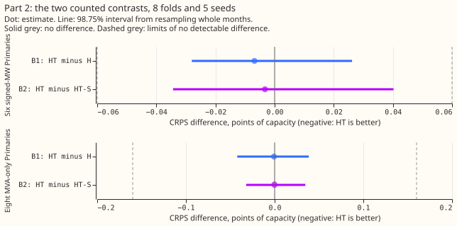
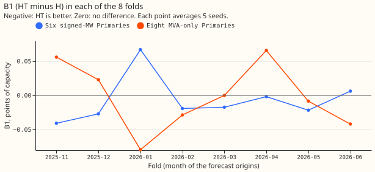
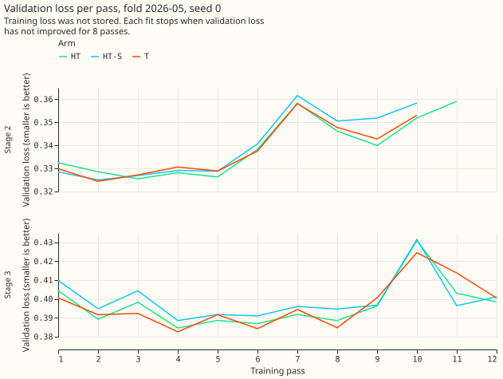
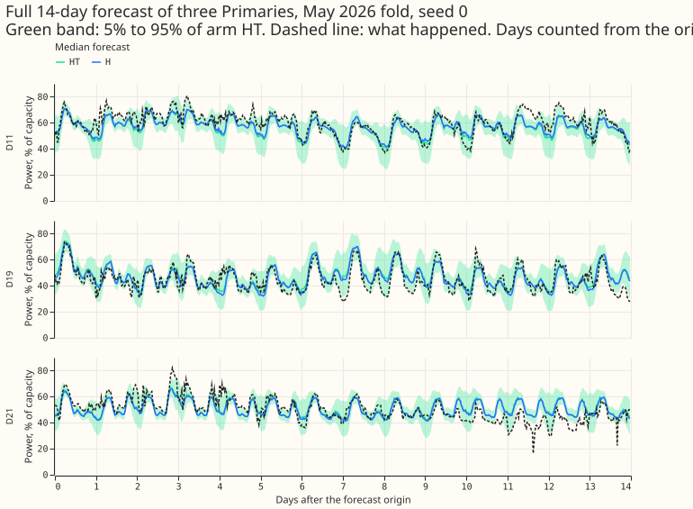
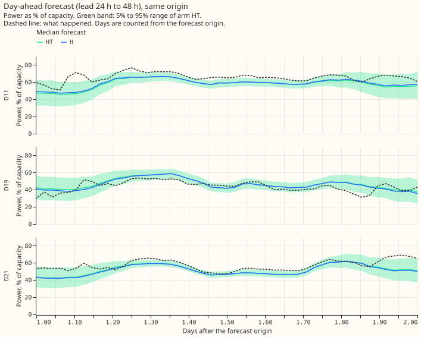

**We asked whether a neural network that forecasts a Primary substation's electricity demand
becomes more accurate when it is also given a forecast of the solar power generated behind the
substation, for the day being forecast.** The network is the axial-attention network of
[experiment 713](../00713-msa-axial-attention-demand-network-part-1/result.md), and
[experiment 716](../00716-msa-unmetered-pv-part-1-history-estimate/result.md) already gives it an
estimate of the solar output of each of the 14 past days. We added a forecast for the target day:
the substation's installed solar capacity times a yield curve driven by the ensemble-mean and
ensemble-spread shortwave irradiance of the 00:00 UTC European Centre for Medium-Range Weather
Forecasts (ECMWF) ensemble run of the origin day. We compared the network with and without that
forecast on 16 Primaries over 8 monthly test periods and 5 random seeds. A second network read
the forecast issued 28 days earlier, which has no information about the target day, so that a gain
from the target day's own sky could be told from a gain from the extra parameters. The forecast
error did not change: both differences are within 0.007 percentage points of capacity of zero, and
every interval includes zero. This page is part 2 of follow-up F7. The design is condensed from the
private design note `f7_design.md`, and the details that this part shares with part 1 (the
estimate of past solar output, the as-of capacity, the network paths, the training recipe, the
known-answer worlds, and the leakage rules) are on the page of experiment 716.

## Result

**The verdict is `not supported`, taken from the pre-registered mapping and applied as written.**
Each of the two counted contrasts is read in two groups of Primaries: the six whose power is
metered in signed megawatts, and the eight metered only in megavolt-amperes (MVA). B1 is arm `HT`
minus arm `H`, and B2 is arm `HT` minus arm `HT-S`. Each of the four counted readings is "no
detectable difference", because its 98.75% interval lies inside plus or minus 0.06 points of
capacity (six signed-MW Primaries) or 0.16 (eight MVA-only Primaries). The verdict function of
experiment 716 maps four such readings to `not supported`, and `closes_line` is true, so the
verdict adds one to the stop-rule count and closes the line. The prediction written before any fit
held: B1 lies inside its ranges, and the interval of B2 includes zero in both groups. The
warm-start states of experiment 713 come from a waived known-answer gate, and the verdict
concerns a forecast added to a network that already reads the historical estimate. Every number in
this section comes from `score/part2.json` or `score/secondary_part2.json` in the data folder of
this experiment.

| Contrast | Group | Point | Interval (98.75%) | Seeds with the sign of the point |
|---|---|---|---|---|
| B1: `HT` minus `H` | six signed-MW | -0.0068 | -0.0280 to +0.0262 | 4 of 5 |
| B1: `HT` minus `H` | eight MVA-only | -0.0007 | -0.0422 to +0.0385 | 2 of 5 |
| B2: `HT` minus `HT-S` | six signed-MW | -0.0033 | -0.0344 to +0.0402 | 4 of 5 |
| B2: `HT` minus `HT-S` | eight MVA-only | -0.0002 | -0.0320 to +0.0346 | 3 of 5 |
| Control: `HT-S` minus `H` | six signed-MW | -0.0036 | -0.0300 to +0.0221 | 2 of 5 |
| Control: `HT-S` minus `H` | eight MVA-only | -0.0005 | -0.0144 to +0.0159 | 2 of 5 |

**The contrasts are differences of CRPS in percentage points of capacity, over leads of 24 h up to
240 h, and a negative number favours the first arm.** The 99.375% sensitivity reading (eight
readings across both parts) changes no verdict. Its B1 intervals are -0.0292 to +0.0293 and -0.0460
to +0.0417. The seed guard fails in both groups, so a pre-registered `gain` reading was
unreachable as well, and the three guards of the reading are false in every row.

**The 95% report-only readings are consistent with a tie, with two exceptions that change no
verdict.** Report-only readings are not corrected for the number of readings.

| Reading (95%) | Six signed-MW | Eight MVA-only |
|---|---|---|
| `HT` minus `M*`, 5 seeds | -0.0235 [-0.0463, -0.0015] | -0.0191 [-0.0569, +0.0235] |
| `HT` minus the Candidate, 5 seeds | -0.1707 [-0.2710, -0.0724] | +0.0030 [-0.0924, +0.0841] |
| `HT-S` minus the Candidate, 5 seeds | -0.1674 [-0.2769, -0.0579] | +0.0032 [-0.0790, +0.0684] |
| `T` minus `M*`, 2 seeds | -0.0271 [-0.0604, +0.0073] | -0.0340 [-0.0602, -0.0067] |
| `HT` minus `T`, 2 seeds | +0.0212 [-0.0136, +0.0643] | +0.0131 [-0.0274, +0.0508] |

**Two exceptions stand out.** First, `HT` minus `M*` excludes zero at the six signed-MW
Primaries, but `HT` minus `H` does not, so the difference from `M*` does not come from the
target-row forecast. Second, `HT` is worse than `H` at the two Primaries D15 and D18, whose
history is short: the first contrast pooled over those two is +0.136 [+0.018, +0.269] (95%), and
D15 alone is +0.260 [+0.013, +0.554]. Those two Primaries belong to neither counted group. Arm `T`,
which has the target-row forecast and no historical estimate, scores as well as `HT` within its
intervals, on 2 seeds only.

**The first contrast by lead band is flat.** At the six signed-MW Primaries, `HT` minus `H` is
-0.0133 [-0.0318, +0.0108] at leads of 24 h to 72 h, -0.0106 [-0.0286, +0.0149] at 72 h to 120 h,
and -0.0027 [-0.0247, +0.0235] at 120 h to 240 h. At the eight MVA-only Primaries it is +0.0005,
-0.0012, and -0.0010, with intervals of about plus or minus 0.03 to 0.035. All intervals include
zero. The pooled reading over all 16 Primaries is +0.0140 [-0.0037, +0.0311].

**Secondary readings S1 to S5 (95%, one of 14, so one false positive is likely) read as a tie.**
S1 and S2 are B1 and B2 on the solar block (06:00 to 14:30 UTC) of the three sunny folds, 2026-04
to 2026-06. S4 is B1 on the whole band of the four dark folds, 2025-11 to 2026-02.

| Reading | Six signed-MW | Eight MVA-only | Holds |
|---|---|---|---|
| S1: `HT` minus `H`, solar block, sunny folds | -0.0067 [-0.0124, -0.0011] | -0.0045 [-0.0886, +0.0564] | No, No |
| S2: `HT` minus `HT-S`, solar block, sunny folds | -0.0420 [-0.0482, -0.0278] | -0.0036 [-0.0430, +0.0555] | No, No |
| S4: `HT` minus `H`, dark folds | -0.0043 [-0.0356, +0.0435] | -0.0072 [-0.0553, +0.0392] | Yes, Yes |

**S1 at the six signed-MW Primaries excludes zero but is 0.007 points, far below the 0.05 that
the reading needs, and S2 at the same Primaries excludes zero with a point of -0.042, still above
the -0.05 that it needs, so neither holds.** S2's interval is narrow because the seeds agree. S3
(the gap between the dull and the sunny third of days) is -0.0393 [-0.0617, -0.0154] at the
six signed-MW Primaries and -0.0769 [-0.1146, -0.0403] at the eight MVA-only Primaries, with 90
origin days, and holds in neither group. S5, the Spearman correlation between the per-Primary first
contrast and the photovoltaic share, is -0.160 [-0.730, +0.509] over 14 Primaries.

**Leaving one Primary or one month out does not change a verdict, and flips the sign of B1 at the
eight MVA-only Primaries in several cases because the point is almost zero.** At the six
signed-MW Primaries, B1 stays negative whichever Primary or month is left out (from -0.0121 to
-0.0018 over the Primaries and from -0.0173 to -0.0019 over the months). At the eight MVA-only
Primaries, B1 is -0.0007 with all eight, and leaving out D4, D12, D21, D2, or D8 gives a point
between +0.00002 and +0.0083, while leaving out D22 gives -0.0140.

## Loss curves

**The figure shows validation loss only, because the fit logs store no training loss.** Each fit
log keeps the validation-loss value of every pass (`val_history`), its best value, and the
stopping pass, and keeps no per-pass training loss in any of the 96 fits (`HT` 40, `HT-S` 40, `T`
16). The curves are those of fold 2026-05 and seed 0. Every fit stopped by patience (8 passes
without improvement) before the 60-pass cap, with a mean of 14.4, 13.7, and 13.7 passes in stage 2
and 17.0, 16.0, and 15.9 in stage 3 for `HT`, `HT-S`, and `T`.

## Forecast examples

**The examples use Primaries D11, D19, and D21 at the middle origin of the fold 2026-05, seed 0,
chosen before the plots were drawn.** The band is the 5% to 95% range of arm `HT`, and the lines are
the median forecasts of `HT` and `H` and the actual. The bands widen with the lead. **A caveat
applies to D19 and D21: the as-of capacity factors of the fold 2026-05 look ahead of the forecast
origin at both Primaries, so the solar estimate of arm `H` carries information that a live service
would not have.** D8, D12, and D22 are not shown, for the same reason. The charts were rendered with headless Chromium and read for labels, overlaps, and units.

## Attention maps

**Part 2 stores no attention maps of its own, so the maps of fold 2026-05, seed 0, are those of
experiment 716.** Arms `M*` and `H` are stored in `work/attention/` of
[experiment 716](../00716-msa-unmetered-pv-part-1-history-estimate/result.md), and the same
look-ahead caveat for D19 and D21 applies. No attention extraction was run for arm `HT`.

## Checks

- **The median forecast minus the mean forecast, per site, is not stored.** `part2.json` has no
  table of it, so the page does not report it. This is a gap against the plan.
- **The error of the median beside the CRPS contrast.** At the six signed-MW Primaries, the
  normalised MAE contrast is -0.0114 [-0.0423, +0.0237], the same direction as B1. At the eight
  MVA-only Primaries it is +0.0048 [-0.0564, +0.0635] against a CRPS contrast of -0.0007, so the
  two point in different directions, and both intervals include zero. That is audit trigger 3 on
  its wording, with no verdict at stake.
- **Which audit triggers fired.** Trigger 5 (a nested arm beats its container) did not fire
  (`audit_trigger_5.fires` is false). The control `HT-S` minus `H` moved the score by less than its
  own interval's half-width. Trigger 4 (leaving one site out flips the sign) fires on its wording
  at the eight MVA-only Primaries, where the point is -0.0007, with no change of verdict. No audit
  was run, and the experiment manager decides whether one is needed. Triggers 1, 2, and 6 did not
  apply, and trigger 7 was not assessed.
- **Cold nights.** The cold-night difference is +0.0011 at the six signed-MW Primaries and -0.0406
  at the eight MVA-only Primaries (`cold_night_difference` in `part2.json`). The guard of
  `supported` for the six signed-MW Primaries holds, and for the eight MVA-only Primaries the
  guards of leaving one Primary and one month out and of the MAE fail. The verdict does not depend
  on them.
- **Tails.** The upper limits of the 95% intervals of the q01 and q99 pinball-loss contrasts are
  0.0092 and
  0.0308 at the six signed-MW Primaries and 0.0005 and 0.0146 at the eight MVA-only Primaries,
  all below their limits (`guards.<group>.tails`). Coverage tables for q01, q05, q95, and q99 were
  not produced.
- **The equivalence of the lean loader passed.** The check script ran in one fold and 2 seeds of
  arm `HT`, and the largest difference was 0 in every column with identical row order (log in
  the experiment manager's scratch folder, `717_check.log`).

## Planned tables that do not exist

**Several tables of the plan were not produced, and this page does not invent them.** The stored
files have no table of each arm's absolute CRPS beside the manual heuristic and BG2, no q01, q05,
q95, and q99 coverage table, no avoidable-curtailment cost, and no four load-shift scenarios. The
plan's reading of cold winter nights is the single difference above, with no per-arm score. The
report script `e00717_report.py` stops with a `TypeError` while printing the report-only
contrasts, after the cold-night line, because it indexes a list as a dictionary. This page takes
those contrasts from `part2.json` directly. The script is a reviewed script and was not edited.

**Known-answer check KF9 failed and the maintainer waived it, so the gate is a waived known-answer
check and not a passed one.** The gate is the one of part 1. KF9 asks arm `H` to beat arm `H-S` on
the solar block of world WH by half the `gap`. Its value is 0.00070 against the need of 0.00729, and
its secondary readings (days 1 to 60, days 61 to 236, and pass 60) fail as well. KF10, KF11, and
KF12 pass. No threshold and no verdict rule changed. An audit of the failure found no implementation
fault and two method findings. First, the patience-8 rule scored arm `H` at passes 4, 23, and 5 of
seeds 0, 1, and 2, against global bests at passes 43, 55, and 32, because the history path learns
slowly. Second, the pass mark forces arm `H` below the oracle ridge: arm `H-S` scores 0.0394 on the
solar block and arm `Z` 0.0397, the naive ridge reference 0.0470, and the oracle ridge 0.0324, so
arm `H` must score 0.0321 or better, below the oracle ridge's 0.0324. Every statement that the
history path recovers the hidden sky from the PV estimate is therefore unsupported by a passing
known-answer test.

**The early-stopping pre-check of the known-answer worlds read one seed of three, and the other
seeds of arm `M` in world WH are noisier than its limit.** The pre-registered pre-check reads arm
`M` of seed 0 only. At rung 4 it passed in both worlds, with a last-10 validation-loss noise of
0.0109 in world WH against the limit of 0.0225, and 0.0121 in world WT against the limit of 0.134.
Seeds 1 and 2 of arm `M` in WH have a last-10 noise of 0.029 and 0.031, above the WH limit, so the
rung-4 pass in WH depended on seed 0. In WT, seeds 1 and 2 have 0.038 and 0.016, below the WT limit.
The numbers review checks this reading.

**The expectation, written before any fit, was a tie, and the result was a tie.** Six earlier
experiments found that an explicit PV term built
on forecast weather did not help net demand (the table below), and the target tokens already carry
ENS shortwave. With 5 seeds the design detects, with 80% power, a CRPS difference of 0.06 points
of capacity at the six signed-MW Primaries and 0.16 at the eight MVA-only Primaries.

## Why this runs although the stop rule counts earlier verdicts

**The maintainer asked for follow-up F7 by name and confirmed the scope on 2026-11-23 ("I
confirm."), relayed through the experiment manager. That instruction is the approval that the
demand protocol requires, and part 2 is at least the seventh counted experiment on its idea.** The
stop rule counts the verdicts `not supported` and `refuted` on one idea, resets the count at
`supported` or `small gain`, and from the fourth experiment requires the maintainer's approval and
scoring at every Primary. The last `supported` or `small gain` verdict on this idea is experiment
325, in the GAM stack. Part 2 is scored at every one of the 16 Primaries.

| Experiment | What the experiment gave the forecast | Verdict | Counted |
|---|---|---|---|
| 409 | An explicit solar term in the pooled mixture density network | `not supported` | Yes |
| 477 | An explicit PV module in the net demand neural network | `not supported` | Yes |
| 501 | An explicit solar-output column from an as-of capacity | `refuted` | Yes |
| 644 | An explicit solar-capacity term with ENS weather | `refuted` | Yes |
| 655 | A member-level solar curve with cell temperature | `refuted` | Yes |
| 664 | Net demand as gross demand minus a sampled ENS solar curve | `refuted` | Yes |
| 661 | Whether the ENS time step explains experiment 644, and a bias adapter | `refuted` | Borderline: gives 7 |
| 350, 351 | A capacity-free irradiance curve and a capacity read-out in the GAM stack | `not supported`, twice | Arguably: gives 9 |
| 329, 419 | A 3-member solar distribution; a solar summary in the mixture density network | `not supported`, twice | Borderline: gives 11 |
| 031, 349, 405, 416 | PV features in XGBoost and the GAM stack; explicit term with learned capacity or 5 seeds | `inconclusive` | No |
| 352, 639, 643 | Explicit terms scored with recorded weather | `partly supported` | No: neither counts nor resets |

**This part departs from the advice of experiments 644 and 655 (no explicit solar term in the ENS
demand network) on the maintainer's instruction.** It follows experiment 661's advice to keep
production's window-mean resampler for ENS shortwave and experiment 501's advice to judge a
capacity by a placebo test. The new element over the counted experiments is the paired history
estimate of experiment 716. Experiment 713's screen stop rule binds this part: if it fires, or
if part 1 stops at its screen, part 2 stops and asks the manager. Experiment 713's known-answer
gate failed KA3 and KA12 and was waived by the maintainer on 2026-11-23, so every verdict here
makes no claim about era recognition or level shifts.

## What is compared

| Arm | PV input | Seeds | Role |
|---|---|---|---|
| `H` | CAMS `PV̂` in the 14 history rows | 0 to 4 | Reference of B1 (experiment 716's fit) |
| `HT` | As `H`, plus the ENS PV forecast in the target row | 0 to 4 | Treatment |
| `HT-S` | As `HT`, with the target-row forecast from the ENS run 28 days earlier | 0 to 4 | Counted placebo |
| `T` | The ENS PV forecast in the target row only | 0 and 1 | Report-only: scope (b) without scope (a) |

**B1 is read against `H` and not against `M*`, so that part 2 is not credited with a gain that part
1 made.** `HT` with its target paths at zero is `H` exactly, and both start from the same state of
`M*`. `HT` minus `M*` and `T` minus `M*` are report-only. `HT-S` reads the ENS run issued 28 days
before the origin day at the same lead day, with the same clear-sky-index transfer on the mean and
the spread. For origins in the first 28 days of the ENS record the donor run is 28 days later, which
is issued after the sample's origin and says nothing about the sample's target day; the check counts
those origins in training and in held-out days and the page lists them.

## The target-row forecast

**The target row gets two numbers per half-hour, `p0_mean` and `p0_sd`, from the yield curve's mean
and standard deviation over three Gauss-Hermite nodes of the ENS shortwave.** The shortwave and its
spread are columns 0 and 7 of the Candidate's non-lag layout, un-standardised with the fold's
standardiser from float32 source rows, with the ENS-mean 2 m temperature. A second token path `γ_t ⊙
(W2_t GELU(W1_t [p0_mean·ok, p0_sd·ok, ok]) / r_t)` enters the target tokens, a table `c[primary]`
multiplies `p0_mean` in the mixture means, and the head map reads `p0_mean` and `p0_sd`. All of them
start at zero with a random partner. Arm `HT` has 4,800 new parameters (134,799 in all, 3.7% more
than `M*`). With `a = 1` and `c = -1` the mean is the similar-day mean of gross demand minus the
forecast PV, the decomposition of experiment 064; `p0_sd` lets the head widen the mixture when the
ENS members disagree about the sky. The network, training recipe, optimiser groups (1e-2 for `a` and
`c`, 3e-3 for `γ_h` and `γ_t`), and known-answer checks are those of experiment 716, with world WT
and checks KF11 and KF12 for part 2. **KF11 requires `HT-S` minus `HT` in world WT to be at least
0.5 × the `gap` of WT** (`HT-S` reads the target sky of the run 28 days earlier), and the same two
pre-checks as in part 1 apply to WT: the `gap` of at least 0.010 and the early-stopping check, which
uses the rung that part 1's ladder chose.

## Counted contrasts and the decision rule

| Id | Contrast | Question |
|---|---|---|
| B1 | `HT` minus `H` | Does an explicit PV forecast in the target row add to the network that reads the historical estimate? |
| B2 | `HT` minus `HT-S` | Does the gain come from the forecast sky of the target day? |

Each part has four counted readings, so each interval is read at 98.75%. Because the two parts share
arm `H`, each page also reports its contrasts at 99.375% (eight readings across both parts) as a
labelled sensitivity reading that changes no verdict. **Report-only, at 95%:** `HT` minus `M*`, `T`
minus `M*` (the reading that compares directly with experiments 501 and 644), `HT` minus `T`, every
arm minus the Candidate, every contrast at all 16 Primaries, by lead band, by Primary, with one
Primary left out, and with one month left out. The `supported` guards are those of experiment 716,
except the mask guard, which belongs to part 1. Secondary readings S1, S2, and S4 (the solar block
of the sunny folds, and no harm in the dark folds) apply to B1 and B2 and change no verdict.

**Seeds 2 to 4 run only if a counted treatment contrast gives a reason to continue.** After the
8-fold, 2-seed reading of the counted contrasts, seeds 2 to 4 run only if, for at least one counted
treatment contrast, the point estimate is below zero in at least one group (the six signed-MW
Primaries, the eight MVA-only Primaries). If every counted treatment contrast has a point estimate
at or above zero in both groups, the experiment is written up at 2 seeds with the pre-registered
two-seed values, and the page states that the futility rule fired. A reading with a point estimate
below zero is the only one that opens seeds 2 to 4, and the ablation contrasts (A2 and B2) never
open them. Interim, 2 seeds: the counted points of B1 (-0.0014 and -0.0033) are below zero in both
groups, so the rule opened seeds 2 to 4. This rule was added before any treatment score was read. No
threshold or verdict rule changed. The fit logs of phase 3 already held validation-loss lines when
this rule was added (five at the time of the edit), and they were not read before the edit.

**Fits run in the order of phases 3, 4, and 5 before phase 6, and the fit logs are read for stopping
passes only.** Every fit's log summary reports its stopping pass: the stage, the pass number, and
whether the 60-pass cap or the patience ended the stage. The implementer reports that table to the
manager, and reads no validation loss and no treatment score from the logs before the two-seed
scores are read.

## Leakage, compute, and plots

**The target-row forecast is buildable live.** The ENS run of the origin day is issued 9 hours
before the 09:00 UTC native origin, and the experiment asserts `nwp_init_time <= origin - 9 h` for
every row and for the PV table. A poisoned-input check sets every target-row value from a run
issued after the native origin minus 9 hours to 1e6 and to NaN and requires every assembled input
to stay unchanged. **Because `H` carries the lab shortcut on history weather, every score is a
ceiling for a live forecast.** Part 2 needs about 8 GPU-process-hours (`HT` and `HT-S` on 8 folds
with 2 seeds, 2.6; seeds 2 to 4, about 3.8; `T`, 1.3), inside a reporting ceiling of 24 across
both parts. Part 2 has no screen, because the stop rule's requirement of scoring at every Primary
replaces any screening arm. The plots are those of experiment 716, with `HT` added to the
day-ahead and 14-day forecasts, and the learned `c` per Primary. No page names or plots a metered
generator's time series.

## Risks

- **The ENS cloud error defeated the explicit term in experiments 644, 655, and 661.** `HT` reads
  the
  same forecast. `p0_sd` and the zero-initialised gain let the network discount it.
- **A nested arm beating its container** (`H` beating `HT`) is audit trigger 5 of experiment 713.
- **The design cannot resolve a gain under 0.06 at the six signed-MW Primaries**, although the
  smallest gain worth porting is 0.02.

## Method

All fits of the three arms are stored and scored, so these bullets
describe the design as it was run.

- **The known-answer gate is waived at KF9:** `e00716_waive_gate.py` writes the gate file with
  `waived: true`, the failed check and its values, the code hash, and the sha256 of the last-run
  file and of `e00716_known_answer.py`. The scoring rule of the known-answer checks, patience 8 and
  the median of the 5 passes ending at the best pass, is unchanged.
- **The pre-check reads seed 0 only:** the noise limit of the early-stopping pre-check comes from
  the last 10 validation losses of arm `M` at seed 0. At seeds 1 and 2 of WH the same noise is 0.029
  and 0.031, above the limit of 0.0225 in WH at rung 4. The diagnostic best pass of the pre-check
  uses patience 30, the patience that trains arm `M`. An Opus review of the code behind the
  pre-check (commit 126577d1d) was clean.
- **Architecture and training regime:** experiment 716's, with the target-row paths of this page.
  Every arm starts stages 2 and 3 from the stored stage 1 state of `M*` of the same fold and seed.
- **Measurement:** as experiment 716, on 8 folds and 16 Primaries, with no screen.
- **Standing practices followed:** as experiment 716.

## Amendments made after the first code review

**The reference regressions, the gating fits, and the cold-night guard are as on the page of part
1.** The amendments that part 1's page lists (48 ridge regressions per Primary pooled over the 14
leads, the gating fits that mirror the real recipe, and the cold-night guard computed inside the
scorer) apply to this page unchanged.

**KF7 runs on the GPU, as on the page of part 1.** The stored forecast of `M*` was written on the
GPU, and the CPU path differs from it by 8.4e-6 of capacity at the 99th percentile.

**The pre-check, the step up, and the reserve are as on the page of part 1.** After a failed
early-stopping pre-check at rung N, the step up to the next rung needs a failed pre-check record of
rung N, every extra fit of arm `M` is charged to the reserve of phase 9 of design section 10, and F7
stops before any PV fit if no rung above N passes.

**The `gap` of the worlds is measured on the 236 days after the cutoff, over eight world draws, and
a rung passes only if both the mean and draw 0 reach 0.010 in WH and WT.** The rule is the one on
the page of part 1: `HELD_OUT_DAYS = 236` for the `gap` and for every metric of KF9 to KF12 (so KF11
compares against the `gap` of WT's draw 0 on the 236 days, and needs 0.057 at rung 4 where the
60-day rule needed 0.041), a rung whose mean passes and whose draw 0 fails is a failed rung,
`chosen_rung()` refuses a stale file or one without the eight-draw fields, and KF9 and KF11 are also
printed on days 1 to 60 and 61 to 236 without gating.

**The first rung failed on fresh draws on the 60-day window, and the validation window was widened
before any fit of `M`.** The stored rung-4 pass came from an upper-tail world draw: on the 60
validation days, 3 of 10 fresh draws reached 0.010 and the mean was 0.0087. Before any fit of `M`,
and with those values known, the `gap` and KF9 to KF12 were moved to the 236 days after the cutoff
and the rung rule gained a condition on the mean over draws 0 to 7. The world itself was not
changed. The change turns rung 5 from a fail into a pass (0.0099 on the 60 days at draw 0, 0.0147 in
WH and 0.1163 in WT on the 236 days), so a failed early-stopping pre-check at rung 4 leads to rung 5
and not to a stop. Rung 4 is chosen: WH's eight draws on the 236 days have a mean of 0.0129, and
WT's have a mean of 0.1123. A second failure of the pre-check after the step up to rung 5 goes to
the maintainer through the manager as a waiver question, and no new definition of the check's tokens
or noise is adopted afterwards. In the eight stored known-answer fits of experiment 713 the standard
deviation of the last 10 validation losses (`ddof=1`) lay between 0.0037 and 0.0265, and arm `M` in
world W1 sits at 0.0220 against the rung-4 limit of 0.0225.

**The cold-night guard departs from the protocol's slice in two ways.** The guard restricts to UTC
months 12, 1, and 2, which the protocol's slice does not, and reads the sun at the grid stamp, not
at the half-hour midpoint.

**Merge experiment 716 (part 1) first, then rebase this branch onto `main`.** Until part 1 is on
`main`, `ty check` cannot resolve the `e00716_*` imports of this folder, so they carry `ty: ignore`
comments. Every script here calls `e00717_guard.require_part1`, which refuses to run when
`EXTRA_PYTHONPATH` does not name an existing part 1 folder or when an `e00716_*` module comes from
any other folder, so a removed part 1 checkout cannot silently give way to a stale copy.

**The fits of `HT`, `HT-S`, and `T` run through this folder's `run.sh`,** which finds
`e00716_fit.py` and `e00716_predict.py` in part 1's folder through `EXTRA_PYTHONPATH`. The fits
write under this experiment's data folder.

## What is stored

**All 96 fits of part 2 are stored, and every one ended by patience.** Arm `HT` has 40 fits (8
folds, seeds 0 to 4), arm `HT-S` has 40, and arm `T` has 16 (8 folds, seeds 0 and 1). The fit logs
in `work/logs/<arm>/<fold>_s<seed>_fit.json` give these stopping passes (stage 2 is the first of the
two stages that each fit trains, and stage 3 is the second).

| Arm | Fits | Stage 2 passes: mean (min to max) | Stage 3 passes: mean (min to max) | Fits at the pass cap |
|---|---|---|---|---|
| `HT` | 40 | 14.4 (10 to 25) | 17.0 (9 to 38) | 0 |
| `HT-S` | 40 | 13.7 (10 to 25) | 16.0 (9 to 38) | 0 |
| `T` | 16 | 13.7 (10 to 25) | 15.9 (10 to 23) | 0 |

**Report-only read-outs of arm `HT` without a refit are stored for the look-ahead and mask checks.**
The forecasts `HT-cams` and `HT-convention` (all 40 fold-seed cells), and `HT-nopv`, `HT-lookahead`,
`HT-scale0.7`, and `HT-scale1.3` (8 folds, seed 0) are stored under `work/fits/`.

**GPU time: 23.7 GPU-process-hours are counted for F7 as a whole, and part 2's arms took 8.4.**
The figure sums the start and end times of every GPU job in the F7 run logs (22.5 hours),
the two known-answer fits of arm `M` in worlds WH and WT at seed 0 (1.1 hours, from file times),
the KF7 check (0.02 hours), and the attention extraction (about 1 minute, which runs on the GPU).
Part 2's share is arm `HT` 5.0, arm `HT-S` 2.4, and arm `T` 1.0 hours. The total stays under the
manager's stop line of 26. If the rebuild of the known-answer world ladder (about 1.2 hours of
wall time) ran on the GPU, the total is 26.1 hours. The code of that ladder
(`e00716_world_rung.py` and `e00716_worlds.py`) names no device, so it is taken to run on the
CPU, but the run log records no device, so the device of the ladder rebuild is unconfirmed. The
run logs live in the workstation's `/tmp`, not in the data folder, and the figure is a sum over
them.

**Anonymisation.** The page names no metered generator and gives no capacity in megawatts. The
forecast examples show Primaries and count days from the origin.

## Reviews

Two Opus design reviews preceded this page, and the second review's finding S7 changed one verdict
rule before any fit, as the decision rule states. Code reviews of the scripts and a read of the
lean-loader diff took place before the final scoring. Still to come: a fresh numbers review of this
page against the stored tables, a write-up review, a prose review, and the manager's decision on
whether audit trigger 4 or 3 needs an audit.

## Files

- `ml-experiments/00717-msa-unmetered-pv-part-2-target-row-forecast/e00717_score.py`: scores arms
  `HT`, `HT-S`, and `H` with the scoring code of experiment 716 (contrasts B1 and B2, guards,
  verdict, secondary read-outs). It also holds `load_all_lean`, which replaces part 1's loader
  with one that loads one fold at a time and keeps 7 columns per per-seed row, because the
  5-seed run of the unpatched loader needs more than 16 GB. SHA-256 of the file as committed with
  the patch: `adfc8a4f0af7f2d1168e81ae786c94e323aadbbfb6acf40ec3f4ecae6a7c6648`. It ran the final
  5-seed
  scoring of part 2 (`score/part2.json` and `score/secondary_part2.json`).
- `.../e00717_check_lean_loader.py`: a read-only check that writes no file. For one fold and
  seeds 0 and 1 of one arm, it prints the largest absolute difference between the two loaders in
  every column that the contrast reads, the row counts, and whether the row order is identical.
  The expected result is a difference of at most 1e-12 and identical order. SHA-256:
  `37e8cae474a3d63b3a49fdda3b4917a2337eef9b3deb86de0abd3a230c001f77`. It ran once, with a result of
  PASS: a largest difference of 0 in every column and
  identical row order, for one fold and 2 seeds of arm `HT`.
- `.../e00717_report.py`: prints the numbers of the final page from the score files. It stops
  at the report-only extra contrasts, see "Planned tables that do not exist".
- `.../e00717_figures.py`: draws a contrast chart and a by-fold chart from `score/part2.json`. The
  page's `contrasts.svg` and `b1_by_fold.svg` come from `e00717_plots.py` instead, because the
  charts of `e00717_figures.py` were wider than the text column.
- `.../e00717_plots.py`: draws `contrasts.svg` and `b1_by_fold.svg` from `score/part2.json`, the
  forecast examples at D11, D19, and D21 from the stored forecasts of arms `HT` and `H`, and the
  validation-loss curves from the fit logs. It scores nothing.
- `.../e00717_futility_read.py`: reads the interim 2-seed contrasts and writes
  `score/futility_part2.json`. `.../e00717_s1_read.py` writes the report-only
  `score/s1_interim.json`.
- `.../e00717_guard.py` and `.../run.sh`: refuse a stale copy of part 1's code, and run a command
  with one thread per numerical library and a memory cap.
- `ml-experiments/00716-msa-unmetered-pv-part-1-history-estimate/`: the network, batches,
  training, and predictions (`e00716_fit.py`, `e00716_predict.py`, `e00716_score.py`), imported
  and not edited, as described on
  [experiment 716](../00716-msa-unmetered-pv-part-1-history-estimate/result.md).
- `data/ml-experiments/00717-msa-unmetered-pv-part-2-target-row-forecast/work/fits/<arm>/`: the
  stored forecasts, one parquet file per fold and seed (written by this experiment, read by the
  scorer). `work/logs/<arm>/` holds the fit, stage, and predict logs, and `work/models/` the
  network states. Never committed.
- `data/ml-experiments/00717-msa-unmetered-pv-part-2-target-row-forecast/score/`: the interim
  files `futility_part2.json` and `s1_interim.json`, both written by this experiment.
- `data/ml-experiments/00716-msa-unmetered-pv-part-1-history-estimate/work/fits/H/` and
  `work/attention/`: arm `H` forecasts and the attention maps, written by experiment 716 and read
  here.
- `data/ml-experiments/briefs/msa_architecture/f7_design.md` and its reviews (read, private).
