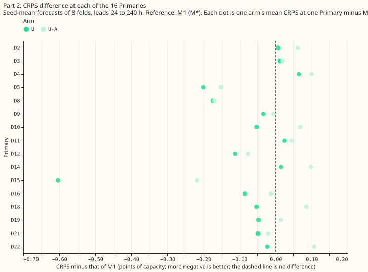
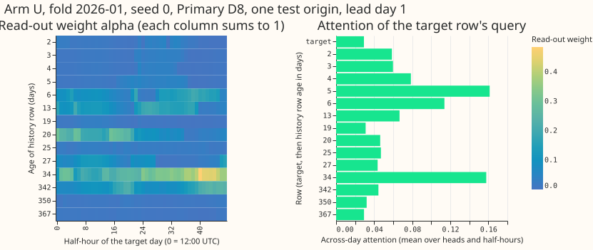
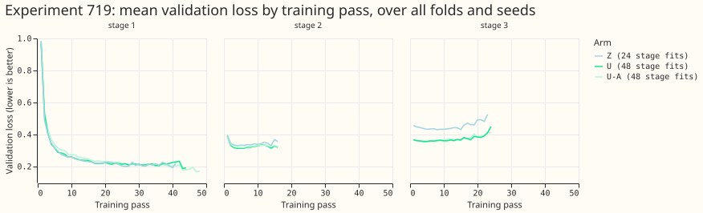
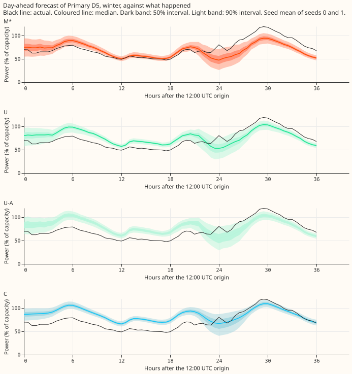

**We asked whether the axial-attention demand network of experiment 713 forecasts a Primary
substation better when its 14 history rows are a mixture of recent, same-weekday, and
weather-matched past days instead of the last 14 days.** The network reads a matrix of past days by
48 half-hours and attends over the days. We fitted the network with five rows chosen by weather
similarity to the target day's ensemble weather forecast, five of the most recent days, and four of
the most recent days with the same weekday, taken from the past 379 days. We compared the forecasts
with two references: the network with the last 14 days, and the network with the same recent rows
and random rows of matched ages. We scored 8 months of forecasts at 16 Primaries. The
weather-and-recency mixture forecast about 0.06 points of capacity better than the network with the
last 14 days at the 6 Primaries that meter signed power, and not detectably better at the 8
Primaries that meter only apparent power (MVA).

**Verdict: small gain.** The two-seed rule of experiment 713 gives `small gain` at the six and `no
detectable difference` at the eight for the first contrast. Every interval below is at 98.75%
(month-block bootstrap, 8 monthly folds, seeds 0 and 1, CRPS in points of capacity, negative favours
the mixture).

| Contrast | Group | Point and interval | Reading |
|---|---|---|---|
| B1: mixture `U` minus last 14 days `M*` | six | -0.055 [-0.111, -0.006] | small gain |
| B1 | eight | -0.041 [-0.131, +0.057] | no detectable difference |
| B2: `U` minus the matched-age random placebo `U-A` | six | -0.062 [-0.100, -0.021] | gain |
| B2 | eight | -0.045 [-0.076, -0.012] | small gain |

**The gain is small, and the two guards that need extra scoring have not been read.** The cold-night
guard and the selection-swap guard of the decision rule are unread, so the page's `all guards hold`
field is false by rule. The leave-one-Primary-out, leave-one-month-out, tail, and
error-of-the-median guards hold at both groups. The table of guards, the screen reading, and the
clean-fold reading are in the printed report under `data/ml-experiments/00719-*/score/`. All scores
are ceilings for a live forecast, because the rows were retrieved with the stored ensemble forecast
and the lab shortcut that experiment 713 documents. Experiment 713's own known-answer gate was
waived by the maintainer on 2026-11-24, and F9's gate passed (checks KS1, KS2, and KS3 on the
synthetic worlds).

## What the post hoc readings show

**Reverse flow does not explain why the gain is weaker at the eight (post hoc, report-only, from the
stored forecasts).** The maintainer asked whether reverse flow at D8 is the reason.

- **Per Primary, B1 is below zero at 11 of the 16 Primaries and above zero at 5.** The eight's B1 is
  positive at D2 (+0.007), D3 (+0.012), and D4 (+0.064), and negative at D8 (-0.174) and D12
  (-0.113).
- **D8 is where the mixture helps the eight most.** Without D8 the eight's B1 is -0.022, with D8
  alone -0.174. Leaving D8 out makes the eight weaker, so the reverse-flow Primary is not the cause.
- **The data cannot separate reverse-flow half-hours at the eight.** The eight are stored as
  apparent power with no negative values. At the six, 792 half-hours have negative observed power,
  and B1 on those half-hours is -0.499 against -0.055 elsewhere. That is 0.3% of rows and probably
  one Primary, so it is an observation and not a result.
- **The eight's monthly B1 swings about twice as much as the six's.** The standard deviation of the
  8 monthly means is 0.114 at the eight (range -0.185 to +0.139), 0.123 at the eight without D8, and
  0.063 at the six. B2 has the same spread at both groups (0.040 and 0.048). The month-to-month
  spread, not reverse flow, is the likelier reason for the wider interval.

**The network uses its history rows.** Masking all history power at prediction (a read-out with no
refit) raises the error of `U` by 0.40 points at the six [0.27, 0.54] and 0.33 at the eight [0.24,
0.43], at 95%. `R` of part 1 loses about 0.30 at both groups.

**The 28-row and Christmas variants are report-only.** Scored on the 4 screen folds, `U27` (28 rows:
the last 14 days plus 7 weather and 6 same-weekday rows from older days) minus `M*` is -0.024 at the
six [-0.065, +0.014] and +0.015 at the eight [-0.007, +0.038]. `U27` minus its random placebo
`U27-A` is -0.060 at the six [-0.122, -0.002]. `UX` (calendar-matched rows of earlier winters for
the days around Christmas), scored on folds 2025-12 and 2026-01, forecast 0.062 points worse than
`U` at the six [+0.054, +0.069] and 0.070 worse at the eight, and 0.082 better than `M*` at the six.
`UX` therefore adds no gain over `U` on those two folds. The refit of `M*` through F9's code (arm
`Z`) reproduces experiment 713's forecasts exactly (difference 0.000).

## Plots

- **Contrasts by Primary.** 
- **Ages of the retrieved rows,** fold 2026-01. 
- **Read-out weight by row age** (unreviewed plot). 
- **Attention maps** of `U` at D5 and D8 (unreviewed plots).  
- **Training and validation loss by pass** (unreviewed plot). 
- **Day-ahead and 14-day forecasts** of `M*`, `U`, `U-A`, and the Candidate at D5 and D8 in winter
  and summer.  

## Checks

- **Triggers.** Audit triggers 1 (placebo and `Z` rule) and 5 (nested arm beating its container) did
  not fire on the screen. The error-of-the-median guard moves with CRPS at both groups, so trigger 3
  did not fire. Leave-one-Primary-out keeps the sign at both groups, so trigger 4 did not fire.
- **Numbers from code that has not had its Opus review.** The post hoc reverse-flow table, the
  masked-history scores, the `U27`, `UX`, and `Z` contrasts (a new `secondary` command in
  `e00718_contrasts.py`), the loss plot, the read-out weight plot, and the attention maps all come
  from scripts that wait for one Opus diff-limited review before the pull request leaves draft. The
  `secondary` command changes no line of the headline path.
- **Not done.** The selection-swap read-out (rows chosen with live-fair weather) was not built. The
  cold-night guard and the selection-swap guard are therefore unread.
- **Unlogged events.** NGED's load-shift logs may miss events, so the clean-lag rows may hold events
  no label covers.

## The plan as registered

The sections below are the plan as registered before any fit, followed by the method,
departures, reviews, and files.

**We ask whether the axial-attention network of experiment 713 forecasts a Primary substation's
demand better when its 14 history rows are a union of the 5 weather-nearest, the 5 most recent, and
the 4 same-weekday blocks of the last 379 days, instead of the last 14 days.** This is part 2 of
follow-up F9. Part 1
([experiment 718](../00718-msa-similar-day-retrieval-part-1-weather-distance/result.md)) tests the
weather distance alone over 91 days and fixes the arms, the code, and the decision table that this
page reuses. This page is the plan: no neural network has been fitted, and every number below is a
design value or a figure from an earlier experiment.

**The honest expectation is a tie or a small gain.** In the CPU-only exploration of F9, a plain mean
of the union's rows beat a plain mean of the last 14 days by 0.80 points of MAE at 15 rows, and beat
the best single measure by 0.18. The union was the best of 64 settings reported on the evaluation
folds, on weather that a live service would not hold for the youngest blocks, so the 0.18 is a
hypothesis. Experiment 713's interim screen puts `M*` only 0.13 points (the six) and 0.31 points
(the eight) ahead of 14 random days of the past year.

## Why this runs

**This experiment runs on the maintainer's instruction, as part 1 does.** On 2026-11-23 the
maintainer approved F8 and F9 ("yes, please run these autonomously at the appropriate time.") and,
relayed by the manager, said: "I'd be generous to the similar days idea. I'm optimistic that the MSA
will be able to extract information from similar days that a simpler approach can't." The rules of
[experiment 718](../00718-msa-similar-day-retrieval-part-1-weather-distance/result.md) on experiment
713's verdict, on the confirmation obtained from the maintainer, and on the stop rule apply to this
page unchanged. Experiment 713's section 1.8 closes the "28-row layout" after `not supported`, and
`U27` is a different layout (1 target row and 27 history rows, where experiment 713's layout has 14
target rows and 14 history rows). The maintainer's instruction replaces the manager's earlier
condition that arm `R` as specified would not run.

## What is compared

| Arm | History rows | Rows | Seeds | Role |
|---|---|---|---|---|
| `M*` | Ages 2 to 15 | 15 | Stored | Control; never refitted |
| `U` | 5 weather-nearest, 5 most recent, 4 same-weekday blocks, ages 2 to 379 | 15 | 0, 1 (then 2 to 4) | Treatment |
| `U-A` | The 5 most recent rows of `U`, and 9 random blocks whose ages match the other 9 rows of `U` | 15 | As `U` | Counted placebo |
| `U27` | Ages 2 to 15, plus 7 weather-nearest and 6 same-weekday blocks of ages 16 to 379 | 28 | 0, 1 on 4 folds | Secondary: the largest affordable layout |
| `U27-A` | Ages 2 to 15, plus 13 age-matched random blocks | 28 | 0, 1 on 4 folds | Secondary placebo of `U27` |
| `UX` | `U`, with calendar-nearest blocks of earlier winters for targets from 20 December to 5 January | 15 | 0, 1 on 2 folds | Secondary: the Christmas switch |

**The counted contrasts are B1 (`U` minus `M*`) and B2 (`U` minus `U-A`), each at the six and at the
eight.** B1 compares the union's rows with the last 14 days at equal tokens. B2 compares similar
days with equally old random days beside the same 5 recent rows. `U-A` randomises the weekday rows
as well as the weather rows, so B2 measures weather similarity and weekday similarity together.
`U` minus `P`, `U27` minus `M*`, `U27` minus `U27-A`, `U27` minus `U`, and the Christmas readings
are pre-registered and report-only. The 27 history rows of `U27` contain the 14 history rows of
`M*`, so `U27` minus `M*` is a container against its nested arm.

**Each measure fills its rows in a fixed order, and no block repeats inside a sample.** `U` takes the
5 weather-nearest eligible blocks of ages 2 to 379, then the 5 youngest eligible blocks not yet
chosen, then the 4 youngest same-weekday blocks not yet chosen. The weather distance, the
eligibility rule, the tie rule, the age buckets, and the full-recipe training are those of
[experiment 718](../00718-msa-similar-day-retrieval-part-1-weather-distance/result.md). The
placebo `U-A` keeps the 5 recency rows and draws each of the other 9 rows uniformly from its age
class and from outside the rows of `U`, where ages 2 to 15 form one class and the buckets of the
age table form the others.

## Leakage and the weather look-ahead

**The rules of experiment 718 hold, with the pool widened to 379 days.** Selection reads only the
target row's ENS weather, the calendar, ages, whether a block holds power at least 27 h old, and the
pool blocks' ERA5 and CAMS weather, which is a lab shortcut for blocks of ages 2 to 5. A
prediction-only read-out, the selection swap, rebuilds the row tables with the stored ENS table for
blocks of ages 2 to 5 and ERA5 from age 6, and reports the share of rows that change and B1 under the
swap. The tokens still read ERA5, so the swap measures the selection's dependence on the shortcut
and does not make a live score.

## Decision rule and verdict

**The decision rule is that of
[experiment 718](../00718-msa-similar-day-retrieval-part-1-weather-distance/result.md), with B1 and
B2.** Each part has four counted readings, each interval is read at 98.75%, the smallest gain worth
porting is 0.02 points of capacity, and the seed count is 5 for `U` and `U-A` if experiment 713's
phases 8 and 9 run and 2 otherwise. The reachable thresholds are the same: a null part ends
`inconclusive` or `small gain`, and "no detectable difference" is out of reach at the eight.

**Screen, audit, and stop rules.** The screen is experiment 713's four folds with seeds 0 and 1,
labelled interim. If B2 is positive in both groups on the screen, audit trigger 1 fires before the
other four folds run. The part stops, and is written up from the screen as `not supported`, if B1
on the screen is above +0.15 in both groups, or above +0.10 in both and positive in at least 3 of 4
folds in both. A stop of part 1 does not stop part 2. A verdict of `not supported` or `refuted` in
both parts closes similar-day retrieval of history rows in the network on the 16-Primary panel,
unless `U27` minus `U27-A` is below zero at 95%, which the page says it could not read if `U27-A`
was cut. The exploration tuned on the four screen folds, so the other four folds (2025-12, 2026-02,
2026-04, 2026-05) give the only reading clean of that selection, printed at 95% and report-only.

## Christmas

**No MSA network runs in the live service, and the decision to port any arm lies outside this
experiment.** Arm `UX` replaces the 5 weather rows of `U` by the 5 blocks of earlier winters
nearest in calendar distance, for targets from 20 December to 5 January. In the exploration, the
plain mean of calendar-nearest blocks scored 7.72% against 11.77% for the last 7 days on 24 to 26
December (6 winters). `UX` is fitted for folds 2025-12 and 2026-01 with seeds 0 and 1, and its
readings (`UX` minus `U`, `UX` minus `M*`, `U` minus `M*`) are report-only and one winter. The
pointer "calendar rows help at Christmas" needs `UX` minus `U` on the blocks of 24 to 26 December at
most -0.30 in both groups, with the interval below zero and the same sign for both seeds, and
larger in size than the refit noise that `UX` minus `U` shows outside the window. The pointer is
never a live decision.

## Known-answer checks and worlds

**Part 2 reuses the wiring checks KR1 to KR9 and the worlds of experiment 718.** KS2 needs `U-A`
minus `U` in world WS to be at least half the gap that a NumPy reference computes for the union's
rows. The gating fits and the checks run once, under experiment 718's code, and this page records
the result.

## Compute

**The plan for part 2 is about 9.5 GPU-process-hours with seeds 0 and 1, within the shared ceiling of
23.5 for both parts.** The `U27` fits take about 1.9 times the time of a 15-row fit and an estimated
5.2 GB, and phase 0 of experiment 718 measures both. If the peak exceeds 5.8 GB, `U27` and `U27-A` run
with two half-batches of 128 per optimiser step, with the loss of each half-batch normalised by the
weight sum of the full 256 samples. Order of cuts when the plan is tight: `U27-A`, then `U27`, then
seed 1 of `UX`. The fits of `U` and `U-A` are never cut.

## Disclosures

- **Experiment 713's known-answer gate failed KA3 and KA12 and was waived by the maintainer on
  2026-11-23.**
- **The union was chosen from 64 settings reported on the evaluation folds, with means of rows and
  not with the network.** All four of the exploration's folds are this experiment's screen folds.
  The 5, 5, and 4 split of `U` and the 14, 7, and 6 split of `U27` were not among the 64 settings.
- **The pool blocks' weather is ERA5 and CAMS, a lab shortcut,** and every score of `U`, `U27`, and
  `UX` is a ceiling for a live forecast. The follow-up F8 removes the shortcut from the tokens, and
  a combined arm needs F8's design to include the mixed rule.
- **A null result may come from slow learning, and the Candidate's frozen encoders may not separate
  two days' weather well enough for attention to match the days.**
- **The Christmas reading is one winter,** report-only.

## Method

The experiment is planned and has no fitted result yet, so these bullets describe the design.

- **Architecture and training regime:** those of experiment 718, with rows chosen by the union and
  the 28-row layout for `U27`.
- **Measurement:** CRPS in points of capacity on experiment 713's row set, month-block bootstrap
  intervals, no valid time on or after 2026-07-01 scored.
- **Standing practices followed:** monthly refit; cleaned data; fitted states saved outside git;
  stored forecasts reused as controls; a screen on four folds first; forecast example plots.

## Departures from the design

The code departs from the design in these places, each chosen to keep experiment 713 unedited, to
keep a check independent, or to follow the design where experiment 713's code does not.

- The weather of the pool is read from experiment 713's float16 standardised array and converted to
  float64. The design asked for float64 from the source rows. The table builder and its independent
  recomputation read the same array.
- Each placebo draw is seeded by the placebo seed, the Primary, the origin day, the lead day, and an
  arm tag. The design names the first four. The arm tag keeps the draws of different placebo arms
  independent.
- The negative control "a pool that admits the block of age 0" is a block of age 1 under a power cap
  of 0, because the block of age 0 lies beyond the grid index that a cap of 0 exposes.
- The newest-row dropout is applied after experiment 713's `Source.assemble`, to the rows of age 2,
  so that experiment 713 stays unedited.
- The 27-row arms have more rows than the 24 age buckets, so a placebo draw for them can put two
  rows in one bucket.
- Each row table stores the selected weather distance as a float32 array, `distance`, and its
  provenance: the hash of the builder's code, the phase the builder ran in (read from the loaded
  fold, not a constant), the arm, the month, the standardiser fingerprint, a digest of the inputs
  (the pool weather, the day types, and the ensemble table before the fold's cutoff), and the
  `--limit-days` value. The builder, the fit, and the prediction refuse a table whose provenance
  differs. A table built with `--limit-days` is rebuilt by a full build and refused by a fit.
- The tolerance of the independent recomputation (KR3) for a rank swap between tied blocks is a
  relative 1e-9, as in the design. KR4 requires that the placebo's class counts equal the
  treatment's in at least 90% of samples, because a class that runs out of eligible blocks passes
  its shortfall to an older class. KR4 also prints the mean weather distance of the replaced rows
  beside the treatment's. KR8 reads the finite power flags and its own visibility rule, not the
  builder's eligibility function, and exempts the 14 fixed rows of ages 2 to 15, which the design
  does not filter by eligibility.
- With 2 seeds, the reading "small gain" needs both seeds to agree in sign, as design section 7.3
  states. Experiment 713's scorer accepts 1 seed of 2 for that reading. This experiment requires
  both, and the manager approved the stricter rule. The rule makes "small gain" harder to reach. A
  reading that fails that row falls to the next row of the table, so with 2 seeds it falls in
  practice to "cannot tell", because "no detectable difference" is out of reach at 2 seeds. This
  experiment's decision code applies the rule and leaves experiment 713's scorer unedited.
- Audit trigger 5 (a nested arm beats its container) fires only when the nested arm is better in
  both Primary groups, because the design names no group.
- The tables of all arms of a fold are built in one pass, and each weather distance is computed once
  for the 379-day pool and shared by the arms that read it. Arm `UX` is built only for the two folds
  on which it is fitted. On 6 origin days of fold 2025-11 the 9 arms cost 1.30 CPU-hours per fold
  when extrapolated to the fold's 2,267 origin days, which is about 10 CPU-hours for 8 folds. That
  extrapolation is an upper bound, because the pools of arms `U` and `U27` are truncated for the
  first 364 origin days. The slice run peaked at 6.76 GB, almost all of it the fold's load, and a
  full build is estimated at about 7.9 GB, so it runs under a 12 GB limit. The build enforces a cap
  of 3 CPU-hours per fold with `RLIMIT_CPU`. The design estimated 22 CPU-hours, and the estimate of
  the second code review for a build without reuse was 60 to 90.
- The sequence of the sparse world's last era was: the designed layout (a last era of 91 days)
  failed the pre-check, because the reference gap of arm `U` on the real grid of fold 2025-11 was
  0.0000008 against a minimum of 0.010. Arm `U`'s 379-day pool then crosses the era boundary at
  every held-out origin. The last era was widened to 400 days before any world fit ran, and no
  fitted result had been seen. With 400 days the gaps on that grid are 0.043 (`R`), 0.039 (`Z`), and
  0.064 (`U`). The widening leaves 4,620 stage 1 training samples instead of 5,460 (15% fewer) and
  18.0 steps per pass, so 2,160 steps over the 120 fixed passes instead of 2,760. About 40% of
  training samples have a 379-day pool that crosses an era boundary, whereas no held-out origin
  does, so a network that learns to discount old matching rows in training may under-use them at the
  held-out origins. The reference gap of 0.064 assumes full use, and the reference gap with only
  rows up to 91 days old is 0.041, so KS2 can still fail on a correct network, although less likely
  than under the designed layout. The change is a gate-world change made before any fit, and it
  amends design section 10.2, whose rule is that a failed pre-check goes back to the designer. The
  worlds also zero the `covid` date-time column, so that no arm can read an era from it.
- The known-answer gate writes a result record in every case, with the per-pass trajectories of
  every fit, and deletes an earlier gate file when it starts. It writes the gate file only when
  every check passes and KS3's difference tests were read. The gate file is valid only for the
  current text of the gate's scripts, by a gate hash. The override `--manager-accepts-unread-ks3`
  takes the path of the manager's written decision, and the note's path and hash go into the result
  record, the gate file, and every fit log.
- The fit asserts, by sha256 before and after, that the files of experiment 713 that it reads are
  unchanged: the selection file and the job's pre-trained encoder file. It does not watch the other
  files that experiment 713's jobs write.
- Not written: the sparse world with a power pool (`WS+`), `U27` in the sparse world, the frozen-
  encoder world, audit triggers 2, 3, 4, and 6, and the swap tables of the `ft` arm. The cold-night
  slice and the swap points are inputs that the scorer takes from the caller. Without them the
  `supported` guard fails by rule, so a missing input cannot produce a positive verdict.
- `e00718_check_real.py` runs KR2 (a), KR3, KR7's batch assembly, and KR8 on the last origin days of
  one real fold on the CPU, and a table-level poison check that rebuilds the tables from power that
  is NaN or filled after the visibility cap. `e00718_check_built.py` runs KR8, KR3 on 1,000 samples
  per arm over all days, KR7's buckets, and KR1 (a) on a fold's built tables, and `--kr2c` runs KR2
  (c) in a training-phase process. KR1 (a) compares the CPU forecast with a forecast stored from the
  GPU, so that reading, labelled "CPU smoke", uses a tolerance of 1e-5 (the CPU path differs by about
  6e-6). The required KR1 (a) keeps the design's 1e-6 and runs on the GPU as a short job
  (`e00718_check_built.py MONTH --kr1a-gpu`); a pass on every fold is a precondition of the gate. The
  candidate-table half of KR9 is not yet run.

## Reviews

An Opus agent reviewed the design before this page was written, and the design was revised after it.
Still to come: an Opus code review of each new script before any fit, a second review of the fixed
code, the known-answer gate, a result review, an audit if a trigger fires, a numbers review, and a
prose review.

## Files

**Merge order: experiment 713 (pull request 402), then experiment 718, then this experiment.** After
experiment 718 merges, rebase this branch on `main`: both branches add a row after the row of
experiment 713 in the theme's `plan.md`, so keep both rows, with 718 first. The scripts of
experiment 719 find experiment 718's folder through the environment variable `PART_1_FOLDER`, or as
the sibling folder `00718-*`. They stop with an error that names the places tried when neither
exists. Run `e00719_check_import.py` to check the path.

- `data/ml-experiments/briefs/msa_architecture/f9_design.md`, `f9_design_review.md`, and
  `f9_design_triage.md` (read, private): the design that this page condenses.
- `ml-experiments/00719-msa-similar-day-retrieval-part-2-union-of-measures/`: this part's `run.sh`,
  which puts the code of experiment 718 on the path, and the scripts `e00719_score.py`,
  `e00719_contrasts.py`, `e00719_figures.py`, and `e00719_report.py`, which run experiment 718's
  scripts for this part. Experiment 718's scripts fit, predict, and score the arms of this part
  and write under this experiment's data folder. No fit has run.
- Read from experiment 713 ([pull request 402](https://github.com/openclimatefix/nged-ml-research/pull/402)):
  the stored states and forecasts of `M*` and `P`, and the scorer.
- Written by this experiment (to be created): fitted states under
  `data/ml-experiments/00719-msa-similar-day-retrieval-part-2-union-of-measures/work/` and
  predictions under `predictions/`, never committed.
