**We ask whether a neural network can tell, half-hour by half-hour, whether power flows out of
D8 towards the grid, and whether teaching the same neural network what D8's ordinary demand looks
like makes that probability more trustworthy.** D8 is a primary substation (a "Primary"), which
steps the voltage down to 11 kV. D8's meter reports apparent power in megavolt-amperes (MVA), a
magnitude with no sign. A gas engine and a large solar farm now connect below D8, so on some
half-hours D8's power may flow in reverse, and the meter shows that export as a positive reading.
No meter tells us D8's signed power on any real day, so the neural network learns from synthetic
days with a known answer: D8's real readings from before the engine was connected, minus a
simulated engine and a simulated solar output, folded into a magnitude the way the meter does.

**The neural network outputs one number per half-hour, the probability that D8's power flows in
reverse, and a second output predicts the demand D8 would have drawn with no engine and no solar
farm.** During training, parts of the reading are hidden from the input, so the second output has
to learn D8's demand from the weather, the calendar, and the hours around the hidden span. We test
whether the second output makes the first one better, which way of hiding the reading helps most,
whether encoders pre-trained on 16 Primaries help, whether a transformer does better than the
recurrent neural network of the earlier experiment, and how much a version that sees only the past
gives up. The page holds the result first and the plan as registered after it. Every number in the
result is interim.

**Experiment 729's banks lack solar output in every S2 solar world, so this experiment builds the
corrected synthetic world and redoes experiment 729's key comparisons on it.** Every solar-world
segment of source S2 (the satellite-driven solar model, defined below) in experiment 729's banks
carries zero solar output, and those segments are 37.5% of experiment 729's test rows. This
experiment rebuilds the banks with the corrected code in its own data folder, runs the realism gate
again under experiment 729's rules, and refits experiment 729's arms A, D, and D-sign on the
rebuilt banks beside its own arms.

**The design follows the earlier experiment on the same kind of synthetic days.** [Experiment
729](../00729-msa-d8-neural-untangler-synthetic-known-answers/result.md) trained neural networks in
the manner of [Kelly and Knottenbelt (2015)](https://doi.org/10.1145/2821650.2821672), on randomised
synthetic data in the spirit of domain randomisation ([Tobin et al.
(2017)](https://doi.org/10.1109/IROS.2017.8202133)). The auxiliary demand output with hidden input
spans follows the masked-input training of [Devlin et al.
(2019)](https://doi.org/10.18653/v1/N19-1423) and the masked autoencoders of [He et al.
(2022)](https://doi.org/10.1109/CVPR52688.2022.01553), applied here to one series. The transformer
is the encoder of [Vaswani et al.
(2017)](https://proceedings.neurips.cc/paper/2017/hash/3f5ee243547dee91fbd053c1c4a845aa-Abstract.html).

## Result

*Every number in the results on this page is interim: it comes from the first and only scoring of
the test bank, before the Opus review of the results and the prose reviews. The figure numbers (1 to
10, then S1 to S16) come from the plan's figure list in "Figures planned", so the figures appear out
of numeric order.*

**The verdict is `not supported` (verdict row 3): the demand output did not improve the sign
probability, and SD\* failed the harm check H1 by a small margin.** The sign probability, written
P(X<0), is the neural network's probability that a half-hour's signed power is negative, which means
reverse flow. SD\* is the arm with a demand output and random spans of the reading hidden during
training, on the U-net architecture. C1 is +0.00105 (interval −0.00011 to +0.00222, read at
99.286%): the Brier score of P(X<0) for SD\*, minus the Brier score for the sign-only arm S. A
positive difference means SD\* does worse than S, and the interval includes zero, so the verdict
word for C1 is "no detectable difference". The margin m is 0.00122.

**H1 reads the mean P(X<0) on import half-hours with a reading of at least 1 MVA (89,556
half-hours), and SD\* misses it by a small margin.** SD\* scores 0.00744 against the limit L of
0.0071, and S scores 0.00453. The share of those half-hours with P(X<0) above 0.5 is 0.00245 for
SD\*, and that share is within the limit. The detection bar (a mean P(X<0) of at least 0.75 on the
2,554 reverse-flow half-hours with a reading of at least 1 MVA) passes at 0.802. The sign
calibration bar also passes, at a reliability term of 0.00016 against 0.00364, and its bin bar
passes too: the largest gap between a bin's forecast and observed share is 0.083 against 0.1. Row 3
applies because H1 fails. If H1 had passed, C1's interval would include zero with a half-width of
0.00117, below m, and the verdict would still be `not supported`, by row 8.

**The plan's prediction fails, because C1 is a loss and the prediction said it would be a gain of
0.0005 to 0.0030.** The prediction named H1 as the likeliest miss, and H1 missed. The part of the
prediction that places the gain on half-hours with a reading of 1 to 3 MVA and in solar-only worlds
cannot be tested, because there is no gain to place. The other parts fare as follows:

- Hiding the whole scored day (W) gave no gain (C3 is +0.00009, and the interval includes zero), so
  W did not give the largest gain.
- Hiding random spans (R) gave the only gain among C2 to C4, and a narrow one (C4 is −0.00063,
  interval −0.00153 to −0.00001), so at least one of C2 to C4 is a gain, as predicted.
- The W-trained demand output beats the demand climatology by 3.25 points of capacity on whole days
  it did not see (3.78 points against 7.03). That is more than the 1 point the prediction asked for.
- Pre-trained and fresh encoders show no detectable difference (C5), and neither do the transformer
  and the bidirectional long short-term memory (LSTM) neural network (C6).
- The causal variant is 0.00407 worse in Brier score (C7), inside the predicted 0.002 to 0.008.
- Experiment 729's two-lobe arm D again scores worse than the reference P0f on import half-hours
  (R4 and R5 below). P0 is the reading read as signed import, and P0f is P0 with a spread floor.

### Only hiding random spans improved on the unmasked demand output

**Seven contrasts are counted, and only C4 is a gain, a narrow one, and only C7 is a loss at the
Bonferroni level.** A negative Brier difference is a gain of the first arm. The arms are these:

- **S** is the sign-only arm, and **S-A** is a sign-only arm that reads only the reading and its
  mask. - **SD-0, SD-K, SD-W, and SD-R** add the demand output and hide nothing, the engine blocks,
  the whole scored day, and random spans of the reading in training. **SD\*** is the style chosen on
  validation, which is SD-R.
- **SDe-PT and SDe-FR** are SD\* with encoders in place of the calendar and weather rows, with the
  encoders pre-trained on 16 Primaries (PT) or fresh (FR). - **SD\*-C** is the causal variant, which
  sees no half-hour after the scored one, and **SD\*-lambda** repeats SD\* with a demand loss weight
  of 0.5 instead of 0.1.
- **A, D, and D-sign** are experiment 729's two-lobe arms (A and D) and sign arm (D-sign), refitted
  on the rebuilt banks.

The last column of the table is the log loss of the same pair.

| Contrast | What is compared | Brier difference | Interval | Verdict word | Log-loss difference |
|---|---|---|---|---|---|
| C1 | SD\* minus S: the demand output, with random spans hidden, against none | +0.00105 | -0.00011 to +0.00222 | no detectable difference | +0.00351 |
| C2 | SD-K minus SD-0: hiding the engine blocks against hiding nothing | +0.00006 | -0.00085 to +0.00090 | no detectable difference | +0.00029 |
| C3 | SD-W minus SD-0: hiding the whole scored day against hiding nothing | +0.00009 | -0.00067 to +0.00091 | no detectable difference | +0.00044 |
| C4 | SD-R minus SD-0: hiding random spans against hiding nothing | -0.00063 | -0.00153 to -0.00001 | narrow gain | -0.00211 |
| C5 | SDe-PT minus SDe-FR: pre-trained encoders against fresh encoders | +0.00003 | -0.00063 to +0.00089 | no detectable difference | -0.00061 |
| C6 | The better transformer variant minus the bidirectional LSTM, both on arm S | +0.00016 | -0.00064 to +0.00097 | no detectable difference | +0.00098 |
| C7 | SD\*-C in the causal protocol at k = 0 minus SD\* two-sided | +0.00407 | +0.00180 to +0.00855 | loss | +0.01516 |

**Two audit triggers of the `ml-experiment` skill fired, and a third is arguable.** Trigger 3 fired
because the signs of C5's Brier and log-loss points are opposite. Trigger 2 fired because C1 is a
loss where the prediction said gain, and because W was not the best masking. Trigger 5 may apply,
because S, which has less to do than any arm with a demand output, has a better Brier point
estimate than every one of them.

**The stored evidence explains each trigger, and the independent audit is left to the manager.** The
skill says that an agent other than the experiment's session runs the audit, so this page records
only what the stored scores show.

- Trigger 3: C5's Brier point is +0.00003, so the sign of the Brier point is a rounding of zero.
  Both of C5's intervals include zero (the log-loss interval is −0.00242 to +0.00166), and the
  result stays "no detectable difference".
- Trigger 2: SD-0 minus S (R7) is +0.00168 with an interval that excludes zero, and raising the
  demand loss weight from 0.1 to 0.5 worsens the Brier score by a further 0.00359 (R9). Both
  results are in the direction of an explanation in which the demand loss competes with the sign
  loss in the shared encoder, and random spans recover 0.00063 of the worsening (C4). A second
  explanation covers W: whole-day hiding gives the lowest demand error on whole days hidden (3.78
  points, against 4.11 for R), and it gives no detectable difference in the sign (C3). Neither
  explanation has been tested by a new run.
- Trigger 5: arms S and SD-0 differ in the demand output and its loss, so the comparison is the same
  as R7.

**Three report-only comparisons add three results.** SD-0 minus S (R7) is +0.00168 (interval
+0.00055 to +0.00288), so a demand output without hidden input worsens the sign probability.
SD\*-lambda minus SD\* (R9) is +0.00359, so raising the demand loss weight from 0.1 to 0.5 worsens
the sign probability again, and SD\*-lambda fails the detection bar (0.694). SD\*-C in the two-sided
protocol minus SD\* (R10) is +0.00092 (interval +0.00016 to +0.00194), so training with the future
hidden slightly lowers the two-sided score.

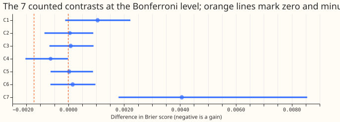

**Figure 3 shows C1 right of zero and C4 as the only interval wholly left of zero.** The dashed
lines, both orange, are at zero and at −m. C1's interval reaches +0.00222. C4's point (−0.00063)
does not reach −m (−0.00122).

### No arm with a demand output beats the sign-only arm

**The sign-only arm S has the lowest Brier score of every arm on all rows.** The table gives each
arm's Brier score on all rows, on import rows, on reverse-flow rows, and on rows with a reading of 1
to 3 MVA, then the harm and detection means. H1 is the mean P(X<0) on import half-hours with a
reading of at least 1 MVA, and passes at or below 0.0071. Detection is the mean P(X<0) on
reverse-flow half-hours with a reading of at least 1 MVA, and passes at or above 0.75. SD-R and SD\*
are the same fit, listed under both names to match the legend of figure 2. P0's Brier score on a
row subset is the share of reverse-flow half-hours in it.

| Arm | Brier, all | Brier, import | Brier, reverse | Brier, 1 to 3 MVA | H1 (limit 0.0071) | Detection (bar 0.75) |
|---|---|---|---|---|---|---|
| P0 | 0.03643 | 0.00000 | 1.0000 | 0.2506 | n/a | n/a |
| S-A | 0.00879 | 0.00372 | 0.1428 | 0.0682 | 0.00493 | 0.800 |
| S | 0.00853 | 0.00370 | 0.1361 | 0.0634 | 0.00453 | 0.842 |
| SD-0 | 0.01021 | 0.00505 | 0.1467 | 0.0844 | 0.00858 | 0.802 |
| SD-K | 0.01027 | 0.00463 | 0.1595 | 0.0856 | 0.00819 | 0.786 |
| SD-W | 0.01030 | 0.00440 | 0.1664 | 0.0843 | 0.00799 | 0.782 |
| SD-R | 0.00958 | 0.00445 | 0.1453 | 0.0772 | 0.00744 | 0.802 |
| SD\* (the same fit as SD-R) | 0.00958 | 0.00445 | 0.1453 | 0.0772 | 0.00744 | 0.802 |
| SDe-PT | 0.00923 | 0.00368 | 0.1559 | 0.0701 | 0.00572 | 0.801 |
| SDe-FR | 0.00920 | 0.00373 | 0.1538 | 0.0705 | 0.00682 | 0.799 |
| SD\*-C (causal protocol, k = 48) | 0.01049 | 0.00499 | 0.1560 | 0.0863 | 0.00979 | 0.784 |
| SD\*-lambda | 0.01316 | 0.00554 | 0.2147 | 0.1075 | 0.01440 | 0.694 |
| D-sign | 0.00977 | 0.00438 | 0.1525 | 0.0767 | 0.00664 | 0.777 |
| D | 0.01594 | 0.00593 | 0.2808 | 0.1266 | 0.01274 | 0.526 |
| A | 0.02247 | 0.01026 | 0.3453 | 0.1545 | 0.02360 | 0.366 |

**H1 passes for S-A, S, SDe-PT, SDe-FR, and D-sign, and fails for SD-0, SD-K, SD-W, SD-R, SD\*-C,
SD\*-lambda, D, and A.** SDe-PT and SDe-FR sit below the limit with a demand output, but neither
beats S in Brier score. Arms D and A fail the detection bar as well (0.526 and 0.366).

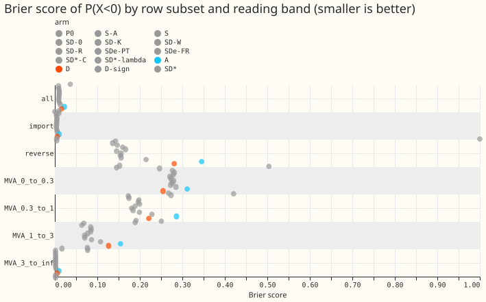

**Figure 2 cannot identify most arms by colour, so the table above names them.** Arm A is light cyan
and arm D is orange, and the other 13 arms and P0 are grey dots in the order of the legend, which
lists 15 entries to match the 15 rows of the table. On import rows and on rows of 3 MVA and above,
every arm sits near zero. The arms separate on reverse-flow rows and on rows below 3 MVA, where P0
scores 1.0 on reverse-flow rows and 0.25 on rows of 1 to 3 MVA.

### SD* fails H1 because it over-forecasts, mostly at readings of 1 to 3 MVA

**SD\* fails H1 because it over-forecasts, and most of its excess is in the band of 1 to 3 MVA.**
The mean P(X<0) on import half-hours with a reading of 1 to 3 MVA is 0.0828 for S and 0.1361 for
SD\*. That band holds about 3,289 import half-hours, 3.7% of H1's 89,556, so at SD\*'s mean it adds
about 0.0050 of SD\*'s H1 mean of 0.00744. On readings of 3 MVA and above, SD\* scores 0.0025 and S
scores 0.0015, and SD\* would pass H1 on those half-hours alone.

**H1 has no design flaw, because a calibrated detector passes it whenever its detection d is at
least 0.75.** The plan shows that a calibrated detector's H1 mean is s₁ (1 − d) / (1 − s₁), where s₁
is the share of reverse flow among half-hours with a reading of at least 1 MVA (0.0277). With d =
0.802, a calibrated SD\* would score 0.0057, below L = 0.0071. S fits the identity: it predicts
0.00451 and scores 0.00453, and S's summed P(X<0) over half-hours with a reading of at least 1 MVA
is about 2,556 against 2,554 reverse-flow half-hours. SD\* sums to about 2,715, which is 6% more
than the 2,554 reverse-flow half-hours, so SD\* fails H1 because it over-forecasts.

**The limit that the plan's formula gives for the band of 1 to 3 MVA is about 0.083, and S sits at
it.** In that band 25.1% of the 4,389 half-hours are reverse flow. Applying L = 0.25 s / (1 − s) to
the band's share of 0.2506 gives 0.0836. S (0.0828) is at that limit, and SD\* (0.1361) is 1.6 times
it. The band is where the fold makes an import half-hour look like a reverse-flow half-hour, which
is the folding of negative power into a positive reading, so a calibrated probability on an import
half-hour in this band is above zero. That is context and not an excuse for SD\*.

**Only S is calibrated in the band of 1 to 3 MVA.** S gives a mean forecast of 0.2479 against an
observed share of 0.2506, with a reliability term of 0.00033. SD\* gives 0.2745 against 0.2506, with
a reliability term of 0.00288, nine times S's.

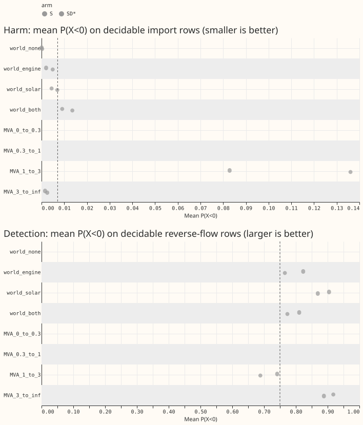

**Figure 5 shows two rows right of the pooled limit line, and the 1 to 3 MVA row is far right.** In
each row the left dot is S and the right dot is SD\*, because both arms are drawn in the same grey.
The dashed line is the pooled L in the upper panel and the detection bar in the lower panel. The
world_both row is also right of the line (0.0091 for S and 0.0136 for SD\*). The two bands below 1
MVA are empty, because the check reads decidable half-hours only, which have a reading of at least 1
MVA. Detection by band is 0.741 for S and 0.688 for SD\* in the 1 to 3 MVA band, both below the bar
of 0.75, and 0.918 and 0.888 at 3 MVA and above.

**The real held-out pre-engine days pass the real harm check H2.** The mean P(X<0) is 0.00031, and
no half-hour is above 0.5, over 11,760 half-hours. K2 is the same check on the days of the metered
engine record, with D8's reading unchanged, and it also passes (mean 0.00030, none above 0.5).

### On real days, H2 and K2 pass, K1 is void, and R2 and R3 have no bar

**K1 is `void`, so it changes no verdict word, because the days of the metered engine record hold no
reverse-flow half-hour with a reading of at least 1 MVA once the record is subtracted.** The bar
needs at least 100 such half-hours, and the days hold none. The numbers are still counted, and on
these days the answer derived from the record is import on every half-hour, so P0's Brier score is
0. SD\*'s Brier score there is 0.0156, its mean P(X<0) on import half-hours with a reading of at
least 1 MVA is 0.0334 (4.7 times L), and the share above 0.5 is 0.0151. These are false alarms
against a known answer, and they are higher than on the pre-engine days (0.00031). SD\*'s demand
output has a mean absolute error of 3.26 points against D8's real reading on K1's half-hours, and
the demand climatology has 8.92 points.

**On the real eras, SD\* puts P(X<0) above 0.5 on 5.1% of net-era half-hours, 15.8% of solar-era
half-hours, and 19.2% of fade-era half-hours.** The causal SD\*-C at k = 0 gives 3.8%, 11.9%, and
14.1%. The demand output is above the reading on 66% of net-era, 79% of solar-era, and 75% of
fade-era half-hours. The R2 and R3 checks have no bar, and the real answer is unknown in
these eras, so the R2 and R3 checks describe the neural networks and do not score them.

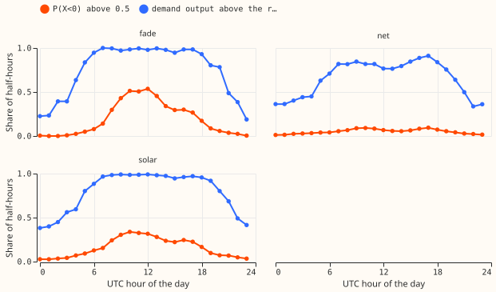

**Figure 10 shows the sign output flagging the middle of the day in the solar and fade eras, and the
demand output above the reading on nearly every midday half-hour.** In the solar era, the share with
P(X<0) above 0.5 peaks near 0.34 at 10:00 UTC, and the share with the demand output above the
reading is at least 0.94 from 07:00 to 17:00 UTC. In the fade era, the peak is 0.54 at 12:00 UTC. In
the net era, the share stays below 0.1 at every hour.

### The demand output halves the error of the demand climatology

**The demand output reproduces D8's clean demand on hidden half-hours at about half the error of the
demand climatology.** The table gives the mean absolute error in points of capacity on hidden
half-hours, by the style of hiding at training (rows) and at evaluation (columns). The demand
climatology scores 7.03 points. A style of hiding that the neural network saw in training scores 3.6
to 4.1 points. A demand output trained with no hiding (row 0) scores 5.25 to 9.25 points, so hidden
spans in training improve the demand output.

| Trained with | Evaluated with K | Evaluated with W | Evaluated with R |
|---|---|---|---|
| none (SD-0) | 5.254 | 8.220 | 9.251 |
| K, the engine blocks (SD-K) | 3.598 | 5.349 | 5.586 |
| W, the whole day (SD-W) | 4.590 | 3.779 | 4.670 |
| R, random spans (SD-R, SD\*) | 3.741 | 3.960 | 4.113 |

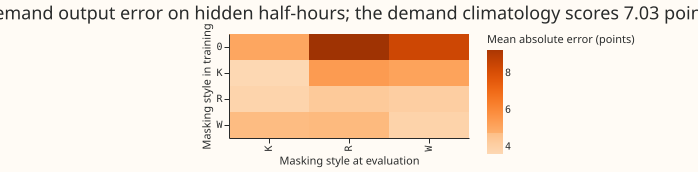

**Figure 6 draws the same table as a heat map.** The columns are in the order K, R, W, and darker
cells are larger errors.

### The causal variant is worse than the two-sided arm at every k and better than P0

**The causal variant, which sees no half-hour after the scored one, scores worse than the two-sided
SD\* at every number k of visible future half-hours, and better than P0.** The Brier score of SD\*-C
is 0.01364 at k = 0, 0.01177 at k = 2, 0.01117 at k = 6, 0.01076 at k = 12, 0.01060 at k = 24, and
0.01049 at k = 48. SD\*-C at k = 0 is below P0 (0.03643) by 0.02278 (interval −0.04176 to −0.00865),
and above S by 0.00512 (interval +0.00252 to +0.01007). At k = 48 the gap to S is 0.00197.

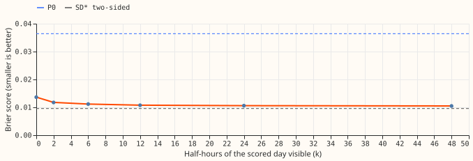

**Figure 7 shows the Brier score of SD\*-C falling steeply over the first two half-hours of future
and slowly after that.** The dashed lines are the two-sided SD\* (0.00958) and P0 (0.03643).

### The U-net won the architecture screen, and other arm-level results

**The U-net won the architecture screen and carries every later arm.** The mean validation Brier
score over arms S-A and S, seeds 0 to 2, is 0.01044 for the U-net (1.06 million weights), 0.01087
for the GRU-transformer (a transformer with a gated recurrent unit layer), 0.01128 for the
transformer, and 0.01275 for the bidirectional LSTM. The U-net's lead of 0.00043 over the
GRU-transformer is above f / 2 (0.00036), so the tie rule did not apply. On arm S alone the order
differs: the U-net scores 0.01065, the bidirectional LSTM 0.01127, the GRU-transformer 0.01180, and
the transformer 0.01223.

**Style R won the choice among the hiding styles.** No hiding had the lowest validation Brier score
(0.01234). R (0.01251) and K (0.01261) lie within f / 2 of it, and W (0.01334) does not. Among the
styles within f / 2, the rule picks the one with the lowest demand error on whole days hidden, which
is R. The margin
m is 0.00122, from twice the standard deviation of arm S's validation Brier score over seeds 0 to 4.

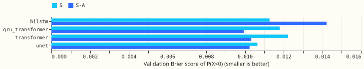

**Figure 1 shows the screen, with arm S-A darker blue and arm S lighter blue.** The U-net and the
GRU-transformer are the two lowest for arm S-A and for the mean over both arms, and they are not the
two lowest for arm S alone.

**The shifted-mix bank, a synthetic bank with a different mix of world types, leaves S ahead of SD\*
and keeps both calibrated.** S scores a Brier score of 0.00445 and SD\* 0.00516 (reliability terms
0.00004 and 0.00009), and both pass H1 there (0.00259 for S and 0.00449 for SD\*).

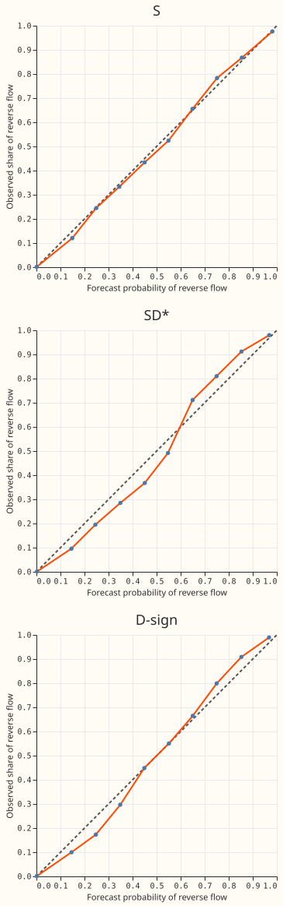

**Figure 4 shows S close to the diagonal and SD\* below it at forecasts of 0.1 to 0.6.** SD\*
observes less than it forecasts there (0.096 at a mean forecast of 0.146 and 0.285 at 0.349), so it
overstates the risk in the middle. From 0.65 to 1 it observes more than it forecasts (0.711 at
0.650), so it understates the risk at the top. D-sign is close to the diagonal only in the upper
bins (0.989 observed at a forecast of 0.968). At a forecast of 0.146 it observes 0.100, as far below
the diagonal as SD\*.

**Experiment 729's comparisons, redone on the rebuilt banks, show the same order as before.** In
signed continuous ranked probability score (CRPS) on all rows, D minus B1 is −29.9 points (R2), A
minus P0f is −0.75 (R3), and D-sign minus D is −0.43 (R6). B1 is the demand climatology turned into
a sign probability. On import rows, D minus P0f is +0.286 points against the limit 0.12 (R4), and in
the normalised error of the median it is +0.487 against 0.25 (R5), so both fail. S minus D-sign in
Brier score is −0.00125 (interval −0.00255 to +0.00004, R1).

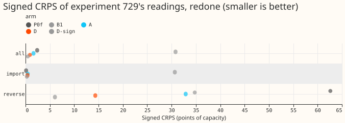

**Figure 9 draws the signed CRPS of P0f, B1, A, D, and D-sign on all, import, and reverse-flow
rows.** D-sign scores 6.04 points on reverse-flow rows, D scores 14.3, A scores 32.9, B1 scores
34.8, and P0f scores 62.6. On import rows P0f scores 0.12 and D-sign 0.27.

**The attention maps (figure 8) are not drawn, because no fit stored attention weights.** The plan
drew them from the chosen style's transformer fit of seed 0, and that fit does not exist: the arms
with a demand output are fitted on the U-net, the architecture the screen chose.

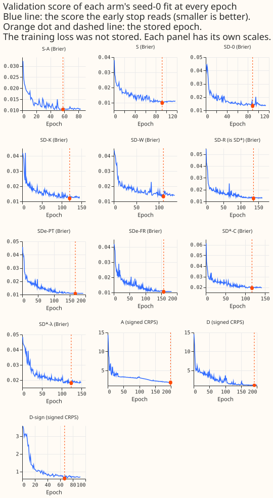

**Figure 11 shows that the validation score of every arm's seed-0 fit falls steeply in the first
20 or so epochs, then flattens.** Each panel is one arm's fit with seed 0. Ten panels draw the
validation Brier score of P(X<0), for the U-net fits of arms S-A, S, SD-0, SD-K, SD-W, SD-R, SDe-PT,
SDe-FR, SD\*-C, and SD\*-λ. SD\* is the fit of SD-R, so it has no panel of its own. The other three
panels draw the validation signed CRPS of the bidirectional LSTM refits of arms A, D, and D-sign.
The panels hold the validation score only, because the fits stored no training loss.

**In the ten Brier panels the stored epoch lies between epoch 58 (S-A) and epoch 168 (SDe-PT), on
a flat stretch of the curve.** Each of these fits stopped 25 epochs after its stored epoch. The
mean of the last 5 epochs lies 0.0001 to 0.0012 above the score at the stored epoch, so none of the
ten curves is still falling at the stop. The curves are noisy, with single-epoch spikes, and the
S and SD-W curves drift upward a little after the stored epoch.

**The refits of arms A and D stored epochs 199 and 192 of the cap of 200 epochs.** The curve of arm
A still slopes slightly downward at the cap, so the cap and not the early stop ended that fit. Arm
D-sign stored epoch 67 and stopped at epoch 92.

**The plot was added after the merge, from the stored histories of the fits.** The run itself
produced no loss plot.

### Single test days drawn from the synthetic test bank

**Each figure draws the scored UTC day, 24 hours, from one 48-hour window of a synthetic test day.**
The window is picked by a fixed rule and carries no calendar date, and the axes run from hour 0 to
hour 24 of day 1. The top row shows the signed truth, the reading, and the clean demand, with the
mean of the demand output of SD\*. The lower row shows P(X<0) of S, SD\*, and SD\*-C. The windows
are published for source S2 and engine-only segments. The figure names are the time series rules S1
to S16 of "Figures planned", and "figure S1" means the first of those rules, not source S1.

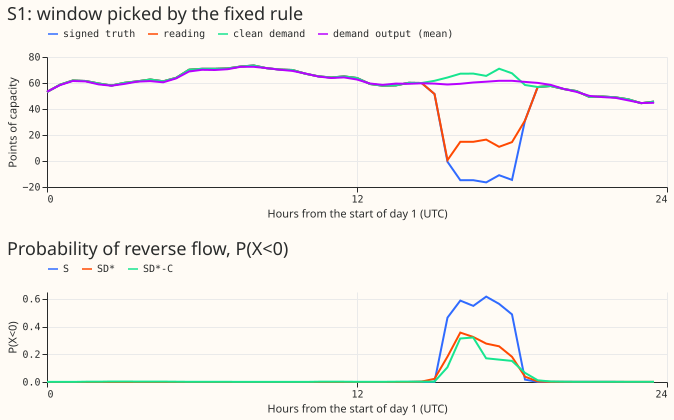

**Figure S1, an evening engine run, shows SD\* giving about half of S's probability.** The truth
reaches −15 points and the reading folds back to about +15. S rises to 0.6, SD\* to 0.35, and SD\*-C
to 0.3. The demand output follows the clean demand until the run. During the run it stays near 60
points while the clean demand rises to about 70.

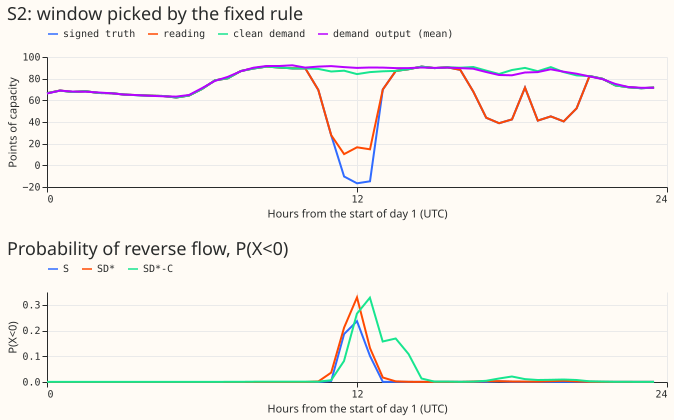

**Figure S2, a morning engine run, is a short event.** The truth is below zero for about 1 hour, and
P(X<0) peaks at 0.24 for S, 0.33 for SD\*, and 0.33 for SD\*-C, which peaks about half an hour
later.

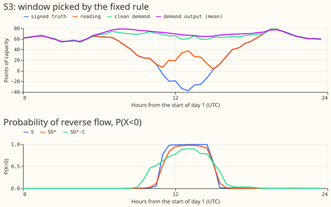

**Figure S3, solar output alone, is a clean case.** The truth is below zero for about 3 hours. S and
SD\* reach P(X<0) near 1.0 over that time, and SD\*-C starts earlier and peaks at 0.9.

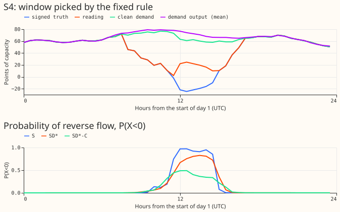

**Figure S4, engine and solar together, shows SD\* and SD\*-C below S.** The truth reaches about −22
points and is below zero for about 4 hours. S gives P(X<0) near 1.0, SD\* gives 0.8, and SD\*-C
peaks at about 0.53. The demand output sits above the clean demand by 10 to 15 points during the
run.

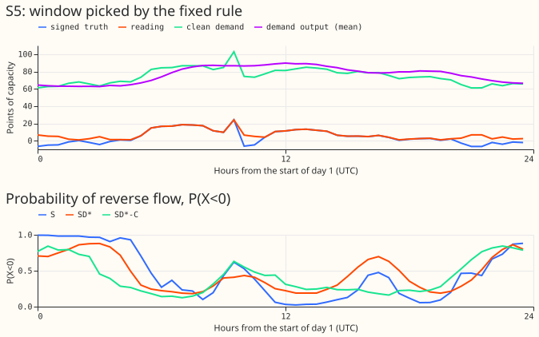

**Figure S5, a day with the reading near zero, is the ambiguous case.** The three neural networks
give P(X<0) between 0.1 and 1.0 over the day, and they differ from each other by up to 0.4. The
truth is slightly below zero at times at the start and the end of the day.

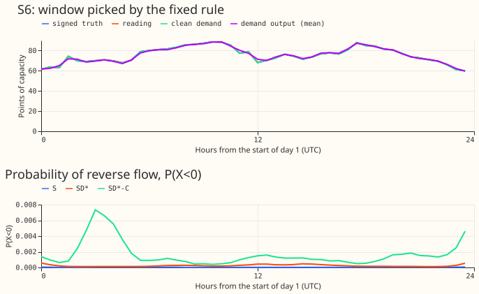

**Figure S6, a plain import day, shows no neural network raising an alarm.** S and SD\* stay below
0.001, and SD\*-C peaks at 0.007 at about 03:00 UTC.

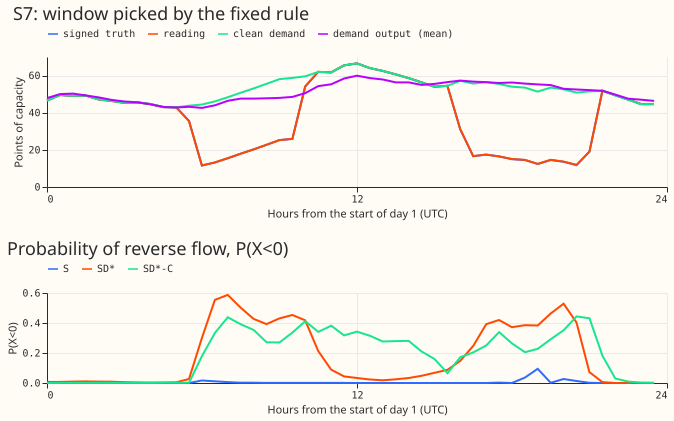

**Figure S7 shows the harm mode of SD\* on one import day.** The reading falls from 45 points to
about 12 points for 4 hours in the morning and again for 7 hours in the evening. No half-hour is
reverse flow. SD\* gives P(X<0) up to 0.59 and SD\*-C up to 0.45, while S stays near 0.01 (peak
0.1). The reading of 12 points is 1.2 MVA, inside the ambiguous band.

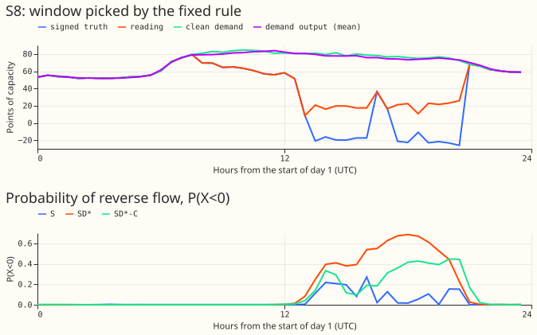

**Figure S8, the day on which SD\* gains most over S, shows the gain.** The truth is about −20
points for 8 hours. S gives 0.05 to 0.28, and SD\* gives 0.4 to 0.7.

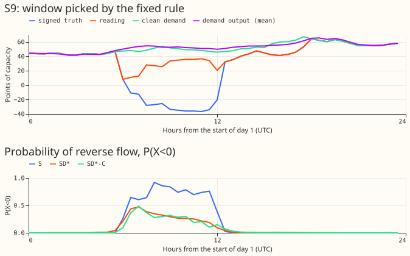

**Figure S9, the day on which SD\* loses most to S, shows the loss.** The truth is −30 points for 5
hours. S gives 0.65 to 0.93, and SD\* gives 0.25 to 0.5.

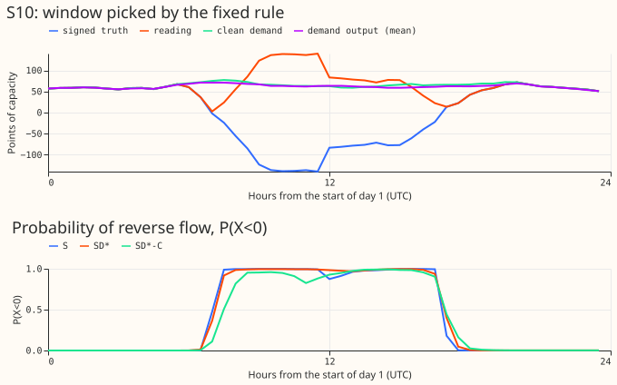

**Figures S10, S11, and S16 draw the same window, so one figure is published for the three.** The
fixed rules of S10 (whole-day hiding), S11 (engine blocks hidden), and S16 (a solar day with arms D
and D-sign) each picked the same deep solar day. The drawn lines are those of S, SD\*, SD\*-C, and
the demand output of SD\*. The truth falls below −130 points
and stays below zero for about 9 hours. The three neural networks reach P(X<0) of 1.0 over that
time, with SD\*-C lagging by about 1 hour at the start. The demand output of SD\* stays near the
clean demand of 60 to 70 points through the window.

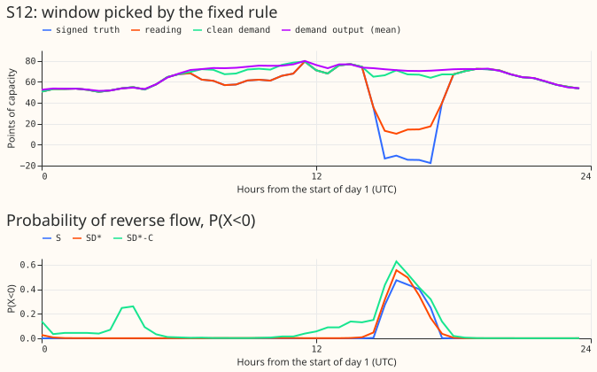

**Figure S12, an engine day, shows SD\*-C close to the two-sided SD\*.** The truth reaches −15
points for 3 hours. The peaks of P(X<0) are 0.48 for S and 0.55 for SD\*. SD\*-C peaks at 0.63 and
also gives a spurious bump of 0.26 at about 04:00 UTC, when the day has no event.

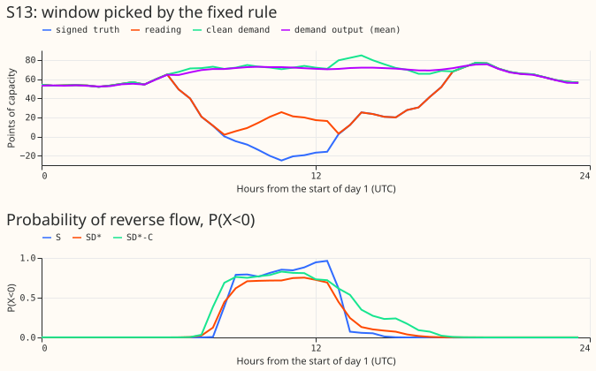

**Figure S13, a solar day, shows SD\* below S over the middle of the event.** The truth reaches
about −22 points for 5 hours. S gives 0.8 to 1.0 and SD\* peaks at about 0.79. SD\*-C starts earlier
and stays above 0.2 after the event.

**Figures S14 and S15, two real pre-engine days, are described in aggregate and not drawn.** The
rule of S14 picks the median real day by SD\*'s largest P(X<0) of the day, and the rule of S15 picks
the day with the largest such value. On the S14 day the largest P(X<0) of any of the three arms (S,
SD\*, and SD\*-C) is below 0.0006. On the S15 day that largest probability is about 0.03, read from
the axis. Both days are import days, because the pre-engine era has no reverse flow.

### The run departed from the plan in ten ways

**Six departures happened in the run, and four in the figures and tables. Each is recorded on the
page where it happened.**

- **A first-run correctness failure stopped the `real` stage at verdict row 1, and the first record
  is kept as `invalid_run1.json`.** K2 held half-hours that K1 lacks, because the metered engine
  record has half-hours with no row. The fix aligned K2 to K1 inside the K1 comparison. The first
  run produced no numbers. The rerun followed the plan's rerun clause: a check that reads no bar, a
  fix that changes no constant, and the Opus reviewer's confirmation of the fix ("A first-run
  correctness failure in the `real` stage").
- **S1 clear base days with no solar output are excluded from the share when the real record
  explains them, and the excluded days are bounded at 5%.** The bound is 5 times the pooled real
  rate of 1.0%, and it was set after the first `banks` run stopped on the fault, before any rebuilt
  bank passed. The realised excluded share is 0 in the validation, test, and shifted banks and 0.3%
  to 2.4% in the training banks, so every bank is inside the bound ("Rebuilding the banks and the
  realism gate").
- **The component checks use pooled bars.** The bar of 20 cases applies to the solar cases pooled
  over worlds and seasons for each bank kind and source. The harm limit L pools every import
  half-hour with a reading of at least 1 MVA, so no band has its own bar.
- **The ranges were re-tuned once, on the four share checks only.** The re-tune moved four ranges
  (spells per 30 days, spell length, the share of days with no engine run, and the solar capacity).
  It read no bulk supply point (BSP) slope, no neural network output, and no score ("Rebuilding the
  banks and the realism gate").
- **The gallery found a sky-gap bug in experiment 729's simulator, and the banks were rebuilt once
  with a repair in this experiment's code.** The repair fills runs of up to 4 half-hours of missing
  irradiance (source S2) and 3 half-hours of missing power (source S1) at a zenith below 80 degrees.
  The gate then had one fresh attempt on the repaired banks, and it passed ("A sky-gap bug found in
  the gallery, fixed after the first gate pass").
- **The manager raised the stop line from 8 to 16 graphics processing unit (GPU) process-hours
  before any fit.** The timing gate projected 5.5 GPU-process-hours at the epoch cap, with a peak
  memory of 6.2 GB against the cap of 14 GB. All 59 fits and 3 pre-training runs finished, and none
  failed ("Compute, stop line, and gates").
- **The attention-map figure 8 is not drawn,** because the chosen style has no transformer fit.
- **Figures S14 and S15, the real pre-engine days, are described in aggregate and not drawn.**
- **Figures S10, S11, and S16 are one figure,** because the three rules picked the same window.
- **The per-arm table lists SD\*-C at k = 48, while C7 reads SD\*-C at k = 0.** The table's Brier
  score for SD\*-C is the 48-half-hour score of the causal protocol.

**The realism gate passed on the repaired banks.** The share of engine-only half-hours with a
reading below 1.0 MVA is 0.0144 against 0.0119 in the real net era, and the share of days is 0.104
against 0.172. In the engine-and-solar worlds the half-hour share is 0.0433 against 0.0454 in the
real solar era, and the day share is 0.476 against 0.536. All four ratios lie inside 0.5 to 2.0.

### What the result means for later experiments

**On this synthetic world, a demand output with hidden input did not improve P(X<0), and the
sign-only arm was the best arm.** In this design the demand output worsens the sign probability.
Without hidden input it worsens the Brier score by 0.00168 (R7), and random spans recover 0.00063 of
that (C4). Pre-training the encoders does not help (C5), and a transformer does not beat the
recurrent neural network (C6). The sign-only arm S also has the lowest H1 mean of the arms that
have one (0.00453). The result does not show that a demand output cannot help in other designs. It
shows that this design did not help, with an encoder shared by the sign output and the demand output
and a demand loss weight of 0.1.

**The 1 to 3 MVA band is where every arm is uncertain, and it holds most of SD\*'s excess in H1.**
The harm and detection means in that band (S 0.083 and 0.741, SD\* 0.136 and 0.688) show how little
a reading near the fold says. H1's failure comes from SD\*'s higher mean in that band: the band adds
about 0.0050 of SD\*'s 0.00744. A later experiment that uses P(X<0) should treat the bands below 3
MVA as a calibrated mix of import and reverse flow, and not as a sign.

**Coincident weather is legitimate here only because this experiment reconstructs the past.** The
synthetic days use observed ERA5 and CAMS weather at the scored times. The later experiment 731
reads P(X<0) in history rows near a forecast origin, and any forecasting use must use only the
weather available at the forecast origin. The causal variant hides the future of the reading, and it
does not hide the future of the weather.

**The two real-day results differ in what is known.** On the metered engine record's days the
answer is import, so SD\*'s mean P(X<0) of 0.0334 against 0.00031 on the pre-engine days is a false
alarm. In the solar and fade eras the real answer is unknown, so the share of half-hours above 0.5
(16% to 19%) does not say whether the flagged half-hours are reverse flow.

## The plan as registered

**The sections below hold the plan as registered before any code existed, with two later
amendments, the 5% metered-zero bound and the stop line of 16 GPU-process-hours, both marked in the
text.** Where the run departed
from the plan, "The run departed from the plan in ten ways" says so.

## Terms

- **Signed power X** is D8's real power, positive for import and negative for reverse flow.
- **The reading R** is what D8's meter reports: R = sqrt(X² + Q²), where Q is the reactive floor,
  the reactive power that keeps the reading above zero when X crosses zero. **Folding** is the name
  for this loss of the sign.
- **A point** is 1% of D8's effective capacity of 10.379 MVA, the normaliser that
  [data-processing](../data-processing.md) already uses for D8. A reading of 1 MVA is 9.6 points.
- **P(X<0)** is the neural network's probability that the half-hour's signed power is negative.
  **P0** is the reading read as signed import, so P0's P(X<0) is 0 everywhere.
- **The clean demand**, or **base demand**, is D8's real pre-engine reading on the base day before
  the simulated engine and solar output are subtracted. In the synthetic world the clean demand is
  known exactly.
- **The bulk supply point (BSP)** above D8 is BSP A, the substation that feeds D8 and eight other
  Primaries. Its meter reports signed MW. **The BSP steps** are the half-hour changes of that meter.
- **A base day** is a UTC day of D8's real reading in the pre-engine era. **A segment** is one
  calendar month of base days carrying one continuous injection draw. **A world type** says what a
  segment holds: no injection, engine only, solar only, or engine and solar.
- **Import rows** are scored half-hours with X ≥ 0, and **reverse-flow rows** are those with X < 0.
  **The decidable rows** are those with a reading of at least 1 MVA. Because the reactive floor is
  at most 0.3 MVA, a decidable row has |X| above 9 points, far outside experiment 729's dead band of
  2 points around zero.
- **The eras of D8** are the pre-engine era, the net era (engine only), the solar era (engine and
  the large solar farm), and the fade era, as [experiment
  697](../00697-gas-engine-state-tracker-part-4-running-patterns/result.md) defines them.
- **The metered engine record** is the record of D8's engine output that experiments 194, 694, 697,
  and 729 use. Its length is on the [experiment
  194](../00194-ps1-ps5-generator-visibility-d8-analogue-break-and-price-following-census/result.md)
  page.

## What experiment 729 found

**Experiment 729's numbers come from banks in which every S2 solar world has no output, so they
guided this design and are not evidence.** This experiment's refits of arms A, D, and D-sign test
each finding below again on the rebuilt banks.

**Experiment 729's headline neural network beat the demand-climatology rule by a wide margin on
synthetic days, and added error on import half-hours, so its verdict was `not supported`.** Its
headline arm D had a two-lobe output: a probability of reverse flow and a Gaussian magnitude on
each side of zero, each with a spread of at least 0.5 points. On synthetic import half-hours arm D
scored a signed CRPS 0.258 points above P0f, the reading given the same 0.5-point spread, against a
limit of 0.12 points. Five findings of experiment 729 shape this plan:

- **The 0.5-point spread floor puts a floor of about 0.12 points under every half-hour's CRPS.** A
  lobe of spread 0.5 points with an exact mean scores 0.117 points. The CRPS with a floor therefore
  mixes the sign with the floor's penalty, and this plan scores the sign by a proper score on the
  sign alone.
- **The sign-only arm D-sign beat arm D on the point means of all, import, and reverse-flow rows.**
  D-sign put its two lobes at plus and minus the reading with the reactive floor removed and
  learned only the probability. D-sign scored 0.445 points of signed CRPS over all rows against arm
  D's 0.786, and its report-only contrast with arm D was −0.340 points (interval −0.749 to −0.099).
- **Sunshine carried most of the gain, and the BSP steps added little once sunshine was known.**
  Sunshine added to the reading gained 0.370 points (interval −1.024 to −0.018); the BSP steps added
  to sunshine lost 0.149 points (interval 0.068 to 0.455) on the two months the BSP meter covers.
- **No arm is sure of the sign where the reading is under 1 MVA.** Below 0.3 MVA, 46% of synthetic
  half-hours are reverse flow, and D-sign's mean P(X<0) there was 0.482.
- **Almost every two-lobe fit ran to the 200-epoch cap still improving, while the sign-only fits
  stopped early, at 76 to 132 epochs.** The fit records of experiment 729 show that 44 of its 47
  two-lobe and quantile fits ran to the cap with their best epoch in the last 20 epochs.

**The maintainer's discussion of experiment 729 set four directions for this plan.** The sign is
the main output. An auxiliary output predicts the clean demand, so that the neural network learns
what ordinary demand looks like and can use that knowledge where the reading is ambiguous. The
encoders of the earlier modular demand networks are tried pre-trained and fresh, and a transformer
joins the architectures. A variant trained with the future hidden gives a causal version, because
the later experiment 731 is to read P(X<0) in history rows near a forecast origin, where only past
data exist. This plan does not plan that work.

## The synthetic world

**This experiment owns the corrected synthetic world: it rebuilds experiment 729's banks with the
fixed simulator into its own data folder and never reads experiment 729's banks.** The world is
experiment 729's as its plan registered it. Two corrections are in experiment 729's merged code: the
sky rule `sky_present` in `e00729_data.py`, which counts a farm's satellite sky as present when at
least 40/48 of the day's sun-up half-hours have irradiance, and the simulator ranges restored to the
values experiment 729's plan registered before its re-tune. **The banks stage asserts that
`e00729_core.RUN_ID` is "2" and that `e00729_data.sky_present` exists, and the line stops at verdict
row 0 if the banks digest or `RUN_ID` is not the fixed one.**

### Base days and the split

**The base is D8's cleaned pre-engine reading, cut at the earlier of the end of the pre-engine era
label and the engine's connection date in the private constants file.** Half-hours that the
`substation_zero` rule flags are dropped, and so are days within 24 hours of a logged closure at
D8. Whole calendar months are held out by a rule that `e00729_core.py` applies to the private base
calendar:

- A base month is a calendar month with at least 20 base days. A base month that overlaps the
  fixed lockdown window of [data-processing](../data-processing.md) is always a training month.
- The remaining base months fall in two groups, numbered from 1 in time order: the months in which
  the BSP A meter has data on at least 20 base days, and all other months.
- In both groups, every third month from the second is a test month. A validation month is the last
  month of the BSP group, and every sixth month from the first in the other group. Every other base
  month is a training month.

**The rule gives 8 test months and 4 validation months, and neither the page nor the code lists a
month.** The explicit list is in experiment 729's private `PRIVATE/splits.md`, which this
experiment reads and never copies. Training drops every base day within 2 days of a test or
validation month, because a window spans 48 hours.

### Engine, solar, fold, and BSP

**The engine simulator draws one parameter set per segment from wide ranges set from published
descriptions of D8's engine, never from a fitted real value.** The ranges are the ones experiment
729's plan registered, which the realism gate below tests first:

| Parameter | Range |
|---|---|
| Number of units | 1 to 4 |
| Size of one unit | 10 to 50 points; total capped at 120 points |
| Share of days with no run | 0.2 to 0.7 |
| Weekday evening run (start 15:00 to 17:30 local, 2 to 6 hours) | probability 0.3 to 0.9 a day |
| Weekday morning run (start 05:30 to 08:30 local, 1 to 8 hours) | probability 0.1 to 0.6 a day |
| Midday run (start 10:00 to 14:00 local, 1 to 4 hours) | probability 0 to 0.3 a day |
| Weekend and bank-holiday factor on each run probability | 0.1 to 0.8 |
| Multi-day spell (2 to 19 days, at part or full output) | 0 to 2 per 30 days |
| Units running in a run | 1 to all, drawn per run |
| Output of a running unit | 0.6 to 1.0 of its size |
| Ramp to full output | 0 to 2 half-hours |
| Trip of one unit, per running half-hour | probability 0 to 0.02, lasting 1 to 4 half-hours |
| Start and stop times | continuous, so a half-hour that holds a switch carries a partial mean |

**Solar output comes from one of two sources per segment, so that the sunshine input never equals
the driver of the injected solar.** Source S1 is the normalised output of one of the metered solar
farms A to F on the same base day. Source S2 is the satellite irradiance of the
Copernicus Atmosphere Monitoring Service (CAMS) at a farm site, through a plane-of-array solar model
with a drawn tilt, azimuth, and ratio of direct-current to alternating-current rating, plus
autocorrelated noise. A solar segment draws a capacity log-uniform from 5 to 150 points. A day on
which the drawn farm has no metered output takes another farm, then source S2; a day on which no
farm has a satellite sky carries zero solar output and is flagged, and the flagged days are left
out of the by-source tables.

**Each segment folds its signed truth with its own reactive floor Q, drawn from 0 to 0.3 MVA, and
builds a synthetic BSP meter from the real BSP A meter of the same base day.** The reading is R =
sqrt(X² + Q²). The synthetic BSP is the real meter minus β (E + S), with β drawn per segment from
0.6 to 1.0.

**The test bank's world mix is fixed, and the training mix is randomised.** The test mix is no
injection 0.15, engine only 0.30, solar only 0.20, and engine and solar 0.35. Each training bank
of 32 segment draws per month draws its share of no-injection segments uniformly from 0.05 to
0.60. The test bank holds about 94,000 scored half-hours, the same base days and draws as
experiment 729's, and the banks stage counts its reverse-flow half-hours.

### Rebuilding the banks and the realism gate

**Two new stages build the banks and run the realism gate, and both write only to this
experiment's data folder.** Experiment 729's `stage_banks` and `stage_gate` write to experiment
729's folder through `e00729_paths.data_root()`, so this experiment does not call them.
`e00730_stages.py` calls experiment 729's lower-level functions through imports
(`e00729_banks.build_bank`, `bank_digest`, the save and load functions, and the gate functions of
`e00729_banks.py` and `e00729_stages.py` that take arrays), with the data root passed as a
parameter. The run-marker guard of experiment 729's `guard_run` is copied with the root as a
parameter: the banks stage writes `run_marker.json` with the run, the sky rule, and a hash of the
ranges, and every later stage refuses to read banks whose marker differs from the code. A test
replaces `e00729_paths.data_root` with a function that raises and runs the bank and gate stages on
synthetic arrays, so any write into experiment 729's folder fails the test.

**The banks are the same in kind and size as experiment 729's.** Training banks of 32 segment draws
per month for seeds 0 to 4 come from generator seed 7290 plus the seed; the validation bank, the
test bank, and the shifted-mix bank come from the seed spaces 729,250, 729,000, and 729,500, with
world types assigned by quota and dealt out month by month. The digests differ from experiment
729's, because the solar draws now produce output, and the banks stage writes them to
`banks/summary.json`.

**The realism gate runs under experiment 729's rules as written.** The gate compares the training
bank of seed 0 with the real eras on folded aggregates only: the share of days whose daily minimum
is below 1.0 MVA and the share of half-hours below 1.0 MVA, each within 0.5 to 2.0 times the real
share, for the engine-only worlds against the net era and for the engine-and-solar worlds against
the solar era. It also regresses the half-hour BSP steps on the metered engine record's steps, size
matched in quintile bins, and passes when the real slope's 95% interval overlaps −1.0 to −0.6 and
the real standard error and residual standard deviation lie inside the 5th to 95th percentiles of
the synthetic stretches. The test bank must hold at least 2,000 reverse-flow half-hours outside the
dead band, and at least 200 in the two BSP test months.

**The registered ranges are tested first, and one re-tune of the share checks is allowed.** If
attempt 1 fails its share checks, the ranges may be re-tuned once by an offline calibration,
`e00730_gate_calibration.py`, which follows experiment 729's `e00729_gate_calibration.py`: it builds
small banks for candidate range sets on a seed that no fit and no gate uses (training seed 9), and
reads only the four share ratios, no BSP slope, no network output, and no score. The re-tuned
ranges are recorded on the page, the banks are rebuilt, and the gate runs once more. **If attempt
2 fails, or attempt 1 fails a BSP check, the line stops at verdict row 0 and the manager is told.**
No other freedom exists: no bar, no world mix, and no BSP coefficient range changes.

**Attempt 1 failed its share checks, and this is the plan's one re-tune.** Attempt 1 used the
registered ranges. The BSP-step checks passed (the result was not void). The engine-only worlds
failed the half-hour share: the reading was below 1.0 MVA in 4.19% of synthetic half-hours against
1.19% of real net-era half-hours, 3.5 times the real share, where the pass band is 0.5 to 2.0 times.
The day share passed (0.144 against 0.172, 0.84 times), and so did both solar-era shares (0.60 times
for days, 1.29 times for half-hours). Multi-day spells at constant output hold the reading at the
floor for long runs of consecutive half-hours, so the re-tune makes them rarer and shorter and lets
the engine run on more days. These four ranges change, and every other range is unchanged:

| Range | Registered (attempt 1) | Re-tuned (attempt 2) |
|---|---|---|
| Multi-day spells per 30 days | 0 to 2 | 0 to 1 |
| Length of a multi-day spell | 2 to 19 days | 2 to 3 days |
| Share of days with no engine run | 0.2 to 0.7 | 0.05 to 0.5 |
| Solar capacity (log-uniform) | 5 to 150 points | 20 to 250 points |

**The solar capacity range moves although the solar checks passed at attempt 1.** With the new
engine ranges alone, the solar-era day share falls from 0.60 times to 0.52 times the real share,
which is too close to the 0.5 lower bound to rely on, because fewer long spells leave fewer
solar-era days below 1.0 MVA. A larger solar capacity restores the margin. The offline calibration
(two grids of 17 and 18 candidate range sets, on small banks of training seed 9) gave the chosen
set these ratios to the real shares, in the order days and half-hours: engine-only worlds 0.70 and
1.36, engine-and-solar worlds 0.82 and 0.91. All four lie inside 0.5 to 2.0. A test-kind bank
under the chosen set held 3,191 reverse-flow half-hours outside the dead band and 426 in the two
BSP test months, above the minimums of 2,000 and 200. Attempt 2 reports the ratios of the rebuilt
banks, which differ from these because the rebuilt banks are larger. The `retune` stage writes the
four ranges to `ranges_override.json` once, and refuses unless exactly one gate attempt exists,
that attempt failed its share checks only, and no fit exists.

**Every simulated component is checked for output where output must exist before the gate reads
the banks.** The solar and BSP checks are stated per day, never per segment, because a segment of a
month with one nonzero day would pass a per-segment check while the generator is still silent on
the other days. A key that has no cases fails its check, so that a silent component cannot pass by
leaving nothing to count. A solar key expects cases only in a season that holds a clear base day,
and a bank with solar-world segments and no clear base day fails. The bar of 20 cases applies to
the solar cases pooled over worlds and seasons for each bank kind and source, because a split of a
few months of the real record holds only a handful of clear base days in some seasons.

**An S1 clear base day with no solar output is excluded from its share when the real record
explains it, and a bound on the excluded days is fixed before the rebuilt banks pass.** On 7 of 678
clear farm days in the real record (1.0%, and 4.6% in summer), a farm reports data but its
metered output is zero or missing whenever the sun is up.
Experiment 729's S1 draw copies the first reporting farm's metered
shape, so a simulated S1 day on such a calendar day has zero output. The check excludes such a day
from the share only where some reporting farm is metered at zero on that calendar day, and counts
it apart. The excluded days must be at most 5% of the S1 clear base days of each bank kind, 5 times
the pooled real rate of 1.0%. The first `banks` run stopped on this fault with S1 summer shares of
0.78 to 0.98 in the training banks; the bound was set after that run and before any rebuilt bank
passed.
The banks stage counts, per world type, bank, source, and season:

- the share of clear base days of solar-world segments with solar output above zero on at least
  one clear sun-up half-hour, for S1 and S2 separately;
- the days with engine output of engine-world segments, pooled over each world, bank, and season,
  and read separately on weekdays and on quiet days (weekends and bank holidays). Each day has a
  lower-bound chance of output from the segment's drawn run chance, block probabilities, and
  weekend factor. A pool fails when its count of days with output falls more than 4 standard
  deviations below the sum of those chances, or when it has no day although it expects at least 3.
  Experiment 729's engine simulator marks no running half-hour, and the plan does not edit it, so
  the check reads "any output on the day": a silenced evening block alone still passes it, and the
  next item is the second line of defence;
- the share of base days with solar or engine output on which the truth lies below the base
  demand, so that a change that stops the simulator subtracting a component fails the check;
- the share of base days of BSP-month segments whose synthetic BSP differs from the real meter at
  every half-hour where the engine or solar output is above zero;
- the share of mid-day half-hours with zero output on source-S2 solar days, at most 1% (the bound
  of "A sky-gap bug found in the gallery, fixed after the first gate pass");
- the share of no-injection half-hours whose truth equals the base demand; and
- the share of half-hours whose reading is at least the reactive floor.

**The bar is one constant, `MIN_OUTPUT_SHARE` = 0.99, in `e00730_core.py`, and the page, the
plan, and `tests/smoke_real_files.py` quote that same value.** Each share must be at least
`MIN_OUTPUT_SHARE`, or 1.0 where the simulator leaves no room for an exception (the no-injection
truth and the fold), or the line stops at verdict row 0 before any fit. A clear sun-up half-hour
has a CAMS clear-sky index of at least 0.8 at D8. A sun-up half-hour is one on which the index
exists (it is missing where the clear-sky irradiance is at most 5 W/m2) and the cosine of the
zenith exceeds 0.1. A clear base day has at least 8 sun-up half-hours and a clear one on at least
0.9 of them.

**A gallery of the synthetic world is a gate before any fit.** The figures stage draws the gallery
from the rebuilt banks on the CPU (see "Figures planned"). The session, which is the design lead,
checks each panel against a written list of what the panel must show, and the maintainer reads the
same gallery in the write-up. The check is in the gate list of "Compute, stop line, and gates",
before the "fits starting" line.

### A sky-gap bug found in the gallery, fixed after the first gate pass

**The synthetic world gallery found a bug in experiment 729's simulator after the realism gate had
passed, and the gate is rerun once on the repaired banks without a re-tune.** Gate attempt 2 had
passed on the re-tuned ranges. Reading the G2 panels, the design lead saw the solar output drop to
zero for one to four half-hours in the middle of a clear day, at the half-hours where the clear-sky
index line is also broken. The cause is in experiment 729's `farm_set`: where the CAMS irradiance is
missing on a sun-up half-hour, `np.nan_to_num` replaces the global, direct, and diffuse irradiance
by zero, after the day was accepted with up to 6% of its sun-up half-hours missing. The source-S2
draw then outputs zero there. The source-S1 draw copies a metered farm's power with the same
`nan_to_num`. Counts on the stored banks and the real farm table, taken before any repair:

- On clear days (median clear-sky index above 0.8), the share of mid-day half-hours (08:00 to 17:00
  UTC) with zero S2 output was 0.6% in spring, 0.9% in summer, 3.4% in autumn, and 5.0% in winter.
  Of the S2 mid-day half-hours, 7.6% were zeroed, and 41% of S2 solar days held at least one.
- In S2, 240 of 242 zeroed half-hours in winter, 72 of 72 in spring, 64 of 64 in summer, and 232
  of 254 in autumn were half-hours where D8's clear-sky index is missing.
- On S1 clear days the zeroed share was 6.4% in winter, 4.1% in spring, 2.7% in summer, and 4.5% in
  autumn. In spring and summer most of these are genuine metered zeros, which the 5% metered-zero
  bound already covers.
- On the real farm table, the missing-irradiance runs at sun-up (zenith under 80 degrees) were 844
  runs of 1 half-hour, 402 runs of 2, 6 runs of 3, and 36 runs of 4, and no run was longer. The
  missing-power runs of the metered farms were 492 runs of 1 half-hour, 225 of 2, 5 of 3, and 10
  of 4.

**The repair is `fill_sky_gaps` in `e00730_sky.py`, in this experiment's code only, and it runs on
the calendar before the banks are built.** Experiment 729's code is not edited. Its rules are fixed
here, before the repaired banks exist:

- A gap is a half-hour with zero irradiance (or missing power) whose solar zenith is below 80
  degrees. Dawn, dusk, and night are never touched, and a test covers dawn and dusk.
- For S2 a run of at most 4 half-hours (2 hours) is filled by linear interpolation of the global
  irradiance divided by the cosine of the zenith, between the nearest positive half-hours on both
  sides of the same day, and multiplied back by the cosine. A run that touches the first or last
  sun-up half-hour has one anchor, and the fill holds that anchor's ratio of global irradiance to
  the cosine of the zenith. Only half-hours with a zenith below 80 degrees serve as anchors, and a
  missing value at a zenith of 80 to 90 degrees stays zero, as in experiment 729. The direct and
  diffuse parts are derived again from the filled global irradiance with the Erbs model.
- A run longer than 4 half-hours, or with no positive neighbour, is never filled with zero: the
  farm-day's sky becomes NaN and the farm-day leaves the set of days with a sky, which is the
  treatment of a day with no satellite sky.
- For S1 a run of at most 3 half-hours of missing metered power is filled the same way over the
  power. A longer run removes the farm-day from the days with metered power. Genuine metered zeros
  are left as they are. On the real record this removes 10 farm-days with metered power of 4,485,
  and no farm-day with a sky.

**A bound, fixed before the repaired banks exist, fails the banks and the smoke test if zeroed
half-hours remain.** The share of mid-day half-hours (10:00 to 14:00 UTC, where the sun is about 10
degrees or higher all year) with zero output, on source-S2 solar days that kept their drawn source,
must be at most 1% in every bank. A bank with no such day, or a share that is not a number, fails
the check, and the smoke test reads the same share in the test bank. On the banks before the repair
this share was 1.1% in the test bank, 1.4% in the shifted bank, and 1.1% in the training banks of
seeds 0 and 1. The smoke test reads the real farm table and fails if more than 1% of the sun-up
half-hours of days with a sky have zero irradiance after the repair (it is 1.3% before and 0.0%
after). S1 is not in this bound, because its genuine metered zeros are covered by the metered-zero
bound.

**The repair changes the synthetic worlds, so the run marker carries the repair's version and the
guard allows one fresh gate attempt.** The marker's new entry, `sky_gap_fill`, names the zenith
limit and the two gap limits. The `banks` stage then rebuilds once, and only after the manager moves
the earlier run's banks, `limits.json`, and `scores` to `superseded_run_2`, and refuses if anything
else of the earlier run is left, if a fit or `margin.json` exists, or if the marker differs in
another entry. A marker that already holds a `sky_gap_fill` entry never allows another rebuild. The
gallery's automatic check and the design lead's record carry a digest of the banks, and a record of
other banks does not open the gate. The ranges override of the one permitted re-tune stays in place,
and the re-tune stays spent: the gate has one attempt on the repaired banks, and if it fails the
line stops at verdict row 0. The changed functions and their AST hashes (SHA-256 of `ast.dump` of
the function without its docstring, first 12 hexadecimal digits) are:

| File | Function | Hash |
|---|---|---|
| `e00730_sky.py` | `gap_runs` | `e8ee39eee1cd` |
| `e00730_sky.py` | `day_of_year` | `c5cbb512bdcb` |
| `e00730_sky.py` | `sun_up_zero_mask` | `138f898fc916` |
| `e00730_sky.py` | `zeroed_sky_share` | `3bbda0c39eb9` |
| `e00730_sky.py` | `fill_run` | `8fd17d5f96bd` |
| `e00730_sky.py` | `fill_sky_gaps` | `e4fd46d91de6` |
| `e00730_banks.py` | `run_marker_payload` | `15a3bbc4939b` |
| `e00730_banks.py` | `banks_digest_id` | `ac81c3a384ff` |
| `e00730_banks.py` | `gallery_passed` | `3d473c934a03` |
| `e00730_banks.py` | `sky_fix_rebuild_blocked` | `f259f14016f3` |
| `e00730_banks.py` | `gate_attempts_allowed` | `280f898261fc` |
| `e00730_banks.py` | `_guard_banks` | `e7ae127396e8` |
| `e00730_banks.py` | `zeroed_sunup_share` | `a3114756af4a` |
| `e00730_banks.py` | `component_checks` | `078381f67958` |
| `e00730_banks.py` | `stage_gate` | `04b8f89f2ae5` |
| `e00730_stages.py` | `bank_inputs` | `06184af15845` |
| `e00730_stages.py` | `stage_gallery` | `f10505619bc6` |
| `e00730_stages.py` | `record_panel_check` | `5f72b9e84f16` |
| `e00730_gallery.py` | `check_ramp` | `c895a8cbeef4` |
| `e00730_gallery.py` | `check_evening` | `1970efd21016` |
| `e00730_gallery.py` | `check_morning` | `1586969e11b5` |
| `e00730_gallery.py` | `check_weekend` | `2626b12e3fb5` |
| `e00730_gallery.py` | `check_part_load` | `69e78c54bd3c` |
| `e00730_gallery.py` | `check_trip` | `66cf1d2ee06d` |
| `e00730_gallery.py` | `check_spell` | `ff27b08a5a2d` |
| `e00730_gallery.py` | `run_plateaus` | `09d1c8a6b7c5` |
| `e00730_gallery.py` | `check_units` | `d289d568aec5` |
| `e00730_gallery.py` | `check_fold` | `356a07b22b2f` |
| `e00730_figures.py` | `window_array` | `966025012186` |
| `e00730_figures.py` | `pick_windows` | `be874cc10c1f` |
| `e00730_figures.py` | `is_weekend` | `b58f04c593f2` |
| `e00730_figures.py` | `engine_gallery` | `657ae213fb07` |
| `e00730_figures.py` | `extreme_index_day` | `e0220a7cd41f` |
| `e00730_figures.py` | `solar_index_chart` | `e5226306a8b1` |
| `e00730_figures.py` | `solar_gallery` | `0d9c143a05d2` |
| `e00730_figures.py` | `bsp_fold_base_gallery` | `5a219638d110` |
| `e00730_figures.py` | `aggregate_gallery` | `d1af8b1f5947` |

**The same gallery reading changed four gallery checks and panels, with no change to a bar.** The G1
check on units counted every ramp value as a level, so it compares the share of days with two
plateaus in a run (at least 2 points apart) for one-unit days, at most 10% because overlapping runs
and spells give some one-unit days two levels, with that for several-unit days, which must be
higher. The G1 panels each showed the first matching window of the bank, so one window served five
features and two checks ran on a day that the panel did not plot. Each G1 feature panel is now a
small multiple of 3 draws from different segments. The feature picks each window, the check runs on
the exact arrays that the panel plots, and the panel passes only if all 3 draws pass. The spell
check needs at least 2 whole days of output with a non-whole day before and after inside a 5-day
window (the registered spell length after the one re-tune is 2 to 3 days), and the trip check needs
a zero run of 1 to 4 half-hours between two equal levels. The G3 panel carries one shared
vertical-axis title. The G5 check compared the folded reading with the truth by `allclose`, which
fails whenever the reactive term is not negligible, so it now checks that the reading squared minus
the truth squared lies between the square of the floor and the square of the largest reactive term.
The G2 panels now show the clearest and the cloudiest day of each season by the clear-sky index,
compare the output as a share of the draw's solar capacity, and draw the clear-sky index on its own
axis at the right. The G9 panel shows the lowest share of each check group (32 groups) against the
bar, and the metered-zero and zeroed-sun-up shares in a second panel against their bounds, because
the earlier panel drew 468 bars and drew the bounded shares against a bar of 0.99.

## The sign output and how it is scored

**The main output is one logit per half-hour, trained by binary cross-entropy on the event X < 0,
and its probability P(X<0) is the sigmoid of the logit.** The head is experiment 729's sign head.
The scored probability is the head's own P(X<0), not the mass of a two-lobe mixture below zero,
which experiment 729 showed is pulled towards 0.5 wherever the reading is small.
The refitted arms D and D-sign, whose output is two lobes, are scored on the weight
of the reverse-flow lobe, which is their head's own P(X<0).

**The magnitude is reconstructed only for the signed read-outs.** The signed distribution is a
mixture with weights (1 − P, P) of an import lobe at +M and a reverse-flow lobe at −M, where M =
sqrt(max(R² − Q̂², 0)) and Q̂ is 0.1 MVA, each lobe with experiment 729's spread of 0.5 points. The
median of that mixture gives the normalised mean absolute error of the median, which every table
reports. The signed CRPS of the same mixture is reported for continuity with experiment 729 and is
not a bar.

**The sign is scored by two proper scores on the event X < 0.** The Brier score is the mean of (P −
y)², where y is 1 on reverse-flow rows and 0 on import rows; it carries every counted contrast,
because it is bounded and its per-row losses average cleanly in the bootstrap. The log loss is the
mean of −y log P − (1 − y) log(1 − P), with P clipped to 1e-6 to 1 − 1e-6, and is reported beside
every Brier reading. The reliability term and its bins come from experiment 729's
`reliability_term`, with 10 equal-width bins.

**P0's Brier score on the test bank is the share s of reverse-flow rows.** The banks stage
computes s from the rebuilt test bank's truth. Experiment 729's silent-solar test bank gave about
0.023, and the rebuilt bank gives more, because its S2 solar worlds now reverse the flow at midday.
P0's log loss is infinite on reverse-flow rows, so P0 enters no log-loss table.

## The demand output and how the reading is hidden

**The auxiliary output predicts the clean demand at each half-hour of the scored day as a Gaussian,
trained by negative log likelihood.** The target is the segment's base demand in points, on the
half-hours that the segment's validity mask keeps. Base demand is stored in every segment of the
banks (`base`), and the demand row is added to the target stack only. The head is experiment 729's
auxiliary Gaussian head: a mean, and a spread of 0.5 points plus a softplus. The loss is the sign
head's cross-entropy plus λ times the demand head's negative log likelihood, with λ = 0.1. A
report-only arm repeats the chosen design at λ = 0.5, experiment 729's weight for its auxiliary
heads.

**λ is set to 0.1 because the two losses differ in scale.** The reverse-flow share is a few
percent, so a good sign head's cross-entropy averages a few hundredths of a
nat a half-hour. A Gaussian negative log likelihood in points with a spread near 2 points averages
near 2 nats. A weight of 0.1 keeps the demand term within a factor of a few of the sign term rather
than tens of times larger. The report-only arm at 0.5 shows whether the choice matters.

**The demand output never feeds an input.** The demand head is a separate linear output on the last
hidden layer, shared with the sign head, and no window, sign logit, or later layer reads the demand
head's output. The base-demand row lives in the target stack, which no input window reads, and a
leakage assertion checks that no input channel equals the base-demand row on any window.

**Four masking styles are compared.** A masked span sets the reading and its presence mask to zero,
as in experiment 729's arm E, and every other channel stays visible. Each style hides the reading
on half of the training windows, drawn per window:

| Style | Span hidden on a masked window | Why |
|---|---|---|
| 0, none | Nothing | The demand output with no hidden input; the control for styles K, W, and R |
| K, engine blocks | The scored day's morning block (start 05:30 to 08:30 local, 1 to 8 hours), its evening block (start 15:00 to 17:30 local, 2 to 6 hours), or both, with equal probability | Hides the reading when the engine simulator runs, so the demand output learns demand where the engine would hide it |
| W, whole day | All 48 half-hours of the scored day; the 12 hours either side stay visible | Forces the demand output to predict a day from weather, calendar, and the neighbouring half-days |
| R, random spans | One span of 1 to 24 hours anywhere in the window, as in experiment 729's arm E | The earlier masking, for comparison |

**On a masked half-hour the sign loss is dropped and the demand loss is kept.** The sign is not
recoverable from a hidden reading, and test windows are never masked, so a sign loss on hidden
half-hours would teach the sign head a guess it is never asked for. The demand loss on hidden
half-hours is the reason for the masking. Both losses average over the scored day's valid
half-hours that they keep.

**Every test window is scored unmasked, except in the causal protocol and the demand read-out.**
The demand read-out evaluates each demand-head arm on the test bank four times: unmasked, and with
each of the styles K, W, and R applied to every window, with masks drawn from generator seed 730 so
that every arm sees the same masks. The read-out reports the demand head's mean absolute error, in
points, on the hidden half-hours and on the visible half-hours, as a matrix of training style
against evaluation style. The median of D8's demand climatology (experiment 729's B1 climatology,
the empirical distribution of base demand in each month, half-hour, and weekend cell of the
training days) is the reference row. The demand read-out enters no verdict row.

### The causal variant

**The causal variant SD\*-C is trained with the future hidden on half of its windows.** On a masked
window a cut c is drawn uniformly from the scored day's 48 half-hours. Every observed channel after
the cut is set to zero: the reading and its mask, the CAMS clear-sky index and its mask, the BSP
steps and their mask, and the ERA5 temperature, wind speed, and precipitation. The channels that
are known in advance stay visible: the clear-sky irradiance, the cosine of the solar zenith angle,
the local half-hour, the day of the week, and the bank-holiday flag. One extra channel holds 1 where
the future is hidden. The sign loss is kept on the scored half-hours at or before the cut, and the
demand loss on every scored half-hour. SD\*-C uses SD\*'s masking style on the other windows.

**The cut is on the hourly grid of the weather sources, because the half-hour channels are built
from hourly values.** The CAMS clear-sky index is hourly and is interpolated linearly to
half-hours, and each hourly ERA5 and CAMS value is copied to both half-hours of its hour, with the
period-end stamping that experiment 729's clear-sky-peak check exposes. A half-hour channel before
the cut could therefore depend on the hour after the cut. Under a cut at half-hour t, every hourly
source value stamped after the start of t's hour is hidden before the interpolation or the copy, and
the channel for t is built from the remaining hourly values only. The same rule applies in training
to SD\*-C's masked windows.

**The causal protocol scores each half-hour t with nothing after t visible.** For each scored
half-hour t, the test window is cut at t, and the output at t is read, so each test window takes 48
forward passes. A read-out with k half-hours after t visible, for k of 0, 2, 6, 12, 24, and 48,
shows how P(X<0) changes as later data arrive. The read-out with k of 0 carries contrast C7. The
later experiment reads history rows that end at a forecast origin, so a row t half-hours before the
origin corresponds to k = t. The cut sits at half-hour min(t + k, 47) of the day, so at k of 12 and
24 the last half-hours of the day see fewer than k half-hours after them.

**SD\*-C stops early on a causal validation score.** Each validation window carries 4 cuts, fixed
by generator seed 730, and the validation Brier score reads the output at each cut with nothing
after it visible. The final scoring uses all 48 cuts.

## Encoders from the modular demand networks

**Two arms replace arm D's raw calendar and weather channels with the weather encoder and the
datetime encoder of experiment 545's modular network.** [Experiment
545](../00545-modular-lag-free-demand-network-weather-and-datetime-encoders/result.md) defines both
encoders in `e00545_model.ModularMdn`, and experiments 560, 569, 570, 585, and 632 reuse them
unchanged. Each encoder is experiment 397's two-layer perceptron (`e00397_models.mlp`: a linear
layer to 64 units, GELU, dropout of 0.1, and a linear layer to 32 outputs, followed by a GELU), and
each reads its columns together with an 8-wide embedding of the Primary.

- **The weather encoder reads 7 columns at the half-hour:** CAMS global horizontal irradiance at
  D8's demand point and ERA5 longwave radiation, 2 m temperature, 2 m dew point, surface pressure,
  precipitation (log of one plus the value), and 10 m wind speed. Each is z-scored with the
  standardiser of the pre-training run below.
- **The datetime encoder reads 21 columns:** the cosine of the solar zenith angle, the sine and
  cosine of the solar azimuth, the sine and cosine of the local hour at one and two cycles a day,
  seven day-of-week indicators, the lockdown flag, three Christmas-window columns, the bank-holiday
  flag, and two nearest-holiday columns. No column reads the month or the day of the year. The
  nearest-holiday distance is clipped to plus or minus 7 days in the pre-training rows and in the
  arms, so it cannot act as a calendar position.
- **The time step is half-hourly, and the weather values are coincident.** Each hourly ERA5 and
  CAMS value is copied to both half-hours of its hour, stamped as in experiment 418's pre-training
  rows, so the encoder sees the inputs it saw in pre-training.

**Coincident observed ERA5 and CAMS weather is legitimate here, because this experiment
reconstructs the past and makes no forecast.** No forecast origin exists, and no arm reads weather
issued at a forecast origin. Any later use of these networks inside a forecast must use the weather
available at the forecast origin, as the forecasting experiments do.

**The encoder outputs enter each window as 64 channels per half-hour.** For every half-hour of the
48-hour window, the weather encoder's 32 outputs and the datetime encoder's 32 outputs are
concatenated with the reading, its mask, the CAMS rows, and the BSP rows, in place of arm D's 8
calendar and weather rows. D8's row of the embedding feeds both encoders. The encoders and the
embedding are trained with the rest of the network, at the same learning rate in both arms, so the
two arms differ only in their initial weights.

- **SDe-PT** starts the two encoders and D8's embedding row from the weights of the pre-training
  run below, one weight file per seed.
- **SDe-FR** starts them from random weights, with the same seeds and the same code.

### Pre-training without the test months

**Every stored set of encoder weights from the earlier experiments saw D8's readings in the months
that this experiment holds out, so none is used.** Experiment 545's pre-training rows cover every
calendar month from 2019-09 to the month before each fold's refit, for all 16 Primaries, D8
included, and the later experiments use the same recipe. D8's pre-engine test months therefore sit
in the pre-training target of every stored file.

**`e00730_pretrain.py` repeats experiment 545's M0 pre-training with the held-out months removed,
and stores the weights in this experiment's data folder.** The recipe is unchanged otherwise:

- **Rows:** experiment 448's `pretrain_rows`, built by experiment 428's `build_fold` for a refit at
  2026-07-01, which keeps valid times at least 3.5 hours before the refit, so no valid time on or
  after 2026-07-01 is read. The rows are ERA5 and CAMS rows for all 16 Primaries from 2019-09-01,
  and the target is each Primary's cleaned power, z-scored per Primary.
- **Removed half-hours:** every half-hour of every Primary that falls in one of this experiment's 8
  test months or 4 validation months, or within 2 days of one, or on a day of the metered engine
  record or within 2 days of one. Neighbouring Primaries are removed as well as D8, because their
  demand in the held-out months shares D8's weather.
- **How the removal reaches the fits:** experiment 428's `build_fold` fits the standardiser and the
  target means and spreads on the rows before the refit, and experiment 448's `pretrain_rows` has no
  exclusion argument. `e00730_pretrain.py` therefore sets `clean` to NaN on every removed half-hour
  of every Primary before it calls `build_fold`, so that the standardiser, the target means and
  spreads of experiment 428, and the lead-band medians of experiment 448's `spread_table` are all
  rebuilt on the surviving half-hours. It then drops every `pretrain_rows` row whose valid time or
  whose origin falls in a removed period. The rows are (origin, lead) pairs, and the ERA5 and CAMS
  values of one valid time repeat across leads, so the removal tests the valid time and the origin
  of each row.
- **Network and loss:** `e00545_model.ModularMdn` with `stage="pre"` and no auxiliary heads; the
  mixer sees only the two encoders' outputs and the embedding, and outputs a 3-component Gaussian
  mixture trained by negative log likelihood.
- **Optimiser and stopping:** experiment 545's training loop, copied into `e00730_pretrain.py`
  because `e00545_fit.py` parses its command line when it is imported, with experiment 510's
  learning rate, weight decay, batch size, row fraction, gradient clipping, and early stopping on
  held-out weeks. The held-out weeks are drawn from the rows that remain.
- **Standardiser:** the column means and standard deviations are fitted on the rows that remain,
  and stored beside the weights.
- **Seeds:** 0, 1, and 2, one weight file each, written to
  `data/ml-experiments/00730-.../pretrained/M0x/2026-07_s<seed>.pt`.

**The same run writes D8's encoder input table.** `pretrained/d8_encoder_inputs.parquet` holds the
7 weather columns and the 21 datetime columns of every half-hour of D8's base calendar, z-scored
with the stored standardiser, and the windows read the table by UTC half-hour. The table covers the
test months, because the arms read the inputs there; no weight was fitted on those rows.

## Architectures and the screen

**Four architectures are fitted on two sign-only arms, and the lowest validation Brier score
chooses the architecture that carries every other arm.** The two sign-only arms are S-A, which reads
only the reading and its mask, and S, which reads arm D's inputs (below).

- **Bidirectional long short-term memory neural network (bilstm),** experiment 729's: a 1-D
  convolution of 16 filters of width 5, two bidirectional layers of 128 units, and a linear output
  at each half-hour; about 0.55 million weights.
- **1-D U-net,** experiment 729's, after [Ronneberger et al.
  (2015)](https://doi.org/10.1007/978-3-319-24574-4_28): four levels of 32, 64, 128, and 256
  channels, kernels of width 5, group normalisation, GELU activations, and skip connections; about
  1.06 million weights.
- **Transformer encoder:** a 1-D convolution of width 5 from the input channels to 128 channels as
  the token embedding of each of the 96 half-hours, a fixed sinusoidal position code over the 96
  positions, three pre-norm layers of 4-head self-attention with 128 channels, a feed-forward block
  of 512 units with GELU, dropout of 0.1, and a linear output at each half-hour; about 0.61 million
  weights, comparable with the bilstm.
- **GRU-transformer:** the same transformer with its token embedding replaced by a 1-D convolution
  to 64 channels and one bidirectional gated recurrent unit layer of 64 units in each direction;
  about 0.65 million weights.

**The position code is absolute, because every window starts at 12:00 UTC.** A position in the
window is therefore a UTC half-hour of a known day of the window, the same information as the
window's position in experiment 729's architectures, and it carries no month or day of the year.
Self-attention is unmasked in every arm: the causal variant hides the future through its input, not
through the attention.

**The attention weights are stored for the figures.** The transformer returns its attention
matrices when a flag is set, and the figures stage averages them by world type on the test bank.

**The architecture rule is fixed here:** the lowest mean validation Brier score over the 6 fits of
arms S-A and S (seeds 0 to 2) wins, and an architecture within f / 2 (half of the margin's floor) of
the lowest wins if it has fewer weights. The test scores of all four architectures are reported.
Contrast C6 reads the better transformer variant on validation against the bilstm, on arm S's test
rows.

## Arms

**Every arm reads a 48-hour window from 12:00 UTC on the day before the scored day to 12:00 UTC on
the day after, and scores the middle 24 hours.** Arm D's inputs are experiment 729's:

- the reading R in points divided by 50, and its presence mask;
- the CAMS clear-sky index (clipped to 0 to 1.5), the clear-sky irradiance divided by 1,000, the
  cosine of the solar zenith angle, and a CAMS presence mask, at D8, with the hourly index
  interpolated linearly to half-hours;
- the half-hour change of the synthetic BSP meter divided by 20, and a BSP presence mask;
- the local half-hour (sine and cosine), the day of the week (sine and cosine), the bank-holiday
  flag, and ERA5's 2 m temperature, 10 m wind speed, and log precipitation at D8's grid cell,
  standardised on the training days.

| Arm | Inputs | Outputs | Masking | Role |
|---|---|---|---|---|
| S-A | The reading and its mask | Sign | None | Architecture screen |
| S | Arm D's | Sign | None | The control of C1 |
| SD-0 | Arm D's | Sign and demand | None | Demand output without hidden input |
| SD-K | Arm D's | Sign and demand | Engine blocks | Masking style K |
| SD-W | Arm D's | Sign and demand | Whole day | Masking style W |
| SD-R | Arm D's | Sign and demand | Random spans | Masking style R |
| SD\* | The one of SD-0, SD-K, SD-W, and SD-R chosen on validation | Sign and demand | As chosen | The headline arm |
| SDe-PT | SD\*'s, with the encoders in place of the calendar and weather rows | Sign and demand | As SD\* | Pre-trained encoders |
| SDe-FR | As SDe-PT | Sign and demand | As SD\* | Fresh encoders |
| SD\*-C | SD\*'s, plus the future-hidden channel | Sign and demand | As SD\*, plus the future hidden on half of the windows | Causal variant |
| SD\*-λ | As SD\* | Sign and demand | As SD\* | Report only: λ = 0.5 |
| A | The reading and its mask | Two-lobe | None | Report only: experiment 729's arm A, refitted |
| D | Arm D's | Two-lobe | None | Report only: experiment 729's headline arm, refitted |
| D-sign | Arm D's | Sign | None | Report only: experiment 729's sign arm, refitted |

**SD\* is chosen on the validation months before any test score is read.** The masking style with
the lowest mean validation Brier score over seeds 0 to 2 wins. A style within f / 2 of the lowest
wins if its demand head has the lower mean validation error on windows with the whole day hidden,
because the demand output's purpose is to know demand where the reading cannot show it.

**Experiment 729's arms A, D, and D-sign are refitted on the rebuilt banks with experiment 729's
own protocol, so that experiment 729's key comparisons are redone on the corrected world.** The
three arms run on experiment 729's bilstm, with seeds 0 to 2, early stopping on the validation
signed CRPS, and the cap of 200 epochs, through experiment 729's `e00729_train.fit` called unchanged
with this experiment's banks. The two-lobe head outputs a logit for the sign and a mean and a spread
for each lobe, each spread 0.5 points plus a softplus, trained by negative log likelihood. Arm S
differs from D-sign in its protocol only, unless the screen chooses another architecture: S stops
early on the validation Brier score, and S has a cap of 300 epochs.

## Contrasts

**Seven contrasts are counted, each read at 99.286% (Bonferroni, 1 − 0.05 / 7), on the Brier score
of P(X<0) over all synthetic test half-hours.** A negative difference is a gain of the first arm. C1
carries the verdict. The other six each read "gain", "loss", or "no detectable difference" at a
threshold of zero, because nothing is ported.

| Contrast | Difference | Question |
|---|---|---|
| C1 (verdict) | SD\* minus S | Does the demand output, with the chosen masking, improve the sign? |
| C2 | SD-K minus SD-0 | Does hiding the engine blocks help? |
| C3 | SD-W minus SD-0 | Does hiding the whole day help? |
| C4 | SD-R minus SD-0 | Does hiding random spans help? |
| C5 | SDe-PT minus SDe-FR | Does pre-training the encoders help? |
| C6 | The better transformer variant minus the bilstm, both on arm S | Does the transformer beat the recurrent neural network? |
| C7 | SD\*-C in the causal protocol (k = 0) minus SD\* two-sided | How much does seeing only the past give up? |

**Report-only readings enter no verdict row and no Bonferroni count, and each is read at the same
level as the counted contrasts.**

The page has 22 report-only contrasts (R1 to R22) and 2 report-only tables (T1 and T2), listed
here so that the count is reproducible:

| Reading | Content | Count |
|---|---|---|
| R1 | S minus the refitted D-sign, on the Brier score, the log loss, and the signed CRPS | 1 |
| R2, R3 | Experiment 729's C1 and C2 redone on the rebuilt banks: D minus B1 and A minus P0f in signed CRPS over all rows | 2 |
| R4, R5 | Experiment 729's harm check H1 redone: D minus P0f in signed CRPS (limit 0.12 points) and in the normalised error of the median (limit 0.25 points) on import rows | 2 |
| R6 | Experiment 729's C13 redone: D-sign minus D in signed CRPS | 1 |
| R7 | SD-0 minus S, the demand output without hidden input | 1 |
| R8 | SDe-FR minus SD\*, the encoders against the raw calendar and weather rows | 1 |
| R9 | SD\*-λ minus SD\*, the loss weight | 1 |
| R10 | SD\*-C two-sided minus SD\*, whether training with the future hidden costs the two-sided score | 1 |
| R11 to R16 | SD\*-C in the causal protocol minus P0, at each of the 6 values of k | 6 |
| R17 to R22 | SD\*-C in the causal protocol minus S, at each of the 6 values of k | 6 |
| T1 | The signed CRPS and the normalised mean absolute error of the median for S, SD\*, D-sign, A, and D, for continuity | table |
| T2 | S and SD\* scored on the shifted-mix bank: the Brier score, the reliability term, and H1, with no bar | table |

**The shifted-mix bank enters T2 alone.** Experiment 729's triage asked for a calibration check
under a shifted world mix, and T2 reads it.

**Every counted reading pairs arms on the same rows and averages seeds 0 to 2.** The point estimate
is the mean over the seeds of each row's loss, and each resample uses the seed-averaged losses, as
in experiment 729. The log loss of the same pair is printed beside each counted Brier reading, and
a log-loss point of the opposite sign is treated as audit trigger 3 of the `ml-experiment` skill.

**Intervals come from experiment 729's two-way bootstrap, called unchanged.** Within each test
month, a resample draws whole blocks of 7 consecutive base dates with replacement and,
independently, whole segments (the 8 draws of that month) with replacement, with 20,000 resamples
and generator seed 730. The Kish effective number of each factor is reported beside each interval,
and an interval is widened by the ratio of the Student t quantile to the normal quantile when either
factor falls below 20. The eight test months hold about 37 effective blocks and 64 effective
segments in experiment 729's reading of C1, so no all-month interval is widened.

**The margin m is set from the spread between seeds before any test contrast is read.** It is the
larger of the floor f and twice the standard deviation over seeds 0 to 4 of arm S's validation Brier
score. Seeds 3 and 4 are fitted for arm S alone, on the architecture that the screen chooses, after
the screen and before any SD fit, and m is written before any test score is read. The floor is f =
0.02 s, 2% of P0's Brier score, rounded down to two significant figures. A Brier gain of f is the
gain of turning 2% of the reverse-flow half-hours from a fully wrong call into a correct call; a
smaller gain changes too few half-hours to matter for the later experiment that reads P(X<0). On
experiment 729's silent-solar bank the floor would have been 0.00045. The banks stage writes f to
`limits.json` before any fit, and m to `margin.json`; neither file can be overwritten. The tie
windows of the architecture screen and of the choice of SD\* are f / 2.

## Harm checks and bars

**The harm check H1 measures the probability that SD\* puts on reverse flow where D8 imports and the
reading decides the sign.** P0 puts no probability on reverse flow, so any P(X<0) on an import row
is extra false-reverse probability against P0. H1 reads two numbers on the synthetic import rows
with a reading of at least 1 MVA:

- the mean P(X<0), which is the expected number of import half-hours called reverse, per import
  half-hour; and
- the share of those rows with P(X<0) above 0.5, the false alarms at the decision threshold.

**Each limit is a quarter of the reverse-flow share on the same decidable rows, expressed per
import row.** The limit L is 0.25 × s₁ / (1 − s₁), where s₁ is the share of reverse-flow rows among
the test rows with a reading of at least 1 MVA. A detector whose expected false calls are at most a
quarter of the true reverse-flow half-hours keeps an expected precision of at least 0.8 if the
detector finds every reverse-flow half-hour, and at least 0.67 if the detector finds half of them.
The later experiment feeds P(X<0) into history rows, so the limit also bounds the share of import
history rows that the probability corrupts.

**L is computed once from the rebuilt test bank's truth, before any fit, and written to
`limits.json`.** The truth of the test bank holds no model output, so a limit computed from the
truth is fixed in advance as firmly as a number written here. L is rounded down to two significant
figures, and both H1 numbers share it. On experiment 729's silent-solar test bank the formula gives
L = 0.0044: that bank's ambiguity read-out puts 2,880 test rows at a reading of 1 to 3 MVA with an
observed reverse-flow share of 0.222, and 89,963 rows above 3 MVA with a share of 0.011, so s₁ =
0.0175. The rebuilt bank has more reverse flow in its solar worlds, and experiment 729's plan
simulation, which ran the solar sources correctly, put the reverse-flow share of all half-hours
near 0.05. The plan therefore expects L between 0.005 and 0.013. **The line stops at verdict row 0
if L falls outside 0.003 to 0.02,** because a value outside that range would mean the world differs
from the one this plan describes.

**The limit is new, and three numbers of experiment 729 were seen before the limit was set.**
Experiment 729's arm D had a share above 0.5 of 0.00908 over all its import rows, about twice the
value of 0.0044 that the formula gives on that bank, though over a wider set of rows than H1 reads.
Its D-sign arm had a mean P(X<0) of 0.011 above 3 MVA, where the observed share is 0.011. All three
numbers come from the silent-solar banks. Neither experiment 729's CRPS limit of 0.12 points
nor its limit of 0.25 points on the error of the median is reused, because both were set on a score
whose floor the sign head no longer carries. A limit of this size is close to what a calibrated
detector can reach: a calibrated probability puts mean mass E[P(1 − P)] / (1 − s₁) on import rows,
which is not zero wherever the sign is uncertain.

**Import rows under 1 MVA are left out of H1, because no input decides the sign there.** Below 1
MVA about 40% of the synthetic half-hours are reverse flow, and P0's zero is not a correct answer
there either. The ambiguity read-out reports those rows.

**The ambiguity read-out of experiment 729 is repeated for every arm, with no bar.** It splits the
synthetic test rows by the reading, in four bands (under 0.3 MVA, 0.3 to 1.0 MVA, 1.0 to 3.0 MVA,
and over 3.0 MVA), and by the truth's magnitude |X| in multiples of Q̂ (under 1, 1 to 3, 3 to 10,
and over 10). Each band reports its row count, its mean P(X<0), the observed share of reverse flow,
the Brier score, the reliability term over 10 bins, the sharpness (the mean of 2 |P − 0.5|), and
the share of rows with P(X<0) under 0.1 or over 0.9.

**H2 applies the same two limits on the real held-out pre-engine days.** On the test months without
injection, every half-hour is import and every reading is above 1 MVA, so H2 reads SD\*'s mean
P(X<0) and its share above 0.5 over every half-hour, each at most L. H2 is a weak check: these
days never read near zero, so the neural network meets no ambiguous reading there.

**Two bars decide between `supported` and `partly supported`.**

- **Sign calibration:** SD\*'s reliability term of P(X<0) outside the dead band is at most 0.1 s,
  where s is the test bank's share of reverse-flow half-hours, written to `limits.json` with f and
  L; and no bin of at least 200 half-hours sits off the diagonal by more than 0.1, the bin bar of
  experiments 724 and 729. **The dead band is the set of rows with |X| at most 2 points of D8's
  capacity** (`DEAD_BAND_POINTS` of experiment 729), and the reliability term is read on the other
  rows. The reliability term is a count-weighted mean squared gap between a bin's mean probability
  and its observed share, so a term of 0.1 s is a root-mean-square gap of about 0.3 times the square
  root of s. The bar is scaled to s because P0's Brier score is s, and a fixed 0.01 would be a
  fifth of P0's Brier score where s is about 0.05, too loose to separate a calibrated detector from
  an uncalibrated one.
- **Detection:** SD\*'s mean P(X<0) on the synthetic reverse-flow rows with a reading of at least 1
  MVA, which this page calls d, is at least 0.75. The bar is the reverse-flow mirror of H1: P0
  scores 0 there, and a detector that puts less than three quarters of its probability on reverse
  flow where reverse flow happens and the reading decides the sign is not yet useful. The bar is
  0.75 because H1's mean limit is itself a recall bar, as the next paragraph shows.

**H1's mean limit is a bar on d for a calibrated detector.** On the decidable rows, a calibrated
detector's mean P(X<0) on import rows is s₁ (1 − d) / (1 − s₁), where d is its mean P(X<0) on
reverse-flow rows. That mean is at most L = 0.25 s₁ / (1 − s₁) only if d is at least 0.75. H1's mean
limit therefore binds first at d of 0.75, and the detection bar of 0.75 matches it. The formula
holds only for the fixed test mix (no injection 0.15), so L is a property of this synthetic world
and not of D8. The check cannot be met by outputting zeros, because the Brier gain and the detection
bar both penalise zeros. The H1 and detection readings of S are reported beside those of SD\*.

**Every number is labelled interim until the counted reading it belongs to is read.**

## Verdict table

**The first row that matches is the verdict, and every row is reachable.** Row 3 sits before the
gain rows: a sign detector that raises false alarms on import half-hours is not usable, however well
it scores elsewhere.

| Row | Condition | Verdict |
|---|---|---|
| 0 | The line stops before C1 is read: the manager halts it; the banks digest or `RUN_ID` is not the fixed one; a component check of the banks fails; the realism gate fails after its one re-tune, or attempt 1 fails a BSP check; the reachability counts are short; L falls outside 0.003 to 0.02; the gallery check finds a panel that does not show what the list requires; the timing projection exceeds the stop line and the manager declines; or a review gate has not passed when a fit would start | Stopped, no verdict (`inconclusive` in the front matter) |
| 1 | A correctness check fails: a leakage assertion below, the holdout guard, the private cut, or a known-answer unit test of the Brier score, the log loss, the masks, the causal cut, or the bootstrap | `invalid` |
| 2 | A fit that a counted reading needs raised and was not rerun under the rerun rule | `failed` |
| 3 | H1 or H2 fails for SD\* | `not supported` |
| 4 | C1 at or below −m with an upper end below zero, and the sign calibration and detection bars pass | `supported` |
| 5 | C1 as in row 4, and the sign calibration bar or the detection bar fails | `partly supported` |
| 6 | C1's upper end below zero and its point above −m | `small gain` |
| 7 | C1's interval includes zero and its half-width is at least m, or C1's point is at or below −m with an interval that includes zero and a half-width under m | `inconclusive` |
| 8 | Every other case | `not supported` |

**The half-width of C1's interval is half the width of its 99.286% interval,** the upper end minus
the lower end, divided by 2. **SD\* may be SD-0, the unmasked demand head,** if SD-0 wins the
choice of masking style, and then "the chosen masking" in C1 means no masking; the verdict words
still read C1 as the demand output's gain over S.

**A failed report-only fit leaves the verdict untouched.** A missing seed of SD\*-λ makes its
reading `void`. A failed fit of SD\*-C, SDe-PT, or SDe-FR makes C7 or C5 `void`, and the verdict
rows read the other arms, because C5 and C7 enter no verdict row.

**A rerun is the same attempt only when a fit raised, or a check that reads no bar failed, the fix
changes no constant, and the Opus reviewer confirms the fix.** `inconclusive` and `not supported`
are never rerun.

**The harm check H1 and the detection bar are also reported for S, A, D, and D-sign (two-sided), and
for SD\*-C in the causal protocol.** Those readings enter no verdict row. The causal reading decides
whether the later experiment can feed P(X<0) into history rows.

## Real-data checks

**Five checks run on real days, and each reports aggregates only.** The checks are experiment 729's,
with the sign and the demand output read in place of the two-lobe output.

- **H2, false alarms on the real held-out pre-engine days,** as above.
- **K1, the metered engine record's days with the record subtracted.** On those days D8's reading is
  gross demand with no engine in it, as [data-processing](../data-processing.md) records. The
  record's output is subtracted from the reading and the result folded with Q̂, so the signed truth
  is the reading minus the record, and the real BSP meter, which already holds the engine's step, is
  read unchanged. K1 reports SD\*'s Brier score and log loss against P0's and B1's, the H1 numbers
  on K1's decidable import rows, and the demand output's mean absolute error against D8's real
  reading on those days, beside the demand climatology's. Bars: SD\*'s Brier score is below P0's,
  and SD\*'s demand error is below the demand climatology's. K1 is `void` if fewer than 100 of its
  half-hours are reverse flow with a reading of at least 1 MVA.
- **K2, the BSP placebo on the same days.** D8's reading is read unchanged, so it holds no engine,
  while the BSP meter steps with the engine. Bars: SD\*'s share of half-hours with P(X<0) above 0.5
  and its mean P(X<0) are each at most L.
- **R2, the demand output on the real eras, a report with no bar.** The share of half-hours on which
  the demand output's mean lies above the reading, by era and by UTC hour, beside the share of
  half-hours with P(X<0) above 0.5. A demand above the reading is what an engine or a solar farm
  below D8 would cause.
- **R3, descriptions with no bar.** The share of half-hours with P(X<0) above 0.5 by era and by era
  and UTC hour, for SD\* and for SD\*-C in the causal protocol at k = 0. No reading is split by
  month, because the months of each era would show when the engine ran.

**K1 and K2 are counted readings that change no verdict word.** Each is reported as passes, fails,
or void. The simulator's ranges were set from published descriptions of the same record, so K1 is
not wholly independent of the simulator.

### A first-run correctness failure in the `real` stage

**The first run of the `real` stage stopped at verdict row 1 because K2 holds half-hours that K1
lacks.** The metered engine record has half-hours with no row. K1's truth is D8's reading minus the
record, so K1 drops those half-hours, and K2's truth is the reading itself, so K2 keeps them. K2 has
58 half-hours that K1 lacks. Both sets cover the same days of the metered engine record, whose
length is on the [experiment
194](../00194-ps1-ps5-generator-visibility-d8-analogue-break-and-price-following-census/result.md)
page, and no key repeats, so the sets differ by the 58 missing record rows and by nothing else. The
alignment check compared the two sets whole, so it raised the correctness failure. The stage wrote
no score file. The failure left `scores/invalid.json` and a verdict file of row 1, and the rerun
keeps them as `invalid_run1.json` and `verdict_run1_invalid.json`. The first run produced no
numbers, so no first-run number needs a label.

**The fix aligns K2 to K1 by day and half-hour inside the K1 comparison only.** The stage looks up
each K1 half-hour in K2 and still raises the correctness failure when a key repeats, when a K1 key
is missing from K2, or when the aligned K2 keys differ from the K1 keys. The K2 harm check keeps all
K2 half-hours, and no constant changes. A rerun is the same attempt only when a check that reads no
bar failed, the fix changes no constant, and the Opus reviewer confirms the fix, and the verdict
follows the rerun.

## Leakage checks

**Each of these checks is an assertion in the code, and a failure is verdict row 1.** The checks of
experiment 729's `e00729_leakage.py` run unchanged on the banks, and these are added.
The predictions of the test bank are written when each fit ends, before the choices
of the architecture, the style, and the margin; the choice-before-test check orders the first
test *score*, which is read from those files, so no choice reads a test prediction:

- No pre-training row of any Primary has a valid time in a test or validation month, within 2 days
  of one, on a day of the metered engine record or within 2 days of one, or on or after 2026-07-01.
- The pre-training standardiser is fitted on the rows that remain: the leakage test refits the
  standardiser from the surviving rows and asserts that it equals the stored one. No
  early-stopping week of the pre-training lies in a removed period.
- No stored weight file of experiments 545, 554, 560, 569, 667, or any other experiment is loaded;
  every pre-trained weight comes from this experiment's `pretrained/M0x/` folder, and the file's
  digest is recorded in each fit record.
- The base-demand row, the truth row, and the engine and solar rows are target rows only, and no
  input channel of any window equals any of them.
- The demand head's output feeds no input, no sign logit, and no later layer; a unit test changes
  the demand head's weights and checks that the sign logits do not change.
- In the causal protocol, the output at half-hour t is unchanged when every observed channel after
  t is replaced by random values, and also when the raw hourly source values stamped after the
  start of t's hour are replaced before the channels are built; a unit test checks both on every
  architecture.
- No input reads the month or the day of the year, and the nearest-holiday distance is clipped to
  plus or minus 7 days.
- The architecture, the masking style of SD\*, and m are chosen on validation months only, before
  any test score exists, and each choice file is older than the first-test-score marker.
- `limits.json` is written from the test bank's truth alone, before any fit, and is older than every
  fit record.
- No stage writes into experiment 729's data folder, and no stage reads experiment 729's banks,
  fits, or predictions.

## Compute, stop line, and gates

**The slot is A2: one GPU process of at most 6 GB, cores 16 to 21, a memory cap of 14 GB, and at
least 25 GB of free memory at launch.** `run.sh` copies experiment 729's wrapper: every command runs
inside `systemd-run --user --scope` with `MemoryMax=14G`, `MemorySwapMax=0`, `OOMPolicy=continue`,
and `AllowedCPUs=16-21`, under `taskset`, with one thread for every numerical library. The wrapper
refuses to start a GPU command while a 716 or 717 scorer or an F7 job runs, while another process
of this experiment holds the GPU, or while the GPU lacks 6 GB. The fits run one at a time. The bank,
gate, scoring, and bootstrap stages may run up to 6 single-threaded workers on the CPU.

**The plan has 59 fits and 3 pre-training runs:**

- 24 fits in the architecture screen (4 architectures, arms S-A and S, seeds 0 to 2);
- 2 further fits of arm S, for seeds 3 and 4, which set the margin m;
- 12 fits of SD-0, SD-K, SD-W, and SD-R (seeds 0 to 2);
- 6 fits of SDe-PT and SDe-FR, 3 of SD\*-C, and 3 of SD\*-λ (seeds 0 to 2);
- 9 fits of experiment 729's arms A, D, and D-sign on the bilstm (seeds 0 to 2);
- 3 pre-training runs of experiment 545's network, seeds 0 to 2.

**Every new fit uses experiment 729's optimiser with a higher epoch cap.** An epoch is 8,000
windows; the optimiser is AdamW with a learning rate of 1e-3, weight decay of 1e-4, batch size 256,
and gradient clipping at 1.0; the learning rate halves after 10 epochs with no gain; training stops
after 25 epochs with no gain in the validation Brier score, or at 300 epochs. Half of each epoch's
windows come from the training months that carry real BSP steps. The cap rises from 200 because
experiment 729's two-lobe fits reached the cap still improving. The refits of experiment 729's arms
keep experiment 729's cap of 200 and its early stop on the validation signed CRPS.

**The projection is about 5.0 GPU-process-hours at the epoch cap, from experiment 729's measured
times and an estimate for the transformer.** Experiment 729's timing gate measured 0.437 seconds an
epoch for the bilstm and 0.409 for the U-net. The transformer is estimated at 1.0 seconds an epoch
and the GRU-transformer at 1.2, because self-attention over 96 tokens at batch 256 costs more than a
recurrent layer of the same width.

| Work | Fits | Seconds an epoch | Hours at the cap |
|---|---|---|---|
| Screen, bilstm and U-net | 12 | 0.44 and 0.41 | 0.43 |
| Screen, transformer and GRU-transformer | 12 | 1.0 and 1.2 | 1.10 |
| Every later new fit, priced at the slowest architecture | 26 | 1.2 | 2.60 |
| Experiment 729's arms A, D, and D-sign, at 200 epochs | 9 | 0.44 | 0.22 |
| Pre-training | 3 runs | estimate | 0.45 (0.15 each, an upper estimate) |
| Inference: validation, test, the 48-pass causal protocol, and the masked demand read-out | | | 0.2 (the timing gate replaces its 0.1 hours for the causal read-out by 18 times one measured causal read-out) |
| Total | | | about 5.0 |

**An early stop near 130 epochs, where experiment 729's sign-only fits stopped, cuts the projection
to about 2.5 GPU-process-hours.** The stop line is 16 GPU-process-hours.
The manager raised it from the default of 8 before any
fit, and one GPU process of 6 GB stays. The projection at the cap is 11 hours below it.
The timing gate runs before the first fit: 5 epochs
of S on each of the four architectures, 5 epochs of SD-W and of SDe-PT on the bilstm, and 2 epochs
of one pre-training run, and it records the peak resident memory of the pre-training row build,
which loads the summary files of all 16 Primaries and must stay under the 14 GB cap. It projects
every fit at its own architecture, with the later fits priced
at the slowest architecture until the screen has chosen, and a projection above 16 hours at the cap
stops the line and goes to the manager. The projection at the cap would pass 16 hours if the
transformer took more than about 5.3 seconds an epoch and the screen chose it.

**The CPU work is about 4 hours of wall time on the 6 cores, before the realism gate's re-tune.**

| CPU work | Estimate |
|---|---|
| Building the training banks of 5 seeds, the validation, test, and shifted banks, and the component checks | under 30 minutes (experiment 729 measured under 15 minutes for the bank build) |
| The realism gate, each attempt | under 15 minutes |
| The one re-tune, by `e00730_gate_calibration.py`, after attempt 1 failed its shares | under 5 minutes (2 grids of 17 and 18 candidate range sets) |
| The synthetic world gallery | under 30 minutes |
| The pre-training rows of 16 Primaries and D8's encoder input table | under 1 hour |
| The B1 baseline, the margin, the limits, scoring 59 fits, the demand and ambiguity read-outs, and the bootstrap of 20,000 resamples over 7 counted and 22 report-only contrasts | about 1.5 hours |
| The real-day checks and the figures | under 30 minutes |

**The gates run in the maintainer's order, with the corrected world first.**

1. This Opus plan, then a Sonnet plan review.
2. Sonnet code, then a fresh Opus code review before any first run, and an Opus review of the fixes
   and the fixed code path.
3. A real-file smoke test of every file that the synthetic-array tests do not exercise, which also
   runs experiment 729's `tests/smoke_real_files.py`: that script checks that the share of clear
   base days on which S2 solar-world segments carry solar output is at least `MIN_OUTPUT_SHARE`
   (0.99), the same constant as the component checks.
4. The bank build, the component checks, and the realism gate, on the CPU.
5. The synthetic world gallery, drawn from the rebuilt banks. The session (the design lead) checks
   each panel against the written list in `e00730_core.py` and records the result in
   `PRIVATE/gallery/panel_check.json`; the maintainer reads the same gallery in the write-up.
6. The plan's pull request opened, and a "fits starting" line to the manager that carries the
   projection, the cores, and the gallery's folder.

**The first fit or pre-training run starts only after every gate above has passed.** The
real-file smoke test opens experiment 729's private splits; the pre-training rows of the 16
Primaries; the ERA5 longwave, dew point, and surface pressure columns; D8's encoder input table;
the farms' metered output and satellite sky; the bank holidays; and the metered engine record. The
pre-training runs count as fits. Every fitted neural network and every pre-trained weight file is
saved in this experiment's data folder.

## Checks that each simulated component produces output

**A simulated component that silently outputs zero passes every score-based check, so each
component needs its own check that it is nonzero where it must be.** Experiment 729's realism gate
passed with every S2 solar world producing no output, because the gate's shares were met by the
engine and S1 worlds. The plan answers each risk below with a check that runs before any fit:

- **A solar source that is silent on one source or one season.** The component checks count solar
  output per clear base day, split by source and by season, and the gallery shows S1 and S2 apart in
  each season. - **An engine that never runs, never ramps, or never trips.** The component checks
  count, for each running half-hour, whether the engine output is above zero, and the gallery shows
  weekday and weekend days, part load, ramps, one and several units, and a multi-day spell. - **A
  synthetic BSP meter that ignores the injection.** The component checks compare the synthetic BSP
  with the real meter where the injection is above zero, and the gallery shows the BSP steps with
  the injected steps marked. - **A fold that loses the reactive floor, or a truth that differs from
  the base on a no-injection segment.** The component checks require both to hold on every
  half-hour. - **A masked input that is not hidden, or a demand target that is empty.** A unit test
  checks every masking style on a window of known values, and the gallery shows the demand target
  beside the masked inputs for each style. - **An encoder input table that is constant or misaligned
  in time.** The smoke test prints the share of non-constant columns and the hour of the clear-sky
  peak in the table, which must lie within 11:00 to 13:00 UTC. - **A rule that falls back
  silently.** Every fallback is counted per split and printed. An S1 day that takes source S2 is
  expected on about a fifth of S1 days, because no farm has metered output on 19% to 25% of base
  days. A day with no satellite sky at any farm carries zero solar output, so a share of such days
  above 5% in any split stops the line at verdict row 0.

## Standing practices and earlier advice

**The plan follows the standing practices that apply to a reconstruction.** It uses cleaned data
and reports the dropped half-hours, saves every fitted neural network, screens the architectures on
the validation months, and plots example days. It refits experiment 729's arms as references in
place of reusing their stored predictions, which come from the silent-solar banks. Monthly
refits, the D15 and D18 cut, cold winter nights, the avoidable-curtailment cost, and the day-ahead
and 14-day forecast plots do not apply, because no forecast is made. The experiment is not about
load-shift events, so the four load-shift scenarios do not apply; days near a logged closure are
dropped instead.

**The plan follows six items of earlier advice and departs from none.**

- It checks import rows before any reverse-flow gain (experiments 721 and 729), as H1 and H2, and
  against P0 with the same quantity on both sides.
- It does not read a gain over a demand climatology as evidence (729): B1 is a reported row only,
  and C1 compares two neural networks.
- It tests an output head other than the two-lobe head with a floor (729), as the sign head with a
  proper score.
- It does not expect the BSP steps to help once sunshine is known (729), and adds no BSP contrast.
- It reports the calibration of P(X<0) by reading band (729), in the ambiguity read-out.
- It splits daylight from the other hours (721) in every table.

## Decisions that need the maintainer

**The plan holds no open decision.** The maintainer has decided that experiment 729 is not rerun
and that this experiment owns the corrected synthetic world; a realism gate that fails after its one
re-tune goes back to the manager as a stopped line, not as a decision this plan takes. The plan
spends nothing, makes no call to a large language model on
substation data, reads only stored files, and changes no threshold after data are seen. The
pre-training reads the stored ERA5, CAMS, and power files of the 16 Primaries that experiment 545
read.

## Anonymisation

**The published page and its figures follow the anonymisation rule, and D8 is named because it is
a substation.** The page shows no engine size, no connection date, no distance, no register entry,
no series identifier, and no generator value. The metered engine record enters only as the K1 and
K2 aggregates, and its length is on the experiment 194 page, which this page cites without
repeating. The test and validation months are defined by the rule above, and the month list stays
in experiment 729's private `PRIVATE/splits.md`. Printed output holds counts, shares, flags, and
scores only, never a month, a date, an engine size, a series identifier, or a register value.

## Synthetic world gallery

**The gallery shows the output of every synthetic generator in the rebuilt banks, and each panel
shows what the written list requires.** The panels are drawn from the test bank and the training
bank of seed 0 before any fit. Every window carries its hours from the start of day 1 on the axis
and no calendar date. Source S1 (the metered farms) appears only as seasonal aggregates, and no real
generator series appears. The gallery found two faults when it was first drawn: the first run showed
zero solar output for one to four half-hours in the middle of clear S2 days (see "A sky-gap bug
found in the gallery, fixed after the first gate pass"), and the first render of G1 drew one window
for five different engine features. The panels below are the third gallery run, on the repaired
banks, with every automatic check passing and the design lead's reading recorded beside them.

### G1: engine days

**Each engine feature is a small multiple of 3 draws from different segments, and the draws differ
in size, timing, and shape.** The evening and morning runs start from zero output and end inside
their block. The ramp panels show a run that reaches its level over at least 2 half-hours. The trip
panels show output that drops to zero for one to four half-hours inside a block and returns to the
same level. The part-load panels keep the output under the sum of the unit sizes, which is drawn as
a green line. The weekend panels start on a Saturday or Sunday with output. The units panel holds 3
draws of one unit and 3 of several units; the several-unit draws show a run with two levels, and
some one-unit days also show two levels where two runs overlap. The spell panel shows 5 days around
a spell of 2 to 3 whole days at constant output.

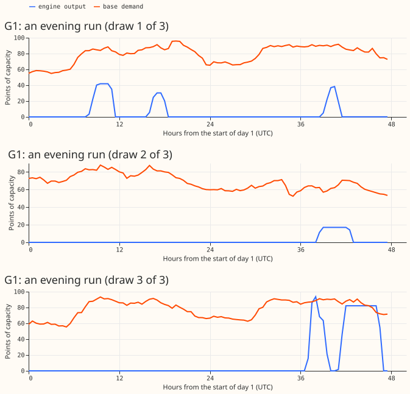

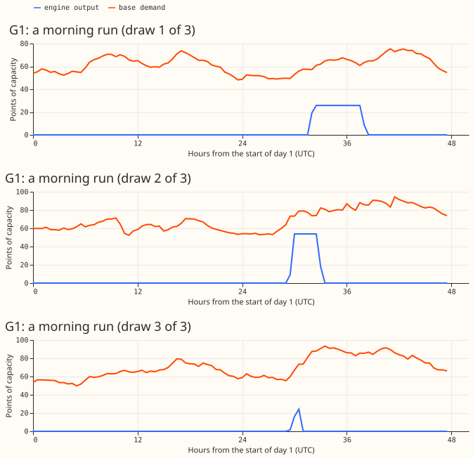

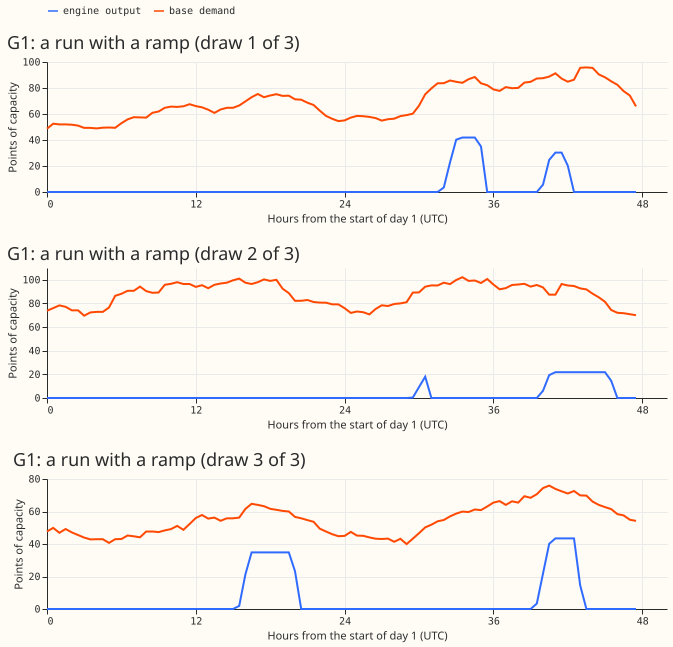

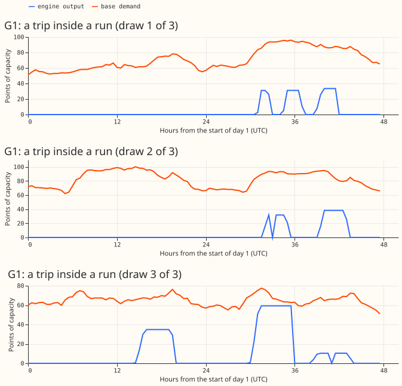

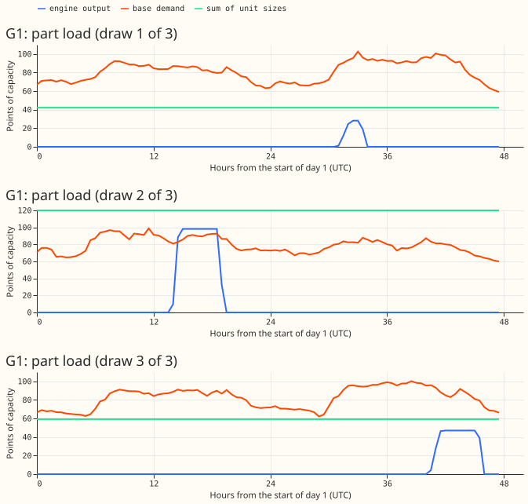

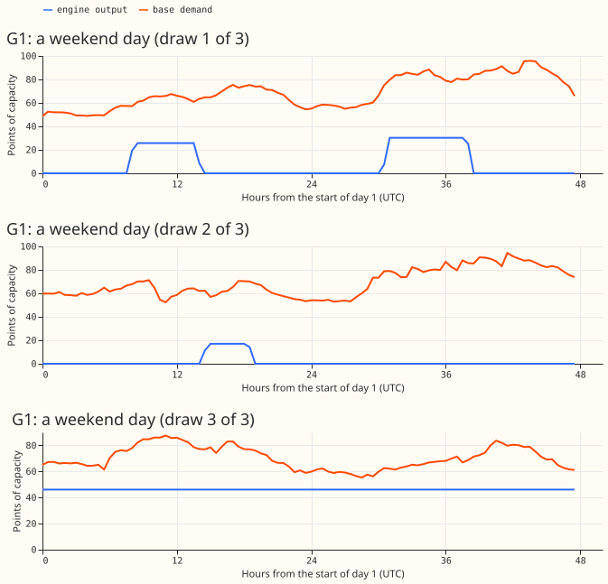

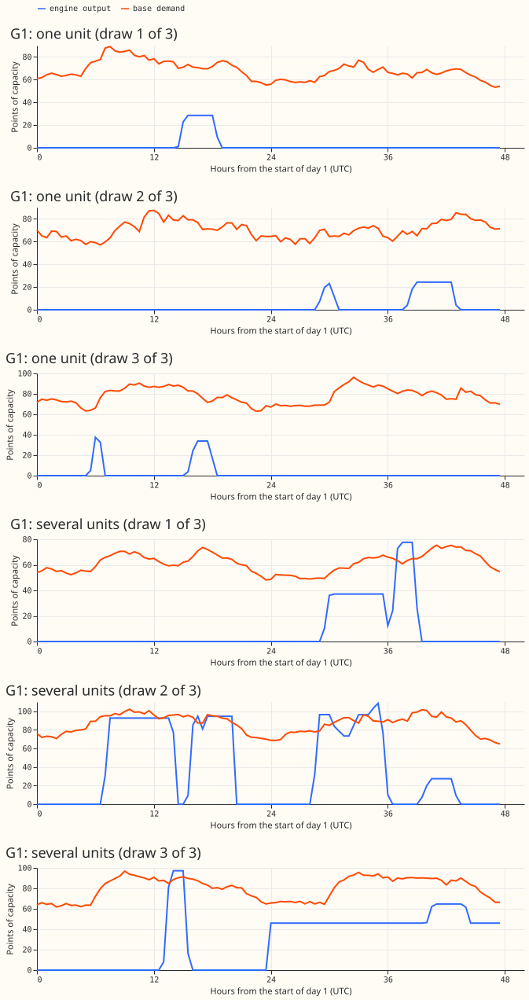

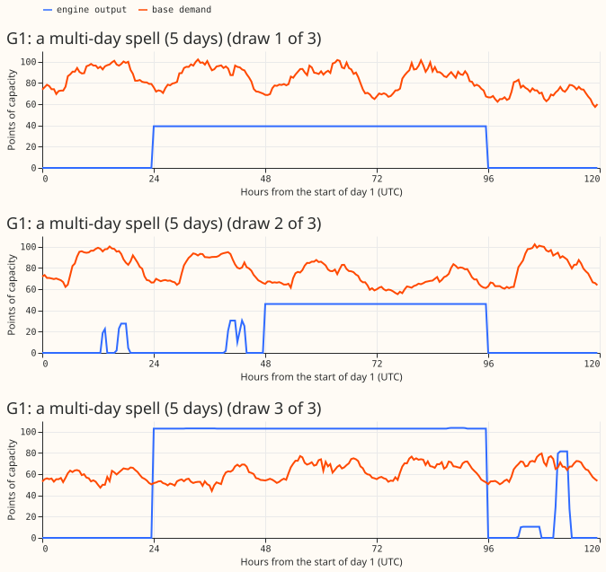

### G2 and G3: solar output

**In source S2 the solar output follows the clear-sky index, with no zero notch inside a day.** The
panels show the clearest and the cloudiest day of each season by the clear-sky index. The output is
plotted as a share of the drawn solar capacity, and the index sits on its own axis at the right. On
the clearest days the output is a smooth arch that reaches about the drawn capacity in spring,
summer, and autumn and a smaller share in winter. On the cloudiest days the output is low and varies
with the index. The index is missing at the first and last sun-up half-hour of a day, so its line is
broken there while the output continues.

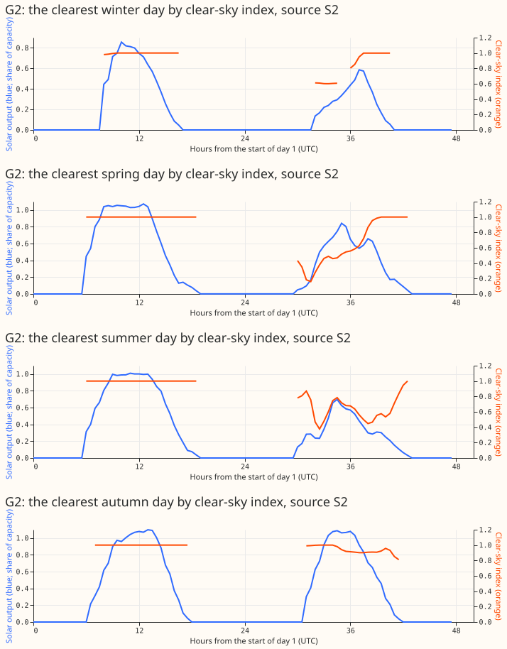

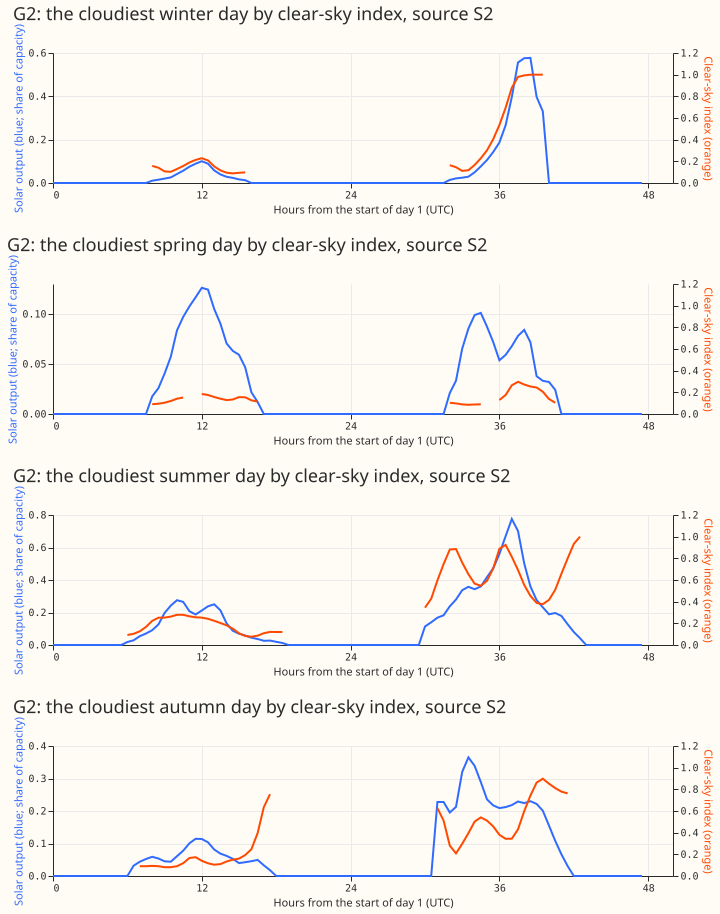

**In source S1 the 10%, 50%, and 90% bands of the daily shape are ordered in every season, and the
90% band peaks near midday.** The bands are daily shapes at a drawn capacity, so their height spans
the capacity range. The 10% band stays near zero because some days carry little or no output. No
single S1 day is published.

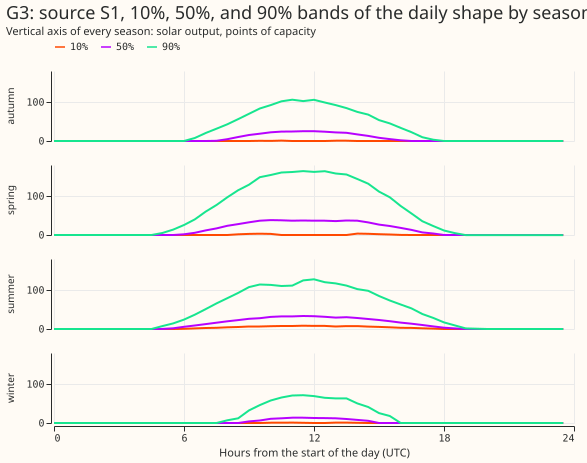

### G4 to G7: the synthetic meter and the masks

**The synthetic BSP steps follow the real meter's steps and carry the injected steps in addition.**
The panel draws the half-hour steps of the synthetic BSP meter beside the steps of the engine and
solar injection. The BSP steps are noisy because the real meter's own variation stays in them, and
the largest injection steps appear in the BSP steps as well.

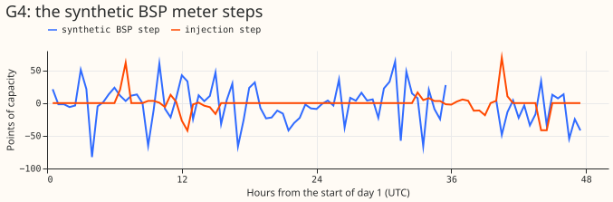

**The folded reading equals the signed truth where the truth is far from zero and sits at the
reactive floor where the truth crosses zero.** Through the reverse-flow spell the reading mirrors
the truth's magnitude, drops toward the floor at the crossing, and rises again, so the sign is
hidden exactly where the truth is negative.

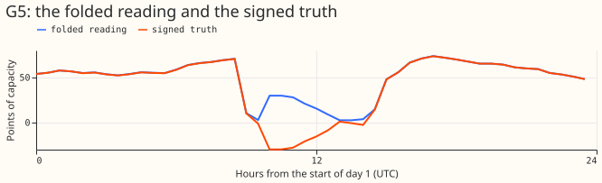

**On a day with no injection the signed truth equals the base demand.** The two lines coincide.

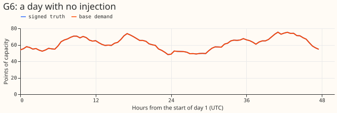

**Each masking style hides a different span of the reading channel, shaded grey, and the clean
demand stays visible as the target.** Style K hides several short spans, style W hides one long
span, style R hides one short span, and the causal cut hides every half-hour from its cut to the end
of the window.

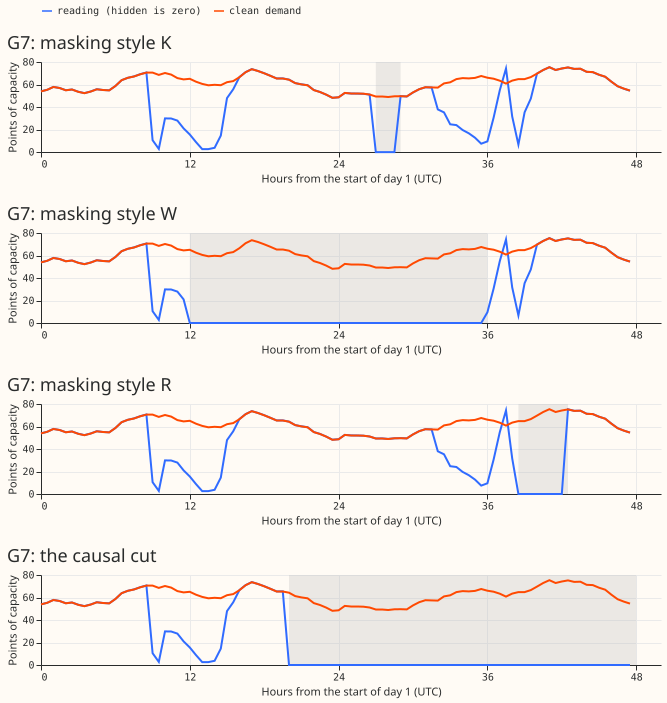

### G8 and G9: realism and component checks

**The synthetic share of half-hours below 1 MVA matches the real share only in sum: by hour of day,
the synthetic share at midday is about twice the real one.** In the engine-only worlds the synthetic
share is 0.0145 against 0.0119 in the real net era, and in the engine-and-solar worlds it is 0.043
against 0.045 in the real solar era. By hour of day the synthetic share peaks near 0.038 between
10:00 and 12:00 UTC, and the real share is near 0.02 at those hours. The real share peaks near 0.03
at 08:00 UTC, where the synthetic share is also near 0.03. The realism gate compares only the daily
and half-hourly shares per era, and those pass, so the gate's bands do not detect this difference in
shape. No real series appears.

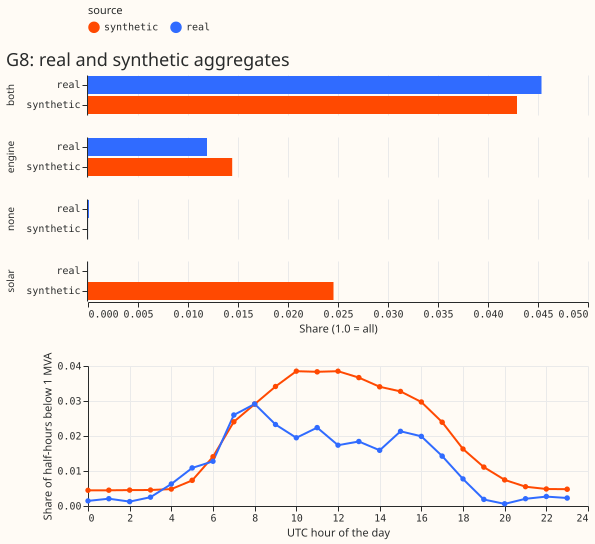

**Every group of component checks has a lowest share of at least 0.99, and every bounded share is
inside its bound.** The upper panel draws one point per check group (component, bank, and seed)
against the bar of 0.99. The lower panel draws the excluded metered-zero shares against their bound
of 0.05 and the zeroed mid-day shares against their bound of 0.01. The zeroed mid-day share is 0 in
every bank.

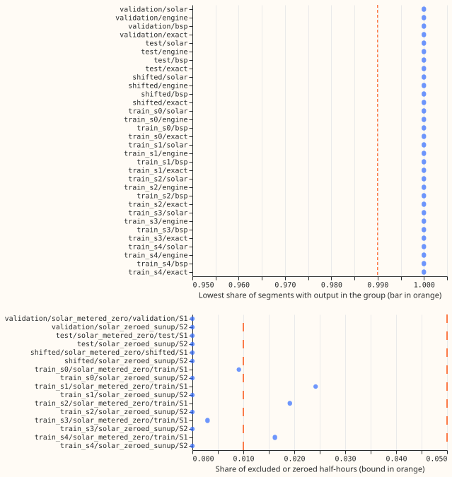

## Figures planned

**Every published figure is safe to publish: synthetic series in detail, except those built from
the metered farms, and real series as aggregates or as D8's own reading with no calendar date.** No
figure shows the metered engine record, a K1 or K2 day, or a date of the engine. Source S1 is a
real farm's metered output scaled to a drawn capacity, so the anonymisation rule decides how it is
shown: the published gallery shows S1 only in aggregate panels (quantile bands of the daily shape
by season, and the share of days with zero output, rounded, with no single farm's series), and every
panel that shows a single S1 day is written to the private `PRIVATE/gallery/` folder and never
published. Source S2 and the engine simulator are published in detail.

### The synthetic world gallery, a gate before any fit

**The gallery shows the outputs of every synthetic data generator in a range of scenarios, so that
a generator bug shows by eye.** The figures stage draws it from the rebuilt banks on the CPU, before
any fit, and picks each panel's segment and day by a fixed rule from the test bank or the training
bank of seed 0. Every panel carries days 1 and 2 of its window on the axis, never a date.

- G1, engine days: for each feature, a small multiple of 3 draws from different segments, each
  showing the engine output beside the base demand: an evening run, a morning run, a weekend day, a
  day at part load (with the sum of the unit sizes drawn), a run with a ramp over at least 2
  half-hours, a day with one unit and a day with several units (3 draws each), a trip inside a run,
  and a multi-day spell shown in a 5-day window.
- G2, S2 solar days: the clearest day and the cloudiest day of each of the four seasons by the
  clear-sky index, each showing the solar output (as a share of the draw's capacity) beside the
  CAMS clear-sky index at D8 on a second axis.
- G3, S1 solar days: the same eight single-day panels for source S1, and a day that fell back from
  S1 to S2, in the private folder only; and the published aggregate panels, which show for each
  season the 10%, 50%, and 90% bands of the daily shape of S1 output at a drawn capacity and the
  share of days with zero output.
- G4, the BSP meter: a BSP month's synthetic BSP steps beside the real meter's steps, with the
  injected steps (β times the change of the engine and solar output) marked.
- G5, the fold: the folded reading beside the signed truth through a reverse-flow spell of the
  engine, of solar output, and of both, and a day whose truth crosses zero inside the reactive
  floor.
- G6, base days: a day with no injection (the truth equals the base), and the same base day carrying
  each of the three injected world types.
- G7, the demand output's target: for each masking style K, W, and R, and for the causal cut, a
  window's masked inputs beside the clean-demand target, with the hidden span shaded.
- G8, real against simulated aggregates: the share of half-hours below 1.0 MVA for each world and
  its matching real era, and the same share by UTC hour, real and synthetic. No panel shows a
  month, because the months of each real era would reveal when the engine ran. The automatic check
  of G8 confirms only that the panel was drawn and the synthetic shares are finite; the design
  lead compares the real and the synthetic shares by eye. No real metered generator's series
  appears.
- G9, the component checks: the lowest share of segments with output where output must exist, for
  each check group (component, bank, and seed), against its bar, and the metered-zero and
  zeroed-sun-up shares against their bounds.

**The gallery passes when each panel shows what a written list requires of the panel.** The list,
in `e00730_core.py`, says for example that the engine output of G1's ramp panel rises over 2
half-hours, that every G2 clear-day panel has solar output above zero from mid-morning to
mid-afternoon, and that G5's reading never falls below the reactive floor. The session (the design
lead) checks each panel against the list as a gate and records the result beside the gallery, in
`PRIVATE/gallery/panel_check.json`; a panel that fails stops the line at verdict row 0. The
maintainer reads the same gallery in the write-up, where every generator output and each solar
source appear separately.

### Result figures

The write-up carries the gallery's published panels G1 to G9 (G3 as its aggregate panels), and then
these figures:

1. The architecture screen: the validation Brier score of the four architectures on arms S-A and S.
2. The Brier score of every arm and baseline on all, import, and reverse-flow rows and by reading
band, as staggered dots on striped rows (`dot_chart` of experiment 700). 3. The 7 counted contrasts
with their intervals and the margin m. 4. Reliability diagrams of P(X<0) for S, SD\*, SD\*-C in the
causal protocol, and D-sign. 5. The harm and detection numbers by world type and reading band,
against the limit L and the detection bar of 0.75. 6. The demand read-out: the demand output's error
on hidden half-hours, training style against evaluation style, with the demand climatology. 7. The
causal read-out: the Brier score against the number k of half-hours visible after the scored
half-hour, with the two-sided SD\* and P0 as lines. 8. Attention maps of the transformer: the mean
attention from each scored half-hour to each window position, averaged over engine-reversal,
solar-reversal, and import-only test days, and one map of a single engine day. 9. Experiment 729's
readings redone: the signed CRPS of P0f, B1, A, D, and D-sign on all, import, and reverse-flow rows
of the rebuilt banks. 10. Real eras: the share of half-hours with P(X<0) above 0.5 and the share
with the demand output above the reading, by UTC hour and era.

**At least 15 time series figures show single 48-hour windows, each day picked by a fixed rule.**
Each figure shows the signed truth, the reading, and the clean demand with the demand output's mean
and 5% to 95% band in a top row, and P(X<0) of S, SD\*, and SD\*-C in a second row, with hidden
spans shaded and no calendar date. A window whose solar output comes from source S1 is drawn to the
private folder only, and each rule below draws from S2 and engine-only segments for the published
figure:

- S1 to S4: an evening engine run, a morning engine run, solar output alone, and engine and solar
  together, each the day with the median depth of reverse flow of its rule (experiment 729's rules).
- S5: a day whose reading comes within 0.3 MVA of zero on at least 4 half-hours.
- S6: a plain import day with no injection, the median of SD\*'s largest P(X<0) of the day.
- S7: the import day with SD\*'s largest mean P(X<0) on decidable rows.
- S8: a reverse-flow day on which SD\* gains most over S in the Brier score, and S9 the day on
  which SD\* loses most.
- S10: a test day with the whole scored day hidden (style W), the demand output of SD-W against the
  clean demand.
- S11: a test day with the engine blocks hidden (style K), the demand output of SD-K.
- S12 and S13: an engine day and a solar day with SD\*-C's causal P(X<0) (k = 0) drawn beside the
  two-sided P(X<0). - S14 and S15: a real pre-engine day, the median and the largest of SD\*'s
  largest P(X<0) of the day.
- S16: a solar day on which the refitted arm D and D-sign are drawn beside SD\*.

## Choices of the plan

- **The sign is scored by the Brier score and the log loss on the event X < 0,** because the CRPS
  with a 0.5-point floor mixes the sign with the floor's penalty.
- **The harm check reads the probability placed on reverse flow at decidable import rows,** because
  P0's zero is the reference that a later forecast would otherwise use, and a reading of 1 MVA or
  more puts |X| above 9 points.
- **The harm limit is a quarter of the decidable reverse-flow share,** which keeps an expected
  precision of at least 0.8 for a detector that finds every reverse-flow half-hour.
- **The sign loss is dropped on hidden half-hours,** because test windows are never hidden.
- **λ is 0.1, with a report-only arm at 0.5,** because the two losses differ in scale by more than
  ten times.
- **The encoders are re-pre-trained without the held-out months,** because every stored encoder file
  saw D8's held-out months. - **The encoders train at the base learning rate in both encoder arms,**
  so the pre-trained and fresh arms differ only in their initial weights.
- **The causal variant hides the future through its input,** so the same architecture serves the
  two-sided and the causal reading, and a unit test proves that no later input reaches an output.
- **The epoch cap is 300,** because experiment 729's two-lobe fits reached 200 still improving.
- **The banks are rebuilt here, with experiment 729's fixed code and registered ranges,** because
  every S2 solar world of experiment 729's banks was silent, and experiment 729 is not rerun.
- **The margin's floor and the harm limit are formulas evaluated on the rebuilt test bank's truth
  before any fit,** because the numbers that this plan could compute came from the silent-solar
  banks.
- **Experiment 729's arms A, D, and D-sign are refitted with experiment 729's protocol,** so that
  experiment 729's key comparisons exist on the corrected world.
- **The synthetic world gallery and the component checks are gates before any fit,** because a
  silent generator passed experiment 729's realism gate.
- **S1 is published only in aggregate panels, and single S1 days stay private,** because source S1
  is a real farm's metered output, and the anonymisation rule decides this.
- **The test and validation months follow a rule and stay in experiment 729's private file,**
  because a list of months, with the era cut, could let a reader recompute withheld dates.

## Method

**Architecture:**

- The headline arm SD\* reads the reading, the CAMS fields at D8, the synthetic BSP steps, the
  calendar rows, and the coincident ERA5 temperature, wind speed, and precipitation over a 48-hour
  window, on the architecture that the screen chooses, and outputs a sign logit and a Gaussian of
  clean demand at each half-hour of the middle 24 hours.
- The four architectures, the encoders, and the heads are in "Architectures and the screen",
  "Encoders from the modular demand networks", "The sign output and how it is scored", and "The
  demand output and how the reading is hidden".
- No arm reads the month or the day of the year, and no arm reads weather issued at a forecast
  origin.

**Training regime:**

- The training data are synthetic segments built on D8's pre-engine base days in the training
  months, from banks of 32 draws per month per seed, rebuilt in this experiment's data folder with
  experiment 729's fixed simulator and the ranges that pass the realism gate.
- Experiment 729's arms A, D, and D-sign are refitted on the rebuilt banks with experiment 729's
  protocol (bilstm, early stopping on the validation signed CRPS, a cap of 200 epochs).
- The loss is the sign head's binary cross-entropy on the visible half-hours plus 0.1 times the
  demand head's negative log likelihood on every valid half-hour.
- The optimiser, the sampler, the early stopping on the validation Brier score, and the cap of 300
  epochs are in "Compute, stop line, and gates"; seeds 0 to 2 set the initial weights and the
  training bank of each fit, and seeds 3 and 4 are fitted for arm S alone.
- The encoders of SDe-PT are pre-trained on ERA5 and CAMS rows of 16 Primaries from 2019-09-01 to
  2026-06-30, with the held-out months and the engine record's days removed.

**Measurement:**

- The scored rows are the half-hours of the rebuilt test bank; the metrics, the two-way
  bootstrap, the Kish widening, the margin, the contrasts, the harm checks, the bars, the real
  checks, and the verdict table are in the sections above.
- Every table reports the Brier score, the log loss, the normalised mean absolute error of the
  median, and the signed CRPS, on all, import, and reverse-flow rows, by reading band, by world
  type, by solar source, and by daylight (09:00 to 13:00 UTC) against the other hours.

## Files

**The code imports experiment 729's fixed modules unchanged and adds modules for the bank build,
the gate, the gallery, the new heads, masks, architectures, encoders, and scores.**
`e00730_paths.py` puts the folders of experiment 729 and its imports (721, 694, 700, 697, 39, 194,
and 722) and of experiment 545's chain (397, 087, 418, 422, 428, 437, 448, 510, 511, and 545) on
`sys.path`. No file of an earlier experiment is edited. A
reused function called unchanged needs no new review; every new module is reviewed.

**Reused unchanged from `ml-experiments/00729-msa-d8-neural-untangler-synthetic-known-answers/`,
as merged:**

- `e00729_core.py` (the split rule, the registered ranges, the reactive floor, the floor of 0.5
  points, and the bootstrap constants), `e00729_sim.py` (the engine and solar simulators, the fold,
  the synthetic BSP, and `Segment`), `e00729_banks.py` (building, hashing, saving, and loading the
  banks, and the gate's functions), and `e00729_leakage.py` (the bank checks);
- `e00729_arms.py` (the channel stack, the windows, `mask_span`, and the sampler),
  `e00729_nets.py` (`BiLstm`, `UNet1d`, the two-lobe head, `sign_bce`, `sign_lobes`, and the
  auxiliary Gaussian), `e00729_train.py` (`fit`, for the refits of arms A, D, and D-sign), and
  `e00729_dist.py` (the mixture CRPS, the quantiles, and `reliability_term`);
- `e00729_score.py` (`rows_from_segments`, the subsets, `cell_table`, `read_contrast`, and the
  Kish numbers), `e00729_baselines.py` (P0 and B1), `e00729_real.py` (the real segments and the
  folded record days), `e00729_data.py` (the loaders and `sky_present`), and
  `tests/smoke_real_files.py` (the real-file checks, among them the S2 output on clear days).

**Reused from experiment 545's chain:** `e00545_model.ModularMdn` (the two encoders, the embedding,
and the pre-training mixer), `e00397_models.mlp`, experiment 428's `build_fold`, and experiment
448's `pretrain_rows`. Experiment 545's training loop is copied into `e00730_pretrain.py`.

**New in `ml-experiments/00730-msa-d8-sign-detector-with-demand-head-and-masking/`:**

- `e00730_paths.py`: the data folder, the `PRIVATE` folder of experiment 729, thread pinning, and
  the sibling folders.
- `e00730_core.py`: every named constant and bar on this page, the arms, the masking styles, the
  limits, the margin file, and the verdict rule.
- `e00730_banks.py`: the bank build and the realism gate with the data root as a parameter, the
  run marker and its guard, the component checks, and the limits file.
- `e00730_gallery.py`: the synthetic world gallery, its written list of what each panel must show,
  and the record of the panel-by-panel check; S1 panels go to `PRIVATE/gallery/`.
- `e00730_masks.py`: the styles K, W, and R, the future cut of the causal variant, and the fixed
  masks of the demand read-out and the causal validation.
- `e00730_arms.py`: the arm specifications, the target stack with the base-demand row, the
  encoder channels, and the batch builder that applies the masks and the loss weights.
- `e00730_nets.py`: the transformer and the GRU-transformer with their attention flag, the sign
  and demand heads, the encoder front, and the loss.
- `e00730_pretrain.py`: the pre-training without the held-out months, the stored standardiser,
  D8's encoder input table, and the weight-file digest checks.
- `e00730_signed.py`: the signed read-outs R2 to R6, table T1, and the by-group harm and detection
  numbers.
- `e00730_train.py`: the fit loop with the Brier early stop and the causal validation, the timing
  gate, and the fit schedule.
- `e00730_score.py`: the Brier score, the log loss, H1, H2, the detection and calibration bars, the
  causal protocol, the demand read-out, the ambiguity read-out, and the contrasts.
- `e00730_real.py`: H2, K1, K2, R2, and R3.
- `e00730_leakage.py`: the new assertions of verdict row 1.
- `e00730_gate_calibration.py`: the offline calibration behind the one permitted re-tune, which
  prints share ratios only.
- `e00730_stages.py`, `e00730_cli.py`, `e00730_report.py`, `e00730_figures.py`,
  `e00730_series_figures.py`, and `run.sh`: the stage orchestration, the command line, the printed
  report, the figures, the time series figures, and the launch wrapper.
- `e00730_loss_curves.py`: added after the merge; draws figure 11 from the stored `history` and
  `best_epoch` of each seed-0 fit. It is not a stage of `e00730_cli.py`.
- `tests/`: tests on synthetic arrays only, including the known-answer tests of the Brier score,
  the log loss, the masks, and the causal cut, and an end-to-end run of the stages with tiny fits
  on the CPU; the tests that need `torch` skip in CI.

**Data:**

- `data/ml-experiments/00729-msa-d8-neural-untangler-synthetic-known-answers/PRIVATE/splits.md`:
  read only, the month lists of [experiment
  729](../00729-msa-d8-neural-untangler-synthetic-known-answers/result.md). No other file of
  experiment 729's folder is read or written: its banks, fits, and predictions come from the
  silent-solar run.
- D8's cleaned reading, the BSP A meter, experiment 39's frame of CAMS fields and temperature at D8
  and at the farm sites, and the metered farms' output: read through experiment 729's loaders to
  build the banks.
- The pre-training inputs of [experiment
  545](../00545-modular-lag-free-demand-network-weather-and-datetime-encoders/result.md): the stored
  power, ERA5, and CAMS files of the 16 Primaries, read through experiments 428 and 448.
- `data/studies/per_study/stage1_pilot/demand/inputs/era5_features.parquet`: read. ERA5 at D8's
  grid cell, as in experiment 729, and the longwave, dew point, and surface pressure columns of the
  weather encoder.
- The metered engine record: read, from the window table of [experiment
  194](../00194-ps1-ps5-generator-visibility-d8-analogue-break-and-price-following-census/result.md),
  for K1, K2, and the pre-training exclusion. Never published with dates.
- `data/ml-experiments/00730-msa-d8-sign-detector-with-demand-head-and-masking/`: written. It will
  hold `run_marker.json`, `banks/` (the rebuilt banks and `summary.json` with their digests and the
  component checks), `scores/gate_attempt<n>.json`, `limits.json` (the floor f and the limit L),
  `gallery/` (the published panels) and `PRIVATE/gallery/` (the S1 panels and the check record),
  `pretrained/` (the weights, the standardiser, and D8's encoder input table), `networks/`, `fits/`,
  `predictions/`, `scores/`, `margin.json`, `verdict.json`, and the run logs.
