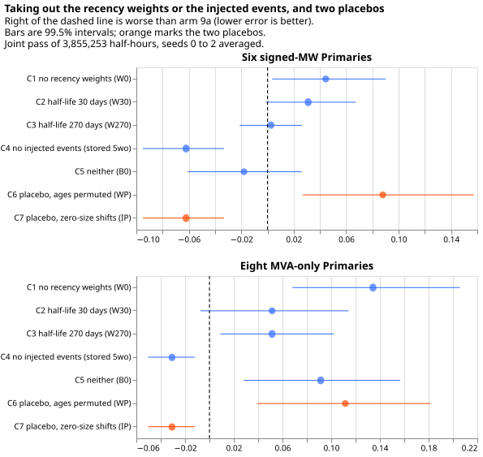
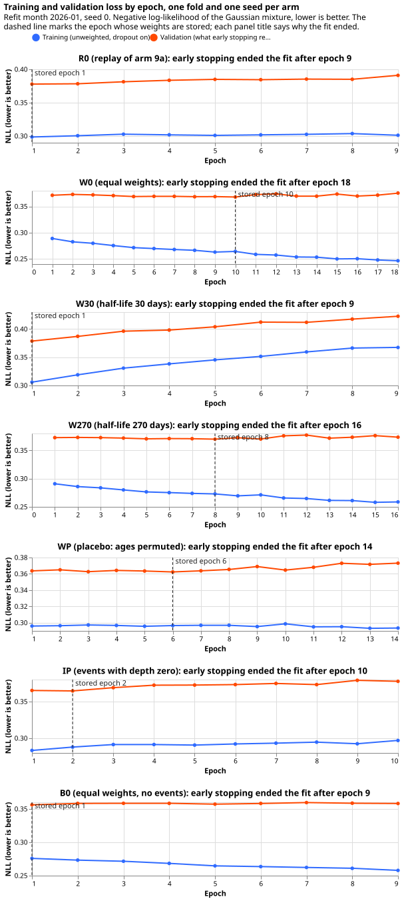
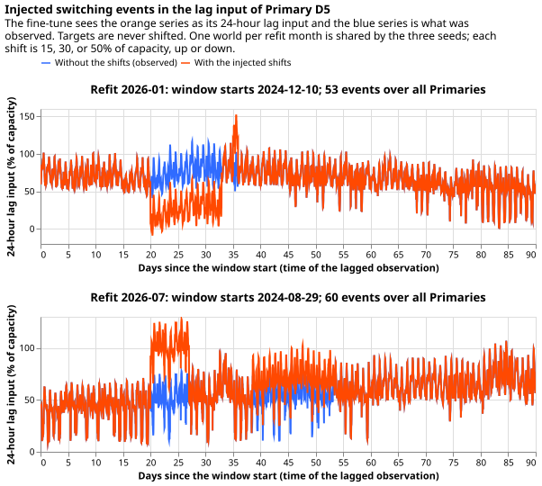
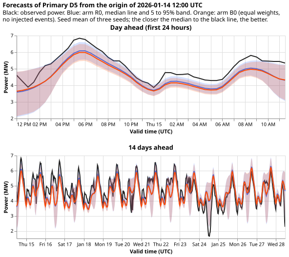
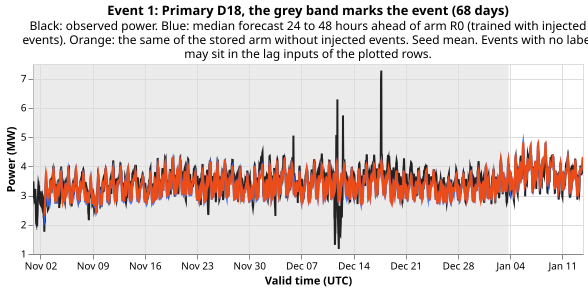
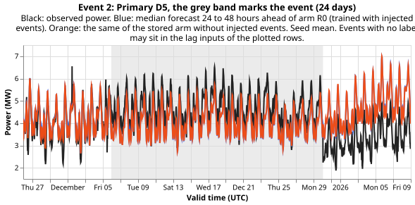
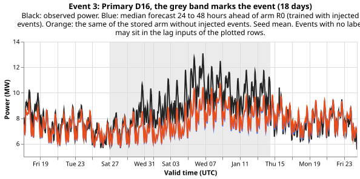
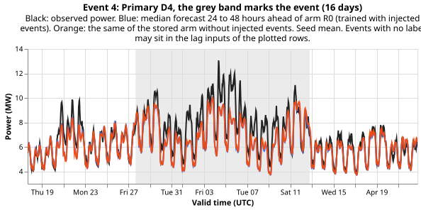
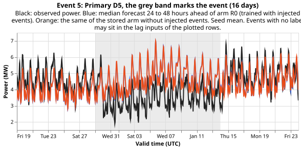
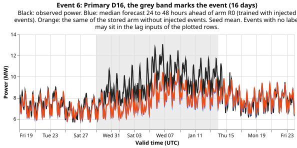

**The step-5 demand network already trains with two choices that the maintainer asked us to test, so
this experiment took each choice out and compared.** The network forecasts the power drawn at 16
Primary substations, and experiment
[677](../00677-building-up-the-candidate-demand-network-one-component-at-a-time/result.md) refits it
every month. Its final fine-tune weights each training row by `0.5 ** (age_days / 90)`, so a row
loses half its weight every 90 days of age, and it injects synthetic switching events (a level shift
added to the lag inputs, never to the target). We refitted the final fine-tune of 12 monthly refits
in 7 arms (a replay of arm 9a and 6 variants with the weights or the events changed), three random
seeds each, and
scored every variant on experiment 677's one-year backtest. Taking out the weights raised the
forecast error. Taking out the events lowered the error slightly but made the forecast copy more of
an injected shift, so no variant replaces the current recipe.

**Verdict: `supported` under the pre-registered rule, with a recency result that is fragile.** The
pre-registered reading is that the 90-day weights help when removing them raises the error and an
age-permuted placebo raises it as well. Both held at both Primary groups, and the sign agreed in all
three seeds. The audit confirmed the numbers from the raw forecasts, and it also showed that the
gain at the six signed-MW Primaries starts 0.004 points above zero and that the gain at the eight
MVA-only Primaries rests on D8 and D22. No variant meets the pre-registered rule for replacing arm
9a, so the production candidate and the exported step-5 bundle stay as they are. **The production
port is not blocked on this experiment.**

## Results

**The score is the normalised mean absolute error of the median forecast, in points of capacity;
lower is better.** One point means a median forecast that is on average 1% of a Primary's capacity
away from the observed power. Every contrast below is the variant minus R0 (the replay of arm 9a),
so a positive number means the variant is worse. The six signed-MW Primaries are the six whose
meters record the direction of flow. The eight MVA-only Primaries have apparent-power meters that
hide reverse flow, so the two groups are scored separately. D15 and D18 are reported only, because
their history is short and noisy.

| Arm | What changed from arm 9a | Six, MAE | Eight, MAE | Six, CRPS | Eight, CRPS |
|---|---|---|---|---|---|
| R0 | nothing (replay) | 5.62 | 6.70 | 3.24 | 3.70 |
| W0 | equal weights | 5.66 | 6.83 | 3.27 | 3.76 |
| W30 | half-life 30 days | 5.65 | 6.75 | 3.27 | 3.74 |
| W270 | half-life 270 days | 5.62 | 6.75 | 3.25 | 3.72 |
| WP | placebo: ages permuted | 5.71 | 6.81 | 3.30 | 3.75 |
| 5wo (stored) | no injected events | 5.56 | 6.67 | 3.20 | 3.68 |
| IP | placebo: zero-size shifts | 5.56 | 6.67 | 3.20 | 3.68 |
| B0 | neither | 5.60 | 6.79 | 3.23 | 3.74 |

**Reproduction gate: arm 9a scores 7.3946 (95% interval 7.1369 to 7.6713) over all 16 Primaries on
the 3,879,313 half-hours of experiment 677's joint pass, as published.** The contrasts use the
3,855,253 half-hours that the new scorer shares with that set. The 24,060 rows that drop out belong
to D15 and D18 between 2025-12 and 2026-03, because the cleaned power table was rewritten after
experiment 677 ran. Arm 9a scores 7.3646 on the shared rows. R0 equals arm 9a to float rounding
(at most 9e-7 of capacity per half-hour).

| Contrast (variant minus R0) | Six, MAE | Eight, MAE |
|---|---|---|
| C1 equal weights (W0) | +0.044 (+0.004, +0.090) | +0.134 (+0.068, +0.206) |
| C2 half-life 30 days (W30) | +0.031 (-0.001, +0.067) | +0.051 (-0.007, +0.114) |
| C3 half-life 270 days (W270) | +0.003 (-0.021, +0.026) | +0.051 (+0.009, +0.102) |
| C4 no injected events (5wo) | -0.062 (-0.095, -0.033) | -0.031 (-0.051, -0.012) |
| C5 neither (B0) | -0.018 (-0.061, +0.026) | +0.091 (+0.028, +0.157) |
| C6 placebo, ages permuted (WP) | +0.088 (+0.027, +0.157) | +0.112 (+0.039, +0.182) |
| C7 placebo, zero-size shifts (IP) | -0.062 (-0.095, -0.033) | -0.031 (-0.051, -0.012) |
| C8 IP minus 5wo | under 2e-8 | under 2e-8 |

**The 90-day weights help, and the effect is largest where the Primary's history changes most.** C1
is positive at both groups. At D15 and D18 (reported only) it is +1.80 and +0.39, and the 30-day
half-life lowers D15's error by 1.75 (-2.81 to -0.75) and D18's by 0.18, yet raises the error at
11 of the 16 Primaries. A half-life per Primary may therefore beat one global half-life, which this
experiment
did not test.

**Taking out the injected events lowers the error but increases the copying of shifts.** C4 is
negative at both groups, and its interval stays below zero whichever one Primary is left out. The
held-out
bank of injected shifts shows the cost: the forecast copies 0.071 of an injected shift in arm 9a
(seed spread 0.006) and 0.126 without injection (0.004). The pre-registered rule for replacing arm
9a requires a copied share no more than 0.02 above arm 9a's, so the injection-free arm does not
replace it. Inside the 10 logged events of more than 7 days, C4 is -0.142 (-0.245 to -0.022) on
105,500 half-hours, and in the 7 days after an event ends it is +0.170 (-0.022 to +0.363) on 32,116
half-hours.

| Scenario of the 10 logged events (C1, C4) | All rows | Outside events | Inside events | 7 days after |
|---|---|---|---|---|
| C1 equal weights minus R0 | +0.205 (+0.123, +0.295) | +0.050 (-0.004, +0.101) | +0.136 (-0.235, +0.461) | +0.221 (-0.139, +0.805) |
| C4 no events minus R0 | -0.061 (-0.083, -0.040) | -0.073 (-0.111, -0.037) | -0.142 (-0.245, -0.022) | +0.170 (-0.022, +0.363) |

NGED's logs may miss events, so the clean-lag rows may hold events no label covers, and the inside
and after intervals are probably optimistic.

Six of the twelve event plots follow. Each shows the observed power and the 24 to 48 hour ahead
median of R0 and of the injection-free arm around one logged event of a Primary.

## Checks

- **Predictions:** C1 at the six (+0.044), C4, and C5 fell inside the registered ranges. C1 at the
  eight (+0.134 against 0 to +0.05), C3 at the eight (+0.051 against under +0.04), and the placebo
  C6 (+0.088 and +0.112, where the registration said within 0.02 of C1) fell outside. The audit's
  explanation for C6 is that the permuted weights keep arm 9a's effective share of about 35% of rows
  but put the heavy weights on random calendar months, so the placebo trains on a seasonally
  mismatched sample and is worse than equal weights at the six (+0.044, interval +0.003 to +0.087).
- **Median minus mean forecast per Primary:** the check is approximate, because the mean is
  estimated from the 11 quantiles by the midpoint rule, and the values run from -6.8 to -0.06
  across the arms and Primaries. Only differences between arms are informative. The table is
  private (`scores/summary/median_minus_mean.csv`).
- **MAE beside CRPS:** the two metrics agree in sign for C1, C4, and C6 at both groups. C2 at all 16
  Primaries has an MAE interval below zero (-0.067, -0.131 to -0.002) and a CRPS interval that
  crosses zero (-0.015), which D15 and D18 cause.
- **Audit triggers that fired:** trigger 2 (C1 at the eight and the placebo C6 contradict the
  prediction) and trigger 4 (leaving out D14 or D16 moves C1 at the six to +0.026 and +0.025 with
  intervals that cross zero). A fresh Sonnet agent re-derived C1, C4, and C6 from the raw fit files
  with its own code and matched every point estimate to 0.0001 and every interval limit to 0.004.
  It found no error. It added that C1 at the eight without D8 and D22 is +0.016 (-0.034 to +0.065)
  and that the fine-tune is one epoch in 72% of arm 9a's fits. The pre-registered verdict stands,
  and
  these two findings are post hoc readings.
- **The zero-size-shift placebo:** arm IP reproduces the injection-free arm 5wo to 8e-7 of capacity,
  as expected when the shifts are zero, so C7 equals C4 and C8 is zero by construction. The pair
  confirms that the code path is equivalent, and it tests no other idea.
- **Tails:** on 3,879,313 half-hours the share of observations at or below the q01, q05, q95, and
  q99 forecasts is 0.0297, 0.0894, 0.9122, and 0.9701 for R0, against nominal 0.01, 0.05, 0.95, and
  0.99, so the tails are too narrow in every arm. Pinball loss at q05 is 0.925 for R0, 0.943 for
  equal weights, and 0.922 for the injection-free arm. Cold winter nights and the avoidable
  curtailment cost were not computed.
- **Limits:** the per-fit total weight and effective rows were not retained (the prediction pass
  overwrote the logs), so the effective-row shares in the audit are an analytic reconstruction.
  The scores are tuning-adjacent, because the year includes valid times from 2026-07 to
  2026-10 that the protocol reserves for finalists, and the fine-tune is short enough that its
  stopping epoch confounds the weights with how long the fine-tune runs.

## Method

### Architecture

- The network is arm 9a's: one pooled Gaussian-mixture neural network with 3 components over the 16
  Primaries, a shared lag encoder (24-hour and 1-week lags), weather and date-time encoders, 60
  input columns, a D5 output offset, and 11 quantiles read from the mixture's cumulative
  distribution.
- The weather input of each row is the 00Z ECMWF ensemble run issued 9 hours before the native
  09:00 UTC origin, so the weather is known at the forecast origin. Experiment 677's assertion
  `nwp_init_time <= power_fcst_init_time` holds by construction after 2026-06-30, where stub demand
  frames are used, so the known-answer test checks the ensemble summary files of all 123 origins
  from 2026-07 to 2026-10 independently (run time equals origin minus 9 hours). The example row is
  run 2025-12-31 00:00, origin 2025-12-31 09:00, oldest lag 2025-12-24 09:30. The network has no
  lag-free head.
- Stages 1 and 2 are frozen at experiment 677's stored weights for each month and seed. Only stage
  3 and the prediction pass run.

### Training regime

- Stage 3 fine-tunes from the stage-2 weights with AdamW (learning rate 2e-4, weight decay 1e-3),
  batches of 8,192 rows, up to 60 epochs with patience 8, and the weighted mixture negative
  log-likelihood as the loss. Validation is unweighted.
- Training rows come from the 730 days before each refit, cleaned of the half-hours that the
  `substation_zero` rule flags, with the noisy start of the short-history Primaries cut, as in
  experiment 677. The newest 7 days are dropped and the next 7 days are halved (experiment 599's
  E3).
- Injection (arm 9a, W0, W30, W270, WP): events cover 5% of each Primary's half-hours (8.5% of rows
  carry a shifted lag in the 2026-04 refit), shift the lag inputs by 0.15, 0.30, or 0.50 of
  capacity for 3, 7, 15, or 30 days, and one world per refit month is shared by the three seeds. The
  early-stopping week is shifted too.
- The 12 monthly refits run from 2025-11-01 to 2026-10-01, seeds 0 to 2. Each of the 7 new arms
  fitted 36 networks (252 in all), each saved as a state file with its per-epoch loss history.
- Variants: W0 and B0 set an infinite half-life, W30 and W270 set 30 and 270 days (each keeps the E3
  embargo and halving), WP replaces the ages in the recency weight with experiment 710's
  `permuted_age_days` (calendar months permuted, one permutation per refit month shared by the
  seeds, E3 acting on the true ages), IP sets every shift depth to zero (same onsets, lengths, and
  signs), and B0 also drops injection.
- The runner `e00731_k1.py` is a copy of experiment 677's `e00677_k1.py` with three marked patch
  blocks (experiment 677 is immutable), and a test checks that the unpatched part equals the
  original. Every script asserts that its data root contains `00731`, and a prediction pass refuses
  to run unless all fits exist and passed their checks. A hash of the runner is stored with every
  fit, and a changed runner refuses to reuse old outputs.
- The experiment used 5.43 GPU-process-hours (fits 2.24, forecast passes 1.64, held-out-bank passes
  1.55), 2 processes at once for the fits and 3 for the held-out banks, on 6 GB of GPU memory
  each, and a peak resident memory of 6.8
  GB per process.

### Measurement

- Scored rows are experiment 677's `backtest_year_2025_11_to_2026_10_daily_12utc`: 365 daily 12:00
  UTC origins, 672 half-hours each, 16 Primaries, lead 0.5 hours to 14 days, scored on the cleaned
  actuals and averaged over seeds 0 to 2 (quantiles averaged, then sorted).
- Pass A reproduces experiment 677's 31-system joint pass (the 29 ladder arms, the manual heuristic,
  and climatology) with 2,000 draws. Pass B uses the half-hours that every system shares under the
  new scorer, adds the new arms, and draws 10,000 block-bootstrap samples.
- Every contrast is paired and uses the arm minus R0, with 7-day blocks of origin days and a 99.5%
  interval (Bonferroni over 5 contrasts and 2 groups); C6 to C8 sit outside that family. The
  threshold is zero, with a point estimate of at least 0.02 for an arm to replace R0, the same sign
  in all three seeds, a CRPS upper limit below +0.02, and a copied share no more than 0.02 above
  R0's.
- The copied share is experiment 677's held-out bank of injected shifts, pooled over months by
  shifted rows and averaged over seeds.
- The verdict follows the ordered rules of the `decision_rule` in the front matter, applied to C1
  and C6 per group.
- The load-shift scenarios use experiment 677's event sets (the table of 10 events of more than 7
  days, and 2 verified transfers) and its slice masks.

## Files

- `ml-experiments/00731-step-5-recency-and-injection-ablations-monthly-refits/e00731_k1.py`:
  stage-3 fit and prediction runner for one arm and month (copy of `e00677_k1.py` with the patch
  blocks). It writes the models, fits, loss histories, and injected worlds.
- `.../e00731_run.sh`: driver for one arm and month (fit, forecast, held-out bank), with the
  memory cap, core pinning, and a per-phase time log.
- `.../e00731_phases.py`: runs the smoke, fit, bank, and score phases behind review markers.
- `.../e00731_score.py`: scores every arm (pass A, pass B, contrasts, per-seed, per-Primary,
  leave-one-out, copied share, median minus mean).
- `.../e00731_tests_known_answer.py`: known-answer tests for the weights, the injection, the
  placebos, and the weather look-ahead.
- `.../e00731_figures.py` and `.../e00731_contrast_figure.py`: the figures and the tails table.
- `data/ml-experiments/00731-step-5-recency-and-injection-ablations-monthly-refits/`: written by
  this experiment (`arms/k1_<ARM>_sp1/work/{fits,models,history,worlds,logs}`,
  `scores/summary/*.csv`,
  `figures/`, `logs/phase_times.csv`).
- `data/ml-experiments/00677-building-up-the-candidate-demand-network-one-component-at-a-time/`:
  read only (stage-1 and stage-2 weights, stored arm 9a and the injection-free arm `5wo`, scores,
  held-out banks). Experiment 574, 581, 591, and 710 supply the training, injection, and
  permutation code, and experiment 510 supplies the weight hook.
- `data/ml-experiments/briefs/step5_recency_injection/findings.md` and
  `data/ml-experiments/briefs/731_audit.md`: the pre-run findings and the audit report (private).
