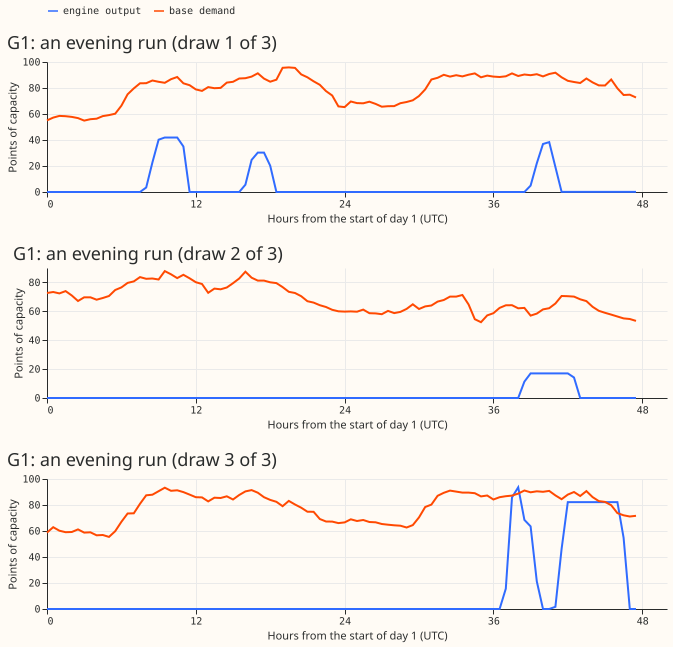
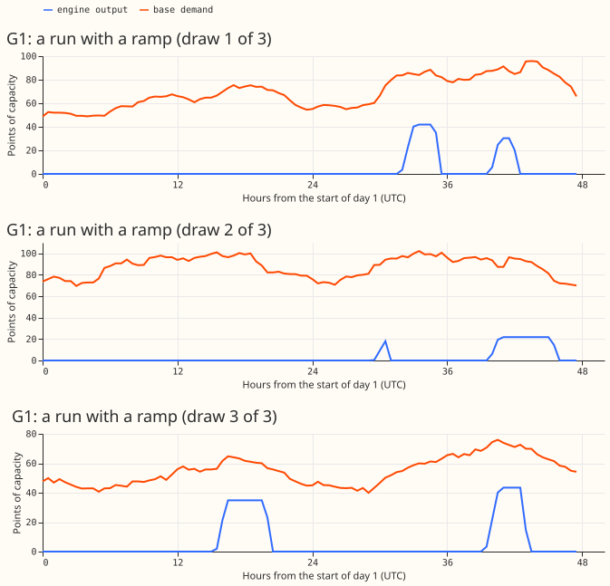
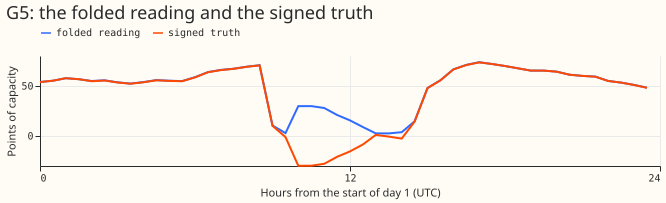
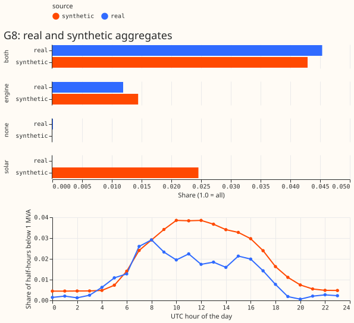

**We ask whether one neural network can take a day of D8's meter reading and pull apart the
signals that add up to it.** D8 is a primary substation (a "Primary") whose meter reports apparent
power, a magnitude with no sign. A gas engine and a solar farm connect below D8, so power
sometimes flows out of D8 towards the grid (reverse flow), and the meter shows that export as a
positive reading. On top of that, the network operator sometimes moves a block of customers from
D8 to a neighbouring Primary, or the other way, for hours or days; this page calls such a move a
load transfer. The neural network is to give three answers at each half-hour: the probability that
the power flows in reverse, how many megawatts the solar panels below D8 produce, and whether a
load transfer starts or ends.

**No meter records those three answers on a real day, so the neural network learns on synthetic
days with a known answer.** We take D8's real readings from before the engine was connected, add a
simulated engine, simulated solar output, and simulated load transfers, and fold the result into a
magnitude the way the meter does. To teach the solar output to behave like solar power, we show the
neural network two copies of the same window that differ only by a known extra amount of solar
output, and require its solar answer to rise by exactly that amount. We then test on synthetic days
that training never saw, and run checks of physical sense on real days.

**The main question is whether learning the extra answers makes the probability of reverse flow
worse.** In [experiment 730](../00730-msa-d8-sign-detector-with-demand-head-and-masking/result.md),
a neural network that also learned D8's demand gave a slightly worse probability of reverse flow
than the same neural network without the demand output. This experiment compares the new neural
network with the stored predictions of experiment 730's best arm, on exactly the same test
half-hours.

**The design follows the earlier experiments on the same synthetic days.** [Experiment
729](../00729-msa-d8-neural-untangler-synthetic-known-answers/result.md) and experiment 730 trained
neural networks in the manner of [Kelly and Knottenbelt
(2015)](https://doi.org/10.1145/2821650.2821672), on randomised synthetic data in the spirit of
domain randomisation ([Tobin et al. (2017)](https://doi.org/10.1109/IROS.2017.8202133)). The paired
windows with a known solar injection take forward the contrastive term of [experiment
624](../00624-pv-probe-contrastive-injection-arms/result.md), which broke a demand network when
built as it was there; "The loss and the contrastive terms" says what differs here. The U-net is
that of [Ronneberger et al. (2015)](https://doi.org/10.1007/978-3-319-24574-4_28), a
convolutional neural network whose layers shrink the window and then grow it back, with skip
connections that carry the detail of each level across. Every section from "Terms" to "Method" is
the plan, written before any code exists.

## Terms

- **Signed power X** is D8's real power, positive for import and negative for reverse flow.
- **The reading R** is what D8's meter reports: R = sqrt(X² + Q²), where Q is the reactive floor,
  the reactive power that keeps the reading above zero when X crosses zero. **Folding** is the name
  for this loss of the sign.
- **A point** is 1% of D8's effective capacity of 10.379 MVA, the normaliser that
  [data-processing](../data-processing.md) uses for D8. One point is 0.104 MW at power factor 1,
  and a reading of 1 MVA is 9.6 points. Every solar figure is given in points and in MW.
- **P(X<0)** is the neural network's probability that the half-hour's signed power is negative.
  **P0** reads the reading as signed import, so P0's P(X<0) is 0 everywhere.
- **The solar output** is the output of the simulated solar panels below D8 in a synthetic window,
  in points, and **the solar head** is the output of the neural network that estimates the solar
  output.
- **A load transfer** moves a block of customers between D8 and another Primary for a span of time,
  so D8's demand steps up or down by a roughly constant amount at the start and steps back at the
  end. **A transfer step** is the half-hour that holds the start or the end of a load transfer.
- **The bulk supply point (BSP)** above D8 is BSP A, the substation that feeds D8 and eight other
  Primaries. Its meter reports signed MW. **The BSP steps** are the half-hour changes of that meter.
  A transfer between D8 and another Primary under BSP A leaves the BSP meter unchanged, and a
  transfer to a Primary under another BSP moves the BSP meter with D8.
- **A base day** is a UTC day of D8's real reading in the pre-engine era. **A segment** is one
  calendar month of base days carrying one continuous injection draw. **A world type** says what a
  segment holds: no injection, engine only, solar only, or engine and solar.
- **Import rows** are scored half-hours with X ≥ 0, and **reverse-flow rows** are those with X < 0.
  **The decidable rows** are those with a reading of at least 1 MVA.
- **Sun-up half-hours** have a cosine of the solar zenith angle above 0.1, and **night half-hours**
  have a cosine of at most 0. The half-hours in between (dawn and dusk) enter neither the night bar
  nor the daylight scores.
- **The eras of D8** are the pre-engine era, the net era (engine only), the solar era (engine and
  the solar farm), and the fade era, as [experiment
  697](../00697-gas-engine-state-tracker-part-4-running-patterns/result.md) defines them.
- **The metered engine record** is the record of D8's engine output that experiments 194, 697, 729,
  and 730 use. Its length is on the [experiment
  194](../00194-ps1-ps5-generator-visibility-d8-analogue-break-and-price-following-census/result.md)
  page.

## What experiments 729 and 730 found

**Experiment 730 is the corrected run of experiment 729's synthetic world, and its findings set
this design.** Experiment 729 is invalid, because a bug in its sky rule left every satellite-driven
solar world without solar output. Experiment 730 rebuilt the banks with the fixed code and found:

- **The sign-only U-net S was the best arm.** It scored a Brier score of P(X<0) of 0.00853 on all
  test rows and an H1 mean of 0.00453 against the limit of 0.0071.
- **A demand output with a shared encoder made the sign worse.** SD-0 (a demand output with no
  hidden input) minus S was +0.00168 in Brier score, with an interval that excludes zero, and
  raising the demand loss weight from 0.1 to 0.5 worsened the Brier score by a further 0.00359.
  Experiment 730's explanation, untested, is that the demand loss competes with the sign loss in
  the shared encoder.
- **Hiding random spans of the reading in training was the best way of hiding the reading** (C4 of
  experiment 730, a narrow gain of 0.00063 over hiding nothing).
- **Pre-trained encoders and a transformer gave no detectable gain** (C5 and C6 of experiment 730),
  and the U-net won the architecture screen.
- **The demand-output arm SD\* failed H1 because it over-forecast reverse flow in the band of 1 to
  3 MVA.** There 25% of the half-hours are reverse flow, and S's mean P(X<0) on import half-hours
  (0.0828) sat at the limit that the plan's formula gives for the band (about 0.083).
- **No arm of experiment 730 has a solar output or a transfer output.** Experiment 729 planned a
  solar head (arm G1), and its silent solar worlds left that head unscored.

**[Experiment 624](../00624-pv-probe-contrastive-injection-arms/result.md) is the warning for the
contrastive term.** A paired-difference term with a weight of 1.0, a scale of 0.05, and dropout on
in both forward passes made a demand network fit the paired rows and lose the real rows, and its
advice is to retry the idea at a smaller weight with the same function in both passes.

## The synthetic world

### The banks of experiment 730, read and never rebuilt

**This experiment reads experiment 730's rebuilt banks and changes none of them.** The banks hold
32 segment draws per training month for seeds 0 to 4, a validation bank, a test bank of 64 segments
(94,080 scored half-hours), and a shifted-mix bank. Their world, base days, split rule, engine and
solar simulators, fold, and synthetic BSP meter are described on experiment 730's page under "The
synthetic world", and the realism gate passed on them there. **The banks stage verifies each bank's
SHA-256 digest against experiment 730's `banks/summary.json`, and the line stops at verdict row 0
if any digest differs.** No stage writes into experiment 730's folder, and a test replaces
experiment 730's data root with a read-only copy to check this.

**Reading experiment 730's banks makes experiment 730's stored predictions valid controls.** The
test rows of the sign and the solar output are experiment 730's rows, built by experiment 729's
`rows_from_segments` from the same test bank. Experiment 730's stored `test.npz` files hold only the
array `p` (and `demand_mu` and `demand_s` for arms with a demand output), with no row keys, so three
checks tie the stored arrays to the rows before any score is read, each a correctness check of
verdict row 1:

- every stored array has 94,080 rows;
- the SHA-256 digest of the row keys (segment, day, and half-hour) rebuilt by `rows_from_segments`
  from the digest-pinned test bank equals the digest that the banks stage records once, before any
  fit; and
- a canary recomputes S's Brier score from the seed-averaged `p` of `S_unet_s0` to `S_unet_s2` and
  requires 0.00853, experiment 730's printed value, to five decimal places.

The stored folders read are `S_unet_s0` to `S_unet_s2` (arm S), `S_bilstm_s0` to `S_bilstm_s2` (arm
S-L), and `SD-R_unet_s0` to `SD-R_unet_s2` (experiment 730's SD\*, which its style choice made the
random-span arm SD-R).

**Three overlays add what experiment 730's banks lack, and each is a pure function of a stored bank
and a fixed seed.** An overlay never edits a bank: it builds new arrays from a segment's stored
arrays when a window is made, and the overlay stage writes the digest of each test and validation
overlay to `overlays/summary.json`. The three overlays are load transfers, an extra solar injection
for the contrastive pairs, and a raised satellite sky for the monotonicity term.

**Each overlay re-folds the reading from the segment's own reactive floor, recovered exactly from
the stored arrays.** Experiment 729's fold draws the reactive term per half-hour and stores the
signed truth x and the reading r, so the term is q = sqrt(max(r² − x², 0)). A new truth x′ gives
the new reading r′ = sqrt(x′² + q²). The synthetic BSP meter of a segment is the real meter minus β
times the injection, with β stored in the segment's parameters, so an overlay that adds output δ
below D8 gives the BSP meter minus β δ.

### Load transfers, a new generator

**The transfer generator adds steps of constant size to D8's demand, with the BSP meter unchanged
for a transfer inside BSP A.** The constant size follows the maintainer's working description of a load
transfer: a donor Primary loses a roughly constant number of megawatts, often mirrored at a
neighbour. The generator draws, per segment:

| Parameter | Range |
|---|---|
| Transfers per 30 days | 0 to 6 in training (uniform per segment); exactly 6 in the test and validation overlays |
| Duration of one transfer | 1 hour to 4 days, log-uniform |
| Size | 3 to 40 points, log-uniform |
| Direction | D8 gains or loses the load, each with probability 0.5 |
| Partner under BSP A (BSP meter unchanged) | probability 0.7; otherwise the BSP meter moves by β times the transfer |
| Start time | continuous on a 5-minute grid, so a half-hour holding an edge carries a partial mean |
| Overlap | transfers never overlap; a draw that overlaps is redrawn |

**The signed truth becomes x + T, where T is the transferred load in points (positive when D8 gains
load).** A transfer that removes load during a solar spell deepens the reverse flow, and a transfer
that adds load can lift a reverse-flow half-hour to import, so the sign truth of an overlaid window
differs from the bank's. **The ranges are wide guesses, set from no fitted real value,** because no
experiment so far measures the size or the length of a load transfer at D8. The real base days may
hold transfers that no log records, which act as label noise; days within 24 hours of a logged
closure at D8 were dropped from the base days by experiment 729's rule.

**The training overlay is drawn once per training bank and seed, from seed 732,100 plus the seed,
and the test and validation overlays from 732,000 and 732,050.** Experiment 730's test bank
therefore carries two versions of every window: the plain one, which carries the sign contrasts,
and the transfer-overlaid one, which carries the transfer contrast C5 and the load-transfer
scenarios.

### Extra solar injected into the same window

**Each contrastive pair is one window and the same window with an extra solar injection δ added
below D8.** The extra shape is the solar output of another solar-world segment of the same month on
the same base day, divided by that segment's drawn solar capacity and multiplied by an amount a.
Segments of one month share their base days, so the shape carries a real day's sky at a different
farm site with a different tilt, azimuth, and ratio of direct-current to alternating-current
rating, and the neural network's sunshine input (the CAMS clear-sky index at D8) is never the
driver of δ. The pair's truth is x⁺ = x − δ, its reading is re-folded, its BSP meter is minus β δ,
and its solar target is the window's solar output plus δ.

- **In training, a is drawn log-uniform from 2 to 60 points for every window and epoch,** from the
  sampler's seeded generator. A window whose month holds no other solar segment with output on that
  day takes no pair, and the sampler counts such windows.
- **The sign loss reads the plain member w only, never the injected member w⁺,** so the prior of
  reverse flow that the sign head learns is that of experiment 730's training windows with the
  transfer overlay, and not one raised by the extra solar. The banks stage prints the share of
  sign-supervised training half-hours that are reverse flow, beside the same share in experiment
  730's training windows, and stops at verdict row 0 if the two differ by more than 10% of
  experiment 730's share. The injected members still carry deeper reverse flow in their reading
  channel, which the sign head sees as input but is not scored on.
- **In the test overlay, a takes each of 5, 20, and 50 points,** and the shape comes from a sibling
  segment of source S2 only (the satellite-driven solar model), picked by seed 732,000. Source S1 is
  a real farm's metered output, so it stays out of the published recovery figures. Windows with no
  S2 sibling with output are skipped and counted.

### The raised sky for the monotonicity term

**The third member of each training triple is the window with the CAMS clear-sky index raised on its
sun-up half-hours.** The index is multiplied by 1 + ε, with ε drawn uniformly from 0.05 to 0.3 per
window, and clipped at 1.5 as in the input channel; every other channel, the reading included, is
unchanged. The raise changes nothing where the index is 0 and little where the clip binds, so the
monotone term, its bars, and panel G12 read only the sun-up half-hours with an index above 0 and
below 1.25, the **raisable half-hours**. The raised sky is not a physical day: it asks how the solar
head responds to sunshine with everything else held fixed, which is the partial derivative the
monotonicity term bounds. The test overlay uses ε = 0.2 on every window.

### Checks that each new component produces output

**Each overlay gets the component checks that experiment 730 applied to its simulators, before any
fit.** Experiment 729 showed that a silent component passes every score-based check. The overlay
stage counts, per bank kind and seed, and fails at verdict row 0 below `MIN_OUTPUT_SHARE` (0.99,
the constant of experiment 730):

- the share of drawn transfers whose span changes the truth by the drawn size on every base-day
  half-hour inside it, and the share of transfer steps that fall on a scored half-hour of some
  window;
- the share of partner-inside-BSP-A transfers that leave the BSP meter unchanged, and the share of
  other transfers that move it by β T;
- the share of extra-injection pairs whose δ is above zero on at least one sun-up half-hour, and
  the share whose re-folded reading equals the bank's reading where δ is zero (1.0 is required);
- the share of raised-sky windows whose index differs from the original on every sun-up half-hour
  with a finite index;
- that the test overlay holds at least 400 transfer steps of 5 points or more on scored
  half-hours, and at least 800 windows at each injected amount (the reachability counts);
- that in every training month of every seed at most 5% of the training windows lack a sibling
  segment with solar output on the window's day, so that the injection term cannot go silent in a
  month or a season. The real-file smoke test runs the same sibling selection on the stored
  training bank of seed 0 and prints the share per month index.

## The four outputs of the network

**The neural network has four outputs at each half-hour of the scored day: one sign logit (the
logarithm of the odds, which a sigmoid turns into a probability), one solar output, one
transfer-step logit, and one step size.** Each output is a separate linear layer
on the backbone's last hidden layer, and no output feeds an input or another output.

- **The sign head is experiment 730's.** P(X<0) is the sigmoid of its logit, trained by binary
  cross-entropy on the event X < 0, and scored by the Brier score (which carries every counted sign
  contrast) and the log loss (printed beside it).
- **The solar head outputs a non-negative number through a softplus (a smooth version of max(0,
  x)), in points.** Its target is the
  window's solar output (plus δ in a pair's injected member). The engine output is not solar
  output, so a solar head that absorbs the engine is wrong. The head is scored by its mean absolute
  error on sun-up half-hours of all world types, so false solar output in worlds without solar
  counts against it. Treating the output as the median, the same error is the normalised mean
  absolute error of the median in points of capacity.
- **The transfer-step head outputs a logit for "a transfer edge lies inside this half-hour".** It
  is trained by binary cross-entropy and scored by the Brier score of the step event, and by
  precision, recall, and F1 at a threshold of 0.5, where a flagged half-hour within one half-hour of
  a true edge counts as a hit and each true edge is matched at most once.
- **The step-size head outputs the signed change of D8's demand at an edge, in points.** It is
  trained by a Huber loss (squared error for errors below a scale, absolute error above it) on true
  edge half-hours only, and scored by its mean absolute error there.

**No demand output is fitted.** Experiment 730 found that a demand output made the sign worse, and
the solar and transfer outputs are the two that the forecast line needs next.

## The loss and the contrastive terms

**The loss of one training triple (the window w, its injected member w⁺, and its raised-sky member
w^c) is the sum of seven terms.** Writing PV(·) for the solar head's output, at every scored
half-hour that the term keeps:

| Term | Definition | Kept on | Weight |
|---|---|---|---|
| Sign | Binary cross-entropy on X < 0, on w only | valid half-hours not hidden | 1.0 |
| Solar | Huber loss (scale 1 point) of PV against the solar target, on w and on w⁺ | valid half-hours | 0.02 |
| Step | Binary cross-entropy on the step event, on w and on w⁺ | valid half-hours not hidden | 1.0 |
| Size | Huber loss (scale 1 point) of the step size | true edge half-hours | 0.02 |
| Injection | Huber loss (scale 1 point) of (PV(w⁺) − PV(w)) − δ | valid half-hours not hidden | 0.02 |
| Night | The mean of PV(w) and PV(w⁺) | night half-hours | 0.02 |
| Monotone | The mean of max(0, PV(w) − PV(w^c)) | raisable half-hours | 0.02 |

**The injection term is the contrastive term: it asks the solar head to rise by the injected amount
between two windows that share everything else.** The supervised solar term already says what each
member's solar output is. The injection term says that the difference must be right even where the
neural network is unsure of both levels, which is the property a later forecast reads when solar
capacity changes. The night term and the monotone term state two physical rules: solar panels
produce nothing when the sun is below the horizon, and more sunshine, with everything else held
fixed, cannot lower their output.

**The three contrastive terms differ from experiment 624's term in the three ways its advice
names.** The weight is 0.02 rather than 1.0. Both members pass through the same function, because
neither the U-net nor the bidirectional LSTM has dropout, and the U-net's group normalisation
normalises each window on its own. The term is a Huber loss in points with a scale of 1 point,
rather than a squared error divided by 0.05, so a large early error gives a bounded gradient.

**The weights put each auxiliary term within a factor of a few of the sign term, which experiment
730's weights did not.** A good sign head's cross-entropy averages a few hundredths of a nat per
half-hour, because reverse flow is a few percent of half-hours. A Huber loss with a scale of 1 point
averages about 1 to 2 where the error is a few points, so a weight of 0.02 gives 0.02 to 0.04.
Experiment 730's demand term was a Gaussian negative log likelihood of about 2 nats at a weight of
0.1, which is 0.2, about seven times the sign term. The step event is rarer than reverse flow, so
its cross-entropy is smaller still and keeps a weight of 1.0. No weight is tuned on data.

**On a hidden half-hour the sign, step, and injection losses are dropped and the supervised solar
loss kept.** A hidden
half-hour sets the reading and its presence mask to zero, as in experiment 730, and test windows are
never hidden. The solar head can still learn the solar output from the sunshine input and the hours
around the hidden span, which is the reason experiment 730 found for hiding the reading. Both
members of a triple share the same hidden span. The injection term is dropped there because
the reading is the main carrier of δ, and a hidden span would leave the BSP channel as the only
carrier.

## Architectures and masking

**The U-net of experiments 729 and 730 carries every arm, and the bidirectional LSTM repeats the
headline arm.** No architecture screen runs, because experiment 730's screen chose the U-net on
validation and found no gain from the transformer. The U-net has four levels of 32, 64, 128, and 256
channels, kernels of width 5, group normalisation, GELU activations, and skip connections, about 1.06
million weights plus the four output layers. The bidirectional LSTM is a 1-D convolution of 16
filters of width 5, two bidirectional layers of 128 units, and a linear output layer at each
half-hour, about 0.55 million weights.

**Every arm hides one random span of the reading, 1 to 24 hours long, on half of its training
windows,** experiment 730's style R, which was its best style. The encoders are the raw calendar and
weather channels of experiment 730's arm S, with no pre-trained encoder, because experiment 730's C5
found no gain from pre-training.

**Every arm reads experiment 730's arm S inputs over a 48-hour window from 12:00 UTC on the day
before the scored day to 12:00 UTC on the day after, and scores the middle 24 hours.** The inputs
are: the reading in points divided by 50 and its presence mask; the CAMS clear-sky index (clipped
to 0 to 1.5), the clear-sky irradiance divided by 1,000, the cosine of the solar zenith angle, and a
CAMS presence mask at D8; the half-hour change of the synthetic BSP meter divided by 20 and a BSP
presence mask; and the local half-hour (sine and cosine), the day of the week (sine and cosine), the
bank-holiday flag, and ERA5's 2 m temperature, 10 m wind speed, and log precipitation at D8's grid
cell. No input reads the month or the day of the year.

**The weather is the observed ERA5 and CAMS weather at the scored times, which is legitimate only
because this experiment reconstructs the past.** No forecast origin exists, and no arm reads
weather issued at a forecast origin. Any later use of these networks inside a forecast must read,
row by row, the weather issued at or before the forecast origin, and its brief must assert that and
print one example. No origin-time-weather test applies here, because no row has a forecast origin.

## Arms

**Six arms are fitted, each with seeds 0 to 2, and two arms of experiment 730 are read from stored
predictions.** Every fitted arm trains on the same plain windows: experiment 730's training banks
with this experiment's transfer overlay. Every arm with a solar head also sees each window's injected
member, and only U\* and U-SG also see the raised-sky member, which carries no supervised target.

| Arm | Architecture | Outputs | Contrastive terms | Role |
|---|---|---|---|---|
| U\* | U-net | Sign, solar, step, size | Injection, night, monotone | The headline arm |
| U-NC | U-net | Sign, solar, step, size | None | The control of C2 and C3 |
| U-NCw | U-net | Sign, solar, step, size | None, with the supervised solar weight raised to 0.08 | Report only: the weight-matched control of R10 and R11 |
| S+ | U-net | Sign | None | The control of C6: sign-only on this experiment's windows |
| U-SG | U-net | Sign, solar, step, size | As U\* | Report only: no gradient from the solar, step, and size terms reaches the backbone |
| U\*-L | Bidirectional LSTM | As U\* | As U\* | Report only: the architecture |
| S (730) | U-net | Sign | None | The control of C1, stored predictions of experiment 730, seeds 0 to 2 |
| S-L (730) | Bidirectional LSTM | Sign | None | The control of R3, stored predictions of experiment 730, seeds 0 to 2 |

**U-SG tests experiment 730's explanation that an auxiliary loss competes with the sign loss in the
shared backbone.** In U-SG the solar, step, and size heads read the backbone's last hidden layer
through a stop-gradient (an operation that passes values forward but blocks the gradient on the way
back), so their losses train only their own linear layers and the sign is learned as in S+. If U-SG
matches S+ while U\* is worse, shared gradients are what hurt the sign; if U\* and U-SG both match
S+, the heads cost the sign nothing in this design.

**U-NCw separates the contrastive terms from a heavier solar loss.** In U\* the four terms that
train the solar head (the supervised solar term, the injection term, the night term, and the
monotone term) carry a total weight of 0.08, and in U-NC the solar head carries 0.02. U-NCw gives
the supervised solar term alone the weight of 0.08, so U\* minus U-NCw reads what the contrastive
terms add beyond a heavier pull on the solar head.

**Every fit uses experiment 730's optimiser and stopping rule.** An epoch is 8,000 plain windows,
each with its injected member in an arm with a solar head and its raised-sky member in U\* and
U-SG; the
optimiser is AdamW with a learning rate of 1e-3, weight decay of 1e-4, batch size 256, and gradient
clipping at 1.0; the learning rate halves after 10 epochs with no gain; training stops after 25
epochs with no gain in the validation Brier score of P(X<0) on the plain validation bank, or at 300
epochs. Half of each epoch's windows come from the training months that carry real BSP steps.

**Every arm stops early on the sign, so the solar and transfer outputs are read at the sign's best
epoch.** The sign is the output that C1 compares with experiment 730's S, which stopped on the same
score. Each fit stores its loss history in its fit JSON under `fits/`: at every epoch, the training
loss and the validation loss of each of the seven terms and of their weighted sum, the validation
Brier score of the sign, the validation solar error, and the validation step Brier score, with the
epoch of the stored state file marked. The write-up can then say whether the solar head was still
improving when the fit stopped.

## Baselines

**Two rules give the solar output without a solar head, from stored predictions of experiment 730,
so they need no fit.**

- **B-PV2** subtracts the signed reading implied by experiment 730's SD\* from its demand output:
  X̂ = −M where SD\*'s P(X<0) is above 0.5 and +M otherwise, with M = sqrt(max(R² − Q̂², 0)) and Q̂
  = 0.1 MVA, and the solar estimate is max(0, demand − X̂) on sun-up half-hours and 0 at night,
  averaged over seeds 0 to 2. B-PV2 is the counted reference of C4. B-PV2 attributes engine output
  to the solar output, which is part of what a solar head must avoid, so C4 is a weak bar wherever
  engine rows are included, and C4 is also printed on the solar-only and no-injection rows alone.
- **B-PV1** is the same rule with the median of D8's demand climatology (experiment 729's B1 cells,
  fitted on the training base days) in place of the demand output, and S's P(X<0) in place of
  SD\*'s. B-PV1 is reported only.

**B-T is a logistic regression for the step event, fitted on the validation overlay.** Its inputs at
each half-hour are the absolute half-hour change of the reading, the same change divided by the
window's median absolute change, the absolute half-hour change of the synthetic BSP meter, the
absolute difference between the two changes, and the cosine of the solar zenith angle. Neither
experiment 729 nor experiment 730 has a transfer output or a transfer baseline, so B-T is the
closest rule on the same inputs.

## Contrasts

**Six contrasts are counted, each read at 99.167% (Bonferroni, 1 − 0.05 / 6).** A negative
difference is a gain of the first arm. C1 carries the verdict through NI. The other five read
"gain", "loss", or "no detectable difference" at a threshold of zero, because nothing is ported.

| Contrast | Difference | Rows | Question |
|---|---|---|---|
| C1 (verdict) | U\* minus S (730), Brier score of P(X<0) | All plain test rows | Is the untangler's sign no worse than the best sign-only network? |
| C2 | U\* minus U-NC, solar mean absolute error | Sun-up plain test rows | Do the contrastive terms improve the solar output? |
| C3 | U\* minus U-NC, mean absolute injection error \|ΔPV − δ\| | Injection overlay, sun-up half-hours with δ at least 5% of a, three amounts pooled, with the amount in the row key | Do the contrastive terms improve the response to an injection? |
| C4 | U\* minus B-PV2, solar mean absolute error | Sun-up plain test rows | Is the solar head better than experiment 730's demand output used as a solar estimate? |
| C5 | U\* minus B-T, Brier score of the step event | Transfer overlay, valid scored rows | Does the transfer head beat the reading-step rule? |
| C6 | U\* minus S+, Brier score of P(X<0) | All plain test rows | Do the extra heads change the sign, on the same training windows? |

**Every counted reading pairs arms on the same rows and averages seeds 0 to 2.** The point estimate
is the mean over the seeds of each row's loss, and each resample uses the seed-averaged losses.
Intervals come from experiment 729's two-way bootstrap, called unchanged: within each test month,
whole blocks of 7 consecutive base dates and, independently, whole segments are resampled with
replacement, with 20,000 resamples and generator seed 732. The Kish effective number of each factor
(the number of equally weighted blocks or segments that the resample is worth) is printed beside
each interval, and an interval is widened by the ratio of the Student t quantile
to the normal quantile when either factor falls below 20. The log loss of each counted sign pair is
printed beside its Brier reading, and a log-loss point of the opposite sign is audit trigger 3 of
the `ml-experiment` skill; for C2 to C4 the root mean squared error is printed beside the mean
absolute error, with the same rule. A row of C3 is keyed by segment, day, half-hour, and injected
amount, so the three amounts give three distinct rows and the bootstrap sees no duplicate key.

**Report-only readings enter no verdict row and no Bonferroni count, and each is read at the same
level.**

| Reading | Content |
|---|---|
| R1 | U-SG minus S+, Brier score of P(X<0): the heads without shared gradients |
| R2 | U\* minus U-SG, Brier score of P(X<0): the shared gradients alone |
| R3 | U\*-L minus S-L (730), Brier score of P(X<0): C1 on the bidirectional LSTM |
| R4 | S+ minus S (730), Brier score of P(X<0): the effect of this experiment's training windows on a sign-only arm |
| R5 | U\* minus U-NC, Brier score of P(X<0): the contrastive terms and the sign |
| R6 | U\* minus B-PV1, solar mean absolute error |
| R7 | U\*-L minus U\*, solar mean absolute error |
| R8 | U\* minus S+, Brier score of P(X<0) on the transfer overlay |
| R9 | U\* minus U-NC, share of monotonicity violations |
| R10 | U\* minus U-NCw, solar mean absolute error: the contrastive terms against a heavier supervised solar loss |
| R11 | U\* minus U-NCw, mean absolute injection error |
| R12 | C4 on the solar-only rows and on the no-injection rows, each alone |
| B13 | U\* minus S (730), mean P(X<0) on import half-hours of 1 to 3 MVA: the band reading of row 3 |
| T1 | The solar error by world type (no injection, engine only, solar only, engine and solar) and by source (S1 as an aggregate, S2), for U\*, U-NC, U-SG, U\*-L, B-PV1, and B-PV2 |
| T2 | The four load-transfer scenarios below, for U\*, S+, and S (730) |
| T3 | The ambiguity read-out of experiment 730 (four reading bands and four bands of \|X\|) for U\*, S+, U-SG, and S (730) |
| T4 | The shifted-mix bank: the Brier score, the reliability term, and H1 for U\* and S (730), with no bar |
| T5 | The injection recovery and the injection error of U\* by tercile of the segment's β, and with the BSP channel and its mask set to zero in the injection overlay at scoring time |

**Table T5 checks a shortcut through the BSP meter.** The injected member's BSP meter is the real
meter minus β δ, so the BSP channel carries a copy of the injection, scaled by β. If the recovery
holds only in the top tercile of β, or falls when the BSP channel is hidden, the solar head is
reading the BSP meter rather than the reading and the sky. Hiding the channel needs no extra fit,
because every arm was trained with BSP presence masks that are zero in the months without BSP data.

**Table T2 reads the four scenarios that the `ml-experiment` skill requires of any experiment
related to load transfers, on the transfer overlay of the test bank.** The scenarios are all rows;
rows outside a transfer and at least 7 days after one ends; rows inside a transfer; and rows within
the 7 days after a transfer ends. Each scenario gives the Brier score of P(X<0), the solar error, and
the step Brier score.

## Checks on false alarms and solar output

**H1 reads U\*'s seed-averaged probability of reverse flow on import half-hours where the reading
decides the sign, pooled and in each of two reading bands.** The probability is averaged over seeds 0
to 2 before H1 is read, as in C1. On the synthetic import rows with a reading of at
least 1 MVA, H1 reads the mean P(X<0) and the share of rows with P(X<0) above 0.5, each at most the
limit. The limit is L = 0.25 s₁ / (1 − s₁), where s₁ is the share of reverse-flow rows among the
rows in question: the pooled decidable rows, the rows of 1 to 3 MVA, and the rows of 3 MVA and above.
Each limit is rounded down to two significant figures and written to `limits.json` before any fit.
The pooled limit must equal experiment 730's 0.0071, because the rows are the same, or the line
stops at verdict row 0. From experiment 730's printed counts the band limits come to about 0.083
for 1 to 3 MVA and about 0.0042 for 3 MVA and above.

**H1 is read by band because experiment 730's advice says that a pooled mean can hide a higher
mean in the band of 1 to 3 MVA.** That band holds 4% of the decidable import rows and most of
experiment 730's harm. A calibrated detector's mean P(X<0) on a band's import rows is s (1 − d) /
(1 − s), where d is its mean P(X<0) on the band's reverse-flow rows, so the band limit binds when d
falls below 0.75. Experiment 730's S, whose band mean was 0.0828, passes the band limit of 0.083,
narrowly.

**The band of 1 to 3 MVA is read against S as well as against its limit, because S sits on the
limit.** A calibrated detector with a band detection near 0.74, which S had there, lands at the
limit, so a pass or fail in the band alone is close to a coin flip whatever the design. B13, U\*
minus S in the band's mean P(X<0) on import half-hours, is read at the counted level. The band
fails H1 only when U\* is above the band limit and B13's lower end is above zero. When U\* is above
the band limit and B13's interval includes zero, the band is recorded as "at the calibrated
boundary" and the verdict rows below read on.

**H2 applies the pooled limit on the real held-out pre-engine days.** On those days every half-hour
is import with a reading above 1 MVA, so H2 reads U\*'s mean P(X<0) and its share above 0.5 over
every half-hour, each at most 0.0071. H2 is a weak check, because those days never read near zero.

**The five solar bars are fixed here, and each is read on U\* on the test bank.**

- **Recovery:** at each injected amount a of 5, 20, and 50 points, the ratio ρ = Σ(PV(w⁺) −
  PV(w)) / Σδ over the sun-up half-hours with δ at least 5% of a lies between 0.9 and 1.1, and the
  median of \|ΔPV − δ\| divided by a is at most 0.1. A
  recovery below 1 here cannot come from scaling, because δ is the exact injected output in the
  same units as the target, unlike the real-farm injections of experiment 624.
- **Night:** on the night half-hours of the plain test bank, the mean solar output is at most 0.05
  points (5 kW) and at most 0.5% of the half-hours exceed 0.5 points.
- **Monotonicity:** on the raisable half-hours of the raised-sky test overlay (ε = 0.2), at most 5%
  of the half-hours have PV(w) − PV(w^c) above 0.1 points.
- **Response to the sky:** on the raisable half-hours of solar-world windows whose solar target is
  at least 1 point, at least 50% have PV(w^c) − PV(w) above 0.1 points.
- **Better than the demand output:** C4 is a gain.

**The night bar and the monotonicity bar check only that the solar head did not break.** The cosine
of the solar zenith angle is an input, so a head can learn zero at night from that input alone, and
a head that ignores the CAMS index passes the monotonicity bar. The response bar closes the second
gap on synthetic days, and the real checks P1 (night) and P3 (the sky) carry the physical test.

**The transfer output has its own verdict word, read from C5 and one bar.** The word is "works" when
C5 is a gain and U\*'s F1 at a threshold of 0.5 on transfer steps of 5 points and more is at least
0.6; "no better than the rule" when C5's interval includes zero; "worse than the rule" when C5 is a
loss; and "works only in Brier score" when C5 is a gain and the F1 bar fails. The word is `void` if
the reachability count of transfer steps falls short. The transfer word changes no verdict row,
because the transfer generator is new and has no realism gate.

**The sign calibration bar and the detection bar of experiment 730 are reported for U\* and every
arm, with no verdict role.** They are the reliability term of P(X<0) outside the dead band (at most
0.1 s, where s = 0.0364 is the test bank's share of reverse-flow half-hours), no bin of at least 200
half-hours off the diagonal by more than 0.1, and a mean P(X<0) of at least 0.75 on decidable
reverse-flow rows.

**Every number is labelled interim until the counted reading it belongs to is read.**

## Verdict table

**The first row that matches is the verdict, and every row is reachable.** NI means C1's upper end
is at most +m (0.00122). Row 3 sits before the gain rows, because a sign that raises false alarms on
import half-hours is not usable however well the solar head scores.

| Row | Condition | Verdict |
|---|---|---|
| 0 | The line stops before C1 is read: the manager halts it; a bank digest differs from experiment 730's; experiment 730's stored predictions or `margin.json` differ from their recorded digests; the recomputed pooled limit differs from 0.0071; the training share of reverse flow differs from experiment 730's by more than 10%; an overlay component check fails, a month lacks sibling pairs for more than 5% of its windows, or a reachability count is short; a gallery panel does not show what the written list requires; the timing projection exceeds the stop line and the manager declines; or a review gate has not passed when a fit would start | Stopped, no verdict (`inconclusive` in the front matter) |
| 1 | A correctness check fails: a leakage assertion below, the row count, row-key digest, or Brier canary of experiment 730's stored predictions, or a known-answer unit test of the Brier score, the overlays, the re-fold, the injection pairing, the contrastive terms, the stop-gradient, the masks, or the bootstrap | `invalid` |
| 2 | A fit that a counted reading needs raised and was not rerun under the rerun rule | `failed` |
| 3 | For U\*, H1 pooled or H1 at 3 MVA and above fails, H2 fails, or the band of 1 to 3 MVA is above its limit with B13's lower end above zero; the row names the check that failed | `not supported` |
| 4 | NI, the five solar bars pass, and C2 is a gain | `supported` |
| 5 | NI and the five solar bars pass, and C2 is not a gain | `partly supported` |
| 6 | NI, and at least one solar bar fails | `not supported` |
| 7 | C1's upper end above +m and its lower end at or below zero | `inconclusive` |
| 8 | Every other case (C1's lower end above zero and its upper end above +m) | `not supported` |

**Every row from 3 to 8 prints C6 (U\* minus S+) and R4 (S+ minus S) beside the verdict word, and
says which of the two carries a change in the sign.** A change that sits in R4 comes from this
experiment's training windows (the transfer overlay), and a change that sits in C6 comes from the
extra heads. Row 3 also names the failed check, so that a fail in the band of 1 to 3 MVA cannot hide
a solar head that passed its bars.

**NI allows a detectable loss smaller than m, and the write-up says so when it happens.** If C1's
lower end is above zero while its upper end is at most +m, the sign is detectably worse, by less
than the spread between seeds of experiment 730's S, and the verdict word follows rows 4 to 6 with
that sentence beside it.

**A failed report-only fit leaves the verdict untouched.** A missing seed of U-SG or U\*-L makes its
readings `void`. A rerun is the same attempt only when a fit raised, or a check that reads no bar
failed, the fix changes no constant, and the Opus reviewer confirms the fix. `inconclusive` and
`not supported` are never rerun.

## Real-data checks

**Eight checks run on real D8 days, and each reports aggregates only.** H2, K1, and K2 are
experiment 730's checks with U\* in place of SD\*, and P1 to P4 and K3 are new. None of the new
checks changes a verdict word, because no real day carries a known solar output below D8; each is
reported as passes, fails, or void.

- **H2,** above.
- **K1 and K2, experiment 730's checks on the metered engine record's days.** K1 subtracts the
  record from D8's reading and reads U\*'s Brier score against P0's; K2 reads D8's reading unchanged
  with the real BSP meter, which steps with the engine, and applies the pooled H1 limits. K1 is
  `void` with fewer than 100 decidable reverse-flow half-hours, as it was in experiment 730.
- **P1, night on real days.** On the night half-hours of every era, the night bar applies: a mean
  solar output of at most 0.05 points and at most 0.5% of half-hours above 0.5 points. The
  pre-engine training months are base days of the training banks, so their part of P1 is in-sample
  and is printed apart.
- **P2, no solar output where no solar farm exists.** On the real held-out pre-engine days, the mean
  solar output on sun-up half-hours is at most 1 point, and at most 1% of those half-hours exceed 5
  points. D8's area holds rooftop solar panels in every era, but the base days already contain
  them, so the solar head is trained to report only output beyond the pre-engine demand.
- **P3, the solar output follows the sky in the solar and fade eras.** Over days, the Spearman
  correlation between the daily sum of U\*'s solar output and the daily mean of the CAMS clear-sky
  index at D8 on sun-up half-hours is above 0.5, and the mean midday output (10:00 to 14:00 UTC) on
  clear days (index at least 0.8) is more than twice that on cloudy days (index below 0.3).
- **P4, the solar output does not absorb the engine.** On K1's days, the mean solar output on
  half-hours when the metered engine record shows the engine running exceeds the mean on the same
  UTC half-hours of days when it does not by at most 1 point. P4 prints its pass or fail word only,
  never a mean or the difference.
- **K3, logged closures at D8.** The switching logs that experiment 729 reads to drop days near a
  closure give each closure's start and, where logged, its end. K3 reports the share of logged edges
  with a step probability above 0.5 within 2 hours of the logged time (or on the logged day where
  the log holds no time), and the number of flagged steps per day on held-out pre-engine days with
  no logged closure. K3 is `void` with fewer than 10 logged edges at D8 on days with a reading. The
  logs may miss transfers, so the false-step rate is an upper bound, and the hit rate counts only
  logged events.

**The real checks publish correlations, ratios, shares, and pass or fail words, never a solar level
of a real era.** The solar output on a real solar-era day estimates the output of a metered
generator below D8, so its level, its daily shape, and its peak are never printed or drawn. P2 reads
the pre-engine era, which has no solar farm, and prints its mean rounded to 0.1 points; P4 prints a
pass or fail word only.

## Leakage checks

**Each check is an assertion in the code, and a failure is verdict row 1.** The checks of
experiments 729 and 730 on the banks run unchanged, and these are added:

- The solar target, the step targets, δ, T, and the base demand are target rows only, and no input
  channel of any window equals any of them.
- No output feeds an input or another output; a unit test changes the solar, step, and size heads'
  weights and checks that the sign logits do not change.
- In U-SG, a unit test checks that the solar, step, and size losses give zero gradient on every
  backbone weight.
- The test and validation overlays are drawn from seed spaces that no training overlay uses, and
  the overlay of a window depends only on its bank, its segment, and the fixed seed.
- The contrastive pair of a window draws δ only from segments of the same bank, so a training
  window never sees a test segment's solar output.
- No stage writes into experiment 730's or experiment 729's data folder, and the stored predictions
  of experiment 730 are read only after their row count, row-key digest, and Brier canary pass.
- No choice of this experiment reads a test score: B-T is fitted on the validation overlay, and the
  fits stop on validation, before the first-test-score marker exists.
- `limits.json` is written from the test bank's truth alone, before any fit, and is older than every
  fit record.
- No input reads the month or the day of the year.

## Compute, stop line, and gates

**The slot is A2: one GPU process of at most 6 GB, cores 16 to 21, a memory cap of 14 GB, and at
least 25 GB available at launch (the `available` column of `free -g`), with the load below 24.**
`run.sh` copies experiment 730's wrapper: every command runs inside `systemd-run --user --scope`
with `MemoryMax=14G` (and `SLOT_MEM=14G`), `MemorySwapMax=0`, `OOMPolicy=continue`, and
`AllowedCPUs=16-21`, under `taskset`, with one thread for every numerical library. The wrapper
refuses to start a GPU command while a 716 or 717 scorer or an F7 job runs, while another process of
this experiment holds the GPU, while the GPU lacks 6 GB, while less than 25 GB is available, or while
the load is 24 or above. The fits run one at a time. The overlay, scoring, bootstrap, and real stages
may run up to 6 single-threaded workers on the CPU.

**The plan has 18 fits: 6 arms with seeds 0 to 2.** The projection uses experiment 730's measured
times (`scores/timing.json` projected 5.49 GPU-process-hours at the cap for its 59 fits, and the
fits took 1.48 hours in total). Experiment 730's U-net with an auxiliary output took 0.54 seconds
an epoch of 8,000 windows, its sign-only U-net 0.42 seconds, and its bidirectional LSTM 0.70
seconds. A pair doubles the forward passes and a triple triples them.

| Work | Fits | Seconds an epoch | Hours at the cap of 300 epochs |
|---|---|---|---|
| U\* and U-SG, U-net, triples | 6 | 1.6 | 0.81 |
| U-NC and U-NCw, U-net, pairs | 6 | 1.1 | 0.55 |
| S+, U-net, plain windows | 3 | 0.45 | 0.11 |
| U\*-L, bidirectional LSTM, triples | 3 | 2.1 | 0.53 |
| Inference: validation, plain test, three injection overlays (and the same with the BSP channel hidden), transfer overlay, raised-sky overlay, shifted bank, and real days | | | 0.25 |
| Timing gate | | | 0.05 |
| Total | | | about 2.3 |

**An early stop near 140 epochs, where experiment 730's U-net fits stopped, halves the projection
to about 1.2 GPU-process-hours.** The stop line is 16 GPU-process-hours, the brief's default, and
the projection at the cap is 13.7 hours below it. **The timing gate runs before the first fit:** 5
epochs each of U\*, U-NC, S+, U-SG, and U\*-L, recording the seconds an epoch (with the overlay and
pair building on one CPU thread inside the measured time), the seconds per epoch of the pair
building alone, the peak GPU memory (at most 6
GB), and the peak resident memory (at most 14 GB). It projects every fit at its own measured rate,
and a projection above 16 hours at the cap stops the line and goes to the manager.

**The CPU work is about 2 hours of wall time on the 6 cores.** The overlays and their component
checks take under 20 minutes, the gallery under 20 minutes, B-T under 5 minutes, the scoring and the
bootstrap of 20,000 resamples over 6 counted and 13 report-only readings about 1 hour, and the real
checks and figures under 30 minutes.

**The gates run in the maintainer's order.**

1. This Opus plan, then a Sonnet plan review.
2. Sonnet code, then a fresh Opus code review before any first run, and a review of the fixes.
3. A real-file smoke test of every script that reads a file the synthetic-array tests do not: the
   switching logs (for K3's edges with their times), experiment 730's banks, `margin.json`,
   `limits.json`, and stored predictions (digests, row count, row-key digest, and the Brier canary),
   the sibling selection of the contrastive pairs on the stored training bank of seed 0, and the
   real-day inputs of H2, K1, K2, and P1 to P4 through experiment 730's loaders. The smoke test also
   runs experiment 729's `tests/smoke_real_files.py`.
4. The banks digest check, the limits, the overlays, and their component checks, on the CPU.
5. The synthetic world gallery G10 to G17, drawn from the overlays. The session that runs the
   experiment checks each panel against the written list in `e00732_core.py` and records the result
   in `PRIVATE/gallery/panel_check.json`.
6. The plan goes to the manager, with the gallery's folder, before any run of a fit, and a "fits
   starting" line to the manager carries the projection and the cores before each family of fits
   (the timing gate, U\* and U-NC, U-NCw and S+, U-SG, U\*-L).

**The first fit starts only after every gate above has passed.** Every fitted neural network is
saved in this experiment's data folder as its state file.

## Standing practices and earlier advice

**The plan follows the standing practices that apply to a reconstruction.** It uses cleaned data
(experiment 730's base days, which drop the half-hours that the `substation_zero` rule flags), saves
every fitted neural network, reuses stored predictions as controls (experiment 730's S, S-L, and
SD\*), plots many examples, and reports the normalised mean absolute error of the median for the
sign and the solar output. It runs no architecture screen, because experiment 730's screen chose the
U-net. Monthly refits, the D15 and D18 cut, cold winter nights, the avoidable-curtailment cost, and
the day-ahead and 14-day forecast plots do not apply, because no forecast is made. The four
load-transfer scenarios apply, in table T2, and the load-transfer event plots appear in "Figures
planned"; D8 is metered in MVA only, so the two metering groups that the skill names cannot both be
shown.

**The plan follows ten items of earlier advice and departs from none.**

- It uses experiment 730's sign-only U-net S as the reference (730), and answers that advice's
  question of why a shared auxiliary output hurt the sign with three readings: the loss weights set
  by scale, the stop-gradient arm U-SG, and the sign-only arm S+ on the same windows.
- It reads the harm check per reading band as well as pooled, with each band's own limit (730).
- It draws every arm in a dot chart with its own colour or label (730).
- It aligns every pair of row sets by key before comparing them (730), in the row-key check with
  experiment 730's predictions and in K1 and K2.
- It checks before any fit that every new component produces output where it must (729).
- It calls the real loaders in the smoke test, never a fixture built by hand (729).
- It counts the night and daylight thresholds over the half-hours where each quantity exists (729):
  the night bar over night half-hours, and the solar error over sun-up half-hours.
- It asks of every overlay whether the overlay actually changes the windows (729), in the component
  checks.
- It retries the contrastive term at a smaller weight with the same function in both passes (624).
- It judges recovery against an injection in the target's own units (624), so a recovery below 1 is
  an error of the neural network and not a scaling convention.

## Decisions that need the maintainer

**None: the plan spends nothing, calls no large language model on substation data, adds no data
source or download, and changes no threshold after data are seen.**

## Anonymisation

**The published page and its figures follow the anonymisation rule, and D8 is named because it is a
substation.** The page shows no engine size, no connection date, no distance, no register entry, no
series identifier, and no generator value. Source S1 is a real farm's metered output scaled to a
drawn capacity, so it appears only in aggregate panels and aggregate rows, and every window drawn
from S1, including any extra injection drawn from an S1 segment, stays in the private
`PRIVATE/gallery/` folder. The real solar output below D8 appears only as the correlations, ratios,
shares, and pass or fail words of P1 to P4. The metered engine record enters only as K1, K2, and P4
aggregates. K3 prints counts and shares, never a date of a closure. The test and validation months
follow the rule of experiment 729, and the month list stays in experiment 729's private
`PRIVATE/splits.md`. Printed output holds counts, shares, flags, and scores only.

## Synthetic world gallery

**The gallery shows the output of every synthetic generator that this experiment's windows use, and
the panels of experiment 730's generators are already drawn from the same banks.** Experiment 730
drew panels G1 to G9 from the banks that this experiment reads, after the sky-gap repair, and the
design lead of experiment 730 checked every panel. The banks are digest-pinned, so the panels below
show the engine, the solar sources, the BSP meter, the fold, the base days, and the masks of this
experiment's windows as well. The new overlays get panels G10 to G17, drawn before any fit.

### G1: engine days, from experiment 730

**Each engine feature is a small multiple of 3 draws from different segments.** Evening and morning
runs start from zero and end inside their block, ramps rise over at least 2 half-hours, trips drop
to zero for 1 to 4 half-hours and return, part load stays under the sum of the unit sizes, and a
multi-day spell holds constant output for 2 to 3 whole days.

### G2 and G3: solar output, from experiment 730

**In source S2 the solar output follows the clear-sky index with no zero notch inside a day, and in
source S1 the 10%, 50%, and 90% bands of the daily shape are ordered in every season.** These
panels also show the shapes from which the extra injections δ are drawn, because δ is a sibling
segment's solar output.

### G4 to G9: the BSP meter, the fold, base days, masks, realism, and component checks, from experiment 730

**The synthetic BSP steps carry the injected steps, the reading mirrors the truth's magnitude and
sits at the reactive floor where the truth crosses zero, a day with no injection has truth equal to
the base demand, and each masking style hides its span of the reading.** G8 compares the synthetic
share of half-hours below 1 MVA with the real eras, and G9 shows every component check at or above
its bar.

### G10 to G17: the new overlays, drawn before any fit

**The figures stage draws the new panels from the test and validation overlays and the training
overlay of seed 0, on the CPU, before any fit.** Every window carries hours from the start of day 1
on its axis and no calendar date, every panel is a small multiple of 3 draws from different
segments, and every published window comes from an engine-only, S2, or no-injection segment. The
written list in `e00732_core.py` says what each panel must show:

- **G10, load transfers.** Four panels: a transfer that adds load on an import day, inside BSP A
  (the truth, the reading, and the base demand step up and back, and the BSP steps stay flat); a
  transfer that removes load during an S2 solar spell (the reverse flow deepens, and the reading
  folds at the new crossings); a transfer to a Primary under another BSP (the BSP steps mark both
  edges); and a transfer of 2 days or more in a 5-day window. Each edge is marked, and a partial
  half-hour at an edge shows a step smaller than the drawn size.
- **G11, contrastive pairs.** For each of the amounts 5, 20, and 50 points: the extra injection δ,
  the truth and the injected truth, the reading and the re-folded reading, and the BSP meter and the
  injected BSP meter. The re-folded reading equals the original wherever δ is zero, and the pair
  differs only on sun-up half-hours.
- **G12, the raised sky.** The CAMS clear-sky index of a window and of its raised-sky member, on a
  clear day and a cloudy day, with the reading unchanged and the raisable half-hours (index above 0
  and below 1.25) marked.
- **G13, the target stack.** For one window of each world type: the solar target, the step events,
  and the step sizes, with the hidden span of style R shaded, so that a target that is empty or
  misaligned shows by eye.
- **G14, the drawn transfer parameters.** Histograms over the training overlay of seed 0 and the
  test overlay of the transfers per 30 days, the duration, the size, and the share of partners
  under BSP A, each against its registered range.
- **G15, everything at once.** Windows that carry an engine run, S2 solar output, a load transfer,
  and an extra injection together, showing each component, the truth, the reading, and the BSP
  meter of w and of w⁺, which is what the injected member of a training triple carries.
- **G16, pairing coverage.** For each training seed and each training month, numbered in time order
  with no month name, the share of windows with a sibling pair, against the bound of 95%.
- **G17, pairs built from source S1.** The G11 panels for extra injections drawn from S1 segments,
  written to the private `PRIVATE/gallery/` folder only.

**The gallery passes when each panel shows what the list requires,** for example that every G10
transfer changes the truth by the drawn size, that every G11 pair's re-folded reading equals the
original where δ is zero, that every G12 raised index is above the original on every raisable
half-hour, and that every G14 histogram lies inside its range. A panel that fails stops the line at
verdict row 0. The maintainer reads the same panels in the write-up.

## Figures planned

**Every published figure is safe to publish: synthetic series in detail, except those built from
the metered farms, and real series as aggregates only.** No figure shows the metered engine record,
a K1 or K2 day, a date of the engine, a date of a closure, or any level or shape of the real solar
output below D8.

**The write-up carries the published gallery (G1 to G16) and these result figures:**

1. The Brier score of P(X<0) of every arm and of S (730) on all, import, and reverse-flow rows and
   by reading band, as staggered dots on striped rows (`dot_chart` of experiment 700), each arm in
   its own colour or with its name on the axis.
2. The 6 counted contrasts with their intervals, the margin m, and zero.
3. H1 pooled and by band for every arm, against the three limits.
4. Reliability diagrams of P(X<0) for U\*, S+, U-SG, and S (730).
5. The solar error by world type and source for U\*, U-NC, U-SG, U\*-L, B-PV1, and B-PV2.
6. The injection recovery: ΔPV against δ at each of the three amounts, with the line of exact
   recovery, for U\* and U-NC.
7. The night output, the monotonicity violations, and the response to the sky for U\* and U-NC,
   and table T5's recovery by tercile of β and with the BSP channel hidden.
8. The transfer step: precision and recall against the threshold for U\* and B-T, and the step-size
   error against the true size.
9. The four load-transfer scenarios of T2.
10. The real-data checks P1 to P4 and K3, as shares, correlations, and pass or fail words by era;
    a breakdown by UTC hour appears only for the night half-hours and for the pre-engine era, and
    no figure shows a level of the real solar output.
11. The training curves: the training loss and the validation loss against the epoch for each of
    the six fitted arms, with the epoch of the stored state file marked, drawn for seed 0 of each
    arm (the full set of 18 fits would crowd the panels; seeds 1 and 2 go to the private folder),
    with one panel per arm and the per-term validation losses of the solar head beside the sum.
    The figure reads the stored loss histories only, so it adds no GPU time and no fit.

**At least 16 time series figures show single 48-hour windows, each picked by a fixed rule.** Each
figure shows, in a top row, the signed truth, the reading, and the base demand; in a second row, the
solar target and U\*'s solar output (with U-NC's); in a third row, P(X<0) of U\*, S+, and S (730);
and in a fourth row, the true transfer edges and U\*'s step probability. Hidden spans are shaded and
no calendar date appears. Windows whose solar output comes from source S1 go to the private folder,
and each rule draws from S2 and engine-only segments for the published figure:

- W1 to W4: an evening engine run, a morning engine run, solar output alone, and engine and solar
  together, each the window with the median depth of reverse flow of its rule.
- W5: a window whose reading comes within 0.3 MVA of zero on at least 4 half-hours.
- W6: the import window with U\*'s largest mean P(X<0) on decidable rows.
- W7 and W8: the windows on which U\* gains most and loses most against S (730) in Brier score.
- W9 to W11: one injection pair at each of the amounts 5, 20, and 50 points, with PV(w) and PV(w⁺)
  and the line of PV(w) + δ.
- W12: the engine-only window with U\*'s largest solar output (the engine mistaken for solar
  output).
- W13: the clear S2 window with U\*'s largest solar error.
- W14 to W19: six load-transfer windows of the transfer overlay, marking the start and end of each
  transfer, two that add load, two that remove load, one inside a solar spell, and one at a
  partner under another BSP, each showing how P(X<0), the solar output, and the step probability
  respond.
- W20 and W21: two real pre-engine windows around a logged closure at D8, the reading and U\*'s
  step probability only, with no date, if K3 is not void.

## Choices of the plan

- **The banks are experiment 730's, read and never rebuilt,** so that experiment 730's stored
  predictions are controls on exactly the same rows.
- **C1 is a non-inferiority reading with experiment 730's margin,** because the question is whether
  the extra outputs harm the sign.
- **S+, U-SG, and U-NCw are fitted beside U\*,** so that a change can be traced to the training
  windows (R4), the extra heads (C6), the shared gradients (R2), or the weight on the solar head
  (R10 and R11).
- **The sign loss reads the plain member of each pair only,** so the extra solar does not raise the
  sign head's prior of reverse flow.
- **The loss weights are fixed by the scale of each term, not tuned.**
- **The solar head is not forced to zero at night by its architecture,** so the night bar measures
  what the neural network learned.
- **Every arm stops early on the validation Brier score of the sign,** so that C1 compares two arms
  stopped by the same rule.
- **The transfer output gets its own verdict word,** because the transfer generator is new and has
  no realism gate.

## Method

**Architecture:**

- U\* reads experiment 730's arm S inputs (the reading and its mask, the CAMS clear-sky index,
  clear-sky irradiance, solar zenith cosine, and CAMS mask at D8, the synthetic BSP steps and their
  mask, the local half-hour, day of week, bank-holiday flag, and the coincident ERA5 temperature, 10
  m wind speed, and precipitation) over a 48-hour window, on experiment 729's U-net.
- U\* outputs, at each half-hour of the middle 24 hours, a sign logit, a non-negative solar output
  in points, a transfer-step logit, and a step size, each a linear layer on the U-net's last hidden
  layer.
- U-SG differs only by a stop-gradient between the backbone and the solar, step, and size heads,
  U-NC and U-NCw differ in the loss only, S+ has the sign output only, and U\*-L uses experiment
  729's bidirectional LSTM.
- No arm reads the month or the day of the year, and no arm reads weather issued at a forecast
  origin.

**Training regime:**

- The training windows come from experiment 730's training banks (32 segment draws per training
  month, seeds 0 to 2), with this experiment's load-transfer overlay drawn once per seed and an
  extra solar injection drawn for every window and epoch.
- The loss is the sign cross-entropy on the plain member plus the step cross-entropy plus 0.02
  times each of the solar Huber loss, the size Huber loss, the injection term, the night term, and
  the monotone term; U-NC drops the last three, U-NCw drops them and gives the solar Huber loss a
  weight of 0.08, and S+ keeps the sign term alone.
- One random span of the reading of 1 to 24 hours is hidden on half of the training windows.
- The optimiser, the sampler, the early stop on the validation Brier score of the sign, and the
  cap of 300 epochs are experiment 730's; seeds 0 to 2 set the initial weights and the training
  bank of each fit.
- Each fit stores its per-term training and validation loss history in its fit JSON, and figure 11
  plots the history of seed 0 of each arm with the stored epoch marked.

**Measurement:**

- The sign and the solar output are scored on experiment 730's 94,080 test half-hours, the
  injection recovery and the monotonicity on this experiment's fixed test overlays of the same
  windows, and the transfer steps on the transfer overlay.
- The metrics, the two-way bootstrap, the Kish widening, the margin, the contrasts, the harm checks,
  the bars, the real checks, and the verdict table are in the sections above.
- Every table reports the normalised mean absolute error of the median beside its own metrics.

## Files

**The code imports the merged modules of experiments 729 and 730 unchanged and adds modules for the
overlays, the heads, the losses, the baselines, and the scores.** `e00732_paths.py` puts the folders
of experiments 730 and 729 and their imports on `sys.path`. No file of an earlier experiment is
edited.

**Reused unchanged from
`ml-experiments/00730-msa-d8-sign-detector-with-demand-head-and-masking/`:** `e00730_core.py`
(`round_down_2sf`, `write_once_json`, the harm formula), `e00730_arms.py` (the channel stack and the
window builder), `e00730_masks.py` (style R), `e00730_score.py` (the Brier score, the log loss, the
harm, detection, and calibration readings, and the contrasts), `e00730_real.py` (H2, K1, and K2),
`e00730_train.py` (the optimiser settings and `predict`), and `run.sh` (copied as the wrapper).

**Reused unchanged from `ml-experiments/00729-msa-d8-neural-untangler-synthetic-known-answers/`:**
`e00729_sim.py` (`Segment`), `e00729_banks.py` (loading and hashing the banks), `e00729_nets.py`
(`UNet1d`, `BiLstm`, and `sign_bce`), `e00729_score.py` (`rows_from_segments`, `read_contrast`, and
the Kish numbers), `e00729_baselines.py` (the B1 cells), `e00729_data.py` (the loaders and the
switching logs), and `tests/smoke_real_files.py`.

**New in `ml-experiments/00732-msa-d8-untangling-network-synthetic-injections/`:**

- `e00732_paths.py`: the data folder, the read-only folders of experiments 729 and 730, thread
  pinning, and the sibling folders.
- `e00732_core.py`: every named constant and bar on this page, the transfer ranges, the loss
  weights, the arms, the gallery's written list, and the verdict rule.
- `e00732_overlays.py`: the load-transfer generator, the re-fold, the contrastive pairing of extra
  solar from sibling segments, the raised sky, the overlay digests, and the component checks.
- `e00732_arms.py`: the arm specifications (U\*, U-NC, U-NCw, S+, U-SG, and U\*-L), the target stack
  (sign truth, solar target, step events, step sizes), and the batch builder of pairs and triples
  with shared hidden spans.
- `e00732_nets.py`: the four heads on experiment 729's backbones, the softplus solar output, and the
  stop-gradient of U-SG.
- `e00732_losses.py`: the seven loss terms and their weights.
- `e00732_train.py`: the fit loop, the per-epoch loss history of every term (training and
  validation) written to each fit JSON, the timing gate, and the fit schedule.
- `e00732_baselines.py`: B-PV1, B-PV2 from experiment 730's stored predictions, and B-T.
- `e00732_score.py`: the solar error, the recovery, the night and monotonicity readings, the step
  metrics, the load-transfer scenarios, and the contrasts.
- `e00732_real.py`: P1 to P4 and K3, with H2, K1, and K2 through experiment 730's functions.
- `e00732_leakage.py`: the new assertions of verdict row 1.
- `e00732_gallery.py`, `e00732_figures.py`, `e00732_series_figures.py`, `e00732_report.py`,
  `e00732_stages.py`, `e00732_cli.py`, and `run.sh`: the gallery panels G10 to G17, the result
  figures (the training curves of figure 11 drawn from the stored fit JSONs), the time series
  figures, the printed report, the stage orchestration, the command line, and the launch wrapper.
- `tests/`: tests on synthetic arrays only, including known-answer tests of the re-fold, the
  transfer overlay, the pairing, the contrastive terms, and the stop-gradient, an end-to-end run of
  the stages with tiny fits on the CPU, and `smoke_real_files.py`; the tests that need `torch` skip
  in CI.

**Data:**

- `data/ml-experiments/00730-msa-d8-sign-detector-with-demand-head-and-masking/`: read only, the
  banks, `banks/summary.json`, `margin.json`, `limits.json`, and the stored test, validation,
  shifted, and real predictions of S, S-L, and SD\* of [experiment
  730](../00730-msa-d8-sign-detector-with-demand-head-and-masking/result.md).
- `data/ml-experiments/00729-msa-d8-neural-untangler-synthetic-known-answers/PRIVATE/splits.md`:
  read only, the month lists of [experiment
  729](../00729-msa-d8-neural-untangler-synthetic-known-answers/result.md).
- D8's cleaned reading, the BSP A meter, experiment 39's frame of CAMS fields and temperature at D8,
  the metered engine record from experiment 194's window table, and the switching logs: read through
  experiment 729's loaders for the real-day checks.
- `data/ml-experiments/00732-msa-d8-untangling-network-synthetic-injections/`: written. It will hold
  `limits.json`, `overlays/` (the test and validation overlays and `summary.json` with their digests
  and component checks), `gallery/` and `PRIVATE/gallery/`, `networks/`, `fits/` (one JSON per
  fit, with its loss history and stored epoch), `predictions/`,
  `scores/`, `verdict.json`, and the run logs.
