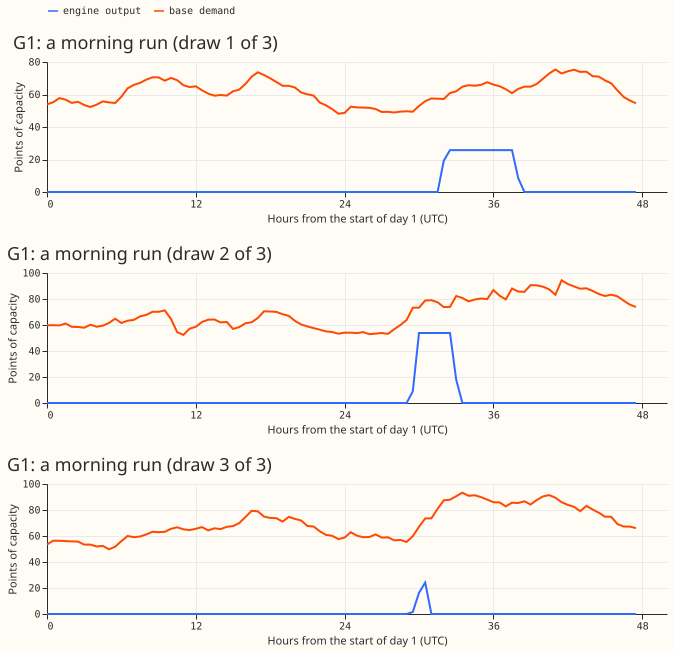
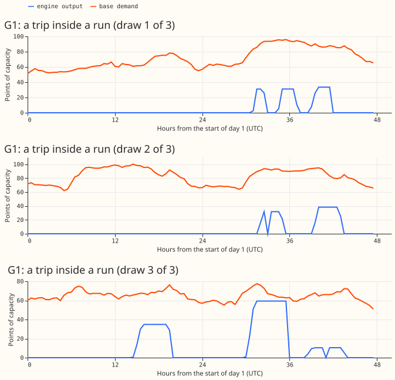
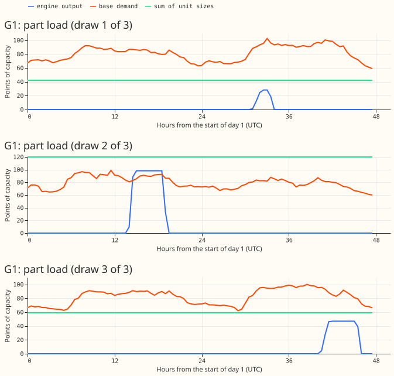
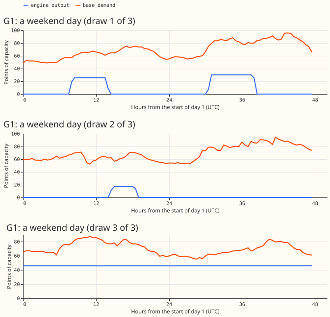
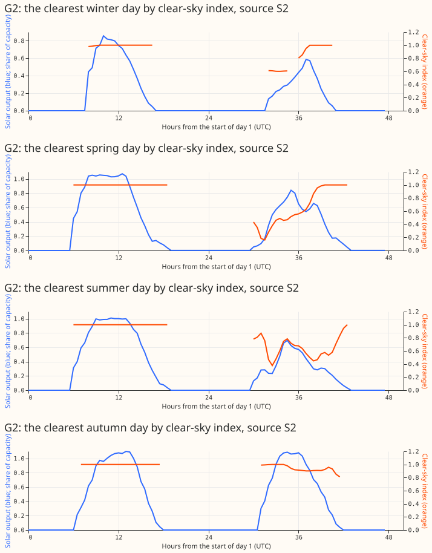
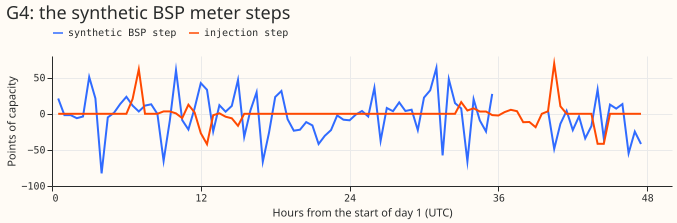
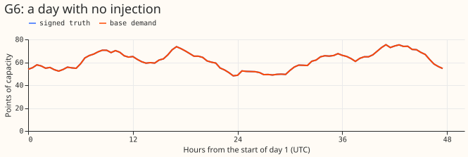
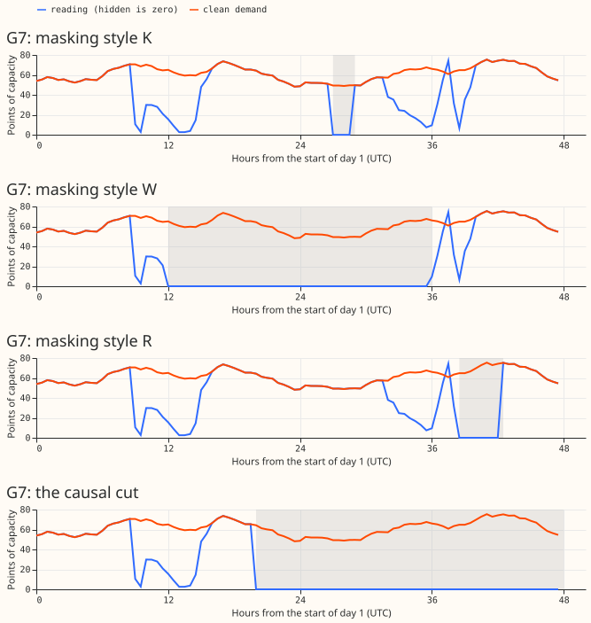
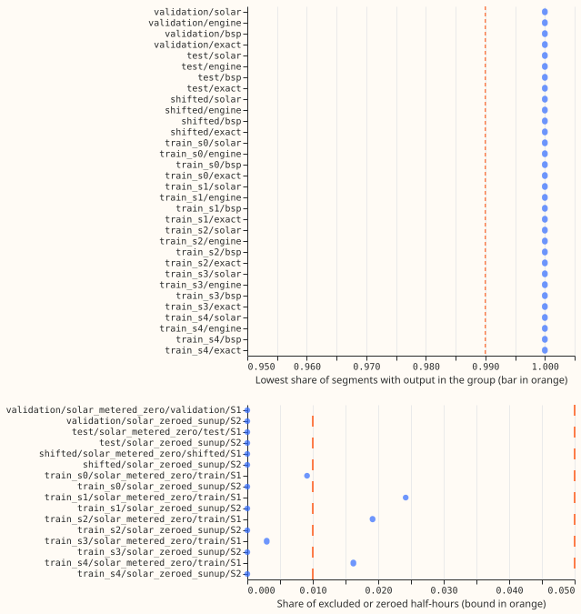

**We ask whether one neural network can take a day of D8's meter reading and pull apart the
signals that add up to it.** D8 is a primary substation (a "Primary") whose meter reports apparent
power, a magnitude with no sign. A gas engine and a solar farm connect below D8, so power
sometimes flows out of D8 towards the grid (reverse flow), and the meter shows that export as a
positive reading. On top of that, the network operator sometimes moves a block of customers from
D8 to a neighbouring Primary, or the other way, for hours or days; this page calls such a move a
load transfer. The neural network is to give three answers at each half-hour: the probability that
the power flows in reverse, how many megawatts the solar panels below D8 produce, and whether a
load transfer starts or ends.

**No meter records those three answers on a real day, so the neural network learns on synthetic
days with a known answer.** We take D8's real readings from before the engine was connected, add a
simulated engine, simulated solar output, and simulated load transfers, and fold the result into a
magnitude the way the meter does. To teach the solar output to behave like solar power, we show the
neural network two copies of the same window that differ only by a known extra amount of solar
output, and require its solar answer to rise by exactly that amount. We then test on synthetic days
that training never saw, and run checks of physical sense on real days. Each of the extra answers
gets its own reading word, and the verdict rests on the probability of reverse flow alone.

**The neural network also reads the meters of D8's three electrical neighbours, because a load
transfer shows as a mirror image there.** When customers move from a neighbouring Primary to D8,
D8's demand steps up and the neighbour's steps down by the same amount, so the simulated transfers
change the neighbours' readings too. We also ask whether the meter of the bulk supply point above
D8 helps the neural network tell the direction of D8's power flow.

**The main question is whether learning the extra answers makes the probability of reverse flow
worse.** In [experiment 730](../00730-msa-d8-sign-detector-with-demand-head-and-masking/result.md),
a neural network that also learned D8's demand gave a slightly worse probability of reverse flow
than the same neural network without the demand output. This experiment compares the new neural
network with the stored predictions of experiment 730's best arm, on exactly the same test
half-hours.

**The design follows the earlier experiments on the same synthetic days.** [Experiment
729](../00729-msa-d8-neural-untangler-synthetic-known-answers/result.md) and experiment 730 trained
neural networks in the manner of [Kelly and Knottenbelt
(2015)](https://doi.org/10.1145/2821650.2821672), on randomised synthetic data in the spirit of
domain randomisation ([Tobin et al. (2017)](https://doi.org/10.1109/IROS.2017.8202133)). The paired
windows with a known solar injection take forward the contrastive term of [experiment
624](../00624-pv-probe-contrastive-injection-arms/result.md), which broke a demand network when
built as it was there; "The loss and the contrastive terms" says what differs here. The U-net is
that of [Ronneberger et al. (2015)](https://doi.org/10.1007/978-3-319-24574-4_28), a
convolutional neural network whose layers shrink the window and then grow it back, with skip
connections that carry the detail of each level across. Every section from "Why this design" to
"Method" is the plan, written before any fit or score exists.

## Why this design

**The project wants three facts about D8's past: when its power flowed in reverse, how much the
unmetered solar panels below D8 produced, and when load was moved to or from another substation.**
No meter recorded any of the three facts. A neural network has to infer them from the reading, and
its answers can be marked right or wrong only on a synthetic day with a known answer. A later
experiment will pass the probability of reverse flow to the forecaster of D8, so that probability
is the output that must not get worse.

**The verdict rests on the probability of reverse flow alone, because experiment 730 found that an
extra output can harm that probability.** A neural network that also learned D8's demand scored
detectably worse on the direction of flow than the same neural network without the demand output.
The verdict therefore asks one question: does a neural network that also learns the solar output
and the load transfers give a probability of reverse flow as good as the best sign-only network?
A verdict that also required a good solar output could read "not supported" for two unrelated
reasons, and a reader could not tell which. The solar output, the detection of load transfers, and
the meter of the bulk supply point each get a reading word of their own, printed under every
verdict row.

**Each of the maintainer's four questions has its own comparison, and each comparison changes one
element of the design.** Questions (a) to (c) have counted comparisons. Question (d) has a
report-only comparison, because the meter of the bulk supply point covers only two of the eight
test months.

| Question | Comparison | The one element that differs |
|---|---|---|
| (a) Do the extra training tasks improve the probability of reverse flow? | The full network against a sign-only network with the same inputs and training days (contrast C6); the verdict compares the full network with experiment 730's stored sign-only network (C1) | The solar and transfer outputs and their loss terms |
| (b) Does the network do a reasonable job of separating the solar output? | Eight fixed bars, among them the recovery of a known solar injection, an absolute error, and a rule that reads the sky alone; and the network against a rule built from experiment 730's demand output (C2 to C4) | A known number of megawatts of solar output added to a window |
| (c) Can the network detect load transfers, and does it need the neighbours? | The network against a fitted rule that reads the neighbours too (C5), and the network with and without the neighbours' readings (C7) | The neighbours' input channels |
| (d) Do the steps of the bulk supply point's meter help the direction of flow? | The network with and without that input (R19, report-only, because two test months cannot resolve a small effect) | The input channels of the bulk supply point |

**The neighbours' readings belong in this experiment, because the mirror at a neighbour is the
strongest cue that separates a load transfer from a gas engine's step.** A load transfer and a gas
engine both change D8's level by a roughly constant number of megawatts. Three cues separate them:
an engine steps more often, an engine's step shows in the meter of the bulk supply point, and a
transfer shows the opposite change at the substation that gives or takes the load. A transfer
output trained and scored without the neighbours would lack the third cue, and its failure would
not say whether the neighbours could have helped. The earlier experiments on real and injected
transfers found only small gains from neighbour signals ("What the earlier load-transfer and BSP
experiments found" lists them), so the gain from the neighbours is measured by a counted comparison
and never assumed. The neighbours cost one arm (3 fits) and one input table built from stored
files.

**We considered a sign-and-solar experiment followed by a separate load-transfer experiment, and
rejected the split.** Question (a) is about the neural network that carries every task, because
that network is the candidate for untangling D8's history. The split would answer question (a) for
a neural network with fewer tasks, and would fit the shared arms twice. The combined experiment
stays focused because one contrast carries the verdict and every other reading is labelled as a
side reading before any fit. We also left out arms that learn one extra task only (the sign with
the solar output, or the sign with the transfers). If the extra tasks harm the sign, the arm with
a stop-gradient says whether shared gradients are the cause, and only then would a one-task arm be
worth 6 more fits.

**The solar and transfer readings are claims about synthetic days, and four safeguards stop a
reader from taking them for more.**

- Every synthetic generator's output is drawn and checked before any fit, on the arrays of the
  overlays and again on the tensors that the neural network receives, because a component that
  silently produces nothing passes every score (experiment 729).
- The solar output is judged against a known injection in the units of the target, and the injected
  shape comes from a different farm site than the sunshine input that the neural network reads.
- Each known shortcut has a control: the copy of the injection in the BSP meter, an engine mistaken
  for solar output, a transferred block of customers that carries rooftop solar panels, and a
  transfer whose mirror image at the neighbour is missing.
- Real days are checked in aggregate: the solar output at night, on days before any solar farm
  existed, against the sky, and against the engine's running hours, and the transfer output against
  the logged closures at D8.

**The design leaves three questions to later experiments.** A window of 48 hours shows at most one
edge of a transfer longer than 2 days, so long transfers and the arrival of a new generator need a
neural network with a longer memory. The synthetic transfers follow the maintainer's working
description, and no experiment has yet measured the size or the length of a real transfer at D8.
Passing the probability of reverse flow to the forecaster is a separate experiment.

## Terms

- **Signed power X** is D8's real power, positive for import and negative for reverse flow.
- **The reading R** is what D8's meter reports: R = sqrt(X² + Q²), where Q is the reactive floor,
  the reactive power that keeps the reading above zero when X crosses zero. **Folding** is the name
  for this loss of the sign.
- **A point** is 1% of D8's effective capacity of 10.379 MVA, the normaliser that
  [data-processing](../data-processing.md) uses for D8. One point is 0.104 MW at power factor 1,
  and a reading of 1 MVA is 9.6 points. Every solar figure is given in points and in MW.
- **P(X<0)** is the neural network's probability that the half-hour's signed power is negative.
  **P0** reads the reading as signed import, so P0's P(X<0) is 0 everywhere.
- **The solar output** is the output of the simulated solar panels below D8 in a synthetic window,
  in points, and **the solar head** is the output of the neural network that estimates the solar
  output.
- **A load transfer** moves a block of customers between D8 and another Primary for a span of time,
  so D8's demand steps up or down by a roughly constant amount at the start and steps back at the
  end. **A transfer step** is the half-hour that holds the start or the end of a load transfer.
- **The bulk supply point (BSP)** above D8 is BSP A, the substation that feeds D8 and eight other
  Primaries. Its meter reports signed MW. **The BSP steps** are the half-hour changes of that meter.
  A transfer between D8 and another Primary under BSP A leaves the BSP meter unchanged, and a
  transfer to a Primary under another BSP moves the BSP meter with D8.
- **D8's electrical neighbours** are D3, D5, and D14, the three Primaries that the earlier
  load-transfer experiments (for example [experiment
  159](../00159-switching-d8-multi-day-drops-recurrence-and-report/result.md) and [experiment
  709](../00709-era-signal-in-the-candidate-part-1/result.md)) list as interconnected with D8. All
  three sit under BSP A. D3 is metered in MVA and has no generator in its service area, by
  [experiment 722](../00722-msa-mva-bsp-closure-and-fast-hint/result.md)'s census; D5 and D14 are
  metered in signed MW.
- **The partner** of a load transfer is the Primary that gives load to D8 or takes load from D8,
  and **the donor** is whichever of the two loses the load. **The mirror** is the partner's change
  of level, equal and opposite to D8's.
- **The step statistic** of a series at a half-hour is the mean of the series over the next 2 hours
  minus its mean over the previous 2 hours, after the series' daily shape is removed. The daily
  shape is the median of the series over the training base days for each half-hour of the day, on
  weekdays and on weekend days apart, so the morning and evening ramps do not count as steps.
- **A noise unit** of a series is 1.4826 times the median absolute step statistic of that series
  over the training base days, the usual size of a step that no injection or transfer causes. Each
  of D8, D3, D5, and D14 has its own noise unit.
- **A base day** is a UTC day of D8's real reading in the pre-engine era. **A segment** is one
  calendar month of base days carrying one continuous injection draw. **A world type** says what a
  segment holds: no injection, engine only, solar only, or engine and solar.
- **Import rows** are scored half-hours with X ≥ 0, and **reverse-flow rows** are those with X < 0.
  **The decidable rows** are those with a reading of at least 1 MVA.
- **Sun-up half-hours** have a cosine of the solar zenith angle above 0.1, and **night half-hours**
  have a cosine of at most 0. The half-hours in between (dawn and dusk) enter neither the night bar
  nor the daylight scores.
- **The eras of D8** are the pre-engine era, the net era (engine only), the solar era (engine and
  the solar farm), and the fade era, as [experiment
  697](../00697-gas-engine-state-tracker-part-4-running-patterns/result.md) defines them.
- **The metered engine record** is the record of D8's engine output that experiments 194, 697, 729,
  and 730 use. Its length is on the [experiment
  194](../00194-ps1-ps5-generator-visibility-d8-analogue-break-and-price-following-census/result.md)
  page.

## What experiments 729 and 730 found

**Experiment 730 is the corrected run of experiment 729's synthetic world, and its findings set
this design.** Experiment 729 is invalid, because a bug in its sky rule left every satellite-driven
solar world without solar output. Experiment 730 rebuilt the banks with the fixed code and found:

- **The sign-only U-net S was the best arm.** It scored a Brier score of P(X<0) of 0.00853 on all
  test rows and an H1 mean of 0.00453 against the limit of 0.0071.
- **A demand output with a shared encoder made the sign worse.** SD-0 (a demand output with no
  hidden input) minus S was +0.00168 in Brier score, with an interval that excludes zero, and
  raising the demand loss weight from 0.1 to 0.5 worsened the Brier score by a further 0.00359.
  Experiment 730's explanation, untested, is that the demand loss competes with the sign loss in
  the shared encoder.
- **Hiding random spans of the reading in training was the best way of hiding the reading** (C4 of
  experiment 730, a narrow gain of 0.00063 over hiding nothing).
- **Pre-trained encoders and a transformer gave no detectable gain** (C5 and C6 of experiment 730),
  and the U-net won the architecture screen.
- **The demand-output arm SD\* failed H1 because it over-forecast reverse flow in the band of 1 to
  3 MVA.** There 25% of the half-hours are reverse flow, and S's mean P(X<0) on import half-hours
  (0.0828) sat at the limit that the plan's formula gives for the band (about 0.083).
- **No arm of experiment 730 has a solar output or a transfer output.** Experiment 729 planned a
  solar head (arm G1), and its silent solar worlds left that head unscored.

**[Experiment 624](../00624-pv-probe-contrastive-injection-arms/result.md) is the warning for the
contrastive term.** A paired-difference term with a weight of 1.0, a scale of 0.05, and dropout on
in both forward passes made a demand network fit the paired rows and lose the real rows, and its
advice is to retry the idea at a smaller weight with the same function in both passes.

### What the earlier load-transfer and BSP experiments found

**The earlier experiments on load transfers found that neighbour signals help a little, on some
transfers, and each finding below sets one choice of this plan.** Those experiments injected
transfers into the power history of 16 Primaries and scored detectors built from step statistics.

- **A count of neighbours that step the same way found more of the moved megawatts.** In
  [experiment 70](../00070-sw2-19-same-sign-neighbour-count/result.md) (same-sign neighbour count)
  the gain was +0.048 of the moved MW (interval +0.021 to +0.096) over the single-series detector
  at 80 unexplained alarms. The gain held only for transfers with no metered receiver and a donor
  step of 2 to 6 noise units, it was 0.000 for transfers of 15.6 to 60 days, and on 35 real
  transfers the two detectors found 7 against 8, too few to confirm. The rule B-TN carries that
  count.
- **The mirror step at a neighbour gained little as a score and lost as a gate.** In [experiment
  65](../00065-sw2-14-combined-single-series-and-neighbour-score/result.md) (combined own and
  neighbour score) the mirror cue gained +0.005 (interval −0.011 to +0.062), and a hard neighbour
  gate was about 0.1 worse. The neighbours are therefore inputs here, never a gate.
- **Most injected transfers stepped by less than 4 noise units.** [Experiment
  55](../00055-sw2-8-neighbour-veto-single-series-detector/result.md) and [experiment
  58](../00058-sw2-8b-donor-step-recut-and-stronger-veto/result.md) (neighbour veto) raised recall
  by 0.008 to 0.013 and precision by 3 to 7 points, and found that 77% of the unmetered injected
  transfers stepped by less than 4 noise units. This plan reads the detection by size in noise
  units and expects no detection under about 4.
- **A fixed list of interconnected Primaries flatters a search for the partner.** [Experiment
  43](../00043-sw2-1-detector-scoreboard/result.md) (detector scoreboard) found so, and 40% of the
  transfers drawn here have a partner that the neural network does not read.
- **A joint fit on hourly residuals lost to step statistics in noise units.** [Experiment
  67](../00067-sw2-15-joint-edge-flow-estimator/result.md) (joint edge-flow estimator) found 0.108
  of the moved power against 0.646, and noted that 8 of the 16 Primaries are metered in MVA only.
  The rules here read step statistics in noise units, and every neighbour enters as a magnitude.
- **A transfer that follows the donor's solar shape is much harder to find.** In [experiment
  162](../00162-switching-shaped-transfers-donor-demand-and-pv-shapes/result.md) (switching-shaped
  transfers) such a transfer cut recall by about 0.40, and constant-MW injections hid that loss. A
  share of the transfers drawn here is solar-shaped.
- **Neighbours did not help the ordinary rows of a demand forecast.** [Experiment
  426](../00426-mdn-neighbouring-primaries-graph-and-bottom-up-design/result.md) (neighbouring
  primaries graph) and [experiment
  715](../00715-msa-neighbour-row-group-in-the-axial-attention-demand-network/result.md) (neighbour
  row group in the axial-attention network) found no gain from the neighbours' lagged residuals or
  last 14 days, so the value of a neighbour lies in events. This plan expects the neighbours to
  change the sign by no detectable amount (R13).
- **A neighbour cue needs the sign of the Primary's own step and a clean reference level.**
  [Experiment 714](../00714-msa-era-identifiability-audit-and-frozen-probe/result.md) (era audit)
  and [experiment 709](../00709-era-signal-in-the-candidate-part-1/result.md) (era signal) found
  that the error of the reference level was as large as many injected steps. The step statistic
  here takes its reference level from the 2 hours before the half-hour, and each neighbour's step
  is multiplied by the sign of D8's step.

**Three experiments suggest that the BSP steps add little to the direction of flow, or harm it.**
On experiment 729's banks, as experiment 730's page reports, the BSP steps added to sunshine lost
0.149 points of signed CRPS (interval 0.068 to 0.455) on the two months that the BSP meter covers.
[Experiment 124](../00124-differentiable-physics-h-bsp-closure-audit-and-bsp-hint/result.md) (BSP
closure audit) found that a BSP term in the Primaries' loss worsened forecasts on clean data at
every weight above zero. Experiment 722 (BSP closure and fast hint) found that the BSP follows the
Primary in dark hours and moves 2.53 times as much in lit hours. Experiment 730 added no BSP
contrast, so R19 is the first reading we know of the BSP input on a sign-only output.

## The synthetic world

### The banks of experiment 730, read and never rebuilt

**This experiment reads experiment 730's rebuilt banks and changes none of them.** The banks hold
32 segment draws per training month for seeds 0 to 4, a validation bank, a test bank of 64 segments
(94,080 scored half-hours), and a shifted-mix bank. Their world, base days, split rule, engine and
solar simulators, fold, and synthetic BSP meter are described on experiment 730's page under "The
synthetic world", and the realism gate passed on them there. **The banks stage verifies each bank's
SHA-256 digest against experiment 730's `banks/summary.json`, and the line stops at verdict row 0
if any digest differs.** No stage writes into experiment 730's folder, and a test replaces
experiment 730's data root with a read-only copy to check this.

**Reading experiment 730's banks makes experiment 730's stored predictions valid controls.** The
test rows of the sign and the solar output are experiment 730's rows, built by experiment 729's
`rows_from_segments` from the same test bank. Experiment 730's stored `test.npz` files hold only the
array `p` (and `demand_mu` and `demand_s` for arms with a demand output), with no row keys, so three
checks tie the stored arrays to the rows before any score is read, each a correctness check of
verdict row 1:

- every stored array has 94,080 rows;
- the SHA-256 digest of the row keys (segment, day, and half-hour) rebuilt by `rows_from_segments`
  from the digest-pinned test bank equals the digest that the banks stage records once, before any
  fit; and
- a canary recomputes S's Brier score from the seed-averaged `p` of `S_unet_s0` to `S_unet_s2` and
  requires 0.00853, experiment 730's printed value, to five decimal places.

The stored folders read are `S_unet_s0` to `S_unet_s2` (arm S), `S_bilstm_s0` to `S_bilstm_s2` (arm
S-L), and `SD-R_unet_s0` to `SD-R_unet_s2` (experiment 730's SD\*, which its style choice made the
random-span arm SD-R).

**Three overlays add what experiment 730's banks lack, and each is a pure function of a stored bank
and a fixed seed.** An overlay never edits a bank: it builds new arrays from a segment's stored
arrays when a window is made, and the overlay stage writes the digest of each test and validation
overlay to `overlays/summary.json`. The three overlays are load transfers, an extra solar injection
for the contrastive pairs, and a raised satellite sky for the monotonicity term.

**Each overlay re-folds the reading from the segment's own reactive floor, recovered exactly from
the stored arrays.** Experiment 729's fold draws the reactive term per half-hour and stores the
signed truth x and the reading r, so the term is q = sqrt(max(r² − x², 0)). A new truth x′ gives
the new reading r′ = sqrt(x′² + q²). The synthetic BSP meter of a segment is the real meter minus β
times the injection, with β stored in the segment's parameters, so an overlay that adds output δ
below D8 gives the BSP meter minus β δ.

### The neighbours' readings, from stored files

**Experiment 730's banks hold no neighbour series, so this experiment builds a neighbour input
table from power series already stored in the private data folder.** The cleaned half-hourly power
of D3, D5, and D14 is in the cleaned power table that `studies.power.scan_power` reads, and
experiment 722 loads the same three children of BSP A through `e00722_data.load_power`.
`e00732_neighbours.py` reads the three series with that loader and places them on D8's base
calendar, one row per base day and half-hour, in `neighbours/table.parquet`. The plan needs no
download and no new data source.

**The table must cover at least 90% of the base-day half-hours for every neighbour, or the line
stops at verdict row 0.** The real-file smoke test prints the coverage per neighbour and per split.
A missing half-hour gets a presence mask of zero, as D8's missing readings do. If the coverage
gate fails, a fresh export of the neighbours' series is a new data source, and the section
"Decisions that need the maintainer" holds that case.

**The neighbour table must sit on D8's timestamps, or a mirror would land one half-hour away from
D8's step.** For each neighbour, the correlation over the base days between the half-hour changes
of D8's reading and of the neighbour's reading is computed at lags of −1, 0, and +1 half-hours, and
the correlation at lag 0 must be the largest of the three. A failure stops the line at verdict row
0. K3 depends on the same alignment, because K3 reads real mirrors.

**Every neighbour enters the neural network the way D8's reading does: as a magnitude, with a
presence mask, and hidden with D8's reading.** D3's reading is a magnitude already. D5's and D14's
signed series are folded with a reactive floor drawn per segment from 0 to 0.3 MVA, exactly as
experiment 729 folds D8, so no neighbour channel carries a sign. A signed neighbour channel would
show when a neighbour's own generation exceeds its demand. That cue bears on D8's label, and no
neighbour metered in MVA can supply it, so a rule learned from a signed channel would fail at the 8
of 16 Primaries metered in MVA only. The neighbours' readings on a base day are their real readings
of that day, so they carry the neighbours' own demand, weather response, and any real transfer; only
the mirror of a synthetic transfer is added to them.

**Each neighbour has four input channels.** The four channels are the folded reading divided by
the neighbour's median over the training base days, the half-hour change of that scaled reading,
the same change multiplied by the sign of D8's half-hour change of reading, and a presence mask.
The third channel is the sign-aligned cue: where both Primaries import, the sign-aligned cue is
negative at a mirrored step and positive where D8 and the neighbour step the same way. A hidden
span of style R hides D8's reading and all four channels of the three neighbours over the same
half-hours. The sign head therefore never reads a neighbour's step where D8's reading is hidden,
and the sign-aligned cue cannot reveal the direction of D8's hidden step.

**The neighbours can inform the sign only at a transfer edge, and that information exists on real
days too.** When D8 gains load while D8 is in reverse flow, D8's reading falls while the
neighbour's reading also falls, so a mirrored step with both readings moving the same way marks
reverse flow at D8. R13 (U\* minus U-N in the sign's Brier score on the plain test rows) and R14
(the same difference on the transfer overlay, split by whether the transfer has a mirror) measure
that effect. The plain test rows carry no synthetic transfer, so R13 is expected to show no
detectable difference. R8 compares U\* with S+, which also reads the neighbours, so R8 measures the
extra heads on the transfer overlay and says nothing about the neighbours.

### Load transfers, a new generator

**The transfer generator adds a block of load to D8's demand and takes the same block from the
partner's demand.** The generator follows the maintainer's working description of a load transfer:
the donor loses a roughly constant number of megawatts, often (not always) mirrored at a neighbour,
so a transfer shows as a flat change of level with a mirror image at the partner. A gas engine's
steps are flat as well, and only their frequency and the missing mirror separate them, so the
engine worlds stay in the training mix. The generator draws, per segment:

| Parameter | Range |
|---|---|
| Transfers per 30 days | 0 to 6 in training (uniform per segment); exactly 6 in the test and validation overlays |
| Duration of one transfer | 1 hour to 4 days, log-uniform |
| Size T₀, the mean of the transferred load over the transfer | 3 to 40 points, log-uniform |
| Direction | D8 gains or loses the load, each with probability 0.5 |
| Shape | constant (T = T₀) with probability 0.6; demand-shaped with probability 0.2; solar-shaped with probability 0.2 |
| Partner | one of D3, D5, and D14 with probability 0.6 (equal shares; the partner's series changes by −T, and the BSP meter is unchanged); another Primary under BSP A that the neural network does not read, with probability 0.2 (no mirror, BSP meter unchanged); a Primary under another BSP, with probability 0.2 (no mirror, the BSP meter moves by β T) |
| Start time | continuous on a 5-minute grid, so a half-hour holding an edge carries a partial mean |
| Overlap | transfers never overlap; a draw that overlaps is redrawn |

**Two shapes other than a constant keep the detector from learning that every transfer is flat.**
Experiment 162 found that a constant-MW injection hides how much harder a shaped transfer is to
find. A demand-shaped transfer is T₀ times the donor's own demand divided by the donor's mean demand
over the transfer, so the block rises and falls with the donor's day. A solar-shaped transfer is a
block of customers with rooftop solar panels: T = T₀ (1 + κ (ḡ − g)), where g is the CAMS clear-sky
index times the clear-sky irradiance divided by 1,000 at D8, ḡ is the mean of g over the transfer,
and κ is drawn uniformly from 0.3 to 1.0. The block's load dips when the sun shines, and its mean
stays T₀. A draw whose T falls below 0.1 T₀ on any half-hour halves κ until no half-hour does, so T
never changes sign. The solar-shaped transfer here is a constant block with a midday dip. Experiment
162's solar-shaped transfer moved solar output alone and vanished at night, and most of its loss of
0.40 in recall came from scoring before sunrise (the loss was 0.07 when scored from first light). A
block with flat edges at any hour is therefore expected to be nearly as easy to find as a constant
block, and R18 measures the difference. The donor's demand is D8's base demand when D8 loses the
load, and the partner's series when a neighbour that the neural network reads loses the load; for a
partner that the neural network does not read, D8's base demand stands in for the donor's shape.

**The solar target does not change during a solar-shaped transfer.** The solar head estimates the
solar output connected below D8 in its normal arrangement, which is the quantity a forecast under
the normal arrangement needs. A solar-shaped transfer is therefore a deliberate confuser: the
neural network must attribute the midday dip to the transfer, and the mirror at a neighbour is the
cue that allows that attribution. A solar-shaped transfer without a mirror (8% of the drawn
transfers) cannot be told from new solar output while the transfer lasts, so on those windows the
solar target is label noise that no neural network can remove. The plain test bank, the injection
overlay, and the raised-sky overlay carry no transfers, so none of the solar bars reads such a
window. In training, a window's injected member carries the same transfers as the window. Table T1
prints the solar error inside solar-shaped transfers, with and without a mirror, and splits every
row of the transfer overlay by whether a transfer edge lies in the window.

**A donor never gives more load than the donor has.** When D8 loses the load, T is at most 0.8
times D8's base demand at every half-hour of the transfer. When a neighbour that the neural network
reads loses the load, T is at most 0.8 times that neighbour's signed power (D3's reading) at every
half-hour, so D5 and D14 cannot give load on a half-hour when they export. A draw that breaks the
rule redraws its size, up to 20 times, and is then dropped and counted. Without the rule, a large
transfer could push D8's signed power below zero with no generator running, which no real transfer
does. **The donor rule binds at night, when demand is lowest, so the settled sizes depend on the
direction, the partner, and the duration.** A long transfer out of D8 must fit under D8's night
demand and is smaller than a short daytime transfer. Panel G14 therefore prints the settled T₀ by
direction, partner, and duration, and table T6 is split by direction.

**The signed truth becomes x + T, where T is the transferred load in points (positive when D8 gains
load), and a neighbour partner's series becomes its own series minus T.** The mirror is converted
from D8's points to MW at 0.104 MW a point, which assumes a power factor of 1 at D8. D5's and
D14's signed series take the mirror before the fold. D3 has no generator in its service area, so
D3's reading in MVA is read as signed import in MW and takes the mirror directly, which assumes a
power factor of 1 at D3 as well; the donor rule keeps the changed reading above zero.

**The mirror is exact in 70% of the mirrored transfers and jittered in 30%.** In a jittered transfer
the partner's series changes by −j T, with j drawn uniformly from 0.7 to 1.3, as when part of the
block goes to a third substation or the two meters disagree. Experiments 65 and 70 found the mirror
weak on real and injected transfers, and a real mirror also sits in a noisier series than the drawn
mirror does. C7 is therefore an upper bound on what the neighbours add on real days. A transfer that
removes load during a solar spell deepens the reverse flow, and a transfer that adds load can lift a
reverse-flow half-hour to import, so the sign truth of an overlaid window differs from the bank's.
**The ranges are wide guesses, set from no fitted real value.** Experiment 162 fitted shapes to 25
logged transfers across the Primaries, and we found no experiment that measures the size or the
length of the load transfers at D8. The real base days may hold transfers that no log records, which
act as label noise; days within 24 hours of a logged closure at D8 were dropped from the base days
by experiment 729's rule.

**The step targets follow the edges, and the size target is the mean level.** A transfer step is
the half-hour that holds the start or the end of a transfer, whatever the transfer's shape, and
the step-size target at an edge is plus or minus T₀. The limits stage computes each series' noise
unit from the training base days and writes the four noise units to `limits.json` before any fit.
A transfer's size in noise units is T₀ divided by D8's noise unit.

**The training overlay is drawn once per training bank and seed, from seed 732,100 plus the seed,
and the test and validation overlays from 732,000 and 732,050.** Experiment 730's test bank
therefore carries two versions of every window: the plain one, which carries the sign contrasts,
and the transfer-overlaid one, which carries the transfer contrast C5 and the load-transfer
scenarios.

### Extra solar injected into the same window

**Each contrastive pair is one window and the same window with an extra solar injection δ added
below D8.** The extra shape is the solar output of another solar-world segment of the same month on
the same base day, divided by that segment's drawn solar capacity and multiplied by an amount a.
Segments of one month share their base days, so the shape carries a real day's sky at a different
farm site with a different tilt, azimuth, and ratio of direct-current to alternating-current
rating, and the neural network's sunshine input (the CAMS clear-sky index at D8) is never the
driver of δ. The pair's truth is x⁺ = x − δ, its reading is re-folded, its BSP meter is minus β δ,
and its solar target is the window's solar output plus δ.

- **In training, a is drawn log-uniform from 2 to 60 points for every window and epoch,** from the
  sampler's seeded generator. A window whose month holds no other solar segment with output on that
  day takes no pair, and the sampler counts such windows.
- **The sign loss reads the plain member w only, never the injected member w⁺,** so the prior of
  reverse flow that the sign head learns is that of experiment 730's training windows with the
  transfer overlay, and not one raised by the extra solar. The banks stage prints the share of
  sign-supervised training half-hours that are reverse flow, beside the same share in experiment
  730's training windows, and stops at verdict row 0 if the two differ by more than 10% of
  experiment 730's share. The injected members still carry deeper reverse flow in their reading
  channel, which the sign head sees as input but is not scored on.
- **In the test overlay, a takes each of 5, 20, and 50 points,** and the shape comes from a sibling
  segment of source S2 only (the satellite-driven solar model), picked by seed 732,000. Source S1 is
  a real farm's metered output, so it stays out of the published recovery figures. Windows with no
  S2 sibling with output are skipped and counted.

### The raised sky for the monotonicity term

**The third member of each training triple is the window with the CAMS clear-sky index raised on its
sun-up half-hours.** The index is multiplied by 1 + ε, with ε drawn uniformly from 0.05 to 0.3 per
window, and clipped at 1.5 as in the input channel; every other channel, the reading included, is
unchanged. The raise changes nothing where the index is 0 and little where the clip binds, so the
monotone term, its bars, and panel G12 read only the sun-up half-hours with an index above 0 and
below 1.25, the **raisable half-hours**. The raised sky is not a physical day: it asks how the solar
head responds to sunshine with everything else held fixed, which is the partial derivative the
monotonicity term bounds. The test overlay uses ε = 0.2 on every window.

### Checks that each new component produces output

**Each overlay gets the component checks that experiment 730 applied to its simulators, before any
fit.** Experiment 729 showed that a silent component passes every score-based check. The overlay
stage counts, per bank kind and seed, and fails at verdict row 0 below `MIN_OUTPUT_SHARE` (0.99,
the constant of experiment 730):

- the share of drawn transfers whose span changes the truth by T on every base-day half-hour
  inside it, with a mean change of T₀, and the share of transfer steps that fall on a scored
  half-hour of some window;
- the share of transfers inside BSP A that leave the BSP meter unchanged, and the share of other
  transfers that move it by β T;
- **the mirror check:** for every transfer whose partner is D3, D5, or D14, the mean change of the
  partner's series before the fold, over the transfer's half-hours, equals minus j times the mean
  of T within 0.01 points (j is 1 for an exact mirror and the drawn factor for a jittered mirror),
  and the mean change is nonzero (1.0 is required); a transfer with a silent
  mirror, or a mirror at a neighbour that is not the drawn partner, fails the check. The check also
  requires that no neighbour series changes on a transfer whose partner the neural network does
  not read, and that no neighbour series changes outside a transfer. A known-answer unit test
  feeds the check an overlay whose mirror is zero, and one whose mirror sits at the wrong
  neighbour, and requires the check to fail on both;
- the share of drawn transfers of each shape against the registered shares, the share of
  solar-shaped transfers whose T differs from T₀ on at least one sun-up half-hour, that T is at
  least 0.1 T₀ on every half-hour of every solar-shaped transfer, and the count of draws dropped
  by the donor rule (at most 5% of the draws);
- that the test overlay holds at least 100 scored transfer steps under 4 noise units and at least
  100 of 4 noise units and more, or the detectability statement is `void` on the short side (a
  shortfall here voids the statement and does not stop the line);
- the share of extra-injection pairs whose δ is above zero on at least one sun-up half-hour, and
  the share whose re-folded reading equals the bank's reading where δ is zero (1.0 is required);
- the share of raised-sky windows whose index differs from the original on every sun-up half-hour
  with a finite index;
- that the test overlay holds at least 400 transfer steps of 5 points or more on scored
  half-hours, and at least 800 windows at each injected amount (the reachability counts). A
  shortfall of transfer steps makes the transfer word and the neighbour word `void`, a shortfall
  of injected windows makes the solar word `void`, and neither stops the line;
- that in every training month of every seed at most 5% of the training windows lack a sibling
  segment with solar output on the window's day, so that the injection term cannot go silent in a
  month or a season. The real-file smoke test runs the same sibling selection on the stored
  training bank of seed 0 and prints the share per month index.

### Checks on the tensors that the network receives

**Every check above reads an overlay's arrays, and a component can still go silent between the
overlay and the input tensor, so the batch builder gets checks of its own.** The checks run on
batches built by `e00732_arms.py` from the stored training bank of seed 0 and from the validation
bank, before any fit, and a failure stops the line at verdict row 0. Each check has a known-answer
unit test that feeds the check a batch with the component silenced and requires the check to fail;
a unit test that does not fail is verdict row 1.

- At the edges of a mirrored transfer, the partner's reading channel and change channel differ
  from the same window built without the overlay, and the other two neighbours' channels do not.
- The sign-aligned channel is nonzero wherever D8's reading and the neighbour's reading both
  change, and it equals the neighbour's change times the sign of the change of D8's reading, never
  the sign of the change of the truth x.
- All 12 neighbour channels are zero on every half-hour of a hidden span.
- The reading channel and the BSP channel of the injected member w⁺ differ from those of w on
  half-hours with δ above zero, and on no other half-hour. The sign-aligned channel of w⁺ may also
  differ from that of w on a half-hour next to a half-hour with δ above zero, because the change of
  D8's reading there differs.
- The CAMS channel of the raised-sky member w^c is above that of w on every raisable half-hour.
- The solar target is above zero on at least 99% of the sun-up half-hours of clear days in
  solar-world windows.
- A batch of U-N has no neighbour channel, and the BSP channel and its mask are zero on every
  half-hour of a batch of U-noBSP.

## The four outputs of the network

**The neural network has four outputs at each half-hour of the scored day: one sign logit (the
logarithm of the odds, which a sigmoid turns into a probability), one solar output, one
transfer-step logit, and one step size.** Each output is a separate linear layer
on the backbone's last hidden layer, and no output feeds an input or another output.

- **The sign head is experiment 730's.** P(X<0) is the sigmoid of its logit, trained by binary
  cross-entropy on the event X < 0, and scored by the Brier score (which carries every counted sign
  contrast) and the log loss (printed beside it).
- **The solar head outputs a non-negative number through a softplus (a smooth version of max(0, x)),
  in points.** Its target is the window's solar output (plus δ in a pair's injected member). The
  engine output is not solar output, so a solar head that absorbs the engine is wrong. The head is
  scored by its mean absolute error on sun-up half-hours of all world types, so false solar output
  in worlds without solar counts against it. Treating the output as the median, the same error is
  the normalised mean absolute error of the median in points of capacity.
- **The transfer-step head outputs a logit for "a transfer edge lies inside this half-hour".** It
  is trained by binary cross-entropy and scored by the Brier score of the step event, and by
  precision, recall, and F1 at a threshold of 0.5, where a flagged half-hour within one half-hour of
  a true edge counts as a hit and each true edge is matched at most once.
- **The step-size head outputs the signed change of D8's demand at an edge, in points.** It is
  trained by a Huber loss (squared error for errors below a scale, absolute error above it) on true
  edge half-hours only, and scored by its mean absolute error there.

**No demand output is fitted.** Experiment 730 found that a demand output made the sign worse, and
the solar and transfer outputs are the two that the forecast line needs next.

## The loss and the contrastive terms

**The loss of one training triple (the window w, its injected member w⁺, and its raised-sky member
w^c) is the sum of seven terms.** Writing PV(·) for the solar head's output, at every scored
half-hour that the term keeps:

| Term | Definition | Kept on | Weight |
|---|---|---|---|
| Sign | Binary cross-entropy on X < 0, on w only | valid half-hours not hidden | 1.0 |
| Solar | Huber loss (scale 1 point) of PV against the solar target, on w and on w⁺ | valid half-hours | 0.02 |
| Step | Binary cross-entropy on the step event, on w and on w⁺ | valid half-hours not hidden | 1.0 |
| Size | Huber loss (scale 1 point) of the step size | true edge half-hours | 0.02 |
| Injection | Huber loss (scale 1 point) of (PV(w⁺) − PV(w)) − δ | valid half-hours not hidden | 0.02 |
| Night | The mean of PV(w) and PV(w⁺) | night half-hours | 0.02 |
| Monotone | The mean of max(0, PV(w) − PV(w^c)) | raisable half-hours | 0.02 |

**The injection term is the contrastive term: it asks the solar head to rise by the injected amount
between two windows that share everything else.** The supervised solar term already says what each
member's solar output is. The injection term says that the difference must be right even where the
neural network is unsure of both levels, which is the property a later forecast reads when solar
capacity changes. The night term and the monotone term state two physical rules: solar panels
produce nothing when the sun is below the horizon, and more sunshine, with everything else held
fixed, cannot lower their output.

**The three contrastive terms differ from experiment 624's term in the three ways its advice
names.** The weight is 0.02 rather than 1.0. Both members pass through the same function, because
neither the U-net nor the bidirectional LSTM has dropout, and the U-net's group normalisation
normalises each window on its own. The term is a Huber loss in points with a scale of 1 point,
rather than a squared error divided by 0.05, so a large early error gives a bounded gradient.

**The weights put each auxiliary term within a factor of a few of the sign term, which experiment
730's weights did not.** A good sign head's cross-entropy averages a few hundredths of a nat per
half-hour, because reverse flow is a few percent of half-hours. A Huber loss with a scale of 1 point
averages about 1 to 2 where the error is a few points, so a weight of 0.02 gives 0.02 to 0.04.
Experiment 730's demand term was a Gaussian negative log likelihood of about 2 nats at a weight of
0.1, which is 0.2, about seven times the sign term. The step event is rarer than reverse flow, so
its cross-entropy is smaller still and keeps a weight of 1.0. No weight is tuned on data.

**On a hidden half-hour the sign, step, and injection losses are dropped and the supervised solar
loss kept.** A hidden half-hour sets the reading and its presence mask to zero, as in experiment
730, and test windows are never hidden. The solar head can still learn the solar output from the
sunshine input and the hours around the hidden span, which is the reason experiment 730 found for
hiding the reading. Both members of a triple share the same hidden span. The injection term is
dropped there because the reading is the main carrier of δ, and a hidden span would leave the BSP
channel as the only carrier.

## Architectures and masking

**The U-net of experiments 729 and 730 carries every arm, and the bidirectional LSTM repeats the
headline arm.** No architecture screen runs, because experiment 730's screen chose the U-net on
validation and found no gain from the transformer. The U-net has four levels of 32, 64, 128, and 256
channels, kernels of width 5, group normalisation, GELU activations, and skip connections, about
1.06 million weights plus the four output layers. The bidirectional LSTM is a 1-D convolution of 16
filters of width 5, two bidirectional layers of 128 units, and a linear output layer at each
half-hour, about 0.55 million weights.

**Every arm hides one random span of the reading, 1 to 24 hours long, on half of its training
windows,** experiment 730's style R, which was its best style. The encoders are the raw calendar and
weather channels of experiment 730's arm S, with no pre-trained encoder, because experiment 730's C5
found no gain from pre-training.

**Every arm reads experiment 730's arm S inputs over a 48-hour window from 12:00 UTC on the day
before the scored day to 12:00 UTC on the day after, and scores the middle 24 hours.** The inputs
are: the reading in points divided by 50 and its presence mask; the CAMS clear-sky index (clipped
to 0 to 1.5), the clear-sky irradiance divided by 1,000, the cosine of the solar zenith angle, and a
CAMS presence mask at D8; the half-hour change of the synthetic BSP meter divided by 20 and a BSP
presence mask; and the local half-hour (sine and cosine), the day of the week (sine and cosine), the
bank-holiday flag, and ERA5's 2 m temperature, 10 m wind speed, and log precipitation at D8's grid
cell. Every arm except U-N adds the 12 neighbour channels: for each of D3, D5, and D14, the scaled
folded reading, its half-hour change, the sign-aligned change, and a presence mask. U-noBSP drops
the BSP change and its mask. No input reads the month or the day of the year.

**The weather is the observed ERA5 and CAMS weather at the scored times, which is legitimate only
because this experiment reconstructs the past.** No forecast origin exists, and no arm reads
weather issued at a forecast origin. Any later use of these networks inside a forecast must read,
row by row, the weather issued at or before the forecast origin, and its brief must assert that and
print one example. No origin-time-weather test applies here, because no row has a forecast origin.

## Arms

**Eight arms are fitted, each with seeds 0 to 2, and two arms of experiment 730 are read from stored
predictions.** Every fitted arm trains on the same plain windows: experiment 730's training banks
with this experiment's transfer overlay. Every arm with a solar head also sees each window's
injected member, and only U\* and U-SG also see the raised-sky member, which carries no supervised
target.

| Arm | Architecture | Outputs | Contrastive terms | Role |
|---|---|---|---|---|
| U\* | U-net | Sign, solar, step, size | Injection, night, monotone | The headline arm |
| U-NC | U-net | Sign, solar, step, size | None | The control of C2 and C3 |
| U-NCw | U-net | Sign, solar, step, size | None, with the supervised solar weight raised to 0.08 | Report only: the weight-matched control of R10 and R11 |
| S+ | U-net | Sign | None | The control of C6: sign-only on this experiment's windows |
| U-SG | U-net | Sign, solar, step, size | As U\* | Report only: no gradient from the solar, step, and size terms reaches the backbone |
| U\*-L | Bidirectional LSTM | As U\* | As U\* | Report only: the architecture |
| U-N | U-net | As U\* | As U\* | The control of C7: no neighbour channels |
| U-noBSP | U-net | As U\* | As U\* | Report only: the control of R19, no BSP channel |
| S (730) | U-net | Sign | None | The control of C1, stored predictions of experiment 730, seeds 0 to 2 |
| S-L (730) | Bidirectional LSTM | Sign | None | The control of R3, stored predictions of experiment 730, seeds 0 to 2 |

**U-SG tests experiment 730's explanation that an auxiliary loss competes with the sign loss in the
shared backbone.** In U-SG the solar, step, and size heads read the backbone's last hidden layer
through a stop-gradient (an operation that passes values forward but blocks the gradient on the way
back), so their losses train only their own linear layers and the sign is learned as in S+. If U-SG
matches S+ while U\* is worse, shared gradients are what hurt the sign; if U\* and U-SG both match
S+, the heads cost the sign nothing in this design.

**U-N and U-noBSP each remove one input from U\*, and nothing else.** U-N reads no neighbour
channel, so U\* minus U-N in the step Brier score (C7) is what the neighbours add to the detection
of transfers, the maintainer's question (c). U-noBSP reads no BSP channel, so U\* minus U-noBSP in
the sign's Brier score (R19) is what the BSP steps add to the direction of D8's flow, the
maintainer's question (d). Both arms train on the same windows as U\*, whose transfers still carry
their mirror and BSP changes; only the input is removed. S+ reads the same inputs as U\*, the
neighbours and the BSP steps included, so C6 changes the outputs and the loss alone.

**The fits run in an order that puts the verdict first.** The families are, in order: S+ and U\*
(C1 and C6, the verdict), U-N (C7), U-NC (C2 and C3), U-noBSP, U-NCw, U-SG, and
U\*-L. A stop at the stop line therefore loses report-only readings before any counted reading.

**U-NCw separates the contrastive terms from a heavier solar loss.** In U\* the four terms that
train the solar head (the supervised solar term, the injection term, the night term, and the
monotone term) carry a total weight of 0.08, and in U-NC the solar head carries 0.02. U-NCw gives
the supervised solar term alone the weight of 0.08, so U\* minus U-NCw reads what the contrastive
terms add beyond a heavier pull on the solar head.

**Every fit uses experiment 730's optimiser and stopping rule.** An epoch is 8,000 plain windows,
each with its injected member in an arm with a solar head and its raised-sky member in U\* and U-SG;
the optimiser is AdamW with a learning rate of 1e-3, weight decay of 1e-4, batch size 256, and
gradient clipping at 1.0; the learning rate halves after 10 epochs with no gain; training stops
after 25 epochs with no gain in the validation Brier score of P(X<0) on the plain validation bank,
or at 300 epochs. Half of each epoch's windows come from the training months that carry real BSP
steps.

**Every arm stops early on the sign, so the solar and transfer outputs are read at the sign's best
epoch.** The sign is the output that C1 compares with experiment 730's S, which stopped on the same
score. Each fit stores its loss history in its fit JSON under `fits/`: at every epoch, the training
loss and the validation loss of each of the seven terms and of their weighted sum, the validation
Brier score of the sign, the validation solar error, and the validation step Brier score, with the
epoch of the stored state file marked. The write-up can then say whether the solar head was still
improving when the fit stopped.

## Baselines

**Three rules give the solar output without a solar head, and none needs a neural network to be
fitted.** B-PV1 and B-PV2 are read on the injection overlay as well: experiment 730's stored
networks S and SD\* predict on the injected windows (inference only), so each rule has a recovery
ratio beside U\*'s. B-PV0 reads no reading, so its recovery is zero by construction.

- **B-PV2** subtracts the signed reading implied by experiment 730's SD\* from its demand output:
  X̂ = −M where SD\*'s P(X<0) is above 0.5 and +M otherwise, with M = sqrt(max(R² − Q̂², 0)) and Q̂
  = 0.1 MVA, and the solar estimate is max(0, demand − X̂) on sun-up half-hours and 0 at night,
  averaged over seeds 0 to 2. B-PV2 is the counted reference of C4. B-PV2 attributes engine output
  to the solar output, which is part of what a solar head must avoid, so C4 is a weak bar wherever
  engine rows are included, and C4 is also printed on the solar-only and no-injection rows alone.
- **B-PV0** reads the sky alone. A least-squares fit on the validation bank predicts the solar
  target from the CAMS clear-sky index times the clear-sky irradiance, the clear-sky irradiance,
  the cosine of the solar zenith angle, and the products of those three, clipped at zero and set
  to zero at night. B-PV0 cannot know how much solar capacity a window holds, so B-PV0 gives the
  average solar output of the bank for the window's sky. A solar head that does not beat B-PV0
  has learned the sky and has untangled nothing from the reading.
- **B-PV1** is the same rule as B-PV2 with the median of D8's demand climatology (experiment 729's
  B1 cells, fitted on the training base days) in place of the demand output, and S's P(X<0) in place
  of SD\*'s. B-PV1 is reported only.

**B-TN and B-T are logistic regressions for the step event, fitted on the validation overlay, and
both read step statistics in noise units.** Experiment 67 found that step statistics in noise units
beat hourly residuals, and experiments 714 and 709 found that a step needs a clean reference level,
so each feature is a step statistic (the mean of the next 2 hours minus the mean of the previous 2
hours) divided by the series' noise unit. The inputs of B-T at each half-hour are the absolute step
of D8's reading, the absolute step of the synthetic BSP meter, the absolute difference between
those two steps in points, and the cosine of the solar zenith angle. The synthetic BSP meter's step
is divided by D8's noise unit, because both series are in points.

**B-TN adds three neighbour features, each taken from an earlier neighbour detector.**

- **The sign-aligned step of each of D3, D5, and D14:** the neighbour's step times the sign of D8's
  step, negative at a mirror (experiments 714 and 709).
- **The largest opposite-sign step among the three neighbours,** the mirror cue of experiment 65.
- **The count of neighbours whose step is at least 2 noise units and has the sign of D8's step,**
  the same-sign neighbour count of experiment 70.

**B-TN is the counted reference of C5, and B-T is reported only.** A neural network that reads the
neighbours must beat a rule that reads the neighbours, or the transfer head adds nothing beyond
those three features. Neither experiment 729 nor experiment 730 has a transfer output or a transfer
baseline.

## Contrasts

**Seven contrasts are counted, each read at 99.286% (Bonferroni, 1 − 0.05 / 7).** A negative
difference is a gain of the first arm. C1 carries the verdict through NI. Every contrast, C1
included, also reads "gain", "loss", or "no detectable difference" at a threshold of zero, because
nothing is ported. C7 is counted because it answers the maintainer's question (c) directly. The
harm reading HB is outside the count, and "Checks on false alarms and solar output" defines it.

**The BSP reading R19 is report-only, because two test months cannot resolve an effect of the size
that matters.** The BSP channel is empty outside the months in which the BSP meter has data, and
experiment 730's split holds two such test months, so R19 reads those two months alone. Two months
hold about 8 blocks of 7 base dates and 16 segments. We estimate R19's half-width at 0.003 to
0.004, which is a third to a half of S's whole Brier score (0.00853); the figure is an estimate,
because no stored pair of experiment 730 has been read on the two months alone. R19 can therefore
show a large effect of the BSP input and cannot rule out a small one, and a counted contrast with
that little power would only widen the other intervals. R19 is printed with its interval at the
counted level, and the BSP word is read from that interval. R19 and the BSP word are `void` when
the two BSP test months hold fewer than 200 reverse-flow half-hours.

| Contrast | Difference | Rows | Question |
|---|---|---|---|
| C1 (verdict) | U\* minus S (730), Brier score of P(X<0) | All plain test rows | Is the untangler's sign no worse than the best sign-only network? |
| C2 | U\* minus U-NC, solar mean absolute error | Sun-up plain test rows | Do the contrastive terms improve the solar output? |
| C3 | U\* minus U-NC, mean absolute injection error \|ΔPV − δ\| | Injection overlay, sun-up half-hours with δ at least 5% of a, three amounts pooled, with the amount in the row key | Do the contrastive terms improve the response to an injection? |
| C4 | U\* minus B-PV2, solar mean absolute error | Sun-up plain test rows | Is the solar head better than experiment 730's demand output used as a solar estimate? |
| C5 | U\* minus B-TN, Brier score of the step event | Transfer overlay, valid scored rows | Does the transfer head beat the step rule that reads the neighbours? |
| C6 | U\* minus S+, Brier score of P(X<0) | All plain test rows | Do the extra heads change the sign, on the same training windows? |
| C7 | U\* minus U-N, Brier score of the step event | Transfer overlay, valid scored rows | Do the neighbours' readings help the detection of transfers? |

**Every counted reading pairs arms on the same rows and averages seeds 0 to 2.** The point estimate
is the mean over the seeds of each row's loss, and each resample uses the seed-averaged losses.
Intervals come from experiment 729's two-way bootstrap, called unchanged: within each test month,
whole blocks of 7 consecutive base dates and, independently, whole segments are resampled with
replacement, with 20,000 resamples and generator seed 732. The Kish effective number of each factor
(the number of equally weighted blocks or segments that the resample is worth) is printed beside
each interval, and an interval is widened by the ratio of the Student t quantile
to the normal quantile when either factor falls below 20. The log loss of each counted sign pair is
printed beside its Brier reading, and a log-loss point of the opposite sign is audit trigger 3 of
the `ml-experiment` skill; for C2 to C4 the root mean squared error is printed beside the mean
absolute error, with the same rule. A row of C3 is keyed by segment, day, half-hour, and injected
amount, so the three amounts give three distinct rows and the bootstrap sees no duplicate key.

**Report-only readings enter no verdict row and no Bonferroni count, and each is read at the same
level.**

| Reading | Content |
|---|---|
| R1 | U-SG minus S+, Brier score of P(X<0): the heads without shared gradients |
| R2 | U\* minus U-SG, Brier score of P(X<0): the shared gradients alone |
| R3 | U\*-L minus S-L (730), Brier score of P(X<0): C1 on the bidirectional LSTM |
| R4 | S+ minus S (730), Brier score of P(X<0): the effect of this experiment's training windows on a sign-only arm |
| R5 | U\* minus U-NC, Brier score of P(X<0): the contrastive terms and the sign |
| R6 | U\* minus B-PV1, solar mean absolute error |
| R7 | U\*-L minus U\*, solar mean absolute error |
| R8 | U\* minus S+, Brier score of P(X<0) on the transfer overlay |
| R9 | U\* minus U-NC, share of monotonicity violations |
| R10 | U\* minus U-NCw, solar mean absolute error: the contrastive terms against a heavier supervised solar loss |
| R11 | U\* minus U-NCw, mean absolute injection error |
| R12 | C4 on the solar-only rows and on the no-injection rows, each alone |
| R13 | U\* minus U-N, Brier score of P(X<0) on the plain test rows: the neighbours and the sign |
| R14 | U\* minus U-N, Brier score of P(X<0) on the transfer overlay, split by whether the window's transfer has a mirror at a neighbour that the neural network reads: the neighbours and the sign at transfers |
| R15 | U-N minus B-T, Brier score of the step event: the transfer head without neighbours against the rule without neighbours |
| R16 | C7 split by partner case (a neighbour that the network reads with an exact mirror, the same with a jittered mirror, another Primary under BSP A, a Primary under another BSP) |
| R17 | C5 and C7 split by the transfer's shape (constant, demand-shaped, solar-shaped) |
| R18 | The recall of U\*, U-N, B-TN, and B-T on solar-shaped transfers minus the recall on constant transfers |
| R19 | U\* minus U-noBSP, Brier score of P(X<0) on the plain test rows of the two test months that the BSP meter covers: the BSP input and the direction of D8's flow |
| R20 | R19 split by world type (engine only, solar only, engine and solar), and R19 on all plain test rows |
| R21 | U\* with the BSP channel and its mask set to zero at scoring time minus U\*, Brier score of P(X<0) on the two BSP test months: the BSP input removed with no refit |
| R22 | U\* minus U-noBSP, Brier score of the step event on the transfer overlay, split by partner case: the BSP input and the transfers |
| R23 | U\* minus B-PV0, solar mean absolute error on the sun-up rows of solar-world windows: the reading of the bar "better than the sky alone" |
| T6 | The transfer step's F1, recall, and step-size error for U\*, U-N, B-TN, and B-T by direction (D8 gains or loses the load), by band of size in D8's noise units (under 2, 2 to 4, 4 to 8, and 8 and more), by band of size in points (3 to 5, 5 to 10, 10 to 20, and 20 to 40), and by band of duration (1 to 3 hours, 3 to 12 hours, 12 hours to 2 days, and 2 to 4 days) |
| T1 | The solar error by world type (no injection, engine only, solar only, engine and solar) and by source (S1 as an aggregate, S2), for U\*, U-NC, U-SG, U\*-L, B-PV1, and B-PV2; and, on the transfer overlay, U\*'s and U-N's solar error split by whether a transfer edge lies in the window, and inside solar-shaped transfers with and without a mirror |
| T2 | The four load-transfer scenarios below, for U\*, S+, and S (730) |
| T3 | The ambiguity read-out of experiment 730 (four reading bands and four bands of \|X\|) for U\*, S+, U-SG, and S (730) |
| T4 | The shifted-mix bank: the Brier score, the reliability term, and H1 for U\* and S (730), with no bar |
| T5 | The injection recovery and the injection error of U\* by tercile of the segment's β, and with the BSP channel and its mask set to zero in the injection overlay at scoring time; the recovery of U\*, U-NC, B-PV1, and B-PV2 on the half-hours where the plain member imports, where it is in reverse flow, and where the injection changes the sign |

**Table T5 checks a shortcut through the BSP meter.** The injected member's BSP meter is the real
meter minus β δ, so the BSP channel carries a copy of the injection, scaled by β. If the recovery
holds only in the top tercile of β, or falls when the BSP channel is hidden, the solar head is
reading the BSP meter rather than the reading and the sky. Hiding the channel needs no extra fit,
because every arm was trained with BSP presence masks that are zero in the months without BSP data.

**Table T2 reads the four scenarios that the `ml-experiment` skill requires of any experiment
related to load transfers, on the transfer overlay of the test bank.** The scenarios are all rows;
rows outside a transfer and at least 7 days after one ends; rows inside a transfer; and rows within
the 7 days after a transfer ends. Each scenario gives the Brier score of P(X<0), the solar error,
and the step Brier score.

## Checks on false alarms and solar output

**H1 reads U\*'s seed-averaged probability of reverse flow on import half-hours where the reading
decides the sign, pooled and in each of two reading bands.** The probability is averaged over seeds
0 to 2 before H1 is read, as in C1. On the synthetic import rows with a reading of at least 1 MVA,
H1 reads the mean P(X<0) and the share of rows with P(X<0) above 0.5, each at most the limit. The
limit is L = 0.25 s₁ / (1 − s₁), where s₁ is the share of reverse-flow rows among the rows in
question: the pooled decidable rows, the rows of 1 to 3 MVA, and the rows of 3 MVA and above. Each
limit is rounded down to two significant figures and written to `limits.json` before any fit. The
pooled limit must equal experiment 730's 0.0071, because the rows are the same, or the line stops at
verdict row 0. From experiment 730's printed counts the band limits come to about 0.083 for 1 to 3
MVA and about 0.0042 for 3 MVA and above.

**H1 is read by band because experiment 730's advice says that a pooled mean can hide a higher
mean in the band of 1 to 3 MVA.** That band holds 4% of the decidable import rows and most of
experiment 730's harm. A calibrated detector's mean P(X<0) on a band's import rows is s (1 − d) /
(1 − s), where d is its mean P(X<0) on the band's reverse-flow rows, so the band limit binds when d
falls below 0.75. Experiment 730's S, whose band mean was 0.0828, passes the band limit of 0.083,
narrowly.

**The band of 1 to 3 MVA is read against S as well as against its limit, because S sits on the
limit.** A calibrated detector with a band detection near 0.74, which S had there, lands at the
limit, so a pass or fail in the band alone is close to a coin flip whatever the design. **HB is a
harm reading, and it decides verdict row 3 with H1 and H2.** HB is U\* minus S in the band's mean
P(X<0) on import half-hours, read as a one-sided lower bound at 99.286% from the same two-way
bootstrap. HB is no contrast and sits outside the Bonferroni count of seven, as H1 and H2 do,
because HB can only move the verdict towards `not supported`. The band fails H1 only when U\* is
above the band limit and HB's lower bound is above zero. When U\* is above the band limit and
HB's lower bound is at or below zero, the band is recorded as "at the calibrated
boundary" and the verdict rows below read on.

**H2 applies the pooled limit on the real held-out pre-engine days.** On those days every half-hour
is import with a reading above 1 MVA, so H2 reads U\*'s mean P(X<0) and its share above 0.5 over
every half-hour, each at most 0.0071. H2 is a weak check, because those days never read near zero.

**The eight solar bars are fixed here, and each is read on U\* on the test bank.**

- **Recovery:** at each injected amount a of 5, 20, and 50 points, the ratio ρ = Σ(PV(w⁺) −
  PV(w)) / Σδ over the sun-up half-hours with δ at least 5% of a lies between 0.9 and 1.1, and the
  median of \|ΔPV − δ\| divided by a is at most 0.1. A recovery below 1 here cannot come from
  scaling, because δ is the exact injected output in the same units as the target, unlike the
  real-farm injections of experiment 624.
- **Recovery in reverse flow:** the same ratio ρ, pooled over the three amounts, on the half-hours
  where the plain member w is in reverse flow, lies between 0.8 and 1.2.
- **Absolute error:** on the sun-up half-hours of solar-world windows (solar only, and engine and
  solar) of the plain test bank, the mean absolute error of the solar output is at most 0.5 times
  the mean solar target on those half-hours.
- **Better than the sky alone:** R23, U\* minus B-PV0 on the same half-hours, has an upper end
  below zero at 99.286%.
- **Night:** on the night half-hours of the plain test bank, the mean solar output is at most 0.05
  points (5 kW) and at most 0.5% of the half-hours exceed 0.5 points.
- **Monotonicity:** on the raisable half-hours of the raised-sky test overlay (ε = 0.2), at most 5%
  of the half-hours have PV(w) − PV(w^c) above 0.1 points.
- **Response to the sky:** on the raisable half-hours of solar-world windows whose solar target is
  at least 1 point, at least 50% have PV(w^c) − PV(w) above 0.1 points.
- **Better than the demand output:** C4 is a gain.

**The recovery bar alone can be passed without untangling, which is why the bars in reverse flow,
of absolute error, and against the sky alone exist.** A head that outputs an estimate of demand
minus the reading rises by δ whenever an injection lowers the reading, so that head passes the
recovery bar on import half-hours while reporting demand error as solar output. In reverse flow an
injection raises the reading, so the same head falls by δ and gives a ratio near −1, and the bar
in reverse flow fails. Table T5 prints the recovery of U\*, B-PV1, and B-PV2 on import half-hours,
on reverse-flow half-hours, and on the half-hours where the injection changes the sign; B-PV2 is
exactly a head of that kind.

**The absolute bar is half the error of a head that outputs nothing.** A solar output of zero has
a mean absolute error equal to the mean solar target, so the bar asks U\* to remove at least half
of that error. Experiment 730's demand output did the same against its own trivial reference: an
error of 3.6 to 4.1 points on hidden half-hours against 7.03 for the demand climatology. The
limits stage computes the mean solar target from the test bank's truth and writes the bar in
points to `limits.json` before any fit. R23 has the standing of HB: R23 is a bar reading at the
counted level, outside the Bonferroni count, and it can only lower the solar word.

**The night bar and the monotonicity bar check only that the solar head did not break.** The cosine
of the solar zenith angle is an input, so a head can learn zero at night from that input alone, and
a head that ignores the CAMS index passes the monotonicity bar. The response bar closes the second
gap on synthetic days, and the real checks P1 (night) and P3 (the sky) carry the physical test.

**Four reading words sit beside the verdict, and none changes a verdict row.** The verdict rests on
the sign alone, the maintainer's first question.

- **The solar word** answers whether the network does a reasonable job of disaggregating the solar
  output. The word is "reasonable" when all eight solar bars pass; "partly" when the two recovery
  bars, the absolute bar, and the bar against the sky alone pass and another bar fails; and "not
  shown" otherwise. The word is `void` if the reachability count of injected windows falls short.
  C2, the gain of the contrastive terms, is printed beside the word with its own reading word.
- **The transfer word** answers whether the neural network detects load transfers. The word is
  "works" when C5 is a gain and U\*'s F1 at a threshold of 0.5 on transfer steps of 5 points and
  more is at least 0.6; "works only in Brier score" when C5 is a gain and the F1 bar fails; "no
  better than the rule" when C5's interval includes zero; and "worse than the rule" when C5 is a
  loss. The word is `void`, and the line does not stop, if the reachability count of transfer
  steps falls short. The transfer
  generator is new and has no realism gate, so the word describes the synthetic world only.
- **The neighbour word,** printed beside the transfer word, answers whether the neural network
  needs the neighbours to detect load transfers. The word is "the neighbours help" when C7 is a
  gain, "no detectable difference" when C7's interval includes zero, and "the neighbours hurt" when
  C7 is a loss. R16 says on which partner case the difference sits.
- **The BSP word** answers whether the BSP steps help the neural network tell the direction of D8's
  flow. The word is "helps" when R19 is a gain, "no detectable difference" when R19's interval
  includes zero, and "hurts" when R19 is a loss. R19 is report-only and its interval is expected to
  be wide, so "no detectable difference" does not show that the BSP steps are useless. R21 and
  table T5 are printed beside the word,
  because the BSP channel of an injected window copies the injection scaled by β.

**The detectability statement says how large a transfer must be for U\* to find it, in D8's noise
units.** A size band of table T6 is called detectable when U\*'s recall at a threshold of 0.5 in
the band is at least 0.5 with a precision of at least 0.5 over the whole transfer overlay. The
statement names the smallest detectable band, for U\* and for U-N. The plan expects the bands
under 4 noise units not to be detectable with or without the neighbours, as experiments 55 and 58
found for step detectors, and expects the bands of 4 noise units and more to be detectable. The
noise unit here is a 2-hour step of the reading, and the noise unit of experiments 55, 58, and 70
is a 24-hour step of a residual, so the figure of 4 is a prediction and no bar.

**No claim is made outside the drawn ranges.** The generator draws sizes of 3 to 40 points (0.3 to
4.2 MW) and durations of 1 hour to 4 days. A transfer longer than the 48-hour window shows at most
one of its edges in a window.

**The sign calibration bar and the detection bar of experiment 730 are reported for U\* and every
arm, with no verdict role.** They are the reliability term of P(X<0) outside the dead band (at most
0.1 s, where s = 0.0364 is the test bank's share of reverse-flow half-hours), no bin of at least 200
half-hours off the diagonal by more than 0.1, and a mean P(X<0) of at least 0.75 on decidable
reverse-flow rows.

**Every number is labelled interim until the counted reading it belongs to is read.**

## Verdict table

**The first row that matches is the verdict, and every row is reachable.** NI means C1's upper end
is at most +m (0.00122). Row 3 sits before the gain rows, because a sign that raises false alarms on
import half-hours is not usable however well the solar head scores.

| Row | Condition | Verdict |
|---|---|---|
| 0 | The line stops before C1 is read: the manager halts it; a bank digest differs from experiment 730's; experiment 730's stored predictions or `margin.json` differ from their recorded digests; the recomputed pooled limit differs from 0.0071; the training share of reverse flow differs from experiment 730's by more than 10%; the neighbour table covers less than 90% of the base-day half-hours for a neighbour; the neighbour table fails the timestamp check; an overlay component check or a check on the input tensors fails (the mirror check included), or a month lacks sibling pairs for more than 5% of its windows (a short reachability count voids a reading word and does not stop the line); a gallery panel does not show what the written list requires; the timing projection exceeds the stop line and the manager declines; or a review gate has not passed when a fit would start | Stopped, no verdict (`inconclusive` in the front matter) |
| 1 | A correctness check fails: a leakage assertion below, the row count, row-key digest, or Brier canary of experiment 730's stored predictions, or a known-answer unit test of the Brier score, the overlays, the re-fold, the mirror, the injection pairing, the contrastive terms, the stop-gradient, the masks, or the bootstrap, or a unit test of a silenced component that does not fail | `invalid` |
| 2 | A fit that a counted reading needs raised and was not rerun under the rerun rule | `failed` |
| 3 | For U\*, H1 pooled or H1 at 3 MVA and above fails, H2 fails, or the band of 1 to 3 MVA is above its limit with the lower bound of the harm reading HB above zero; the row names the check that failed | `not supported` |
| 4 | NI | `supported` |
| 5 | C1's upper end above +m and its lower end at or below zero | `inconclusive` |
| 6 | Every other case (C1's lower end above zero and its upper end above +m) | `not supported` |

**Every row from 3 to 6 prints C6 (U\* minus S+) and R4 (S+ minus S) beside the verdict word, and
says which of the two carries a change in the sign.** A change that sits in R4 comes from this
experiment's training windows and inputs (the transfer overlay and the neighbour channels), and a
change that sits in C6 comes from the extra heads. C1's own reading word says whether the extra
tasks improve the sign ("gain"), leave it unchanged, or worsen it. Row 3 also names the failed
check, and the solar, transfer, neighbour, and BSP words are printed under every row, so that a fail
in the band of 1 to 3 MVA cannot hide a solar head or a transfer head that worked.

**NI allows a detectable loss smaller than m, and the write-up says so when it happens.** If C1's
lower end is above zero while its upper end is at most +m, the sign is detectably worse, by less
than the spread between seeds of experiment 730's S, and the verdict word follows row 4 with that
sentence beside it.

**A failed report-only fit leaves the verdict untouched.** A missing seed of U-SG, U-NCw, or U\*-L
makes its readings `void`, and a missing seed of U-N or U-noBSP makes C7 or R19 and its reading word
`void`. R19 and the BSP word are also `void` when the two BSP test months hold fewer than 200
reverse-flow half-hours. No `void` reading changes a verdict row. A rerun is the same attempt only
when a fit raised, or a check that reads no bar failed, the fix changes no constant, and the Opus
reviewer confirms the fix. `inconclusive` and `not supported` are never rerun.

## Real-data checks

**Eight checks run on real D8 days, and each reports aggregates only.** H2, K1, and K2 are
experiment 730's checks with U\* in place of SD\*, and P1 to P4 and K3 are new. None of the new
checks changes a verdict word, because no real day carries a known solar output below D8; each is
reported as passes, fails, or void.

- **H2,** above.
- **K1 and K2, experiment 730's checks on the metered engine record's days.** K1 subtracts the
  record from D8's reading and reads U\*'s Brier score against P0's; K2 reads D8's reading unchanged
  with the real BSP meter, which steps with the engine, and applies the pooled H1 limits. K1 is
  `void` with fewer than 100 decidable reverse-flow half-hours, as it was in experiment 730.
- **P1, night on real days.** On the night half-hours of every era, the night bar applies: a mean
  solar output of at most 0.05 points and at most 0.5% of half-hours above 0.5 points. The
  pre-engine training months are base days of the training banks, so their part of P1 is in-sample
  and is printed apart.
- **P2, no solar output where no solar farm exists.** On the real held-out pre-engine days, the mean
  solar output on sun-up half-hours is at most 1 point, and at most 1% of those half-hours exceed 5
  points. D8's area holds rooftop solar panels in every era, but the base days already contain
  them, so the solar head is trained to report only output beyond the pre-engine demand.
- **P3, the solar output follows the sky in the solar and fade eras.** Over days, the Spearman
  correlation between the daily sum of U\*'s solar output and the daily mean of the CAMS clear-sky
  index at D8 on sun-up half-hours is above 0.5, and the mean midday output (10:00 to 14:00 UTC) on
  clear days (index at least 0.8) is more than twice that on cloudy days (index below 0.3).
- **P4, the solar output does not absorb the engine.** On K1's days, the mean solar output on
  half-hours when the metered engine record shows the engine running exceeds the mean on the same
  UTC half-hours of days when it does not by at most 1 point. P4 prints its pass or fail word only,
  never a mean or the difference.
- **K3, logged closures at D8.** The switching logs that experiment 729 reads to drop days near a
  closure give each closure's start and, where logged, its end. K3 reports the share of logged edges
  with a step probability above 0.5 within 2 hours of the logged time (or on the logged day where
  the log holds no time), and the number of flagged steps per day on held-out pre-engine days with
  no logged closure. K3 is `void` with fewer than 10 logged edges at D8 on days with a reading. The
  logs may miss transfers, so the false-step rate is an upper bound, and the hit rate counts only
  logged events. K3 is read for U\*, U-N, and B-TN, so that the real neighbours' own mirrors of
  real transfers show whether the neighbour channels help on real days as well. Experiment 159
  found that D8's logged multi-day drops did not clearly look like transfers to D3, D14, or D5, so
  K3 may show no gain from the neighbours on real days whatever C7 shows on synthetic days.

**The real checks publish correlations, ratios, shares, and pass or fail words, never a solar level
of a real era.** The solar output on a real solar-era day estimates the output of a metered
generator below D8, so its level, its daily shape, and its peak are never printed or drawn. P2 reads
the pre-engine era, which has no solar farm, and prints its mean rounded to 0.1 points; P4 prints a
pass or fail word only.

## Leakage checks

**Each check is an assertion in the code, and a failure is verdict row 1.** The checks of
experiments 729 and 730 on the banks run unchanged, and these are added:

- The solar target, the step targets, δ, T, and the base demand are target rows only, and no input
  channel of any window equals any of them; no neighbour channel carries a sign, because every
  neighbour enters folded.
- A neighbour series changes only by the mirror of a transfer whose drawn partner it is, and never
  by the engine, the solar output, or δ, which sit below D8 alone.
- Wherever a hidden span sets D8's reading and its mask to zero, all four channels of every
  neighbour are zero too, so the sign-aligned change never carries the sign of a hidden step.
- The four noise units are computed from the training base days alone, and `limits.json` holds
  them before any fit.
- No output feeds an input or another output; a unit test changes the solar, step, and size heads'
  weights and checks that the sign logits do not change.
- In U-SG, a unit test checks that the solar, step, and size losses give zero gradient on every
  backbone weight.
- The test and validation overlays are drawn from seed spaces that no training overlay uses, and
  the overlay of a window depends only on its bank, its segment, and the fixed seed.
- The contrastive pair of a window draws δ only from segments of the same bank, so a training
  window never sees a test segment's solar output.
- No stage writes into experiment 730's or experiment 729's data folder, and the stored predictions
  of experiment 730 are read only after their row count, row-key digest, and Brier canary pass.
- No choice of this experiment reads a test score: B-T and B-TN are fitted on the validation
  overlay and B-PV0 on the validation bank, and the
  fits stop on validation, before the first-test-score marker exists.
- `limits.json` is written from the test bank's truth (the harm limits) and the training base days
  (the noise units) alone, before any fit, and is older than every fit record.
- No input reads the month or the day of the year.

## Compute, stop line, and gates

**The slot is A2: one GPU process of at most 6 GB, cores 16 to 21, a memory cap of 14 GB, and at
least 25 GB available at launch (the `available` column of `free -g`), with the load below 24.**
`run.sh` copies experiment 730's wrapper: every command runs inside `systemd-run --user --scope`
with `MemoryMax=14G` (and `SLOT_MEM=14G`), `MemorySwapMax=0`, `OOMPolicy=continue`, and
`AllowedCPUs=16-21`, under `taskset`, with one thread for every numerical library. The wrapper
refuses to start a GPU command while a 716 or 717 scorer or an F7 job runs, while another process of
this experiment holds the GPU, while the GPU lacks 6 GB, while less than 25 GB is available, or
while the load is 24 or above. The fits run one at a time. The overlay, scoring, bootstrap, and real
stages may run up to 6 single-threaded workers on the CPU.

**The plan has 24 fits: 8 arms with seeds 0 to 2.** The projection uses experiment 730's measured
times. Experiment 730's `scores/timing.json` projected 5.49 GPU-process-hours at the cap for its
59 fits, with a peak resident memory of 6.19 GB against the cap of 14 GB, and the fits took 1.48
hours in total. Experiment 730's U-net with an auxiliary output took 0.54 seconds an epoch of
8,000 windows, its sign-only U-net 0.42 seconds, and its bidirectional LSTM 0.70 seconds. A pair
doubles the forward passes and a triple triples them.

| Work | Fits | Seconds an epoch | Hours at the cap of 300 epochs |
|---|---|---|---|
| U\*, U-SG, U-N, and U-noBSP, U-net, triples | 12 | 1.6 | 1.60 |
| U-NC and U-NCw, U-net, pairs | 6 | 1.1 | 0.55 |
| S+, U-net, plain windows | 3 | 0.45 | 0.11 |
| U\*-L, bidirectional LSTM, triples | 3 | 2.1 | 0.53 |
| Inference: validation, plain test, three injection overlays (and the same with the BSP channel hidden), transfer overlay, raised-sky overlay, shifted bank, and real days | | | 0.3 |
| Timing gate | | | 0.05 |
| Total | | | about 3.1 |

**The table counts the GPU's own work, and building the windows on the CPU may cost more than the
GPU does.** A GPU-process-hour runs for as long as a fit holds the GPU, whatever the fit waits for.
Each epoch builds 8,000 windows with a transfer overlay, a mirror, a re-folded injected member, and
a raised-sky member. Two choices keep that work small: the training overlay of each bank and seed
is computed once and stored, and the pairing of extra injections is one vectorised operation per
batch. An epoch could still take 5 to 20 seconds for a triple.

| Seconds an epoch for a triple | Hours at the cap, 24 fits | Hours at the cap, the 12 fits of the counted contrasts |
|---|---|---|
| 1.6 (the GPU alone) | 3.1 | 1.6 |
| 5 | 8.7 | 4.1 |
| 8 | 13.7 | 6.4 |
| 20 | 33.7 | 15.4 |

**All 24 fits are under the stop line of 16 GPU-process-hours at up to about 9 seconds an epoch,
the 12 fits of the counted contrasts are under the stop line even at 20 seconds, and the timing
gate decides which case holds.** The rows above count a pair at two thirds of a triple and S+ at a
third, and add 0.35 hours of inference and timing. An early stop near 140
epochs, where experiment 730's U-net fits stopped, roughly halves every row. **The timing gate
runs before the first fit:** 5 epochs each of U\*, U-N, U-NC, S+, U-SG, and U\*-L, recording the
seconds an epoch with the window building on one CPU thread inside the measured time, the seconds
an epoch of the window building alone, the peak GPU memory (at most 6 GB), and the peak resident
memory (at most 14 GB). The gate projects every fit at its own measured rate (U-noBSP at U\*'s
rate, and U-NCw at U-NC's). If the projection at the cap exceeds 16 hours, the report-only fits
are dropped from the end of the fit order until the projection fits: U\*-L first, then U-SG, then
U-NCw, then U-noBSP. A dropped arm's readings are `void`. If the 12 fits of the counted contrasts
alone exceed 16 hours, the line stops at verdict row 0 and goes to the manager.

**The CPU work is about 2 hours of wall time on the 6 cores.** The overlays and their component
checks take under 20 minutes, the gallery under 20 minutes, B-T under 5 minutes, the scoring and the
bootstrap of 20,000 resamples over 7 counted readings, 23 report-only readings, and HB about 1.5
hours, the neighbour table and the noise units under 10 minutes, and the real checks and figures
under 30 minutes.

**The gates run in the maintainer's order.**

1. This Opus plan, then a Sonnet plan review, then an Opus review of the revised plan.
2. Sonnet code, then a fresh Opus code review before any first run, and a review of the fixes.
3. A real-file smoke test of every script that reads a file the synthetic-array tests do not: the
   switching logs (for K3's edges with their times), experiment 730's banks, `margin.json`,
   `limits.json`, and stored predictions (digests, row count, row-key digest, and the Brier canary),
   the sibling selection of the contrastive pairs on the stored training bank of seed 0, the
   neighbours' cleaned power through `e00722_data.load_power` (coverage per neighbour and per
   split, the timestamp check at lags of −1, 0, and +1 half-hours, the four noise units, and the
   share of half-hours on which D5's and D14's signed power is negative, which stays in the private
   log), the mirror check and the checks on the input tensors on the stored validation bank, and
   the
   real-day inputs of H2, K1, K2, and P1 to P4 through experiment 730's loaders. The smoke test also
   runs experiment 729's `tests/smoke_real_files.py`.
4. The banks digest check, the limits, the overlays, and their component checks, on the CPU.
5. The synthetic world gallery G10 to G21, drawn from the overlays, the neighbour table, and one
   built batch. The
   session that runs the experiment checks each panel against the written list in `e00732_core.py`
   and records the result in `PRIVATE/gallery/panel_check.json`.
6. The plan goes to the manager, with the gallery's folder, before any run of a fit, and a "fits
   starting" line to the manager carries the projection and the cores before each family of fits
   (the timing gate, S+ and U\*, U-N, U-NC, U-noBSP, U-NCw, U-SG, U\*-L).

**The first fit starts only after every gate above has passed.** Every fitted neural network is
saved in this experiment's data folder as its state file.

## Standing practices and earlier advice

**The plan follows the standing practices that apply to a reconstruction.** It uses cleaned data
(experiment 730's base days, which drop the half-hours that the `substation_zero` rule flags), saves
every fitted neural network, reuses stored predictions as controls (experiment 730's S, S-L, and
SD\*), plots many examples, and reports the normalised mean absolute error of the median for the
sign and the solar output. It runs no architecture screen, because experiment 730's screen chose the
U-net. Monthly refits, the D15 and D18 cut, cold winter nights, the avoidable-curtailment cost, and
the day-ahead and 14-day forecast plots do not apply, because no forecast is made. The four
load-transfer scenarios apply, in table T2, and the load-transfer event plots appear in "Figures
planned"; D8 is metered in MVA only, so the two metering groups that the skill names cannot both be
shown.

**The plan follows fifteen items of earlier advice and departs from none.**

- It uses experiment 730's sign-only U-net S as the reference (730), and answers that advice's
  question of why a shared auxiliary output hurt the sign with three readings: the loss weights set
  by scale, the stop-gradient arm U-SG, and the sign-only arm S+ on the same windows.
- It reads the harm check per reading band as well as pooled, with each band's own limit (730).
- It draws every arm in a dot chart with its own colour or label (730).
- It aligns every pair of row sets by key before comparing them (730), in the row-key check with
  experiment 730's predictions and in K1 and K2.
- It checks before any fit that every new component produces output where it must (729).
- It calls the real loaders in the smoke test, never a fixture built by hand (729).
- It counts the night and daylight thresholds over the half-hours where each quantity exists (729):
  the night bar over night half-hours, and the solar error over sun-up half-hours.
- It asks of every overlay whether the overlay actually changes the windows (729), in the component
  checks.
- It reads a step at D8 as a transfer only together with the neighbours' own steps (159), through
  the mirror in the generator, the neighbour channels, and B-TN.
- It tests the detector on solar-shaped transfers as well as on constant transfers (162).
- It builds the step rules from step statistics in noise units, never from hourly residuals (67).
- It does not let a fixed list of interconnected Primaries stand for every partner (43): 40% of
  the drawn transfers have a partner that the neural network does not read.
- It sign-aligns every neighbour cue and takes each step from a reference level of its own (714
  and 709).
- It retries the contrastive term at a smaller weight with the same function in both passes (624).
- It judges recovery against an injection in the target's own units (624), so a recovery below 1 is
  an error of the neural network and not a scaling convention.

## Decisions that need the maintainer

**None, as planned: the plan spends nothing, calls no large language model on substation data, adds
no data source or download, and changes no threshold after data are seen.** The neighbours' series
come from the cleaned power table already stored. Two cases would become decisions for the
maintainer, and the line stops at verdict row 0 in the first:

- **The neighbour table covers less than 90% of the base-day half-hours for a neighbour.** A fresh
  export of that neighbour's series is a new data source.
- **The maintainer wants the transfer generator fitted to real transfers.** The ranges of size,
  duration, shape, and partner are wide guesses, and a fit to NGED's switching logs for the
  Primaries under BSP A would be a new use of a data source. The plan does not need that fit, and
  the transfer word is limited to the synthetic world without it.

## Anonymisation

**The published page and its figures follow the anonymisation rule, and D8 is named because it is a
substation.** The page shows no engine size, no connection date, no distance, no register entry, no
series identifier, and no generator value. Source S1 is a real farm's metered output scaled to a
drawn capacity, so it appears only in aggregate panels and aggregate rows, and every window drawn
from S1, including any extra injection drawn from an S1 segment, stays in the private
`PRIVATE/gallery/` folder. The real solar output below D8 appears only as the correlations, ratios,
shares, and pass or fail words of P1 to P4. The metered engine record enters only as K1, K2, and P4
aggregates. K3 prints counts and shares, never a date of a closure. D3, D5, and D14 are substations,
so their readings may be drawn; the gallery draws each as a multiple of its own median on an axis of
hours with no calendar date, and names no generator in their service areas. The test and validation
months follow the rule of experiment 729, and the month list stays in experiment 729's private
`PRIVATE/splits.md`. Printed output holds counts, shares, flags, and scores only.

## Synthetic world gallery

**The gallery shows the output of every synthetic generator that this experiment's windows use, and
the panels of experiment 730's generators are already drawn from the same banks.** Experiment 730
drew panels G1 to G9 from the banks that this experiment reads, after the sky-gap repair, and the
design lead of experiment 730 checked every panel. The banks are digest-pinned, so the panels below
show the engine, the solar sources, the BSP meter, the fold, the base days, and the masks of this
experiment's windows as well. The new overlays, the neighbour table, and the built input tensor
get panels G10 to G21,
drawn before any fit.

### G1: engine days, from experiment 730

**Each engine feature is a small multiple of 3 draws from different segments.** Evening and morning
runs start from zero and end inside their block, ramps rise over at least 2 half-hours, trips drop
to zero for 1 to 4 half-hours and return, part load stays under the sum of the unit sizes, and a
multi-day spell holds constant output for 2 to 3 whole days.

### G2 and G3: solar output, from experiment 730

**In source S2 the solar output follows the clear-sky index with no zero notch inside a day, and in
source S1 the 10%, 50%, and 90% bands of the daily shape are ordered in every season.** These
panels also show the shapes from which the extra injections δ are drawn, because δ is a sibling
segment's solar output.

### G4 to G9: the BSP meter, the fold, base days, masks, realism, and component checks, from experiment 730

**The synthetic BSP steps carry the injected steps, the reading mirrors the truth's magnitude and
sits at the reactive floor where the truth crosses zero, a day with no injection has truth equal to
the base demand, and each masking style hides its span of the reading.** G8 compares the synthetic
share of half-hours below 1 MVA with the real eras, and G9 shows every component check at or above
its bar.

### G10 to G21: the new overlays, the neighbours, and the input tensor, drawn before any fit

**The figures stage draws the new panels from the test and validation overlays, the training overlay
of seed 0, and the neighbour table, on the CPU, before any fit.** Every window carries hours from
the start of day 1 on its axis and no calendar date, every panel is a small multiple of 3 draws from
different segments, and every published window comes from an engine-only, S2, or no-injection
segment. The written list in `e00732_core.py` says what each panel must show:

- **G10, load transfers at D8.** Four panels: a transfer that adds load on an import day, inside BSP
  A (the truth, the reading, and the base demand step up and back, and the BSP steps stay flat); a
  transfer that removes load during an S2 solar spell (the reverse flow deepens, and the reading
  folds at the new crossings); a transfer to a Primary under another BSP (the BSP steps mark both
  edges); and a transfer of 2 days or more in a 5-day window. Each edge is marked, and a partial
  half-hour at an edge shows a step smaller than the drawn size.
- **G11, contrastive pairs.** For each of the amounts 5, 20, and 50 points: the extra injection δ,
  the truth and the injected truth, the reading and the re-folded reading, and the BSP meter and the
  injected BSP meter. The re-folded reading equals the original wherever δ is zero, and the pair
  differs only on sun-up half-hours.
- **G12, the raised sky.** The CAMS clear-sky index of a window and of its raised-sky member, on a
  clear day and a cloudy day, with the reading unchanged and the raisable half-hours (index above 0
  and below 1.25) marked.
- **G13, the target stack.** For one window of each world type: the solar target, the step events,
  and the step sizes, with the hidden span of style R shaded, so that a target that is empty or
  misaligned shows by eye.
- **G14, the drawn transfer parameters.** Histograms over the training overlay of seed 0 and the
  test overlay of the transfers per 30 days, the duration, the size, and the share of partners
  under BSP A, each against its registered range; and the settled size T₀ after the donor rule, by
  direction, by partner, and by band of duration, so that a size that depends on the direction
  shows by eye.
- **G15, everything at once.** Windows that carry an engine run, S2 solar output, a load transfer,
  and an extra injection together, showing each component, the truth, the reading, and the BSP
  meter of w and of w⁺, which is what the injected member of a training triple carries.
- **G16, pairing coverage.** For each training seed and each training month, numbered in time order
  with no month name, the share of windows with a sibling pair, against the bound of 95%.
- **G17, pairs built from source S1.** The G11 panels for extra injections drawn from S1 segments,
  written to the private `PRIVATE/gallery/` folder only.
- **G18, D8 and the neighbours together, before and after a transfer.** Four panels of 3 draws
  each: a transfer whose partner is D3, one whose partner is D5, one whose partner is D14, and one
  whose partner the neural network does not read. Each draw shows, on one time axis, D8's truth and
  reading and the three neighbours' series before the fold and their folded channels, each without
  the overlay (a thin line) and with the overlay (a thick line), with both edges marked. The
  partner's series moves by the opposite of D8's change, the other two neighbours' lines lie on top
  of their originals, and in the fourth panel no neighbour moves. Each neighbour's series is drawn
  as a multiple of its own median, with no axis in MW.
- **G19, the three transfer shapes.** For a constant, a demand-shaped, and a solar-shaped transfer
  of the same T₀: the transferred load T against time with the line of T₀, D8's truth, the
  partner's series, and the solar target, which is unchanged in all three.
- **G20, the neighbour table and the noise units.** The coverage of each neighbour per month index,
  against the bound of 90%; the histogram of the drawn sizes in D8's noise units for the training
  overlay of seed 0 and the test overlay, with a line at 4 noise units; and, per partner, the
  mirror check's mean change of the partner against minus the mean of T, with the line of
  equality and the jittered mirrors in a second colour.
- **G21, one built input tensor.** For one training window of U\* with a mirrored transfer, an
  injection, and a hidden span: every input channel of w, w⁺, and w^c as a row of small panels on
  one time axis (the reading and its mask, the four CAMS channels, the BSP change and its mask, the
  calendar and weather channels, and the 12 neighbour channels), with the hidden span shaded and
  the transfer edges and the half-hours with δ above zero marked. A second figure shows the same
  window as built for U-N and for U-noBSP. A channel that is flat where the list says it must
  move, or that moves inside the hidden span, shows by eye.

**The gallery passes when each panel shows what the list requires,** for example that every G10
transfer changes the truth by the drawn size, that every G18 mirror is equal and opposite at the
drawn partner and absent elsewhere, that every G11 pair's re-folded reading equals the
original where δ is zero, that every G12 raised index is above the original on every raisable
half-hour, and that every G14 histogram lies inside its range. A panel that fails stops the line at
verdict row 0. The maintainer reads the same panels in the write-up.

## Figures planned

**Every published figure is safe to publish: synthetic series in detail, except those built from
the metered farms, and real series as aggregates only.** No figure shows the metered engine record,
a K1 or K2 day, a date of the engine, a date of a closure, or any level or shape of the real solar
output below D8.

**The write-up carries the published gallery (G1 to G16 and G18 to G21) and these result
figures:**

1. The Brier score of P(X<0) of every arm and of S (730) on all, import, and reverse-flow rows and
   by reading band, as staggered dots on striped rows (`dot_chart` of experiment 700), each arm in
   its own colour or with its name on the axis.
2. The 7 counted contrasts with their intervals, the margin m, and zero, grouped by the
   maintainer's questions, with the report-only R19 and the harm reading HB drawn apart.
3. H1 pooled and by band for every arm, against the three limits.
4. Reliability diagrams of P(X<0) for U\*, S+, U-SG, and S (730).
5. The solar error by world type and source for U\*, U-NC, U-SG, U\*-L, B-PV1, and B-PV2.
6. The injection recovery: ΔPV against δ at each of the three amounts, with the line of exact
   recovery, for U\*, U-NC, B-PV1, and B-PV2, on import half-hours and on reverse-flow half-hours
   apart; and the solar error of U\* beside B-PV0's and the absolute bar.
7. The night output, the monotonicity violations, and the response to the sky for U\* and U-NC,
   and table T5's recovery by tercile of β and with the BSP channel hidden.
8. The transfer step: precision and recall against the threshold for U\*, U-N, B-TN, and B-T; the
   recall of the same four by size in D8's noise units, with a line at 4 noise units, and by shape
   and partner case (T6, R16, and R17); and the step-size error against the true size.
9. The four load-transfer scenarios of T2.
10. The real-data checks P1 to P4 and K3, as shares, correlations, and pass or fail words by era;
    a breakdown by UTC hour appears only for the night half-hours and for the pre-engine era, and
    no figure shows a level of the real solar output.
11. The training curves: the training loss and the validation loss against the epoch for each of
    the eight fitted arms, with the epoch of the stored state file marked, drawn for seed 0 of each
    arm (the full set of 24 fits would crowd the panels; seeds 1 and 2 go to the private folder),
    with one panel per arm and the per-term validation losses of the solar head beside the sum.
    The figure reads the stored loss histories only, so it adds no GPU time and no fit.
12. The BSP input: R19, R20, R21, and R22 with their intervals, and the number of half-hours behind
    each.

**At least 16 time series figures show single 48-hour windows, each picked by a fixed rule.** Each
figure shows, in a top row, the signed truth, the reading, and the base demand; in a second row, the
solar target and U\*'s solar output (with U-NC's); in a third row, P(X<0) of U\*, S+, and S (730);
and in a fourth row, the true transfer edges and the step probability of U\* and of U-N. The
load-transfer windows add a fifth row with the three neighbours' folded readings, each as a
multiple of its own median. Hidden spans are shaded and
no calendar date appears. Windows whose solar output comes from source S1 go to the private folder,
and each rule draws from S2 and engine-only segments for the published figure:

- W1 to W4: an evening engine run, a morning engine run, solar output alone, and engine and solar
  together, each the window with the median depth of reverse flow of its rule.
- W5: a window whose reading comes within 0.3 MVA of zero on at least 4 half-hours.
- W6: the import window with U\*'s largest mean P(X<0) on decidable rows.
- W7 and W8: the windows on which U\* gains most and loses most against S (730) in Brier score.
- W9 to W11: one injection pair at each of the amounts 5, 20, and 50 points, with PV(w) and PV(w⁺)
  and the line of PV(w) + δ.
- W12: the engine-only window with U\*'s largest solar output (the engine mistaken for solar
  output).
- W13: the clear S2 window with U\*'s largest solar error.
- W14 to W19: six load-transfer windows of the transfer overlay, marking the start and end of each
  transfer, two that add load, two that remove load, one inside a solar spell, and one at a
  partner under another BSP, each showing how P(X<0), the solar output, and the step probability
  respond.
- W20 to W23: a solar-shaped transfer with a mirror, a solar-shaped transfer without a mirror, the
  mirrored transfer with U\*'s largest gain over U-N in the step Brier score, and the transfer of
  at least 4 noise units that U\* misses by the widest margin.
- W24 and W25: two real pre-engine windows around a logged closure at D8, the reading and U\*'s
  step probability only, with no date, if K3 is not void.

## Choices of the plan

- **The banks are experiment 730's, read and never rebuilt,** so that experiment 730's stored
  predictions are controls on exactly the same rows.
- **C1 is a non-inferiority reading with experiment 730's margin,** because the question is whether
  the extra outputs harm the sign.
- **S+, U-SG, and U-NCw are fitted beside U\*,** so that a change can be traced to the training
  windows (R4), the extra heads (C6), the shared gradients (R2), or the weight on the solar head
  (R10 and R11).
- **The sign loss reads the plain member of each pair only,** so the extra solar does not raise the
  sign head's prior of reverse flow.
- **The loss weights are fixed by the scale of each term, not tuned.**
- **The solar head is not forced to zero at night by its architecture,** so the night bar measures
  what the neural network learned.
- **Every arm stops early on the validation Brier score of the sign,** so that C1 compares two arms
  stopped by the same rule.
- **The transfer output gets its own reading word,** because the transfer generator is new and has
  no realism gate.
- **The verdict rests on the sign alone,** so one comparison decides the verdict and the solar,
  transfer, neighbour, and BSP readings cannot hide behind it or change it.
- **The neighbours enter folded, with their own masks, and hidden with D8's reading,** so the rule
  that the neural network learns could apply at a Primary whose neighbours are metered in MVA.
- **A mirror is present for 60% of the transfers and absent for 40%,** because real transfers
  often, and not always, show a mirror at a metered neighbour.
- **The solar target ignores the rooftop solar panels of a transferred block,** because the target
  is the solar output below D8 in its normal arrangement.
- **The BSP reading R19 is report-only and reads the two test months that the BSP meter covers,**
  because the BSP input is empty elsewhere and two months cannot resolve a small effect.
- **The harm reading HB and the bar reading R23 sit outside the Bonferroni count,** because each
  can only lower a verdict or a word.
- **The mirror is jittered in 30% of the mirrored transfers,** and C7 is still read as an upper
  bound on real days.
- **The step statistic removes the daily shape,** so a noise unit measures steps and not the
  morning and evening ramps.
- **The transfer bars stay in points and the detectability statement is in noise units,** because
  the bars must be fixed before the noise units are computed from data.

## Method

**Architecture:**

- U\* reads experiment 730's arm S inputs (the reading and its mask, the CAMS clear-sky index,
  clear-sky irradiance, solar zenith cosine, and CAMS mask at D8, the synthetic BSP steps and their
  mask, the local half-hour, day of week, bank-holiday flag, and the coincident ERA5 temperature, 10
  m wind speed, and precipitation) over a 48-hour window, on experiment 729's U-net.
- U\* also reads 12 neighbour channels: for each of D3, D5, and D14, the folded reading divided by
  the neighbour's median, its half-hour change, that change times the sign of D8's change of
  reading, and a presence mask.
- U\* outputs, at each half-hour of the middle 24 hours, a sign logit, a non-negative solar output
  in points, a transfer-step logit, and a step size, each a linear layer on the U-net's last hidden
  layer.
- U-SG differs only by a stop-gradient between the backbone and the solar, step, and size heads,
  U-NC and U-NCw differ in the loss only, S+ has the sign output only, U-N reads no neighbour
  channel, U-noBSP reads no BSP channel, and U\*-L uses experiment 729's bidirectional LSTM.
- No arm reads the month or the day of the year, and no arm reads weather issued at a forecast
  origin.

**Training regime:**

- The training windows come from experiment 730's training banks (32 segment draws per training
  month, seeds 0 to 2), with this experiment's load-transfer overlay drawn once per seed and an
  extra solar injection drawn for every window and epoch.
- The load transfers are synthetic: 0 to 6 per 30 days, 1 hour to 4 days long, 3 to 40 points in
  mean size, constant (60%), demand-shaped (20%), or solar-shaped (20%), and mirrored at D3, D5, or
  D14 in 60% of draws, with the mirror's size jittered by a factor of 0.7 to 1.3 in 30% of the
  mirrored draws.
- The neighbours' readings are the real cleaned readings of D3, D5, and D14 on each base day, with
  D5 and D14 folded to a magnitude.
- The loss is the sign cross-entropy on the plain member plus the step cross-entropy plus 0.02
  times each of the solar Huber loss, the size Huber loss, the injection term, the night term, and
  the monotone term; U-NC drops the last three, U-NCw drops them and gives the solar Huber loss a
  weight of 0.08, and S+ keeps the sign term alone.
- One random span of the reading of 1 to 24 hours is hidden on half of the training windows.
- The optimiser, the sampler, the early stop on the validation Brier score of the sign, and the
  cap of 300 epochs are experiment 730's; seeds 0 to 2 set the initial weights and the training
  bank of each fit.
- Each fit stores its per-term training and validation loss history in its fit JSON, and figure 11
  plots the history of seed 0 of each arm with the stored epoch marked.

**Measurement:**

- The sign and the solar output are scored on experiment 730's 94,080 test half-hours, the
  injection recovery and the monotonicity on this experiment's fixed test overlays of the same
  windows, the transfer steps on the transfer overlay, and the BSP contrast on the two test months
  that the BSP meter covers.
- The baselines are experiment 730's stored S for the sign, the rules B-PV0, B-PV1, and B-PV2 for
  the solar output, and the logistic regressions B-TN and B-T for the transfer steps.
- Seven contrasts are counted at 99.286%, and the BSP reading R19, the harm reading HB, and the bar
  reading R23 are read at the same level outside the count.
- The metrics, the two-way bootstrap, the Kish widening, the margin, the contrasts, the harm checks,
  the bars, the real checks, and the verdict table are in the sections above.
- Every table reports the normalised mean absolute error of the median beside its own metrics.

## Files

**The code imports the merged modules of experiments 722, 729, and 730 unchanged and adds modules
for the neighbours, the overlays, the heads, the losses, the baselines, and the scores.**
`e00732_paths.py` puts the folders of experiments 730, 729, and 722 and their imports on
`sys.path`. No file of an earlier experiment is
edited.

**Reused unchanged from
`ml-experiments/00730-msa-d8-sign-detector-with-demand-head-and-masking/`:** `e00730_core.py`
(`round_down_2sf`, `write_once_json`, the harm formula), `e00730_arms.py` (the channel stack and the
window builder), `e00730_masks.py` (style R), `e00730_score.py` (the Brier score, the log loss, the
harm, detection, and calibration readings, and the contrasts), `e00730_real.py` (H2, K1, and K2),
`e00730_train.py` (the optimiser settings and `predict`), and `run.sh` (copied as the wrapper).

**Reused unchanged from `ml-experiments/00729-msa-d8-neural-untangler-synthetic-known-answers/`:**
`e00729_sim.py` (`Segment`), `e00729_banks.py` (loading and hashing the banks), `e00729_nets.py`
(`UNet1d`, `BiLstm`, and `sign_bce`), `e00729_score.py` (`rows_from_segments`, `read_contrast`, and
the Kish numbers), `e00729_baselines.py` (the B1 cells), `e00729_data.py` (the loaders and the
switching logs), and `tests/smoke_real_files.py`.

**Reused unchanged from `ml-experiments/00722-msa-mva-bsp-closure-and-fast-hint/`:**
`e00722_data.py` (`load_power`, which reads the cleaned power table and refuses rows on or after
2026-07-01) and `e00722_core.py` (the labels of the children of BSP A).

**New in `ml-experiments/00732-msa-d8-untangling-network-synthetic-injections/`:**

- `e00732_paths.py`: the data folder, the read-only folders of experiments 729 and 730, thread
  pinning, and the sibling folders.
- `e00732_core.py`: every named constant and bar on this page, the transfer ranges, the loss
  weights, the arms, the gallery's written list, and the verdict rule.
- `e00732_neighbours.py`: the neighbour table of D3, D5, and D14 on D8's base calendar, read
  through `e00722_data.load_power`; the coverage gate; the timestamp check; the fold of D5 and
  D14; the scaling by each
  neighbour's median; the four noise units; and the 12 neighbour channels with their shared hidden
  spans.
- `e00732_overlays.py`: the load-transfer generator with its three shapes, its donor rule, and its
  mirror at the partner; the re-fold; the contrastive pairing of extra solar from sibling segments;
  the raised sky; the overlay digests; and the component checks, the mirror check included.
- `e00732_arms.py`: the arm specifications (U\*, U-NC, U-NCw, S+, U-SG, U\*-L, U-N, and U-noBSP),
  the checks on the input tensors, the target stack
  (sign truth, solar target, step events, step sizes), and the batch builder of pairs and triples
  with shared hidden spans.
- `e00732_nets.py`: the four heads on experiment 729's backbones, the softplus solar output, and the
  stop-gradient of U-SG.
- `e00732_losses.py`: the seven loss terms and their weights.
- `e00732_train.py`: the fit loop, the per-epoch loss history of every term (training and
  validation) written to each fit JSON, the timing gate, and the fit schedule.
- `e00732_baselines.py`: B-PV0, B-PV1, and B-PV2 (the last two from experiment 730's stored
  predictions, and from its stored networks on the injection overlay), and the step
  rules B-T and B-TN with their step statistics in noise units.
- `e00732_score.py`: the solar error, the recovery, the night and monotonicity readings, the step
  metrics by size in noise units, shape, and partner, the load-transfer scenarios, the BSP readings
  on the BSP test months, the four reading words, and the contrasts.
- `e00732_real.py`: P1 to P4 and K3, with H2, K1, and K2 through experiment 730's functions.
- `e00732_leakage.py`: the new assertions of verdict row 1.
- `e00732_gallery.py`, `e00732_figures.py`, `e00732_series_figures.py`, `e00732_report.py`,
  `e00732_stages.py`, `e00732_cli.py`, and `run.sh`: the gallery panels G10 to G21, the result
  figures (the training curves of figure 11 drawn from the stored fit JSONs), the time series
  figures, the printed report, the stage orchestration, the command line, and the launch wrapper.
- `tests/`: tests on synthetic arrays only, including known-answer tests of the re-fold, the
  transfer overlay, the mirror check (which must fail on a silent mirror and on a mirror at the
  wrong neighbour), a silenced-component test for each check on the input tensors, the pairing,
  the contrastive terms, and the stop-gradient, an end-to-end run of
  the stages with tiny fits on the CPU, and `smoke_real_files.py`; the tests that need `torch` skip
  in CI.

**Data:**

- `data/ml-experiments/00730-msa-d8-sign-detector-with-demand-head-and-masking/`: read only, the
  banks, `banks/summary.json`, `margin.json`, `limits.json`, and the stored test, validation,
  shifted, and real predictions of S, S-L, and SD\* of [experiment
  730](../00730-msa-d8-sign-detector-with-demand-head-and-masking/result.md).
- `data/ml-experiments/00729-msa-d8-neural-untangler-synthetic-known-answers/PRIVATE/splits.md`:
  read only, the month lists of [experiment
  729](../00729-msa-d8-neural-untangler-synthetic-known-answers/result.md).
- The cleaned power of D3, D5, and D14: read through experiment 722's `load_power` for the
  neighbour table.
- D8's cleaned reading, the BSP A meter, experiment 39's frame of CAMS fields and temperature at D8,
  the metered engine record from experiment 194's window table, and the switching logs: read through
  experiment 729's loaders for the real-day checks.
- `data/ml-experiments/00732-msa-d8-untangling-network-synthetic-injections/`: written. It will hold
  `limits.json` (the harm limits and the four noise units), `neighbours/table.parquet`, `overlays/`
  (the test and validation overlays and `summary.json` with their digests and component checks),
  `gallery/` and `PRIVATE/gallery/`, `networks/`, `fits/` (one JSON per fit, with its loss history
  and stored epoch), `predictions/`, `scores/`, `verdict.json`, and the run logs.
