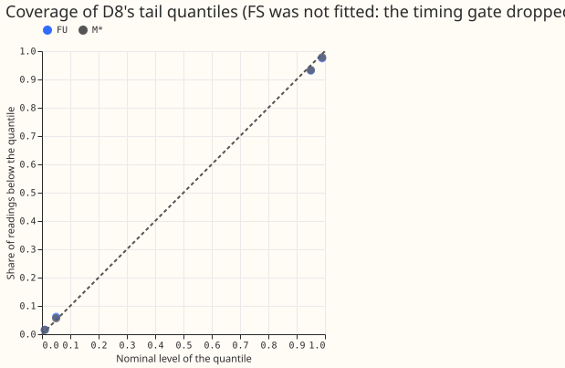
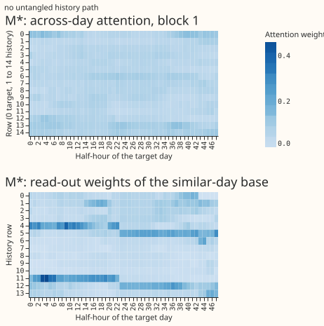
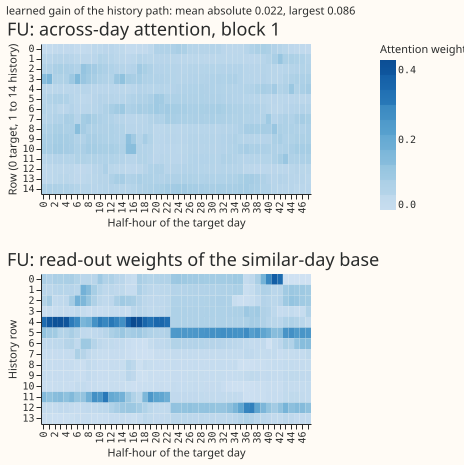
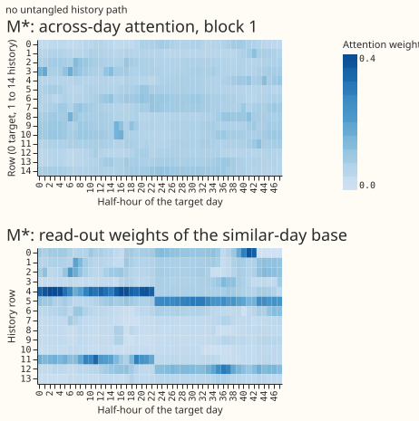
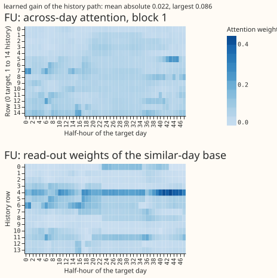
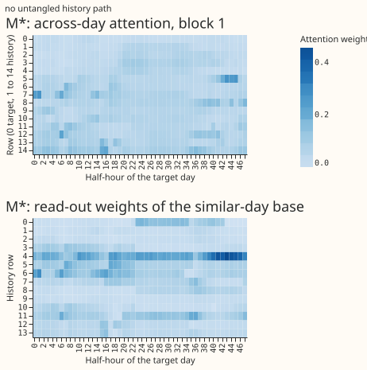
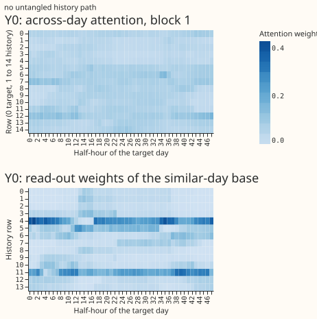
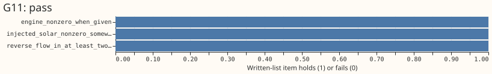

**We asked whether the demand forecaster of D8 forecasts better when it is told what was hidden in
D8's past readings.** D8 is a primary substation (a "Primary") whose meter reports apparent power, a
magnitude with no sign. A gas engine and a solar farm connect below D8, so power sometimes flows out
of D8 towards the grid, and the meter shows that export as a positive reading, the same as import. A
neural network that forecasts D8 from its last 14 days of readings therefore cannot tell, from the
readings alone, which past half-hours were import and which were export.

**An earlier experiment trained a second neural network, the untangling network, to recover what the
meter hides.** For each past half-hour the untangling network gives the probability that D8's power
flowed in reverse, the output of unmetered solar panels in megawatts, and the probability that a
block of customers was moved to or from a neighbouring Primary (a load transfer). The untangling
network learned on synthetic days with a known answer and has never seen a real day with that
answer.

**This experiment added untangled signals to each of the forecaster's 14 history days and compared
the forecast of D8's reading with the forecast of the same forecaster without them.** The untangling
network is frozen, and its stored outputs enter the forecaster as extra numbers per past half-hour.
Only two of the three signals entered, because a written rule dropped the solar output: the
forecaster read the probability of reverse flow and the probability of a load transfer. A placebo
forecaster read the same signals from 28 days earlier, so that a gain from the extra parameters is
not mistaken for a gain from the signals.

**A second question asked whether a head of the forecaster can forecast the probability of reverse
flow itself, for each half-hour of the next 10 days.** No meter records reverse flow at D8, so that
forecast was trained and scored on synthetic D8 days, where the true sign is known. The forecast had
to beat a rule that copies the probability of reverse flow from similar past days.

**The design builds on the earlier work on the same substation.** The forecaster is the
axial-attention network of [experiment
713](../00713-msa-axial-attention-demand-network-part-1/result.md) (the axial-attention demand
network), an attention design that follows the row-and-column attention of AlphaFold 2 ([Jumper et
al. (2021)](https://doi.org/10.1038/s41586-021-03819-2)). The extra history input follows the path
of [experiment 716](../00716-msa-unmetered-pv-part-1-history-estimate/result.md) (an unmetered solar
estimate in the history rows), and the placebo follows experiments 716 and [experiment
717](../00717-msa-unmetered-pv-part-2-target-row-forecast/result.md) (a solar forecast in the target
row). The untangling network is that of experiment 732 (the untangling network on synthetic
injections), whose synthetic days come from [experiment
730](../00730-msa-d8-sign-detector-with-demand-head-and-masking/result.md) (the sign detector). The
page gives the result, the post hoc runs requested after the verdict, the departures from the plan,
the design as registered, the gallery of the synthetic world, the method, and the files.

**In short, the verdict is `not supported` (verdict row 7): the untangled history of D8 changed the
forecast of D8's reading by less than the data can resolve.** The answers to the two questions are
as follows.

- **(a) Do the untangled history signals improve the forecast of D8's apparent power?** No
  detectable difference. FU (the forecaster with the signals) minus M\* (experiment 713's selected
  forecaster, the control) is +0.23% of the control's mean CRPS, with an interval of -1.05% to
  +1.71%. The placebo FU-S is indistinguishable from FU (-0.36%, interval -2.15% to +0.60%).
- **(b) Can a head of the forecaster forecast reverse flow on synthetic days, and does the untangled
  history help it?** The head is skilful and the history does not help. The forecaster with the
  untangled history (YU) beats the persistence of that history by 0.00488 in Brier score (interval
  -0.00829 to -0.00216), and its Brier skill against the climatology of reverse flow is 0.338. The
  forecaster without the untangled history (Y0) scores the same: YU minus Y0 is -0.00001 (interval
  -0.00118 to +0.00109).

## Result

*Every number on this page comes from the first and only scoring of the test half-hours, and is
interim until the reviews of the results and the prose are complete. Numbers come from
`scores/report.txt`, `scores/verdict.json`, `scores/readings.json`, `scores/timing.json`,
`scores/screen.json`, `diagnostics/per_lead.json`, `diagnostics/probe.json`, or a fit record under
`fits/`, all under `data/ml-experiments/00733-msa-forecaster-with-untangled-d8-history/`. The
exceptions are derived by hand: the absolute Brier scores of YU, B-hist, and B-clim in "Every arm's
score"; the sums of fit and prediction seconds in "Compute"; the reliability bar of 0.00369, which
is 0.1 times the share of reverse flow of 0.03694; and the row positions named in the attention
readings, which are read from the attention weights in the figure files.*

### The answers in plain terms

**(a) The untangled signals did not change the forecast of D8's apparent power by an amount the data
can resolve.** The measure is the continuous ranked probability score (CRPS) of the forecast
quantiles, in points of D8's capacity (a point is 1% of D8's effective capacity), on 102,078 scored
half-hours at leads from 24 h up to but not including 240 h, over the 8 monthly folds 2025-11 to
2026-06 and 5 seeds. The control M\* scores a mean CRPS of 7.429 points. FU minus M\* (C1, the first
of four pre-registered contrasts) is +0.017 points, which is +0.23% of the control's mean, with an
interval of -1.05% to +1.71% (-0.078 to +0.127 points). The interval is at 98.75% (Bonferroni over
four contrasts) and is widened by 1.335 for the 8 fold months. Its half-width is 1.38%, so the
experiment resolves differences of about 1.4% of the CRPS.

**The normalised mean absolute error of the median points the same way as the CRPS.** FU minus M\*
in the mean absolute error of the median forecast is +0.069 points, which is less than 1% of the
mean absolute error of about 13.5 points that R10 prints for M\*. The two readings agree in sign, so
the guard that they move together holds, and audit trigger 3 of the `ml-experiment` skill does not
fire.

**The placebo cannot be told from FU either.** FU minus the placebo FU-S (C2) is -0.36% (interval
-2.15% to +0.60%), half-width 1.37%. FU-S reads the same two signals from 28 days earlier, so the
data cannot tell a forecaster that reads the wrong days' signals from one that reads the right
days'. The interval of C2 is as wide as the interval of C1, so C2 cannot show a gain of the signals
from the right days either.

**(b) A head of the forecaster forecasts reverse flow on synthetic days better than persistence, and
the untangled history is not the reason.** The measure is the Brier score of the probability that
D8's signed power is negative (the mean squared difference between the probability and what
happened, 0 or 1; lower is better), over 407,808 half-hours of lead days 2 to 10 from 8,496 samples
in 56 test segments. YU minus the persistence rule B-hist (C3) is -0.00488 (interval -0.00829 to
-0.00216), a gain, and the log loss agrees (-0.0244). YU minus Y0 (C4) is -0.00001 (interval
-0.00118 to +0.00109), and the log loss agrees (-0.0012). The sign-forecast word is "skilful": YU's
Brier skill against B-clim (the training banks' share of reverse flow by hour, day type, and month)
is 0.338 against a bar of 0.10, and its reliability term is 0.00014 against a bar of 0.00369. The
history word is "no detectable difference". The oracle-history reading R5, which says whether even
the true sign in the history helps, is void, because the timing gate dropped the arm YT.

### The verdict is `not supported`: C1's interval includes zero

**C1's interval of -1.05% to +1.71% includes zero, so the first row of the verdict table that
matches is row 7.** Rows 3 to 6 need C1's interval to lie on one side of zero, and rows 0 to 2 need
a stop or a failed check, and none occurred. The smallest gain worth porting, g, is 2% of M\*'s
CRPS, and C1's point (+0.23%) is on the wrong side of it, so the data give no support to a port.

**Four counted contrasts, each read at 98.75%.** A negative difference is a gain of the first arm.

| Contrast | Difference | Point | Interval | Reading |
|---|---|---|---|---|
| C1 | FU minus M\*, CRPS at D8 | +0.23% | -1.05% to +1.71% | No detectable difference |
| C2 | FU minus FU-S, CRPS at D8 | -0.36% | -2.15% to +0.60% | No detectable difference |
| C3 | YU minus B-hist, sign Brier score | -0.00488 | -0.00829 to -0.00216 | A gain: the forecaster beats persistence |
| C4 | YU minus Y0, sign Brier score | -0.00001 | -0.00118 to +0.00109 | No detectable difference |


*The dot chart of the CRPS contrasts at D8. The dots of C1 and C2 sit within 0.4% of zero, and every
interval on the chart includes zero.*


*The dot chart of the Brier contrasts. C3's interval lies wholly below zero, C4's straddles zero,
and R7 (YU minus O, the untangling network's probability on the target day itself) lies wholly above
zero.*

**One guard failed, and the verdict does not change.** The guards are that C1's point keeps its sign
with each fold month left out in turn, that the normalised mean absolute error of the median moves
the same way as the CRPS, and that FU is not worse than M\* by more than 0.05 points on the q01 or
q99 pinball loss at D8. The second and third hold. The first fails: C1's point is +0.0172 points on
all 8 fold months, and +0.0078, -0.0065, +0.0029, +0.0266, +0.0239, +0.0311, +0.0280, and +0.0236
points with 2025-11, 2025-12, 2026-01, 2026-02, 2026-03, 2026-04, 2026-05, and 2026-06 left out in
turn. Leaving out 2025-12 gives a negative point of -0.0065 points. The guard matters only for rows
3 to 5, which need C1 to be a gain, so the failure changes no row.

**The plan predicted row 7 as the likeliest verdict, and the result is row 7.** The plan's
predictions fared as follows.

- **C1 between -2% and +0.5% with an interval that includes zero:** C1 is +0.23%, inside the range,
  and its interval includes zero. The prediction of (a) would have failed if C1's lower end were
  above zero, and it is not.
- **C2 has the sign of C1:** it does not. C2 is -0.36% and C1 is +0.23%. Both intervals include
  zero, so the two signs say nothing.
- **Any gain sits in the midday half-hours of the spring and summer folds:** the midday slice of R8
  is a gain (-2.19%, interval -3.49% to -1.22%), as predicted, and the slice is report-only. A
  matching loss sits on cold winter nights (+2.10%, +0.32% to +4.60%).
- **C3 is a gain and the sign-forecast word is "skilful":** both hold (C3 -0.00488, skill 0.338).
- **C4 is a gain:** it is not. C4 is -0.00001 with an interval that includes zero, so the history
  word is "no detectable difference", and this part of the prediction of (b) failed.
- **The oracle-history arm YT beats YU by more than YU beats Y0:** the reading is void, because the
  timing gate dropped YT.

### Every arm's score

**On the real folds the arms score within about 1% of one another, and every difference has an
interval that includes zero.** R10 prints the CRPS and the mean absolute error of the median at D8
over seeds 0 to 2 and all 8 folds: FU scores a CRPS of 7.509 points and a mean absolute error of
13.636 points, and M\* scores 7.450 and 13.505. R10 reads seeds 0 to 2 (the plan fixes that) and C1
reads seeds 0 to 4, so the +0.059-point gap between FU and M\* in R10 is not C1, and has no
interval.

**On the synthetic world the Brier score of the probability of reverse flow separates the
forecasters from persistence and from the climatology, and does not separate YU from Y0.** The
scores below for YU come from R11 (the bands' scores weighted by their half-hours) and the others
are derived from C3, C4, R7, and the skill (taking the skill as 1 minus the ratio of the Brier
scores), so each is derived by hand.

| Arm | Brier score of P(X<0) | How derived |
|---|---|---|
| B-clim, the climatology | 0.0327 | YU's Brier score divided by (1 - 0.338) |
| B-hist, the persistence rule | 0.0265 | YU's score minus C3 |
| Y0, no untangled history | 0.0216 | YU's score minus C4 |
| YU, with the untangled history | 0.0216 | The three bands of R11 weighted by their half-hours |
| O, the untangling network on the target day | 0.0072 | YU's score minus R7 (+0.0144) |

*O reads the target day's reading and observed weather, so it is a ceiling and not a forecast.*

### The slices of C1: lead band, fold month, midday, and cold nights

**C1 does not move with the lead.** R8 reads C1 by lead band as relative CRPS differences: +0.20% at
days 2 to 3 (interval -1.20% to +1.68%, 23,020 half-hours), +0.20% at days 4 to 6 (-1.23% to +1.77%,
34,170), and +0.27% at days 7 to 10 (-0.91% to +1.76%, 44,888). Every interval includes zero.

**The sign of the monthly difference changes at the turn of the year.** C1's monthly differences (FU
minus M\*, in points) are +0.082 in 2025-11, +0.174 in 2025-12, +0.112 in 2026-01, -0.053 in
2026-02, -0.027 in 2026-03, -0.079 in 2026-04, -0.054 in 2026-05, and -0.038 in 2026-06. FU is worse
in the three winter folds and better in the five later folds. Eight monthly values leave no power to
say whether the pattern is a seasonal effect of the signals or chance, and the leave-one-month-out
guard above says that one month, December, carries C1's sign.

**The midday half-hours gain and the cold winter nights lose, as two report-only slices.** R8 reads
the midday half-hours (10:00 to 14:00 UTC) of folds 2026-04 to 2026-06 (6,156 half-hours): FU minus
M\* is -0.139 points, -2.19% of the control's mean (interval -3.49% to -1.22%), and all three
monthly values are negative (-0.201, -0.093, and -0.121 points). On cold winter nights (4,761
half-hours) FU minus M\* is +0.180 points, +2.10% (interval +0.32% to +4.60%), and all four monthly
values are positive. Both slices are report-only, are read at 98.75% with no correction for the five
slices of R8, and carry no verdict. The two slices have opposite signs and nearly cancel in C1.

### The other 15 Primaries, masking, and the re-run

**The path harms no other Primary that the data can show.** R3 is FU minus M\* pooled over the 15
Primaries that carry no untangled channel, on 1,528,785 half-hours: -0.13% (interval -0.81% to
+0.44%).

**A forecaster given masked channels scores the same as FU.** R4 is FU with every untangled channel
masked at prediction, minus FU, at D8: -0.52% (interval -3.37% to +1.95%). The masked forecaster is
not worse than FU, so the trained forecaster shows no detectable reliance on the channels, and the
interval is too wide to say that it relies on them by less than 3%.

**The re-run of days D - 2 and D - 1 moved the forecast by nothing the score can see.** R12 is FU
scored with the stored untangled outputs of days D - 2 and D - 1 in place of the re-run, minus FU:
-0.00% (interval -0.00% to +0.00%), a point of -0.000014 points. The history that the forecaster
reads is therefore insensitive to the hidden-span re-run at the precision of the score.

### Tails and coverage

**FU's tail quantiles score a little better than M\*'s and cover the same.** R9 reads the q01, q05,
q95, and q99 pinball loss and coverage of FU and M\* at D8, over seeds 0 to 2 (102,078 half-hours
each), with no interval. FS was not fitted, because the timing gate dropped it, so the reading
covers FU and M\* only.

| Quantile | FU pinball loss | M\* pinball loss | FU coverage | M\* coverage | Nominal |
|---|---|---|---|---|---|
| q01 | 0.493 | 0.508 | 0.0154 | 0.0153 | 0.01 |
| q05 | 1.905 | 1.908 | 0.0614 | 0.0560 | 0.05 |
| q95 | 1.666 | 1.668 | 0.9312 | 0.9336 | 0.95 |
| q99 | 0.410 | 0.416 | 0.9749 | 0.9782 | 0.99 |



*Both forecasters put too many readings above the q95 and q99 quantiles and too many below the q01
and q05 quantiles, by similar amounts, so the tails of the two forecasters are as miscalibrated as
each other. FS was not fitted: the timing gate dropped it.*

**The avoidable-curtailment cost is not defined for D8.** The reading is `reactive power assumed
zero; cost not defined for unsigned meters`, because D8 reads unsigned apparent power and the
protocol defines no cost for it.

### Load-shift scenarios

**The four load-shift scenarios at D8 cannot be compared, because no logged event lies inside the
scored rows.** R10 splits D8's scored half-hours into all rows, rows outside logged events, rows
inside logged events, and the 7 days after an event ends. The first two hold all 102,078 half-hours
and the last two hold none, so FU and M\* differ only as in "Every arm's score".

**The unlogged-event caveat applies to the rows outside events.** NGED's logs may miss load
transfers, so the rows outside logged events may hold transfers that no label covers, and the slices
inside events would undercount. The scenarios say nothing about transfers.

### The sign forecast on synthetic days

**The forecaster of reverse flow beats persistence at every lead day, and the untangled history adds
nothing to it.** YU minus B-hist is -0.00488 (C3), and the per-lead reading of "Why C4 is null"
finds the same gain of about 0.005 at each lead day from 2 to 10. The sign-forecast word is
"skilful" on the plan's rule: C3 is a gain, YU's Brier skill against B-clim is 0.338 (bar 0.10), and
its reliability term is 0.00014 (bar 0.1 times the test rows' share of reverse flow of 0.03694,
which is 0.00369). The test rows hold 15,064 reverse-flow half-hours, above the 500 that the word
needs.

**YU is far from the untangling network's probability on the target day.** R7 (YU minus O) is
+0.0144 (interval +0.0055 to +0.0300): O, which reads the target day's reading and observed weather,
scores 0.0144 lower. O is a ceiling and not a forecast, and the distance shows how much of the sign
on a target day the reading holds that a forecast 2 to 10 days ahead lacks.

**YU and Y0 forecast the reading itself equally well.** R6 (YU minus Y0 in the CRPS of the forecast
reading on the synthetic world) is +0.00002 (interval -0.00760 to +0.00734), no detectable
difference.

**By lead band the forecast is well calibrated; by reading band it is not.** R11 reads YU. The Brier
score is 0.0216 at days 2 to 3, 0.0208 at days 4 to 6, and 0.0224 at days 7 to 10, with a
reliability term of 0.00014, 0.00022, and 0.00012. The mean probability is about 0.040 in every band
against a share of reverse flow of 0.038, 0.036, and 0.037. By the size of the target half-hour's
reading, the forecast under-forecasts reverse flow where the reading is small:

| Reading band | Half-hours | Brier score | Mean P(X<0) | Share of reverse flow | Reliability term |
|---|---|---|---|---|---|
| Under 1 MVA | 7,569 | 0.336 | 0.198 | 0.455 | 0.0918 |
| 1 to 3 MVA | 18,738 | 0.182 | 0.165 | 0.242 | 0.0131 |
| 3 MVA and above | 381,501 | 0.0075 | 0.031 | 0.019 | 0.0007 |

**The mean probability on import half-hours of at least 1 MVA is 0.0237, above the limit of 0.0071
that experiment 730 (the sign detector) set for a detector of the same half-hours.** The reading is
report-only. The limit was set for a detector that reads the target day, and the forecaster has no
information on the target day's reading, so it spreads probability over half-hours that a detector
would call import. The reading shows that this forecast would raise false alarms if it were read as
a detector.


*The reliability diagram of YU, Y0, and the persistence rule B-hist over 10 bins of forecast
probability. YU and Y0 lie on one line close to the diagonal, and B-hist departs from it.*


*Four synthetic test segments, three with reverse flow and one without, with the true sign and the
three forecasts over lead days 2 to 10. No calendar date appears on the axis.*

### Why C4 is null: two post hoc diagnostics

**The maintainer asked, after seeing the verdict, why the untangled history does not help the sign
forecast, and two post hoc diagnostics followed.** Both read synthetic days only, are report-only,
and change no verdict. Three explanations are candidate:

- **The future sign is hard to forecast because the engine is random.** The simulated engine starts
  and stops at random, so no history says when it will run, and a forecaster with or without the
  untangled history reaches the same limit.
- **The forecaster gains little from lagged power features.** The forecaster reads the weather of
  the target day, which sets the solar output and the demand, and the readings of the last 14 days
  add little to that.
- **The forecaster already infers the sign of the past half-hours from the folded reading, the
  weather, and the time of day,** so the untangler's probability of reverse flow adds no information
  the forecaster lacks.

**The per-lead reading shows no lead at which YU helps.** The sign Brier score of Y0 and YU is 0.020
to 0.023 at every lead day from 2 to 10, and the persistence rule scores 0.025 to 0.028, so both
forecasters beat persistence by about 0.005 at every lead day. YU minus Y0 stays between -0.00027
and +0.00015, and each of the nine intervals contains zero. The pooled difference reproduces C4
(-0.00001), and the difference shows no trend with lead day: YU does not help at short leads and
wash out later. The intervals come from the scoring's bootstrap and are not adjusted for nine lead
days.


*Top: the sign Brier score at each lead day. Bottom: YU minus Y0, with each interval including
zero.*

**The probe shows that Y0's hidden state already holds much of the sign of its history.** A logistic
regression (the probe) predicts the true sign of each history half-hour from the 64-value hidden
state of the forecaster's token for it, after the last attention block and layer normalisation. The
probe was fitted on 2,000 validation-bank samples (40 history tokens each) from 17 segments and
scored on 22,360 tokens from 7 other test segments, and each seed of the forecaster has its own
probe. For Y0, which never sees the untangler's signals, the probe scores a Brier score of 0.037 and
an AUC (the chance that a reverse-flow token outranks another token) of 0.955 on average over three
seeds. Always forecasting the base rate of reverse flow (5.9%) scores 0.056 and an AUC of 0.5, and
the untangler's own probability scores 0.013 and 0.996. YU's probe scores 0.025 and 0.982, but YU
reads the injected signals directly.


*The probe of Y0 sits between the base rate and the untangler on both scores.*

**The diagnostics favour the third explanation, with three caveats, and cannot rule out the first
two.** The hidden state of Y0 predicts the history's sign far better than the base rate does, which
fits a forecaster that already infers the sign. The state sits between the base rate and the
untangler, so the untangler still holds information that Y0 lacks, yet the forecast of the target
day gains nothing measurable from it. That pattern is also what the first two explanations predict
if the extra information concerns half-hours that matter little for the forecast. The caveats are:

- **The probe also reads the weather and time-of-day features in each token,** so it does not show
  that Y0 infers the sign from the reading alone.
- **The probe was scored on 7 test segments,** so its intervals are wide, and no interval is
  printed.
- **The per-lead intervals are not adjusted for nine lead days.**

**The page does not show which of the three explanations holds.** The arm that would separate them
is YT, which holds the true sign in the history: if YT scored no better than Y0, the sign history
cannot help at all, and the untangler's quality is not the limit. The timing gate dropped YT, so R5
is void.

### Loss curves

**All six synthetic fits stored pass 1, and every fit stopped on patience, never on the cap.** The
validation loss of a synthetic fit is the mixture negative log-likelihood of the reading plus the
sign head's cross-entropy. The negative log-likelihood of the validation bank is between 2.03 and
2.23 at pass 1 and between 3.03 and 3.56 at pass 21 in every fit, while the training loss fell at
every pass, so the forecaster of the reading fitted the training banks and not the validation bank.
The sign head's own validation cross-entropy stayed near 0.11 to 0.12 and was lowest at pass 3, 1,
and 4 for Y0 (seeds 0 to 2) and at pass 2, 2, and 4 for YU. The stored networks of C3 and C4 are the
first-pass networks, and each fit stopped after 21 passes (pass 1 plus a patience of 20), under the
cap of 40.

**On the real folds the fits stopped on patience in 10 to 27 passes, and none hit the cap.** The
stored pass of stage 2 averages 5.6 for FU, 5.8 for FU-S, and 4.5 for F0r, and the stored pass of
stage 3 averages 8.0, 8.7, and 9.8.


*Small multiples by fold for the real-fold arms and by seed for the synthetic arms. The synthetic
panels split the validation loss into the mixture negative log-likelihood and the sign head's
cross-entropy.*

### Attention maps

**The attention of FU and of M\* on the same day is nearly identical, and the attention of YU
differs from Y0's on one synthetic day.** Each figure shows two maps from a forward pass of a saved
state: the across-day attention weights of the first axial block, and the read-out weights that
build the similar-day base, for D8's target tokens at lead day 2. The three real cases are a sunny,
a dull, and a median-shortwave target day of fold 2026-05, and the learned gain `γ` of the history
path is printed under each map. M\* is drawn through F0r, and FU's gain has a mean absolute value of
0.022 and a largest value of 0.086. The read-out maps number the 14 history rows 0 to 13, as the
figures do.




*Sunny day. Both forecasters give the read-out weights mostly to history rows 4 and 5 (FU 0.138 and
0.142, M\* 0.141 and 0.139) and to rows 11 and 12 (FU 0.149 and 0.119, M\* 0.143 and 0.123), and
about 0.02 to each of rows 7 to 10. The across-day attention is spread over all 15 rows, from 0.053
to 0.098 per row on average, and the target row gets the most (0.098 for FU, 0.091 for M\*).*





*Dull day. The read-out weights shift to row 4 (FU 0.195, M\* 0.181) and row 5 (0.160 and 0.150),
with rows 11 and 12 near 0.10. The target row gets 0.051 of the across-day attention for FU and
0.050 for M\*.*





*Median day. Row 4 carries 0.238 of the read-out weight in both forecasters, and rows 5, 6, and 11
carry 0.095 to 0.115. The target row gets 0.032 for FU and 0.030 for M\*.*

**FU and M\* read the history rows alike on all three days.** No history row's mean read-out weight
differs between FU and M\* by more than 0.014 on any of the three days. The path's gain is small
(mean absolute 0.022), so FU's attention stays close to M\*'s, which fits the null C1.




*Synthetic day with reverse flow. YU's gain has a mean absolute value of 0.028 and a largest value
of 0.108. YU gives the read-out weight 0.285 to row 11 and 0.172 to row 4, and Y0 gives 0.224 to row
11 and 0.258 to row 4. One cell of YU's map holds a weight of 0.68.*

**The synthetic maps differ more than the real ones, from one sample and two separately trained
forecasters.** The two forecasters were trained from random starts, so a difference between their
maps may come from the seed and not from the signals, and one sample cannot say which.

### Forecast examples at D8

**The day-ahead and 14-day forecasts of FU and M\* lie close together in winter and in summer.** The
series figure draws, for the origins of 2026-02-13 (winter) and 2026-06-09 (summer), the day-ahead
forecast and the 14-day forecast of FU and M\* against D8's reading, as shares of capacity. FS was
not fitted, so the panels do not draw it.


*The second figure shows the effect of the channels on one day-ahead forecast: the forecast of FU
and the forecast of FU with every channel masked lie close together, as R4 reports.*

**The plan's six load-shift event plots could not be drawn.** D8 has only 2 logged load-shift
events, and neither has forecasts at both its start and its end in the scored rows, so the series
stage drew none (`scores/series_stage.json` records 0 events and 7 windows).

### Checks

- **The origin-time weather assertion passed on every batch.** It reads the run's initialisation
  time and availability time for every target token of every batch, and it printed this example for
  the first checked sample of a real fold:

  ```text
  origin-time weather: D8, contract origin 2026-05-23 12:00 UTC (native 09:00 UTC),
  target valid 2026-05-24 12:00 UTC, lead day 2, ENS run 2026-05-23 00:00 UTC,
  available 2026-05-23 09:00 UTC, latest valid time of any other target-row column
  2026-05-23 00:00 UTC: pass
  ```

- **The target-poison check passed for every FU and FU-S fit.** A copy of the channel table with
  every target-row value set to NaN gave the same forecast, and `scores/target_poison.json` lists
  the number of rows checked for each of the 64 fits (1,338 to 1,344 target rows each).
- **The poison test of the re-run passed:** `scores/poison_test.json` records that NaN and 1e6
  placed in every hidden input after the visibility limit left the re-run output unchanged.
- **The channel table covers 96.4% to 97.3% of the visible history half-hours in each fold's
  training window and 99.83% to 99.85% of those in each fold month,** against the bar of 90%.
- **The test segments:** 8 of 64 synthetic test segments lack an ENS run for every origin and are
  left out, so 56 segments are scored, under the limit of half.
- **The screen (FU minus M\* on folds 2025-11, 2026-01, 2026-05, and 2026-06 at seeds 0 and 1) read
  -0.24% of M\*'s CRPS, interim, and did not stop the rest of FU and FU-S.** The stop point is +2%.
- **F0r, with every channel absent and the new path's learning rates at zero, passed its gate.** The
  chain finished with no failed job (`chain_status.json`), and the gate stops the chain when F0r
  differs from M\* by more than 1e-6.
- **Audit triggers.** Trigger 3 did not fire (the CRPS and the mean absolute error of the median
  agree in sign for C1). No independent audit of the stored predictions has run.
- **The stored output of FS and YT does not exist,** so R1, R2, and R5 are void.

### What the result means for later experiments

**Adding the untangling network's reverse-flow and transfer-step signals to D8's history rows is not
a route to a better forecast of D8's reading.** C1's interval of -1.05% to +1.71% cannot rule out a
loss or a gain of 1%, and the placebo cannot be told from FU. The forecaster of the plan's family
infers much of the sign from the reading and the weather already, which the probe suggests and the
oracle-history arm would have tested.

**A test that wants to settle the question should fit the oracle-history arm first.** If the true
sign in the history does not help either, the untangler is not the limit, and no further untangling
of D8's history is worth building. If it does help, the untangler's remaining error is the limit,
and the pre-registered gain is what an untangler can still deliver.

**The reading that the midday half-hours gain and the cold nights lose deserves a pre-registered
test, because it is the one pattern in the real folds that the plan predicted.** The gain sits in
the spring and summer midday half-hours, where the plan predicted it, and the loss sits on winter
nights. The slices are report-only, and C1's sign depends on December 2025.

## Post hoc runs requested after the verdict

**After seeing the verdict, the maintainer asked for two further fits, and the page reports them as
report-only readings that change no verdict.** The first is FS, the forecaster that reads P(reverse
flow) alone, on the real folds. The second is a synthetic arm YS, the forecaster of reverse flow
that reads P(reverse flow) alone, on the synthetic world. The maintainer's reason is that the
transfer-step signal is poor (recall of 7.7% on the simulated steps of 5 points or more in
experiment
732) and may destroy a gain from P(reverse flow) alone. The timing gate dropped FS on cost, so R1
     (FS minus M\*) and R2 (FU minus FS) are void in the table above, and the fits are requested to
     fill that gap.

**Neither fit has run when this page is written.** The fits use the plan's recipe and bars. They add
no counted contrast and no Bonferroni correction, and every interval is read at 98.75%.

POSTHOC_RESULTS_PENDING

## What changed from the plan and what limits the page

**No bank and no bar changed, and the test and validation months follow the rule only.** The
registered constants, the smallest gain g of 2%, the Bonferroni level of 98.75%, the verdict table,
the seeds, and the digest-pinned banks of experiment 730 are as the plan registered them. The
synthetic world's test and validation months follow experiment 729's rule (a list that stays in
experiment 729's private `PRIVATE/splits.md`), and no choice read a test score. The run followed the
plan's gates in order: three Opus code reviews before any run (`scores/review_gate.json`), a smoke
test of every arm on the real GPU, and a gallery of the synthetic world that the manager viewed and
approved (`PRIVATE/gallery/panel_check.json`). Each item below departed from the plan or limits what
the page can claim. The dated rulings are those of the design lead and are recorded in the plan's
"Choices of the plan" at the dates given.

**The signal rule dropped the solar output, so FU reads the probability of reverse flow and the
transfer step only (rulings of 2026-11-26).** Experiment 732 never scored its check K2, so the
condition for the P(X<0) source, which the plan wrote as "H2 and K2 pass", reads "H2 passes". With
experiment 732's result (verdict row 4, H2 passing, the solar word "not shown", and the transfer
word "works only in Brier score"), the rule gave P(X<0) from experiment 732's U\* and the
transfer-step probability from U\*, and dropped the solar output (zeroed, with its flag off). FU
therefore reads only P(reverse flow) and the transfer step, and `channels.json` records the choice.
The stored solar output of the untangling network appears in grey on the history panels of the
private gallery for reference only, and the forecaster never receives it.

**The G14 gate rule was replaced twice, and both changes preceded any fit.** The first rule asked
that the stored and the re-run outputs of the untangling network be identical before the visibility
limit. The premise was wrong, because the untangling network reads its whole window, so the real
differences are 0.06 at most at 24 to 48 hours before the limit and 0.6 within 3 hours (ruling of
2026-11-26). The rule then required a monotone decay of the 6-hour bin means with a slack of 5e-4,
and the real differences decay noisily (the bin means from the limit outwards are 0.0123, 0.0028,
0.0019, 0.0036, 0.0011, and 0.0005), so the monotone condition was replaced by two conditions: the
mean difference in the nearest 6-hour bin is at least 3 times the mean difference over all
half-hours more than 12 hours before the limit, and every 6-hour bin more than 12 hours before the
limit has a mean below 0.01 (ruling of 2026-11-27). The poison test and the bound of 0.01 over
origins more than 24 hours before the limit stay. The gallery panel records that all six conditions
pass. Of the 7,872 half-hours in the 6 hours before the limit on the synthetic validation bank, 40
(0.5%) have a difference above 0.5. They come from 6 of 24 segments, and 33 are true reverse-flow
half-hours on which the stored output averages 0.82 and the re-run output 0.23, which fits a re-run
that cannot see the half-hours after the limit. All of them are history tokens and none is a scored
target row, because the nearest target row lies 27 hours after the limit.

**F0r trains with the new path's learning rates at zero, and the path is gated by the per-token flag
(ruling of 2026-11-27).** An ungated path added `gamma * W2 * GELU(b1) / r` to every history token
even with every flag off, so after a one-pass fit `gamma` was up to 0.12 and F0r differed from M\*
by up to 0.307. The path's output is now multiplied by the flag, so it is exactly 0 where the
channel is absent, on every arm. F0r also trains with a learning-rate scale of 0 for the new
parameters, and the fit stops with a correctness failure if any new parameter, `gamma` included,
differs from its initial value afterwards.

**A missing counted reading is verdict row 1, and row 2 follows the plan's text (ruling of
2026-11-27).** C1 is counted always, and C2 is counted whenever C1 is a gain. A counted reading that
is absent or not finite after a complete chain is row 1 (`invalid`), never row 7. Row 2 (`failed`)
follows the table's text, "a fit that C1 or C2 needs raised": a failed F0r, FU, or FU-S job. A
failed Y0 or YU job is not row 2, and the sign-forecast word and the history word then read `void`.
No counted reading was missing and no job failed.

**The channel is absent on every history token whose power stage 3 shifted (ruling of 2026-11-27).**
The stored channel output at a token belongs to the unshifted power, so a shifted token carries no
channel: its flag is off and its channel values are 0. The rule covers FU, FU-S, and FS alike.

**The timing gate had faults that the first real runs exposed, and the pass cap fell from 80 to
40.** The gate timed FU on the fold 2025-11, whose training window is the shortest, and predicted
validation rows, where the target-poison check never runs; it now fits the fold 2026-06 and predicts
test rows in a scratch folder (ruling of 2026-11-27). Prediction had run in the fitting process, and
the experiment's checks require a separate process. The first smoke run failed because its scratch
folder lacked the run marker (`failure_smoke.json`). A first timing gate stopped the line at verdict
row 0, because the counted work projected to 17.12 GPU-process-hours against the stop line of 12
(`failure_timing.json`). The gate had measured about 90 seconds a pass for the synthetic fits (470
seconds for 5 passes of YU), because each batch also runs the frozen untangling network forward. The
manager chose the cut: the cap on the synthetic passes fell from 80 to 40, and the patience of 20,
every bar, the seeds, the real-fold fits, and the stop line stayed (ruling of 2026-11-27). The first
synthetic fits stopped early on patience, with the best pass at pass 1, so the cap never bound.
Other changes of the same day made a batch of the synthetic world cheaper to cut (a packed bank,
gathered in one step on prefetch threads, with batches identical to the per-segment cut), stopped a
CPU smoke test from opening the chain, stopped the figure stages from reading test rows before the
first-test-score marker exists, and made the join of the sign forecasts to the truth check each
archive's keys and not only its length.

**The timing gate dropped FS and YT, and the report-only readings were redefined to read the arms
that were fitted (ruling of 2026-11-27).** With the real-fold fits at 224.6 seconds and the
synthetic fits at 3,763 seconds at the cap of 40 passes, the projection was 11.109 GPU-process-hours
with YT and FS dropped, under the stop line of 12, so the counted work ran. The `score` stage had
defined R9 (the tails), R10 (the load-shift scenarios), and the series panels over FU, FS, and M\*,
and had computed R9 and R10 as void for want of FS. The ruling was made after the chain and before
any R9 or R10 value was read: R9 and R10 now read FU and M\*, each records the arms it read and the
arm the gate dropped, and the figures name the missing arm. R1 and R2 (which need FS) and R5 (which
needs YT) stay void. Nothing in the verdict, the contrasts, the bars, or the stop line changed.

**The attention cases all come from fold 2026-05, and M\* is drawn through F0r.** The pipeline of
experiment 713 fixes its fold when it is imported, so a process opens one fold (the first attempt
failed on an assertion that named folds 2026-05 and 2025-11, `failure_attention.json`). The stage
runs on the CPU, builds the dataset of FU and of M\* one at a time to keep within the host limit of
14 GB, and checks that both arms draw from the same origins.

**The synthetic ENS coverage was not computed.** The base days of the synthetic world take their
target weather from the ENS runs of the real date of each base day. The summaries come from
experiment 607 (the ENS summaries from 2024-04 onwards) plus the summaries that experiment 707 (the
ENS backfill pretraining) back-filled for 2020-10-15 to 2024-03-31, so no download was needed. Base
days before 2020-10-15 hold no ensemble run and are coverage-gap data. The `synthetic_coverage`
entry of `scores/verdict.json` reads `not computed`, and the page quotes no share. The line stops at
row 0 if more than half the test segments lack runs, and the check left out 8 of 64.

**D8 has only 2 logged load-shift events, so the plan's 6 event plots could not be drawn.** The plan
said to draw every logged event if the folds held fewer than 6. The series stage found 0 events with
forecasts at both their start and their end in the scored rows (`scores/series_stage.json`), so no
event panel exists. The figures `series_real.svg` and `series_channels.svg` show a winter and a
summer origin and one origin with and without the channels instead, and the R10 slices inside events
and after events hold no half-hours.

**The synthetic fits stored their first pass, and the stop rule cannot be asked to stop on the sign
alone.** The plan's validation loss is the sum of the mixture negative log-likelihood and the sign
head's cross-entropy, each with weight 1.0. The negative log-likelihood of the validation bank is
lowest at pass 1 in every fit and rises afterwards, so the sum is lowest at pass 1, while the sign
head's own validation cross-entropy is lowest at passes 1 to 4. The stored networks of C3 and C4 are
therefore the first-pass networks. A null C4 is a null at that early stop, and the page does not
know whether a later stop on the sign alone would change C4.

**Plan items that were not done.** FS and YT were dropped, so R1, R2, and R5 are void. The synthetic
gallery panels G10, G11, and G13 draw the pass or fail of each item of their written lists as bar
charts, and not the layouts and the series that the plan described; G12, G14, and G15 draw the
panels of the plan. The share of absent flags per fold in FU and in FU-S, which the plan said to
print, is not in the report. The base-day guard counts in `scores/pre_fit_guards.json` are not
interpreted here. The real-day panels of the untangled channels are in `PRIVATE/gallery2/` and are
not published.

**The synthetic fits are on a world with no load transfers, and the transfer signal of FU reads a
detector that finds 7.7% of simulated steps.** The transfer-step channel is near zero in the
synthetic world, so C3 and C4 test the sign channel alone. The transfer step that FU reads on real
days comes from a detector that experiment 732 found finds 7.7% of the simulated steps of 5 points
or more, so a null C1 says little about whether a good transfer signal would help.

**Anonymisation.** The page shows no engine size, no connection date, no distance, no register
entry, no series identifier, and no generator time series. D8 is a substation and is named.
Forecasts of D8's reading appear on calendar dates, and no real-day untangled channel is drawn. The
base dates of the synthetic samples appear only in the private log, and the page draws the synthetic
series without dates. The panels of `PRIVATE/gallery2/` are not published: the history and placebo
panels show real-day untangled channels, and the synthetic panels show the real base-day reading
beside the injected series.

## The design as registered

**The sections from "Why this design" to "Verdict table" state the design as registered before any
fit or score existed, with the changes listed in "What changed from the plan and what limits the
page".** Where the registered text says what the experiment "must" do, the experiment did it, unless
that section says otherwise.

### Why this design

**The forecaster needs the untangled signals in its history rows only, because the untangling
network reads the weather observed at the same time as the reading.** The untangling network reads
D8's reading over a 48-hour window together with observed sunshine and temperature. For a past
half-hour, observed weather is a fact the forecaster may use. For a target half-hour, observed
weather lies in the future, so the target rows read only the weather forecast issued at or before
the forecast origin, and no untangled value of a target half-hour ever enters the forecaster.

**The untangling network enters frozen, through its stored outputs, and is never trained through the
forecaster's loss.** Three reasons decide this choice:

- The frozen network was fitted only on synthetic days built from D8's pre-engine readings. Those
  days lie inside the training window of experiment 713's stage 1, but stage 1 is not refitted here
  and its stored states read no untangled channel. Every pre-engine day precedes the first history
  day of stages 2 and 3, the only stages that read the untangled channels, so no fit of the
  untangling network saw a real day whose untangled channel the forecaster reads.
- An untangling network trained end to end would learn whatever helps the forecast loss, and its
  three outputs would no longer mean the probability of reverse flow, the solar output, and the
  transfer step that the synthetic world defines and scores.
- The stored outputs cost no GPU time, and the real-day outputs of experiment 732 are already on
  disk for every day the forecaster reads.

**A written rule picked each signal before any score of experiment 732 was read, so the plan holds
whichever way experiment 732 came out.** Experiment 732 had not finished when the plan was written.
The section "Which untangled signals entered" states the rule, and the fallback for the probability
of reverse flow was experiment 730's sign-only network S, whose real-day checks passed.

**The forecaster keeps experiment 713's recipe and all 16 Primaries, and only D8 carries the new
signals.** A forecaster trained on D8 alone would be a different recipe from M*, the stored arm that
the counted contrast compares with. Experiment 725 found that refitting stages 2 and 3 from M*'s
stored stage 1 state with the same seed reproduces M* exactly, so the stored forecasts of M* are an
exact control at no GPU cost, and every new arm pairs with M* seed by seed. At the other 15
Primaries the new channels are absent and flagged absent.

**The sign forecast is trained and scored on a synthetic forecasting world, because no real day has
a known sign.** The world is built from experiment 730's synthetic D8 months, which hold a simulated
engine, simulated solar output, and the fold of the meter, so that each half-hour has a true sign.
Each forecasting sample takes 14 history days and up to 14 target days from one synthetic month. The
target rows read the real ENS weather forecast issued on the base day's date, so the synthetic
forecast faces the same weather uncertainty as a real one.

### Terms

- **The reading** is D8's apparent power, a magnitude in points. **Signed power X** is D8's real
  power, positive for import and negative for reverse flow. **Folding** is the loss of the sign.
- **A point** is 1% of D8's effective capacity, the normaliser that
  [data-processing](../data-processing.md) uses for D8.
- **P(X<0)** is the probability that a half-hour's signed power is negative.
- **The untangling network** is experiment 732's headline arm U\*, averaged over its seeds 0 to 2.
  Its three outputs are the sign output P(X<0), the solar output in points, and the transfer-step
  probability. FU reads the first and the third.
- **The untangled channels** are the untangling network's outputs placed on the forecaster's history
  grid, one value per history half-hour, with a presence flag.
- **The forecaster** is experiment 713's axial-attention network. **M\*** is its selected arm M1
  (frozen pre-trained encoders), stored for seeds 0 to 4 of 8 monthly folds.
- **The contract origin c** is 12:00 UTC on the origin day D, and **the native origin** is 09:00 UTC
  on day D, when the ENS 00Z run of day D is available. **The visibility limit** is the last history
  half-hour whose power the forecaster may read, which experiment 713's layout fixes (27 hours
  before the contract origin, as experiment 716's page states).
- **A history row** is one of the 14 rows of 48 half-hours at ages 2 to 15 days, and **the target
  row** is the row of one lead day k, as experiment 713 defines them.
- **A segment** is one calendar month of D8's pre-engine base days carrying one continuous draw of
  injected engine and solar output, as experiment 730 defines it. **A base day** is a UTC day of
  D8's real pre-engine reading.
- **The synthetic forecasting world** is the set of forecasting samples built inside segments, in
  "The synthetic forecasting world".

### What the earlier experiments found

**Six earlier results set the choices of this plan.**

- **Experiment 713:** the axial-attention network forecast the six Primaries metered in signed MW
  slightly better than the Candidate, and at the eight Primaries metered in MVA only the pooled
  difference rested on two Primaries, D8 and D12. A Primary that folds is where a forecaster reading
  only a magnitude has most to gain from knowing the sign, which is why D8 is the scored Primary.
- **Experiments 716 and 717:** a capacity-times-sky estimate of unmetered solar output in the
  history rows, and a solar forecast in the target row, gave no detectable change in CRPS. The
  forecaster already reads the sky. The untangled solar output differs from those estimates because
  the untangling network reads D8's own reading, so the untangled solar output can carry information
  the sky does not, such as a change of capacity.
- **Experiment 725:** history weather that a live service could build changed CRPS by no detectable
  amount, and a refit of stages 2 and 3 from M*'s stored stage 1 state with the same seed reproduced
  M* exactly.
- **Experiment 729** is invalid, because a bug left half of its synthetic solar farms silent. Every
  generator whose output this experiment reads is drawn in a gallery before the first fit.
- **Experiment 730:** the sign-only U-net S gave the best probability of reverse flow on synthetic
  days (Brier score 0.00853), and a demand output with a shared encoder made the sign worse. On real
  days its check H2 passed.
- **Experiment 732** trains one U-net, U\*, for the sign, the solar output, and the transfer steps,
  and stores U\*'s outputs for every real D8 day from the start of the forecaster's training window
  to the end of the last fold, apart from days with no reading.

### The forecaster and its history rows

**The forecaster is M\*, unchanged, with one zero-initialised input path for the untangled
channels.** Every arm on the real folds starts from M*'s stored stage 1 state of the same fold and
seed and runs stages 2 and 3 of experiment 713's recipe through experiment 716's copied training
loop. A network that loads M*'s state with every new channel absent gives M*'s forecast bit for bit,
and a unit test checks that.

**The history path is experiment 716's token path, widened from one channel to three.** For each
history token the path computes `γ ⊙ (W2 GELU(W1 [u·ok, v·ok, w·ok, ok]) / r)`, where u is the
untangled P(X<0), v is the untangled solar output divided by D8's capacity and by the fold's target
standard deviation (clipped to 0 to 10, in the units of the power input), w is the untangled
transfer-step probability, and ok is the presence flag. `W1` maps 4 to 32 with bias, `W2` maps 32 to
64 without bias, `γ` is a 64-element gain that starts at zero, and r is the root mean square of the
path's output at initialisation over the arm's training tokens. The read-out path of experiment 716
also carries the three channels: the attention weights that build the similar-day base give the
weighted means of u, v, and w, and a zero-initialised linear map adds those means and the cover to
the head's first layer. A channel that the rule of the next section drops is set to zero in every
token, with no change to the path's shape.

**The new parameters train in their own optimiser group, as in experiment 716.** The learning rates
are experiment 716's (3e-3 for `γ`, 2e-3 for `W1`, `W2`, and the head map, 1e-2 for the read-out
table), with no warm-up and no weight decay on the gains. Mask dropout hides the untangled channels
of the age-2 row and part of the age-3 row on 10% of training samples, and of ages 2 to 5 on another
10%, as experiment 716 hid its estimate.

**The untangled channels exist only at D8.** At the other 15 Primaries every new channel is zero and
flagged absent. Only D8 is scored for the counted contrasts, and the other 15 Primaries are scored
as a report-only check that the new path harms nobody.

### Which untangled signals entered

**A rule written before any score of experiment 732 was read decided which of the three untangled
signals enter the forecaster, and it admitted two.** The channel stage reads experiment 732's
printed verdict row and reading words from its stored score files and writes the choice to
`channels.json` before any fit of this experiment. Experiment 732's predictions on real days are
read, and its synthetic test scores only through those words. The rule's reading of the real-day
checks H2, P1, and P3 is one bit of selection per signal on real days, some of which fall in the
fold months. The checks read aggregates of the untangling network's outputs and no forecast score.

| Signal | Source when usable | Usable when | Otherwise |
|---|---|---|---|
| P(X<0) | Experiment 732's U\*, seeds 0 to 2 averaged | Experiment 732's verdict row is 4 (`supported`) or 5 (`inconclusive`), and its real-day check H2 passes | Experiment 730's S, seeds 0 to 2 averaged, from its stored real-day predictions |
| Solar output | Experiment 732's U\* | The P(X<0) source is U\*, experiment 732's solar word is "reasonable" or "partly", and its real-day checks P1 (night) and P3 (follows the sky) pass | Dropped |
| Transfer-step probability | Experiment 732's U\* | The P(X<0) source is U\*, and experiment 732's transfer word is "works" or "works only in Brier score" | Dropped |

**The rule gave P(X<0) and the transfer step from U\*, and dropped the solar output.** Experiment
732's solar word is "not shown", which neither "reasonable" nor "partly" matches, so the solar
output is set to zero with its flag off in every token (`channels.json`: usable `p_neg` and
`step_p`, dropped `solar`, P(X<0) source U\*). A dropped signal keeps the arms' shape. FU carries
both usable signals and FS would carry P(X<0) alone, and FU and FS are distinct arms. FU therefore
reads only P(reverse flow) and the transfer step.

### How the outputs are placed on the history grid

**The stored outputs of experiment 732 cover every history day whose untangling window ends before
the forecaster's visibility limit.** Experiment 732 scores the middle 24 hours (a UTC day) of a
48-hour window running from 12:00 UTC on the day before to 12:00 UTC on the day after. The stored
output of a UTC day therefore depends on inputs up to 12 hours after that day ends. For an origin on
day D, every UTC day up to D − 3 has a window that ends at or before 12:00 UTC on day D − 2, which
is before the visibility limit, so the stored outputs of those days enter unchanged.

**For each origin the untangling network is run again on UTC days D − 2 and D − 1, with every input
after the visibility limit hidden.** The stored windows of those two days end after the visibility
limit, at 12:00 UTC on days D − 1 and D. The re-run hides D8's reading, the readings of the three
neighbours, and the BSP steps after the limit by setting each value and its presence mask to zero,
which is the hidden-span input that experiment 732 trained on. The CAMS sky after the limit is
hidden through its presence mask. The ERA5 temperature, wind speed, and precipitation after the
limit are replaced by the ENS-mean values of the latest 00Z run issued at or before the native
origin. The untangled channel of a history half-hour is present only where the forecaster's own
power token is visible. The re-run costs two windows per origin per seed, a few minutes of GPU time
in all.

**The same rule builds the channels of the synthetic forecasting world and of the placebo.** The
placebo FU-S reads, for each history half-hour, the untangled values of the same half-hour 28 days
earlier, which lie before every history row of the sample. A history half-hour whose untangled value
is missing (a day with no reading) has its flag off. A change of regime inside the 28 days, such as
a load transfer or more solar capacity, makes the placebo's values wrong in level as well as in day,
so C2 tests the day-by-day values together with any recent change of level. The report prints the
share of absent flags in FU and in FU-S per fold, so that a C2 gain is not read as a gain from
coverage.

**The table of untangled channels must cover at least 90% of D8's visible history half-hours in each
fold's training window and in each fold month, or the line stops at verdict row 0.** The
real-environment smoke test prints the coverage per fold.

### Leakage and origin-time weather

**Every target row of every arm reads its weather from the NWP run issued at or before the forecast
origin, and an assertion checks this row by row.** On the real folds the target row reads the ENS
00Z run of day D, available at the native origin, through experiment 713's inputs. The assertion
reads, for every target token of every sample in every batch, the run's initialisation time and its
availability time, and fails unless the initialisation time is 00:00 UTC on day D and the
availability time is at or before the native origin. The same assertion checks that every other
target-row column (the trailing-temperature and solar-gain columns, and the CAMS day summary of day
D − 1) reads no valid time at or after the native origin. Those columns are observations of past
days that a live service may not hold at the native origin, so the code records them as a lab
shortcut, and every score is a ceiling on that account, as experiment 725's unrun read-out T3 says.
The date-time columns (solar geometry, calendar, and holiday flags) hold no weather. The assertion
prints one example row, which the "Checks" list reproduces for a real fold.

**The synthetic forecasting world runs the same assertion against the base day's date.** Its target
rows read the ENS 00Z run of the real date of the origin's base day, and the example of the
synthetic world is printed to the private log only, because a base date tells the reader which
months are pre-engine.

**Observed weather enters the untangling network's windows and the forecaster's history tokens only,
never a target row.** The forecaster's history tokens read the ERA5 and CAMS analyses that M\*
reads, as experiment 713 does. A live service could not build those analyses for ages 2 to 5, so
every score here is a ceiling for a live forecast. Experiment 725 found that history weather a live
service could build changed CRPS by no detectable amount.

**Each guard below is an assertion in the code, and a failure is verdict row 1.**

- Every base day of every bank that trained, stopped, or tested experiments 730 and 732 precedes the
  first history half-hour of any stage 2 or stage 3 sample of any fold, the only samples that read
  an untangled channel. The code reads the base calendar from experiment 730's banks and the first
  history half-hour from the fold layout, and prints only pass or fail. A second assertion counts
  the samples whose history overlaps a base day and the untangled channels present there, and
  requires both counts to be zero, so that a change to the fold layout cannot let a pre-engine day's
  in-sample channel into a fit.
- No untangled value of a target half-hour enters any input. The untangled channels are built on the
  history grid alone, and a poisoned copy of the channel table with every target-row value set to
  NaN gives the same forecast to 1e-6.
- No untangling window that feeds a history half-hour reads D8's reading, a neighbour's reading, the
  BSP steps, or the CAMS sky after the visibility limit, and no ERA5 value after the limit. A test
  poisons every such input after the limit with NaN and checks that the re-run's outputs are finite
  and unchanged.
- The placebo's values come from half-hours at least 28 days before the history half-hour they fill.
- Experiment 716's checks run unchanged: cleaned power set to NaN from each fold month's start in
  every training process, and prediction in a separate process.
- On the synthetic world, the forecaster trains on experiment 730's training banks of seeds 3 and 4,
  which no fit of experiment 732 read, stops on the validation bank, and is scored on the test bank,
  which no fit of experiments 730, 732, or 733 trained on. The untangled channels of every synthetic
  sample come from the untangling network's re-run on that sample's own segment.
- No input of the synthetic forecaster reads the segment's world type, its engine parameters, its
  solar capacity, or any truth array.
- No choice reads a test score: the smallest gain g and the climatology B-clim are written to
  `limits.json` from M*'s stored forecasts and the training banks before any fit, and every fit
  stops on validation before the first-test-score marker exists.

### The synthetic forecasting world

**A forecasting sample of the synthetic world takes its history rows and its target rows from one
synthetic month of experiment 730's banks.** A sample is (segment, origin day, lead day k). The
history rows of ages 2 to 15 and the target row of lead day k must lie inside the segment; a history
row outside the segment, or on a missing base day, has `row_exists` set to false, as in experiment
713. A sample is kept when at least 7 history rows exist. The banks are read and never rebuilt, and
     the banks stage verifies each bank's SHA-256 digest against experiment 730's
     `banks/summary.json`.

**The target is the folded reading, and the sign head's target is the event X < 0 at each target
half-hour.** The forecaster's mixture head forecasts the folded reading in the units of experiment
713, and a second head gives the logit of P(X<0) for each target half-hour. Both heads read the same
trunk.

**The target rows read the real ENS forecast issued on the origin's base day, so a synthetic target
day faces real weather uncertainty.** The base days are real days, the injected solar output of
source S1 is a real farm's output on the same base day, and the injected solar output of source S2
comes from the CAMS sky of the same base day, so the ENS run of the base date forecasts the weather
that drives the synthetic solar output. ENS runs exist in the `NWP` Delta table from 2020-10-15, as
experiment 707 records, so base months without a run for every origin are left out. The banks stage
counts the left-out segments per split and writes the count to the private log; if more than half of
the test segments are left out, the line stops at verdict row 0.

**The synthetic forecaster starts from random weights and trains on D8's synthetic samples alone.**
Experiment 713's stage 1 states trained on D8's real readings of the base months, so a warm start
could carry the base demand of a test month into the test score. The synthetic forecaster has
experiment 713's architecture, the history path above, and the sign head, and trains in one stage on
ERA5 history weather and ENS target weather: AdamW with a learning rate of 5e-4 and weight decay of
1e-3, batch 256, gradient clipping at 1.0, at most 40 passes with a patience of 20 on the validation
loss, which is the sum of the mixture negative log-likelihood and the sign head's binary
cross-entropy, each with weight 1.0. The patience is longer than experiment 713's 8, because
experiment 716 found that a patience of 8 stopped a slow history path after 4 to 23 passes.

**The sign head starts as the persistence rule.** The head reads `[h_0, ū, cover, one-hot lead day]`
through a layer of 32 units, where ū is the logit of the attention-weighted mean of the history's
untangled P(X<0) at the token's column. The output layer starts at zero, the bias starts at the
logit of the training banks' share of reverse flow, and a fixed skip adds ū times the cover. An
untrained head therefore gives the similar-day persistence of the history's untangled P(X<0), which
is close to the rule B-hist, and a unit test checks that.

**Load transfers are absent from the synthetic forecasting world.** Experiment 730's banks carry no
transfer, so the transfer-step channel is near zero there, and the synthetic world tests the sign
and solar channels only.

### Arms

**Five arms were fitted, and M\* was read from stored forecasts; FS and YT were registered and not
fitted.** The real-fold arms run 8 monthly folds, and the synthetic arms train on the synthetic
world. The fit counts are those of the files under `fits/`.

| Arm | Where | History input | Sign head | Seeds | Fits | Role |
|---|---|---|---|---|---|---|
| M\* | Real folds | The folded reading | No | 0 to 4, stored | Stored | The control of C1 |
| F0r | Real folds | The folded reading, every new channel absent | No | 0 and 1 on folds 2025-11 and 2026-05 | 4 | Gate: reproduces M\* exactly |
| FU | Real folds | The folded reading, P(X<0), and the transfer step | No | 0 to 4 | 40 | The headline arm |
| FU-S | Real folds | As FU, with each channel taken 28 days earlier | No | 0 to 2 | 24 | The placebo of C2 |
| FS | Real folds | The folded reading and P(X<0) | No | 0 to 2 | Not fitted | Report only: dropped by the timing gate |
| Y0 | Synthetic world | The folded reading | Yes | 0 to 2 | 3 | The control of C4 |
| YU | Synthetic world | The folded reading, P(X<0), and the transfer step | Yes | 0 to 2 | 3 | The headline arm of the sign forecast |
| YT | Synthetic world | The folded reading and the true channels (the indicator of X < 0 and the true solar output) | Yes | 0 to 2 | Not fitted | Report only: dropped by the timing gate |

**F0r is a gate and not a reading.** F0r runs this experiment's loop with every new channel absent
and the new path's learning rates at zero, so its forecasts must equal M\*'s stored forecasts at D8
to 1e-6, as experiment 725's Z did. A difference stops the line at verdict row 0, because every
counted contrast on the real folds pairs a new arm with stored M\*.

**FU-S ran 3 seeds, and C2 pairs seeds 0 to 2 of FU.** The headline C1 reads 5 seeds, because
experiment 716 found a noise floor at 2 seeds that hid gains of the size expected here.

**The fits ran in an order that put the verdict first:** the timing gate, F0r, FU on the four
screening folds at seeds 0 and 1, the screen rule, the rest of FU, FU-S, Y0, YU, and then the
report-only arms FS and YT. The screen read -0.24% and did not stop the rest of FU.

### Baselines

**On the real folds the references are stored forecasts, and none needs a fit.** M\* is the counted
control. The month-by-half-hour climatology of
`baseline_forecasters.climatology.ClimatologyForecaster` is refitted on each fold's training window,
and its rows are repeated once per seed. The Candidate of experiment 667 is read where its stored
rows cover the scored keys.

**On the synthetic world three rules give P(X<0) for a target half-hour without a forecaster fit.**

- **B-hist, the persistence rule, is the counted reference of C3.** For each target half-hour,
  B-hist averages the history rows' untangled P(X<0) at the same column, with weights from
  experiment 713's starting day-type table (3.0 for the same day type, 1.5 for two different working
  days, 0 otherwise, through a softmax). A sample with no visible history value at the column takes
  B-clim.
- **B-clim is the training banks' share of reverse flow by local half-hour, by weekday or weekend,
  and by calendar month,** from the training banks of seeds 3 and 4, written to `limits.json` before
  any fit. B-clim is the reference of the skill bar.
- **O is the untangling network's P(X<0) on the target day itself.** O reads the target day's
  reading and observed weather, so O is not a forecast. O is printed as a ceiling and enters no
  contrast.

### Contrasts

**Four contrasts are counted, each read at 98.75% (Bonferroni, 1 − 0.05 / 4).** A negative
difference is a gain of the first arm.

| Contrast | Difference | Rows | Question |
|---|---|---|---|
| C1 (verdict) | FU minus M\*, CRPS | D8, real folds, leads 24 h to 240 h, seeds 0 to 4 | Do the untangled history signals improve the forecast of D8's reading? |
| C2 | FU minus FU-S, CRPS | The same rows, seeds 0 to 2 | Does the gain come from the untangled values of each history day? |
| C3 | YU minus B-hist, Brier score of P(X<0) | Synthetic test target rows, lead days 2 to 10 | Does the sign head forecast reverse flow better than persistence of the untangled history? |
| C4 | YU minus Y0, Brier score of P(X<0) | The same rows | Do the untangled history signals help the sign forecast? |

**Every counted reading pairs arms on the same rows and averages seeds before the bootstrap.** On
the real folds each arm's quantiles are averaged over seeds and sorted, as in experiment 713, and
the loss frame from `experiment_store.losses_for_bootstrap` pairs rows on the run and the valid
time. The interval comes from experiment 713's month-block bootstrap with 100,000 resamples. With
one Primary the bootstrap has one factor, the 8 fold months, whose Kish effective number is 8, so
the interval is widened by the ratio of the Student t quantile (7 degrees of freedom) to the normal
quantile, which is the widening rule of experiments 729 to 732 applied to one factor. On the
synthetic world the interval comes from experiment 729's two-way bootstrap, called unchanged: within
each test month, blocks of 7 consecutive origin dates and, independently, whole segments are
resampled, with 20,000 resamples, generator seed 733, the Kish effective number of each factor
printed, and the same t widening when either factor falls below 20.

**C1 reads 5 seeds and C2 reads 3, so the report prints the half-width of each interval beside the
verdict.** A C2 that includes zero only because its interval is wider than C1's is then visible to
the reader.

**The normalised mean absolute error of the median is printed beside every CRPS contrast, and the
log loss beside every Brier contrast.** A point of the opposite sign is audit trigger 3 of the
`ml-experiment` skill.

**Report-only readings enter no verdict row and no Bonferroni count, and each is read at 98.75%.**

| Reading | Content |
|---|---|
| R1 | FS minus M\*, CRPS at D8: the sign alone |
| R2 | FU minus FS, CRPS at D8: the solar and transfer channels beyond the sign |
| R3 | FU minus M\*, CRPS pooled over the other 15 Primaries: harm away from D8 |
| R4 | FU with every untangled channel masked at prediction, minus FU, CRPS at D8: whether the trained network uses the channels |
| R5 | YT minus Y0, Brier score of P(X<0): the ceiling of the history path, printed beside C4 |
| R6 | YU minus Y0, CRPS of the forecast reading on the synthetic world |
| R7 | YU minus O, Brier score of P(X<0): the distance to the untangling network on the target day |
| R8 | C1 by lead band (days 2 to 3, 4 to 6, 7 to 10), with each fold month left out in turn, in the midday half-hours (10:00 to 14:00 UTC) of folds 2026-04 to 2026-06, and on cold winter nights |
| R9 | The q01, q05, q95, and q99 pinball loss and coverage, and the avoidable-curtailment cost, for FU, FS, and M\* at D8 |
| R10 | The four load-shift scenarios at D8 for FU, FS, and M\*: all rows; rows outside logged events and at least 7 days after one; rows inside logged events; and the 7 days after an event ends |
| R11 | The sign head of YU by lead band and by reading band (under 1 MVA, 1 to 3 MVA, 3 MVA and above), with the mean P(X<0) on import half-hours of at least 1 MVA beside experiment 730's pooled harm limit of 0.0071 |
| R12 | FU scored with the stored untangled outputs of days D − 2 and D − 1 in place of the re-run, minus FU: how much the inputs after the visibility limit would have moved the forecast |

**R10 carries the unlogged-event caveat.** NGED's logs may miss load transfers, so the rows outside
logged events may hold events that no label covers, and the slices inside events undercount.

### Verdict table

**The first row that matches is the verdict, and every row is reachable.** A gain means the
interval's upper end is below zero, and a loss means its lower end is above zero. The guards are:
C1's point keeps its sign with each fold month left out in turn; the normalised mean absolute error
of the median moves the same way as CRPS; and FU is not worse than M\* by more than 0.05 points on
the q01 or q99 pinball loss at D8.

| Row | Condition | Verdict |
|---|---|---|
| 0 | The line stops before C1 is read: the manager halts it; F0r differs from M\*; the channel table covers less than 90% of a fold's visible history half-hours; a bank digest differs from experiment 730's; more than half of the synthetic test segments lack ENS runs; experiment 732 has not finished; a gallery panel does not show what its written list requires; the timing projection of the counted fits exceeds the stop line; or a review gate has not passed when a fit would start | Stopped, no verdict (`inconclusive` in the front matter) |
| 1 | A correctness check fails: an origin-time weather assertion, a leakage guard, the poisoned-copy checks, the bit-for-bit check of the zero-initialised path, the starting-rule check of the sign head, or a known-answer unit test of the bootstrap or the Brier score | `invalid` |
| 2 | A fit that C1 or C2 needs raised and was not rerun under the rerun rule | `failed` |
| 3 | C1 and C2 are gains, C1's point is at or below −g, and the guards hold | `supported` |
| 4 | C1 and C2 are gains and the guards hold, and C1's point is above −g | `small gain` |
| 5 | C1 is a gain, and C2 is not a gain or a guard fails | `partly supported` |
| 6 | C1 is a loss | `refuted` |
| 7 | Every other case (C1's interval includes zero) | `not supported` |

**Two reading words sit beside every verdict row and never change it.**

- **The sign-forecast word** answers whether the forecaster's sign head forecasts reverse flow well
  on synthetic days. The word is "skilful" when C3 is a gain, YU's Brier skill against B-clim is at
  least 0.10, and YU's reliability term is at most 0.1 times the test rows' share of reverse flow
  (experiment 730's calibration bar); "beats persistence, little skill" when C3 is a gain and the
  skill bar fails; "beats persistence, miscalibrated" when C3 is a gain, the skill bar passes, and
  the reliability bar fails; "no better than persistence" when C3's interval includes zero; and
  "worse than persistence" when C3 is a loss. The word is `void` when a seed of YU is missing or the
  scored target rows hold fewer than 500 reverse-flow half-hours.
- **The history word** answers whether the untangled history helps the sign forecast. The word is
  "helps" when C4 is a gain, "no detectable difference" when C4's interval includes zero, and
  "hurts" when C4 is a loss. R5 is printed beside it: when R5 is not a gain, even the true sign in
  the history does not help the sign head, so a null C4 says nothing about the untangling network.

**The skill bar of 0.10 asks the sign head to remove one tenth of the climatology's Brier score.**
The bar is a judgement and not a ported gain: a forecast that removes less than a tenth adds little
to a decision about reverse flow 2 to 10 days ahead.

**A failed report-only fit leaves the verdict untouched,** and its readings are `void`. A rerun is
the same attempt only when a fit raised, the fix changes no constant, and the Opus reviewer confirms
the fix. `not supported`, `refuted`, and `inconclusive` are never rerun.

### Compute

**The chain used about 7.2 GPU-process-hours against a pre-registered 10.56 and a stop line of 12.**
The sums below are of the seconds that the fit records and job records hold, so each is derived by
hand. The slot was A2: one GPU process of at most 6 GB, cores 16 to 21, a memory cap of 14 GB, and a
launcher that refuses to start when the slot is busy.

| Work | Fits | Mean seconds a fit | GPU-process-hours |
|---|---|---|---|
| F0r | 4 | 136.5 | 0.15 |
| FU | 40 | 138.5 | 1.54 |
| FU-S | 24 | 144.3 | 0.96 |
| Y0 | 3 | 1,899 | 1.58 |
| YU | 3 | 1,970 | 1.64 |
| Fits in all | 74 | | 5.88 |
| Prediction steps (F0r, FU, FU-S) | | | 1.13 |
| Timing gate | | | 0.20 |
| The chain in all | | | 7.2 |

**The real-environment smoke test of every arm took 0.20 GPU-process-hours before the chain, so the
whole experiment used about 7.4.** The peak GPU memory of the timing gate was 3.6 GB, under the cap
of 6 GB, and its peak resident memory 10.8 GB, under the cap of 14 GB. The plan assumed 288 seconds
for a real-fold fit, and the timing gate measured 224.6 seconds for one on the longest training
window. Every synthetic fit stopped after 21 passes of about 90 seconds, so the 40-pass cap never
bound, and the 3,763 seconds that the gate projected for a synthetic fit at the cap is about twice
the 1,899 to 1,970 seconds that the fits took.

### Earlier advice followed

**The plan followed 16 items of earlier advice and departed from one.** It reads the gain at one
Primary metered in MVA, D8 (experiment 713); reports the other 15 Primaries beside D8 (713); refits
stages 2 and 3 from the stored stage 1 state with the same seed and checks that with F0r (725);
reads the gain against a placebo that carries the wrong day's values (716, 717); gives the slow
history path of the synthetic fits a longer patience, and adds an oracle-history arm (716; the arm
was dropped); loads one fold at a time in the scorer (717); treats history weather that a live
service could build as a caveat (725); reads no rerun of the neighbour-row contrasts (715); uses
experiment 730's sign-only S as the fallback for the sign (730); reads the harm of the sign head per
reading band (730); draws every arm in a dot chart (730); aligns every pair of row sets by key
(730); checks that every simulated component and every untangled channel is nonzero where it should
be (729); calls the real loaders in the smoke test (729); and counts every threshold over the
half-hours where the quantity exists (729). The departure is from experiment 715's advice of 400
passes with a patience of 30 before a known-answer test of the axial-attention network: the
synthetic fits ran at most 40 passes with a patience of 20, because 400 passes would cost more than
the 12 GPU-process-hours of the slot. Every fit logs whether the validation loss was still falling
at the cap, and none hit the cap.

## Synthetic world gallery

**The gallery shows the output of every generator whose output this experiment reads, before the
first fit, and again here.** Experiment 730 drew panels G1 to G9 from the banks that this experiment
reads, and the banks are digest-pinned (`banks_digest` 43cb54382013ef5c), so those panels show this
experiment's engine, solar sources, fold, synthetic bulk-supply-point meter, base days, and masks.
Six panels, G10 to G15, were drawn for this experiment, and the session that ran the experiment
checked each against its written list and recorded the result in `PRIVATE/gallery/panel_check.json`:
all six pass, and the manager viewed and approved the gallery before the first fit.

**G10, G11, and G13 draw the result of their checks and not the layouts.** Each panel is a bar chart
of the written-list items, each 1 when it holds. G10 (the layout of a synthetic sample) checks that
the history rows match the segment, that some history row is shown, that the target rows lie inside
the segment, and that the scored lead days are 2 to 10. G11 (synthetic target days) checks that
reverse flow occurs on target days in at least two of three segments, that the injected solar output
is nonzero somewhere, and that the engine is nonzero when given. G13 (the untangled channels against
the truth on synthetic history) checks that the solar channel is nonzero on sun-up half-hours and
that P(X<0) is above 0.5 on most reverse-flow half-hours.





**G12: the ensemble forecast tracks the observed sky.** The correlation between the ENS shortwave of
the base date's 00Z run and the CAMS sky of the same target half-hours is 0.957 at lead day 1, 0.953
at lead day 2, 0.907 at lead day 10, and 0.886 at lead day 14, falling with the lead day and staying
well above zero.


**G14: the re-run of days D - 2 and D - 1 differs from the stored output mostly in the last 6 hours
before the visibility limit.** The mean absolute difference in P(X<0) by 6-hour bin from the limit
outwards is 0.0123, 0.0028, 0.0019, 0.0036, 0.0011, and 0.0005, and the largest difference is 0.955,
0.786, 0.345, 0.245, 0.185, and 0.097. The panel check records that the nearest bin's mean is at
least 3 times the mean difference more than 12 hours before the limit, as the rule asks.


**G15: the base rate that the sign head forecasts is about 4% and peaks around midnight and in the
evening.** The share of reverse flow in the synthetic target rows averages 0.039 to 0.041 at each
lead day, and by half-hour of the day it is 0.112 at the first half-hour, 0.098 at half-hour 4,
0.007 at half-hour 24, and 0.089 at half-hour 44 (the half-hours are numbered 0 to 47 from the start
of the day). The smallest share in the panel is 0.003 and the largest is 0.123, so the share is
above zero on every half-hour, sun-up half-hours included.


**The real-day panels and the S1 windows are private.** The panels of the real untangled channels by
month and hour, and every single window of source S1 (a real farm's metered output), stay in
`PRIVATE/`. The published gallery shows aggregates and checks only.

## Method

### Architecture

- The real-fold arms are experiment 713's network (width 64, two axial blocks, the similar-day
  read-out, and the three-component mixture head; about 130,000 parameters), loaded from M\*'s
  stored stage 1 state of the same fold and seed, with the history path and the read-out path of
  "The forecaster and its history rows" (about 2,600 new parameters, all starting at zero effect,
  and gated by the per-token presence flag).
- The history rows of ages 2 to 15 carry the folded reading, its visibility flag, and the two used
  untangled channels (P(X<0) and the transfer-step probability, with the solar output set to zero
  and its flag off) with their presence flag. The target row reads the ENS 00Z run of the origin day
  and no untangled value.
- The untangling network is experiment 732's U\* (seed average of seeds 0 to 2), frozen. Its stored
  real-day outputs enter the history rows, and days D - 2 and D - 1 are re-run per origin with every
  input after the visibility limit hidden.
- The synthetic arms add the sign head (64 plus 16 inputs, 32 hidden units, one logit), starting as
  the persistence of the history's untangled P(X<0), and train from a random start.
- FU-S reads each channel from the same half-hour 28 days earlier.

### Training regime

- The real-fold arms run stages 2 and 3 of experiment 713's recipe through experiment 716's loop, on
  the 16 Primaries with cleaned power, in 8 monthly refits for the folds 2025-11 to 2026-06, at the
  seeds of "Arms". The fits stopped on patience after 10 to 27 passes a stage, with none at the cap.
- The new parameters train in their own optimiser group with experiment 716's learning rates (3e-3
  for `γ`, 2e-3 for `W1`, `W2`, and the head map, 1e-2 for the read-out table), with mask dropout on
  the untangled channels of the newest history rows on 20% of the training samples.
- The synthetic arms train in one stage on experiment 730's training banks of seeds 3 and 4, stop on
  its validation bank, and read ERA5 and CAMS history weather and ENS target weather: AdamW with a
  learning rate of 5e-4 and weight decay of 1e-3, batch 256, gradient clipping at 1.0, at most 40
  passes with a patience of 20, and a loss that is the sum of the mixture negative log-likelihood
  and the sign head's binary cross-entropy.
- The synthetic world holds 129,024 samples in each training bank (92,448 scored), 4,648 in the
  validation bank (3,312 scored), and 12,040 in the test bank (8,496 scored).
- The measured cost is 7.2 GPU-process-hours for the chain (see "Compute").

### Measurement

- The real folds score D8 on experiment 713's row set at leads 24 h up to but not including 240 h
  against D8's cleaned reading, through experiment 713's scorer, with the month-block bootstrap
  (100,000 resamples) and the widening of 1.335 (the Student t quantile for 7 degrees of freedom
  over the normal quantile), on 102,078 half-hours.
- The synthetic world scores the sign head's P(X<0) against the true sign on the test bank's target
  rows at lead days 2 to 10 (407,808 half-hours in 56 segments), with experiment 729's two-way
  bootstrap (20,000 resamples, generator seed 733, Kish effective numbers of 14.7 blocks and 56.0
  segments, widening 1.150).
- Four contrasts are counted at 98.75%, and every other reading is report-only at the same level.
- The baselines are M\*, stored; the persistence rule B-hist; the climatology B-clim; and O, the
  untangling network on the target day.
- The verdict is the first matching row of the verdict table, with the sign-forecast word and the
  history word beside it.

## Files

**Code, in `ml-experiments/00733-msa-forecaster-with-untangled-d8-history/`** (each script carries
the id as `e00733_`):

- `e00733_core.py` holds every constant, bar, and arm specification as a named `Final`, and the
  written list of each gallery panel.
- `e00733_paths.py` resolves this experiment's data folder and the read-only folders of experiments
  713, 716, 730, and 732.
- `e00733_channels.py` applies the rule of "Which untangled signals entered", builds the table of
  untangled channels on the history grid from the stored outputs, and builds the placebo.
- `e00733_rerun.py` re-runs the untangling network on days D - 2 and D - 1 of each origin with the
  inputs after the visibility limit hidden, on real days and on the synthetic banks.
- `e00733_leakage.py` holds the origin-time weather assertion, which prints its example row, and the
  leakage guards.
- `e00733_model.py` extends experiment 713's network with the history path, the read-out path, and
  the sign head.
- `e00733_inputs.py` adapts experiment 716's inputs to the channels.
- `e00733_synth.py` builds the synthetic forecasting samples from experiment 730's banks, with the
  ENS rows of the base dates through experiment 707's loader.
- `e00733_train.py`, `e00733_fit.py`, `e00733_predict.py`, and `e00733_predictions.py` run the fits
  (experiment 716's loop on the real folds, a one-stage loop on the synthetic world), store the loss
  history of every pass with the stored pass marked, and write the forecasts.
- `e00733_adapters.py` turns the real files into the inputs of the real-fold fits, `e00733_real.py`
  builds the real input windows of the re-run, and `e00733_world.py` builds the synthetic
  forecasting world from experiment 730's banks.
- `e00733_store.py` names the stored prediction sets and checks their rows, `e00733_scoring.py` and
  `e00733_scoring_synth.py` score the real folds and the synthetic world, and `e00733_scorestage.py`
  runs the `score` stage and writes the verdict.
- `e00733_baselines.py` computes B-hist, B-clim, and O.
- `e00733_score.py` and `e00733_report.py` compute every contrast, interval, guard, and reading
  word, and print every number of the page.
- `e00733_gallery.py`, `e00733_figures.py`, and `e00733_attention.py` draw the gallery, the result
  figures, and the attention maps.
- `e00733_series.py` draws the forecast time series, `e00733_signdata.py` joins the synthetic
  world's forecasts of reverse flow to the truth, and `e00733_figstages.py` runs the figure stages
  and optimises each SVG with `svgo`.
- `e00733_smoke.py` and `e00733_smokerun.py` run the real-environment smoke test, and
  `e00733_smoke729.py` runs experiment 729's real-file checks against experiment 730's banks.
- `e00733_runtime.py` holds the launcher's slot checks, and `e00733_stages.py` and `e00733_cli.py`
  run the stages in order and write the chain status.
- `run.sh` is experiment 732's launcher, copied, with this experiment's commands.
- `tests/` holds the guards: every attribute taken from an imported module exists, every `.numpy()`
  call follows `.cpu()`, a failure record stores the message and the traceback, a failed chain exits
  with code 5 and the launcher does not read that code as "slot busy", every device branch is
  touched, the other 15 Primaries carry every channel at zero with its flag off, the masking of R4
  sets every channel and flag of D8 to zero at prediction and changes nothing else, and the
  known-answer tests of verdict row 1.
- `e00733_diag.py`, `e00733_diag_perlead.py`, and `e00733_diag_probe.py` run the two post hoc
  diagnostics (the per-lead split of C4 and the probe of Y0's hidden state) and write
  `diagnostics/per_lead.json`, `diagnostics/probe.json`, and `diagnostics/summary.md`.
- `e00733_gallery2.py` draws the private series panels of the history rows and of the synthetic
  arms, and `e00733_posthoc.py` computes the readings of the post hoc arms (report-only).

**Data, never committed, under
`data/ml-experiments/00733-msa-forecaster-with-untangled-d8-history/`:**

- `channels.json` (the rule's choice), `channels/table.parquet` (the untangled channels on the
  history grid, with presence flags), and `channels/rerun/` (the re-run outputs per origin).
- `limits.json` (g, B-clim, and the counts of the synthetic world), written before any fit.
- `world/` (the synthetic forecasting world: the packed banks and the ENS weather of D8).
- `networks/` (every fitted state: 142 files), `fits/` (the loss history, seconds, and peak memory
  of every fit, and the job and prediction records), and `predictions/` (per-row forecasts, written
  with `experiment_store.write_predictions`).
- `scores/` (`report.txt`, `verdict.json`, `readings.json`, `timing.json`, `screen.json`,
  `smoke.json`, `target_poison.json`, `poison_test.json`, `pre_fit_guards.json`, the stage records,
  and the chain status).
- `figures/` and `diagnostics/` (the figures and post hoc diagnostics of this page).
- `PRIVATE/gallery/` (the six synthetic panels and `panel_check.json`) and `PRIVATE/gallery2/` (the
  real-day history and placebo panels and the synthetic arm panels, not published).

**Earlier experiments' files read, never written:** the stored forecasts and stage 1 states of
[experiment 713](../00713-msa-axial-attention-demand-network-part-1/result.md); the training loop
and history path of [experiment 716](../00716-msa-unmetered-pv-part-1-history-estimate/result.md);
the banks, `banks/summary.json`, networks, and real-day predictions of [experiment
730](../00730-msa-d8-sign-detector-with-demand-head-and-masking/result.md); the networks, real-day
predictions, and score files of experiment 732; the bootstrap and `tests/smoke_real_files.py` of
[experiment 729](../00729-msa-d8-neural-untangler-synthetic-known-answers/result.md); and the ENS
loader of [experiment
707](../00707-ens-backfill-pretraining-gain-against-ens-history-length/result.md).
