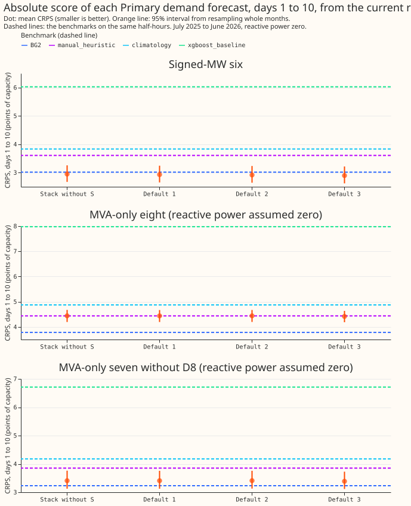

# Scoreboard for Primary demand

**On the current rows, Primary demand research default 3 scores 2.90 against BG2's 3.02 at the six
Primaries that report signed megawatts, and 4.42 against 3.78 at the eight that report apparent
power only.** Both scores are the mean continuous ranked probability score (CRPS) for forecasts 1 to
10 days ahead, in points of effective capacity, and smaller is better. The difference from BG2 is
-0.12 (-0.31 to +0.06) at the signed-MW six and +0.63 (+0.35 to +0.94) at the MVA-only eight (D8
included, with donor spread; 99% intervals). Without D8, the MVA-only gap is +0.16 (-0.02 to +0.35).
This page is descriptive: it adopts nothing, and an adoption is decided by the [evaluation
protocol](evaluation-protocol-demand.md) in an experiment.

BG2's score here differs from experiment 379's by up to 0.006 points (3.78 against 3.788 at the MVA-
only eight), because the shared half-hours differ slightly.

The page scores every stored forecast on one shared set of half-hours, so progress is read from one
table and never from a chain of contrasts on different rows. The script
`scripts/scoreboard_demand_rows.py` scores the stored forecasts and
`scripts/scoreboard_demand_page.py` rebuilds this page from them. Run both again whenever the
protocol version changes. No forecast is refitted.

## What is scored

**Rows.** Two shared sets of half-hours are scored, because the stored forecasts do not all reach
the same lead. Each row set holds the half-hours that every forecast in it covers, scored under the
protocol's fold regime `fold_a_daily_gap_v1` (292 daily runs, July 2025 to June 2026), at all 16
Primaries.

| Row set | Half-hours | Lead range | Forecasts |
|---|---|---|---|
| Leads to 240 hours | 2,041,640 | 0.5 to 240 hours | All eight forecasts in the first table, for days 1 to 10 and each lead band to day 10 |
| Leads to 336 hours | 2,824,844 | 0.5 to 336 hours | Stack without S, BG2, `manual_heuristic`, `climatology` (scored to 336 hours; the tables read only days 11 to 14 from this set) |

**Forecasts and where they are stored.** Every score is computed from the private forecast folders
below. Every forecast was stored under `demand-v1` and is rescored here with the metrics of
`studies.eval_protocol`. The floor check below is the per-Primary floor that `demand-v2` added.

| Forecast | Stored in | Lead range stored | Notes |
|---|---|---|---|
| Primary demand research default 1 | Experiment 378, `work/arms` (`default_1`) | To 240 hours | Two-number solar summary S below 168 hours, stack without S above |
| Primary demand research default 2 | Experiment 378, `work/arms` (`x1` columns) | To 240 hours | Default 1 with S extended to 240 hours. Rebuilt here from the stored columns, never scored before on these rows |
| Primary demand research default 3 | Experiment 378, `work/arms` (`d3` columns) | To 240 hours | Default 2 plus the heuristic blend on daylight half-hours above 168 hours |
| Stack without S | Experiment 377 (to 240 hours: through experiment 378's copy) | To 336 hours | No S at any lead |
| BG2 | Experiment 87, `predictions/p_s6_bg2` | To 351 hours | Production does not run BG2 |
| `manual_heuristic`, `climatology` | Experiment 87, `ref_*` | To 351 hours | The two fixed reference forecasts |
| `xgboost_baseline` | Experiment 87, `ref_xgboost_baseline` | To 240 hours scored here | The production-style XGBoost model |

**D8 appears in two ways.** In the leads-to-240-hours rows every forecast uses the donor spread at
D8, as experiment 378 did. In the leads-to-336-hours rows the stack without S uses D8's own-residual
spread, which is the protocol's D8 row. The two sets of rows therefore disagree about D8 for that
one forecast, so the days 11 to 14 cell of the stack without S in the MVA-only band table is not
like-for-like with the other cells of its row. Separately, every number for the MVA-only group
assumes reactive power is zero.

**Forecasts that cannot be put on the current rows.** No such forecast is mixed in. Each needs a
rerun before it can be added.

- Primary demand research default 1, 2, and 3 at days 11 to 14. The stored arms stop at 240 hours.
- Primary demand research default 3 at D8 with its own-residual spread. Experiment 378 scored D8
  with the donor spread only.
- Release candidates. The [model release log](https://openclimatefix.github.io/nged-substation-forecast/live_service/model-releases/)
  lists no numbered release yet, so there is no release-candidate row.
- Every score from before `demand-v1`. Those scores used six Primaries and a different scored year.

## Progress

## Days 1 to 10

**All forecasts, one table per group.** CRPS is the mean over the half-hours of the group. The
"Minus BG2" column is the paired difference from BG2 on the same half-hours, as a 99% interval from
20,000 resamples of whole months; the CRPS interval is 95% from 2,000 resamples. A negative
difference means the forecast beats BG2. The contrast is not shown for the benchmarks, which are not
candidates.

### Signed-MW six (D5, D9, D10, D11, D14, D16)

| Forecast | CRPS (95% interval) | MAE of the median | twCRPS | Minus BG2 (99% interval) |
|---|---|---|---|---|
| `climatology` | 3.83 (3.36 to 4.38) | 6.77 | 0.43 | – |
| `manual_heuristic` | 3.61 (3.16 to 4.14) | 6.30 | 0.41 | – |
| `xgboost_baseline` (production-style) | 6.03 (5.51 to 6.59) | 6.56 | 0.59 | – |
| BG2 | 3.02 (2.71 to 3.39) | 5.24 | 0.35 | reference |
| Stack without S | 2.95 (2.67 to 3.26) | 5.06 | 0.33 | -0.07 (-0.28 to +0.14) |
| Primary demand research default 1 | 2.93 (2.65 to 3.24) | 5.06 | 0.33 | -0.09 (-0.29 to +0.11) |
| Primary demand research default 2 | 2.92 (2.64 to 3.23) | 5.06 | 0.32 | -0.10 (-0.30 to +0.10) |
| Primary demand research default 3 | 2.90 (2.62 to 3.21) | 5.02 | 0.32 | -0.12 (-0.31 to +0.06) |

### MVA-only eight (D2, D3, D4, D8, D12, D19, D21, D22), reactive power assumed zero

| Forecast | CRPS (95% interval) | MAE of the median | twCRPS | Minus BG2 (99% interval) |
|---|---|---|---|---|
| `climatology` | 4.87 (4.56 to 5.17) | 8.79 | 0.24 | – |
| `manual_heuristic` | 4.44 (4.21 to 4.68) | 7.88 | 0.24 | – |
| `xgboost_baseline` (production-style) | 7.98 (7.46 to 8.44) | 8.58 | 0.32 | – |
| BG2 | 3.78 (3.60 to 3.97) | 6.75 | 0.19 | reference |
| Stack without S | 4.44 (4.20 to 4.67) | 7.20 | 0.21 | +0.66 (+0.36 to +0.98) |
| Primary demand research default 1 | 4.44 (4.20 to 4.67) | 7.20 | 0.21 | +0.66 (+0.36 to +0.98) |
| Primary demand research default 2 | 4.44 (4.20 to 4.67) | 7.20 | 0.21 | +0.66 (+0.36 to +0.98) |
| Primary demand research default 3 | 4.42 (4.18 to 4.64) | 7.17 | 0.21 | +0.63 (+0.35 to +0.94) |

### MVA-only seven without D8, reactive power assumed zero

| Forecast | CRPS (95% interval) | MAE of the median | twCRPS | Minus BG2 (99% interval) |
|---|---|---|---|---|
| `climatology` | 4.18 (3.79 to 4.57) | 7.39 | 0.27 | – |
| `manual_heuristic` | 3.85 (3.53 to 4.21) | 6.80 | 0.26 | – |
| `xgboost_baseline` (production-style) | 6.71 (6.11 to 7.35) | 7.27 | 0.36 | – |
| BG2 | 3.23 (3.02 to 3.47) | 5.72 | 0.22 | reference |
| Stack without S | 3.41 (3.13 to 3.76) | 5.95 | 0.22 | +0.18 (-0.01 to +0.39) |
| Primary demand research default 1 | 3.41 (3.13 to 3.76) | 5.95 | 0.22 | +0.18 (-0.01 to +0.39) |
| Primary demand research default 2 | 3.41 (3.13 to 3.76) | 5.95 | 0.22 | +0.18 (-0.01 to +0.39) |
| Primary demand research default 3 | 3.39 (3.12 to 3.73) | 5.91 | 0.22 | +0.16 (-0.02 to +0.35) |

### Short history (D15, D18), report only

| Forecast | CRPS (95% interval) | MAE of the median | twCRPS | Minus BG2 (99% interval) |
|---|---|---|---|---|
| `climatology` | 22.71 (17.70 to 25.48) | 35.94 | – | – |
| `manual_heuristic` | 11.43 (7.91 to 14.48) | 20.98 | – | – |
| `xgboost_baseline` (production-style) | 33.02 (26.24 to 37.54) | 33.92 | – | – |
| BG2 | 6.92 (4.43 to 8.85) | 12.42 | – | reference |
| Stack without S | 6.63 (4.35 to 8.08) | 11.07 | – | – |
| Primary demand research default 1 | 6.69 (4.37 to 8.16) | 11.08 | – | – |
| Primary demand research default 2 | 6.74 (4.39 to 8.22) | 11.08 | – | – |
| Primary demand research default 3 | 6.92 (4.37 to 8.55) | 11.30 | – | – |

## CRPS by lead band

**Each cell is the CRPS in points of effective capacity.** Days 1 to 10 are from the leads-
to-240-hours rows. Days 11 to 14 are from the leads-to-336-hours rows and cover four forecasts only.

### Signed-MW six

| Forecast | Day 1 | Day 2 | Days 3 to 4 | Days 5 to 7 | Days 8 to 10 | Days 11 to 14 |
|---|---|---|---|---|---|---|
| `climatology` | 3.84 | 3.84 | 3.82 | 3.83 | 3.83 | 3.86 |
| `manual_heuristic` | 3.60 | 3.60 | 3.57 | 3.58 | 3.66 | 3.71 |
| `xgboost_baseline` (production-style) | 5.95 | 5.96 | 5.97 | 5.95 | 6.19 | not on these rows |
| BG2 | 2.51 | 2.65 | 2.84 | 3.09 | 3.36 | 3.52 |
| Stack without S | 2.31 | 2.53 | 2.73 | 3.07 | 3.33 | 3.49 |
| Primary demand research default 1 | 2.29 | 2.51 | 2.71 | 3.04 | 3.33 | not on these rows |
| Primary demand research default 2 | 2.29 | 2.51 | 2.71 | 3.04 | 3.29 | not on these rows |
| Primary demand research default 3 | 2.29 | 2.51 | 2.71 | 3.04 | 3.22 | not on these rows |

### MVA-only eight, reactive power assumed zero

| Forecast | Day 1 | Day 2 | Days 3 to 4 | Days 5 to 7 | Days 8 to 10 | Days 11 to 14 |
|---|---|---|---|---|---|---|
| `climatology` | 4.88 | 4.87 | 4.86 | 4.88 | 4.88 | 4.82 |
| `manual_heuristic` | 4.41 | 4.41 | 4.39 | 4.41 | 4.52 | 4.47 |
| `xgboost_baseline` (production-style) | 7.95 | 7.93 | 7.94 | 7.88 | 8.13 | not on these rows |
| BG2 | 3.35 | 3.47 | 3.64 | 3.84 | 4.07 | 4.15 |
| Stack without S | 4.12 | 4.16 | 4.30 | 4.45 | 4.73 | 4.61 |
| Primary demand research default 1 | 4.11 | 4.15 | 4.30 | 4.45 | 4.73 | not on these rows |
| Primary demand research default 2 | 4.11 | 4.15 | 4.30 | 4.45 | 4.73 | not on these rows |
| Primary demand research default 3 | 4.11 | 4.15 | 4.30 | 4.45 | 4.65 | not on these rows |

### MVA-only seven without D8, reactive power assumed zero

| Forecast | Day 1 | Day 2 | Days 3 to 4 | Days 5 to 7 | Days 8 to 10 | Days 11 to 14 |
|---|---|---|---|---|---|---|
| `climatology` | 4.18 | 4.17 | 4.16 | 4.19 | 4.18 | 4.21 |
| `manual_heuristic` | 3.83 | 3.82 | 3.80 | 3.83 | 3.92 | 3.96 |
| `xgboost_baseline` (production-style) | 6.66 | 6.64 | 6.67 | 6.61 | 6.89 | not on these rows |
| BG2 | 2.77 | 2.90 | 3.07 | 3.29 | 3.54 | 3.68 |
| Stack without S | 3.10 | 3.17 | 3.30 | 3.42 | 3.66 | 3.81 |
| Primary demand research default 1 | 3.10 | 3.17 | 3.30 | 3.42 | 3.66 | not on these rows |
| Primary demand research default 2 | 3.10 | 3.17 | 3.30 | 3.42 | 3.66 | not on these rows |
| Primary demand research default 3 | 3.10 | 3.17 | 3.30 | 3.42 | 3.59 | not on these rows |

### Short history (D15, D18), report only

| Forecast | Day 1 | Day 2 | Days 3 to 4 | Days 5 to 7 | Days 8 to 10 | Days 11 to 14 |
|---|---|---|---|---|---|---|
| `climatology` | 22.36 | 22.39 | 22.90 | 22.63 | 22.89 | 22.40 |
| `manual_heuristic` | 10.91 | 10.93 | 11.27 | 11.06 | 12.27 | 11.82 |
| `xgboost_baseline` (production-style) | 33.16 | 32.82 | 33.50 | 32.41 | 33.34 | not on these rows |
| BG2 | 5.71 | 6.21 | 6.68 | 7.11 | 7.57 | 7.65 |
| Stack without S | 5.12 | 5.79 | 6.32 | 6.91 | 7.38 | 7.50 |
| Primary demand research default 1 | 5.13 | 5.83 | 6.42 | 7.04 | 7.38 | not on these rows |
| Primary demand research default 2 | 5.13 | 5.83 | 6.42 | 7.04 | 7.55 | not on these rows |
| Primary demand research default 3 | 5.13 | 5.83 | 6.42 | 7.04 | 8.15 | not on these rows |

## Floor check of the evaluation protocol

**The floor asks for two things at each of the 14 signed-MW and MVA-only Primaries.** The CRPS over
days 1 to 10 must not exceed the CRPS of `manual_heuristic`, and must stay within 1.10 times the
CRPS of BG2. The check below uses point estimates, as the protocol does. D8 is judged with the donor
spread, which is the weaker arm, so its row is stricter than the protocol's.

| Forecast | Primaries above 1.10 times BG2 | Worst ratio to BG2 | Primaries worse than `manual_heuristic` | Worst difference from `manual_heuristic` |
|---|---|---|---|---|
| Stack without S | 2 of 14 | 1.53 (D8) | 1 of 14 | +3.12 (D8) |
| Primary demand research default 1 | 2 of 14 | 1.52 (D8) | 1 of 14 | +3.11 (D8) |
| Primary demand research default 2 | 2 of 14 | 1.52 (D8) | 1 of 14 | +3.11 (D8) |
| Primary demand research default 3 | 2 of 14 | 1.52 (D8) | 1 of 14 | +3.07 (D8) |

The same check for Primary demand research default 3, at each Primary:

| Primary | Group | BG2 | `manual_heuristic` | Default 3 | Ratio to BG2 | Minus `manual_heuristic` |
|---|---|---|---|---|---|---|
| D2 | MVA-only | 2.30 | 2.86 | 2.46 | 1.07 | -0.40 |
| D3 | MVA-only | 1.75 | 2.11 | 1.66 | 0.95 | -0.45 |
| D4 | MVA-only | 2.51 | 2.80 | 2.43 | 0.97 | -0.38 |
| D8 | MVA-only | 7.64 | 8.54 | 11.61 | 1.52 **above 1.10** | +3.07 **worse** |
| D12 | MVA-only | 6.75 | 7.92 | 7.47 | 1.11 **above 1.10** | -0.46 |
| D19 | MVA-only | 3.18 | 3.79 | 3.28 | 1.03 | -0.51 |
| D21 | MVA-only | 2.38 | 2.77 | 2.34 | 0.99 | -0.42 |
| D22 | MVA-only | 3.75 | 4.71 | 4.08 | 1.09 | -0.63 |
| D5 | signed-MW | 3.94 | 4.35 | 3.99 | 1.01 | -0.36 |
| D9 | signed-MW | 2.51 | 2.92 | 2.45 | 0.98 | -0.47 |
| D10 | signed-MW | 3.45 | 4.16 | 3.21 | 0.93 | -0.94 |
| D11 | signed-MW | 2.57 | 3.41 | 2.41 | 0.94 | -1.00 |
| D14 | signed-MW | 2.39 | 3.01 | 2.18 | 0.91 | -0.83 |
| D16 | signed-MW | 3.24 | 3.80 | 3.15 | 0.97 | -0.66 |

## CRPS at every Primary, days 1 to 10

**One row per Primary, from the leads-to-240-hours rows.**

| Primary | Group | `climatology` | `manual_heuristic` | `xgboost_baseline` (production-style) | BG2 | Stack without S | Primary demand research default 1 | Primary demand research default 2 | Primary demand research default 3 |
|---|---|---|---|---|---|---|---|---|---|
| D2 | MVA-only | 2.93 | 2.86 | 4.64 | 2.30 | 2.47 | 2.47 | 2.48 | 2.46 |
| D3 | MVA-only | 2.33 | 2.11 | 3.60 | 1.75 | 1.67 | 1.67 | 1.67 | 1.66 |
| D4 | MVA-only | 2.83 | 2.80 | 4.34 | 2.51 | 2.45 | 2.45 | 2.45 | 2.43 |
| D8 | MVA-only | 9.76 | 8.54 | 16.85 | 7.64 | 11.66 | 11.65 | 11.65 | 11.61 |
| D12 | MVA-only | 8.83 | 7.92 | 14.90 | 6.75 | 7.52 | 7.52 | 7.52 | 7.47 |
| D19 | MVA-only | 3.93 | 3.79 | 5.90 | 3.18 | 3.29 | 3.29 | 3.30 | 3.28 |
| D21 | MVA-only | 2.91 | 2.77 | 4.60 | 2.38 | 2.35 | 2.35 | 2.35 | 2.34 |
| D22 | MVA-only | 5.47 | 4.71 | 9.00 | 3.75 | 4.10 | 4.10 | 4.11 | 4.08 |
| D15 | short-history | 46.20 | 22.59 | 62.90 | 13.35 | 12.85 | 13.05 | 13.21 | 13.67 |
| D18 | short-history | 7.11 | 4.02 | 13.18 | 2.65 | 2.50 | 2.47 | 2.45 | 2.44 |
| D5 | signed-MW | 4.48 | 4.35 | 7.51 | 3.94 | 4.08 | 4.04 | 4.02 | 3.99 |
| D9 | signed-MW | 2.99 | 2.92 | 4.94 | 2.51 | 2.51 | 2.50 | 2.49 | 2.45 |
| D10 | signed-MW | 4.31 | 4.16 | 7.57 | 3.45 | 3.27 | 3.25 | 3.23 | 3.21 |
| D11 | signed-MW | 3.55 | 3.41 | 5.36 | 2.57 | 2.43 | 2.42 | 2.42 | 2.41 |
| D14 | signed-MW | 3.47 | 3.01 | 5.05 | 2.39 | 2.21 | 2.20 | 2.19 | 2.18 |
| D16 | signed-MW | 4.20 | 3.80 | 5.75 | 3.24 | 3.20 | 3.18 | 3.17 | 3.15 |
