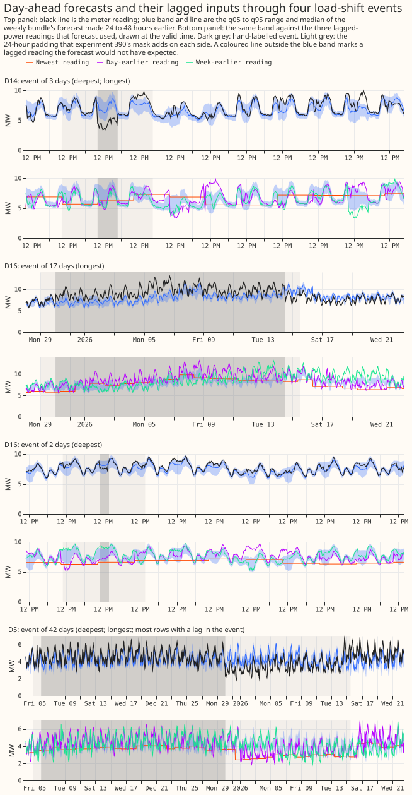
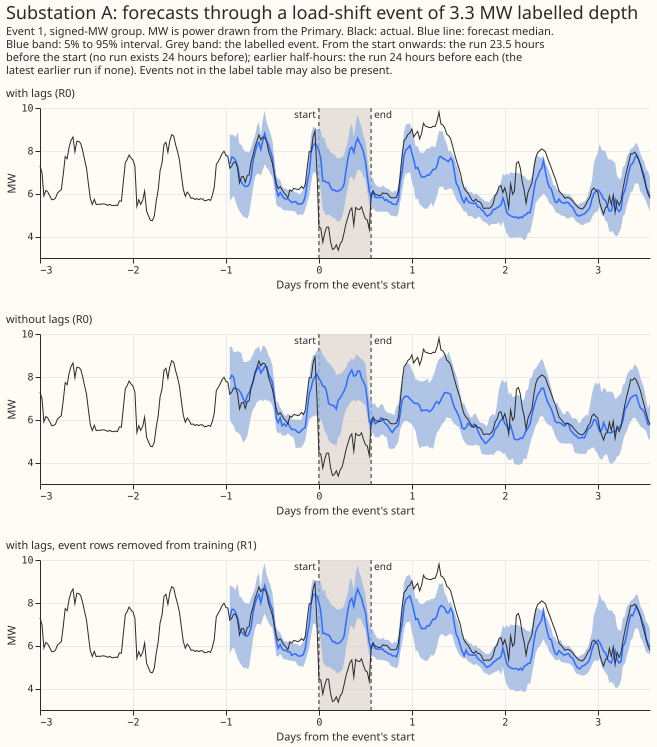
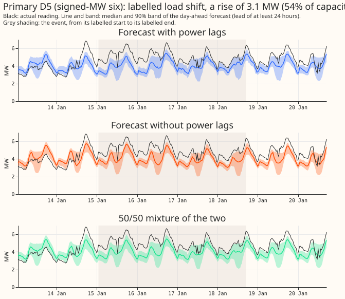
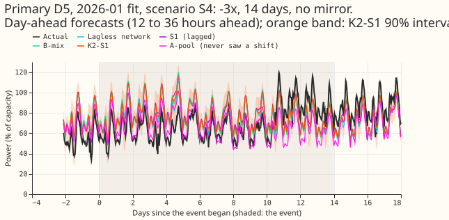
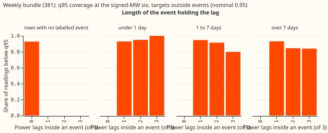
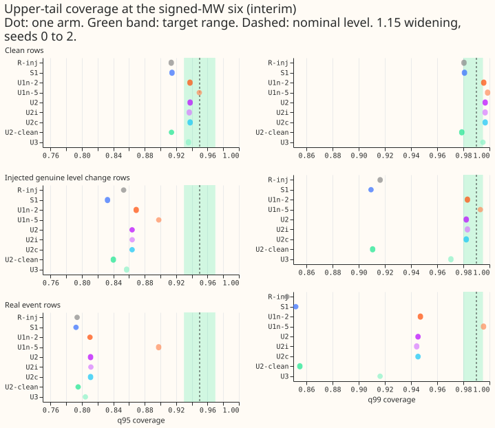
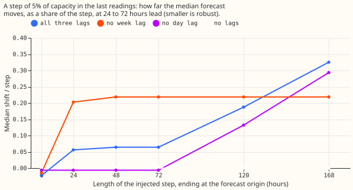
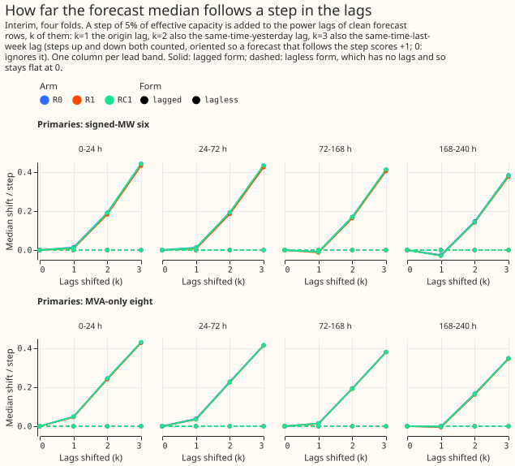
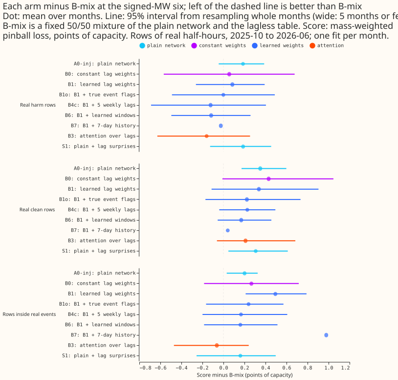
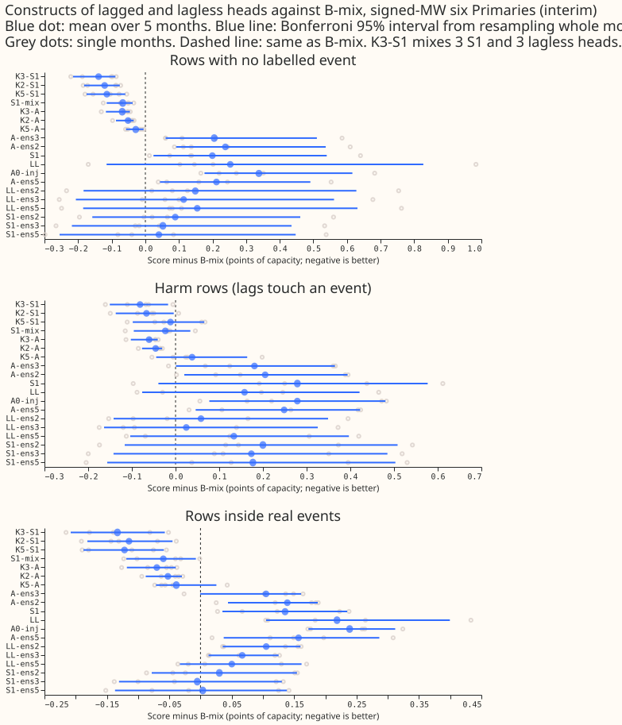

# Summary of what the experiments found about load-shift events

**For the net demand forecast, the experiments found no design that both ignores a load-shift event
in the recent power readings and loses no accuracy on rows with no labelled event.** The best robust
option tried is a fixed 50/50 mixture of a forecast that reads the recent power readings and a
forecast that does not. No learned weight, event detector, or training mask beat that mixture inside
real events. Mixing in more neural networks with extra inputs scored better on rows with no labelled
event, but only one six-network mixture (K3-A, [experiment
454](../../00454-lag-trust-mixture-and-ensemble-constructs-for-lagged-and-lagless-heads/result.md))
did so inside real events scored against actuals corrected to the normal running arrangement (NRA).
The real events are too few to settle several of the questions. This page collects the answers to
the maintainer's ten questions from 38 merged experiments, with the numbers and intervals of the
merged pages. The page says "Not measured" where no merged page answers a question. The page is
written from the merged result pages only, and no fit, score, or figure on it is new.

**The page has four parts.** Part 1 shows what the data and the events look like. Part 2 answers the
ten questions. Part 3 is a table of every experiment with its verdict and headline number. Part 4
says what the findings mean for the forecast and lists the decisions that remain open.

## Part 1: What the data looks like

**A load-shift event is a period in which National Grid Electricity Distribution (NGED) moves load
from one Primary substation to its neighbours, so the Primary's recent power does not show its
normal demand.** A Primary is a primary substation. The NRA is the way NGED's electricity network is
usually run. An alternative running arrangement (ARA) is any other arrangement, for example a
transfer of load between Primaries. A forecast that stays at the NRA level while a transfer is under
way is an NRA forecast. The forecasts on this page read three recent power readings of the Primary,
called lags: the newest usable reading, the reading at the same time on an earlier day, and the
reading at the same time and weekday in an earlier week (the exact days are given on each
experiment's page).

**NGED's event labels are incomplete, so every count and every score on this page is affected.**
NGED's table of hand-labelled events, as corrected by the experiments, holds 133 events, of which
112 are usable because they have an end time and a depth ([experiment
402](../../00402-lag-gate-learned-weight-injected-load-shifts-part-1/result.md), [experiment
400](../../00400-lagged-lagless-forecast-blend-around-load-shifts-stored/result.md)). [Experiment
392](../../00392-xgboost-nra-load-shift-masked-targets/result.md) left 66 hand-labelled events out
of its training targets, and [experiment
395](../../00395-xgboost-level-state-winter-spread-anchor-stored-forecasts/result.md) scored 184
merged hand-labelled intervals from an earlier version of the table. NGED's logs miss some events,
so a row with no labelled event may hold an event nobody logged, and each count of events is a lower
bound. Beside every score on such rows this page writes "rows with no labelled event".

**The experiments score 16 Primaries in three groups.** The signed-MW six (D5, D9, D10, D11, D14,
and D16) are metered in signed megawatts. The MVA-only eight (D2, D3, D4, D8, D12, D19, D21, and
D22) are metered in unsigned megavolt-amperes. D15 and D18 have under a year of history and are not
scored on this page. The two metering groups are never pooled.

The first figure shows day-ahead forecasts through four real events. The event masks are shaded.

**Figure 1. Day-ahead XGBoost forecasts through four labelled events, with the labelled event
shaded.** Source: [experiment
395](../../00395-xgboost-level-state-winter-spread-anchor-stored-forecasts/result.md), Part G, which
redraws the event fans of [experiment
390](../../00390-xgboost-d11-d14-gap-and-load-shift-event-lags/result.md) with the event masks
shaded.

The second figure shows one real event with the forecasts that [experiment
392](../../00392-xgboost-nra-load-shift-masked-targets/result.md) compared. Experiment 392's page
draws six real events, three at each metering group, chosen by a rule fixed before the scores were
read.

**Figure 2. One real labelled event: the actuals, the median, and the 5% to 95% band of the unmasked
lagged, unmasked lagless, and masked lagged XGBoost forecasts, from the forecast origin one day
before the onset.** Source: [experiment
392](../../00392-xgboost-nra-load-shift-masked-targets/result.md).

The third figure shows a real event at Primary D5 with the forecast that reads the power lags and
the forecast that does not.

**Figure 3. A real event at Primary D5, one of the signed-MW six, with the forecast that reads the
power lags and the forecast that does not.** Source: [experiment
401](../../00401-real-and-synthetic-load-shift-median-share-and-fixed-forecast-mixture/result.md),
which draws six real events at both metering groups.

The fourth figure shows an injected event. An injected event is a synthetic load shift added to the
recent power readings of a series, so that the truth is known.

**Figure 4. Primary D5 in scenario 4 of experiment 482: a shift of minus 3 lag spreads (a lag spread
is the standard deviation of the Primary's 24-hour change in power) lasting 14 days, with no
neighbour showing the opposite change, shaded, with the forecasts of five stored demand neural
networks.** Source: [experiment
482](../../00482-best-models-performance-analysis-injected-shifts-and-wind-references/result.md).

## Part 2: The answers to the ten questions

**The maintainer's framing applies to every answer.** No forecast can predict a load-shift event. A
forecast that stays at the NRA level while an event is under way is therefore the forecast NGED
wants. Coverage of the actual reading inside an event is not a test of an NRA forecast, because the
actual reading is at the ARA level. The aim is a better, more explainable, or more robust net demand
forecast, and not recovery of the hidden event.

**Terms used in the answers.**

- **CRPS** is the continuous ranked probability score, in points of effective capacity (percentage
  points of a Primary's effective capacity). Lower is better.
- **Lagless forecast** is a forecast that reads none of the recent power readings.
- **Harm row** is a row whose target lies outside every event but whose lags lie inside one.
- **q95 coverage** is the share of readings at or below the forecast's 95% quantile. The calibrated
  value is 0.95.
- **Share of a step followed** is the shift of the median forecast divided by the size of a step
  added to the lags. A step of 5% of capacity is the usual size. Some pages call it the leak: the
  share of a lag step that reaches the median forecast. **k** is the number of lags that carry the
  step.
- **Minimum detectable effect** is the smallest difference that the design can tell from
  seed-to-seed noise.
- **99.29% interval** is a 95% interval widened for the 7 contrasts that one experiment makes at
  once (a Bonferroni correction).
- **Weekly bundle** is the XGBoost model of experiment 381, refitted weekly with a solar summary, a
  sunny flag, and a 1-year half-life. The **plain weekly member** is the weekly XGBoost member of
  experiment 87. The **monthly control** is experiment 381's monthly-refitted XGBoost model.
- **GAM stack** is the generalised additive model pipeline with a Kalman filter of experiment 377.
  **BG2** is the best-guess stack of five demand models of experiment 87.
- **A0-inj** and **R-inj** are the neural networks that read the three lags and are trained on clean
  and injected power. **A-pool** is the pooled neural network that never saw an injected shift.
- **B1, B3, and B6** are the learned trust weights of experiment 404: learned lag weights, attention
  over the lags, and learned windows. **R1** is the XGBoost model trained with the labelled events
  removed from its targets. **U1n-2** is S1 trained on worlds in which 2% of training rows hold a
  lasting level change. **S3-amb** is a neural network that also reads the surprise at neighbouring
  Primaries.
- **S1** is a neural network that reads the three lags plus the surprise at each lag. The surprise
  at a lag is the lag minus the median of the lagless forecast, divided by half the width of the
  lagless forecast's 5% to 95% band.
- **B-mix** is a fixed 50/50 mixture of the probability distributions of a neural network that reads
  the lags and the lagless forecast. **K2-S1** is an equal-weight mixture of two S1 networks and two
  lagless forecasts.
- **Status** says whether a page is interim (few months scored, no 99% claim) or audited (a fresh
  Claude Sonnet agent re-derived the headline numbers independently). Part 3 gives the status of
  every page.

### Question 1: Does an ARA period in the lagged-power inputs affect the tails of the forecast?

**Probably yes for the XGBoost forecasts: with a lag inside an event, q95 coverage falls from about
0.93 to between 0.75 and 0.85 and the band does not widen, but the interval of the matching CRPS
harm only just excludes zero.** The neural networks trained on injected events keep near-calibrated
tails on real harm rows.

- **All 16 Primaries, weekly XGBoost bundle.** On rows with an event lag, q95 coverage is 0.749 for
  the bundle, 0.772 for the plain weekly member, and 0.845 for the GAM stack. On rows with no lag in
  an event it is 0.931, 0.945, and 0.945. The bundle's 90% band is narrower on event-lag rows (22.1
  points, against 24.5). Rows whose target also lies inside an event drive the failure: their q95
  coverage is 0.566, against 0.855 for harm rows ([experiment
  390](../../00390-xgboost-d11-d14-gap-and-load-shift-event-lags/result.md), audited).
- **Signed-MW six, harm rows with all three lags inside an event.** q95 coverage is 0.831 for the
  bundle, 0.818 for the monthly control, and 0.840 for the GAM stack, against 0.928 for the bundle
  with lags outside events. The bundle's CRPS rises by 1.03 points (95% interval +0.05 to +2.32, 34
  events). The interval is fragile: matching the baseline on Primary, month, and lead band gives
  +1.06 (-0.05 to +2.48) ([experiment
  395](../../00395-xgboost-level-state-winter-spread-anchor-stored-forecasts/result.md), no audit
  recorded).
- **Signed-MW six, share of readings inside the 5% to 95% band.** The band should hold 0.90 of the
  readings. On rows with a contaminated lag it held 0.705 for the plain weekly member. A fixed
  widening raised that to 0.774, and a widening factor fitted on earlier months raised it to 0.883
  but sat at its cap of 2 in most months, which doubles the band ([experiment
  383](../../00383-load-shift-xgboost-oracle-first-part-1/result.md), audited).
- **Neural networks.** On real harm rows S1 has q95 coverage 0.927 and q99 coverage 0.972, and the
  network without the surprise has 0.927 and 0.975 ([experiment
  439](../../00439-surprise-at-the-lags-confirmation-on-seeds-three-to-five/result.md), interim,
  signed-MW six). The pooled network that never saw an injected shift (A-pool) covers 72% of actuals
  with its q95 in the worst of eight injected scenarios ([experiment
  482](../../00482-best-models-performance-analysis-injected-shifts-and-wind-references/result.md),
  interim and unaudited).

Scope: the XGBoost figures use hand-labelled events (most of the failure in [experiment
390](../../00390-xgboost-d11-d14-gap-and-load-shift-event-lags/result.md) comes from five of the
Primaries). The harm interval of [experiment
395](../../00395-xgboost-level-state-winter-spread-anchor-stored-forecasts/result.md) is the less
certain figure. Part 3 lists the other pages.

**Figure 5. q95 coverage of the weekly XGBoost bundle for targets outside events, by the length of
the event that holds a lag, at the signed-MW six.** Source: [experiment
478](../../00478-load-shift-unpadded-curtailment-cost-and-after-event-slices/result.md).

### Question 2: With clean lags, do the forecast tails hold both the ARA and the NRA level (if trained on both)?

**No: when the lags lie outside an event and the target lies inside one, the XGBoost bands hold the
event-level reading about 70% of the time, against the 90% they are meant to hold.** Training a
neural network on lasting level changes widens the upper tail where a jump is ambiguous, and lowers
accuracy on rows with no labelled event.

- **Forecasts issued before an event starts.** Across 19 events with all three lags outside an
  event, readings inside the event fall inside the 5% to 95% band 70% of the time for the weekly
  bundle (interval 59% to 81%) and 73% for the GAM stack. The bundle puts 1.6% of readings below its
  q01 and 7.3% above its q99, against the calibrated 1% each ([experiment
  390](../../00390-xgboost-d11-d14-gap-and-load-shift-event-lags/result.md), audited).
- **Synthetic step with all lags unshifted (k = 0).** The event-level reading lies inside the 90%
  band on 0.681 of rows, against 0.875 for the unshifted reading, and the q95 reaches the event
  level on 0.701 of rows. At k = 3 the figures are 0.784 and 0.812 ([experiment
  395](../../00395-xgboost-level-state-winter-spread-anchor-stored-forecasts/result.md) Part E,
  XGBoost boosters of [experiment 391](../../00391-xgboost-lag-surprise-second-stage/result.md), no
  audit recorded).
- **Trained on both levels (neural network).** Training the S1 network on worlds in which 2% of
  training rows hold a lasting level change that does not return (U1n-2) raised q99 coverage on
  injected level-change rows from 0.909 to 0.983, and on real event rows from 0.852 to 0.947. The
  same training raised q99 coverage on rows with no labelled event from 0.981 to 0.996, above the
  target range of 0.98 to 0.995, and raised CRPS there by 0.076 points. The 95% interval is 0.063 to
  0.090, and the pre-registered limit was 0.03 ([experiment
  446](../../00446-honest-bands-and-tail-calibration-on-the-s1-network/result.md), interim and
  unaudited).

Scope: a lasting level change that does not return is not an ARA period that ends, so [experiment
446](../../00446-honest-bands-and-tail-calibration-on-the-s1-network/result.md) is the nearest test
and not an exact one. No merged page trained a forecast on both running arrangements labelled as
such and then scored its tails around real ARA periods.

**Figure 6. Upper-tail coverage of the networks of experiment 446 against the target bands.**
Source: [experiment 446](../../00446-honest-bands-and-tail-calibration-on-the-s1-network/result.md).

### Question 3: Do the answers depend on the length and depth of the ARA period?

**Yes for how far the median follows the lags in most arms: longer events leak more, and the arm
without the week lag stays flat at 0.20 to 0.22. The real events are too few to rank harm by length
or depth.**

- **Length of the step (XGBoost, readings-level sweep).** For a step of 5% of capacity, 24 to 72
  hour leads, two Primaries and two refit dates, the share followed with all three lags is 0.06 for
  a step of 24 hours or 3 days, 0.19 at 5 days, and 0.33 at 7 days. Without the day lag it is -0.01,
  -0.01, 0.13, and 0.29. Without the week lag it is 0.20, 0.22, 0.22, and 0.22 ([experiment
  502](../../00502-leave-one-lag-out-power-lag-ablation-xgboost-demand/result.md), interim and
  unaudited).
- **Median lags.** Replacing the day and week lags by medians lowers the share followed at the
  signed-MW six from 0.171, 0.192, and 0.192 to 0.081, 0.109, and 0.153 for events of 24, 48, and 72
  hours. At 5 and 7 days the shares are 0.289 and 0.384, against 0.308 and 0.427 ([experiment
  465](../../00465-median-day-and-week-lags-for-load-shift-robustness/result.md), interim and
  unaudited).
- **Real events, harm by length.** The bundle's harm is +0.46 for events under 1 day (19 events) and
  +0.16 for events of 1 to 7 days (11 events), and neither interval excludes zero. Only 4 events at
  the signed-MW six last longer than 7 days and 4 fall in the third depth quartile, so the report
  prints no interval for those slices ([experiment
  478](../../00478-load-shift-unpadded-curtailment-cost-and-after-event-slices/result.md), no audit
  recorded). Depth quartiles of [experiment
  390](../../00390-xgboost-d11-d14-gap-and-load-shift-event-lags/result.md) show no steady depth
  effect (q95 coverage 0.902, 0.574, 0.931, and 0.707 for the shallowest to the deepest quartile).
- **Injected scenarios (neural networks).** The eight scenarios vary the shift (1, 2, or 3 lag
  spreads, positive or negative), the duration (1, 3, or 14 days), and whether a neighbour mirrors
  the shift. A-pool lost most in the largest, longest, unmirrored negative shift (scenario 4, 8.08
  against 5.62 for the lagless network). K2-S1 was no worse than the lagless network in any scenario
  by more than its interval ([experiment
  482](../../00482-best-models-performance-analysis-injected-shifts-and-wind-references/result.md),
  interim and unaudited).

**Figure 7. Share of a 5%-of-capacity step that reaches the XGBoost median, by the length of the
injected step, for arms that drop one lag.** Source: [experiment
502](../../00502-leave-one-lag-out-power-lag-ablation-xgboost-demand/result.md).

### Question 4: Does the median deviate when an ARA of a given length or depth is in the lags?

**Yes for XGBoost: with all three lags inside a synthetic step of 5% of capacity, the median moves
by about 40% of the step. Networks trained on injected events move by 1% to 12%.** Real events move
the median far less than synthetic steps do.

- **XGBoost, synthetic steps.** The median of every lagged arm moves by about 40% of the step with
  all three lags shifted, with or without the labelled events masked out of training (38% to 41%,
  [experiment 392](../../00392-xgboost-nra-load-shift-masked-targets/result.md)). For the baseline
  of [experiment 388](../../00388-xgboost-lagged-power-column-sets-weekly-demand/result.md) the
  shares are 0.04, 0.20, and 0.39 when the newest lag, the two newest, and all three lags are
  shifted. In [experiment
  395](../../00395-xgboost-level-state-winter-spread-anchor-stored-forecasts/result.md) Part E, k =
  1, 2, and 3 lags move the median by 1.3%, 17.3%, and 36.8% of the step.
- **XGBoost, real events.** The share of a labelled step that the median reaches (0.94 with 3 lags
  inside the event) is mostly not a response to the lags: a forecast with no lags reaches 0.95. The
  forecast with lags moves its median by 0.032 (-0.001 to 0.053) of the step more than the forecast
  without lags, against 0.338 (0.299 to 0.375) in synthetic steps ([experiment
  401](../../00401-real-and-synthetic-load-shift-median-share-and-fixed-forecast-mixture/result.md),
  audited). The measured step in the telemetry is 0.62 of the labelled step. Of the 16 events with
  three lags inside, 11 last over 7 days, so a forecast trained over those events has absorbed them.
- **Neural networks.** At three lags and leads under 48 hours, the median follows 0.100 of the step
  for the reference network (A0-inj), 0.224 when 5% of training rows hold an injected event, and
  0.058 when 50% do ([experiment
  486](../../00486-lagged-network-injection-rate-and-schedule/result.md), interim). In eight
  injected scenarios, K2-S1 moved by 1% to 6%, B-mix by 1% to 4%, S1 by 3% to 12%, A-pool by 8% to
  25%, and the lagless network by 0 ([experiment
  482](../../00482-best-models-performance-analysis-injected-shifts-and-wind-references/result.md)).

Scope: the sweep adds steps to lags, which is a stronger and cleaner signal than most real events
([experiment
401](../../00401-real-and-synthetic-load-shift-median-share-and-fixed-forecast-mixture/result.md)).

### Question 5: What does the current model do during and after real and synthetic injected events (plots)?

**The plots are Figures 1 to 4 above, with the findings of the pages that draw them.**

- **Real events, XGBoost.** Figure 1 and [experiment
  390](../../00390-xgboost-d11-d14-gap-and-load-shift-event-lags/result.md) show day-ahead fans
  through events. The upper tail fails most in the middle of a long event: q95 coverage is 0.777 in
  the first 24 hours (15 events) and 0.646 from 24 hours after the onset to the end (11 events), and
  recovers to 0.885 in the 7 days after the end (19 events) ([experiment
  390](../../00390-xgboost-d11-d14-gap-and-load-shift-event-lags/result.md)).
- **Real events, after the end.** A lag inside an event raises the error after the event ends. At
  the signed-MW six, for the weekly bundle, targets 0 to 24 hours after the end score 1.66 CRPS
  points worse, and the interval spans zero (-0.06 to +3.69). Targets 3 to 7 days after score 1.05
  worse, and the interval excludes zero (+0.04 to +2.36) ([experiment
  478](../../00478-load-shift-unpadded-curtailment-cost-and-after-event-slices/result.md)).
- **Real events, networks.** [Experiment
  482](../../00482-best-models-performance-analysis-injected-shifts-and-wind-references/result.md)
  draws real events with the NRA actual restored, the three lags, and the surprise. The largest
  absolute surprise on a lag inside an event is 22, 35, 31, 36, 11, and 21 points of capacity at the
  six labelled events.
- **Synthetic injected events.** Figure 4 and the other five scenario fans of [experiment
  482](../../00482-best-models-performance-analysis-injected-shifts-and-wind-references/result.md)
  show the median of A-pool sitting below the others throughout scenario 4, while the other four
  medians stay near the unshifted actual.
- **More real-event plots.** [Experiment
  404](../../00404-mdn-lagless-and-calibration-module-trust-weights/result.md) draws six,
  [experiment
  428](../../00428-day-window-convolution-attention-encoder-replacing-lagged-power-inputs/result.md)
  draws one figure of forecasts made the day before six events, and [experiment
  454](../../00454-lag-trust-mixture-and-ensemble-constructs-for-lagged-and-lagless-heads/result.md)
  and [experiment 486](../../00486-lagged-network-injection-rate-and-schedule/result.md) draw six
  each.

### Question 6: Lag-encroachment sweep: as a synthetic event reaches back over the most recent lag, then the two most recent, then all, does the median follow the event level or stay NRA, does the band widen, and where does the probability mass sit?

**The sweep adds a synthetic step to the lags, newest first. The median follows more of the step as
more lags shift (XGBoost: 0.04, 0.20, and 0.39 of the step for one, two, and three lags), and the
band does not widen.**

- **Median.** XGBoost: 0.04, 0.20, 0.39 of the step for 1, 2, 3 lags ([experiment
  388](../../00388-xgboost-lagged-power-column-sets-weekly-demand/result.md)); 1.3%, 17.3%, 36.8% in
  [experiment 395](../../00395-xgboost-level-state-winter-spread-anchor-stored-forecasts/result.md).
  Neural networks: R-inj follows 0.125 of the step at k = 3. At k = 2, S1 follows 0.141 against
  0.055 for R-inj ([experiment
  428](../../00428-day-window-convolution-attention-encoder-replacing-lagged-power-inputs/result.md),
  interim). Dropping all lags gives exactly 0 in [experiment
  392](../../00392-xgboost-nra-load-shift-masked-targets/result.md), [experiment
  502](../../00502-leave-one-lag-out-power-lag-ablation-xgboost-demand/result.md), and the
  lag-masked control of [experiment
  428](../../00428-day-window-convolution-attention-encoder-replacing-lagged-power-inputs/result.md).
- **Band.** The 1% to 99% band stays within 3% of its width without the step for a step of up to 5%
  of capacity ([experiment
  388](../../00388-xgboost-lagged-power-column-sets-weekly-demand/result.md)); the 90% band is
  1.005, 1.009, and 1.008 times as wide ([experiment
  395](../../00395-xgboost-level-state-winter-spread-anchor-stored-forecasts/result.md)); the width
  ratio stays within 1.006 for every network arm of [experiment
  486](../../00486-lagged-network-injection-rate-and-schedule/result.md).
- **Where the mass sits.** At a step of 5% the step level lies inside the 1% to 99% band in 93% to
  100% of rows, and the 95% quantile reaches it in 70% to 100% of rows ([experiment
  388](../../00388-xgboost-lagged-power-column-sets-weekly-demand/result.md)). The reading at the
  event level lies inside the 90% band on 0.681 of rows at k = 0 and 0.784 at k = 3 ([experiment
  395](../../00395-xgboost-level-state-winter-spread-anchor-stored-forecasts/result.md)). The pages
  report coverage of the event level and of the unshifted reading only. No merged page reports where
  the quantiles of the forecast sit between the NRA level and the ARA level.
- **Mitigations tried.** The sweep share falls with a higher share of injected events in training
  (Question 10). A convolutional network over whole days followed the same 0.125 as the three lags
  ([experiment
  428](../../00428-day-window-convolution-attention-encoder-replacing-lagged-power-inputs/result.md)).
  Median day and week lags and gap training are in Questions 3 and 4 and Part 3.

**Figure 8. Share of a 5%-of-capacity step that the median of each XGBoost arm follows, by the
number of lags shifted (k) and the lead band, at the signed-MW six.** Source: [experiment
392](../../00392-xgboost-nra-load-shift-masked-targets/result.md).

### Question 7: Does giving XGBoost the "surprise" of each lagged input, at its own Primary and its neighbours, give it the benefit of an explicit detector?

**No for XGBoost, where the surprise columns made the forecast worse. For the neural network the
surprise lowers the error on rows with no labelled event, and a mixture rule given an exact event
flag did not beat the 50/50 mixture.**

- **XGBoost.** Adding own and neighbour surprise raised CRPS on rows whose lags lie inside a
  labelled event by +0.110 points (99.29% interval -0.249 to +0.432) and on rows outside events by
  +0.072 (+0.006 to +0.145), against seed noise of +0.024 and +0.001. The oracle with hand labels
  was also worse than the control, by +0.218. The detector failed its own pre-registered check
  (recall 0.42 against 0.55) and found 0 of 7 labelled transfers at its tuned threshold, so the
  detector arms were not fitted ([experiment
  391](../../00391-xgboost-lag-surprise-second-stage/result.md), audited).
- **A learned blend.** The surprise scores did not help a blend of the forecasts with and without
  lags decide when to trust the lags. The fitted weight on the forecast with lags was 0.61 with
  three lags in an event and 0.62 with none ([experiment
  400](../../00400-lagged-lagless-forecast-blend-around-load-shifts-stored/result.md), no audit
  recorded).
- **Neural network.** S1 scored 0.083 (0.070 to 0.096) lower than the network without the surprise
  on rows with no labelled event, and 0.106 (0.091 to 0.121) lower on three new seeds, against a
  minimum detectable effect of 0.061 ([experiment
  428](../../00428-day-window-convolution-attention-encoder-replacing-lagged-power-inputs/result.md),
  audited; [experiment
  439](../../00439-surprise-at-the-lags-confirmation-on-seeds-three-to-five/result.md), interim). On
  real harm rows the gain is -0.007 (-0.035 to +0.024), and S1 follows more of a step than the
  network without the surprise ([experiment
  428](../../00428-day-window-convolution-attention-encoder-replacing-lagged-power-inputs/result.md)).
- **An explicit detector.** A mixture given an exact flag of which lags lie inside an event scored
  0.465 points (0.198 to 0.644) worse than the fixed 50/50 mixture inside real events at the
  signed-MW six ([experiment
  445](../../00445-flag-oracle-o-rule-ceiling-for-lag-event-detectors/result.md), interim and
  unaudited). Scored against NRA actuals, the gap shrinks from 0.38 to 0.17 and stays above zero
  ([experiment
  455](../../00455-nra-corrected-rescore-of-lag-trust-flag-oracle-and-lagless-arms/result.md),
  interim and unaudited). In that test, a mixture rule given an exact event flag did not beat the
  50/50 mixture.
- **Neighbours.** A neural network that sees neighbouring Primaries (S3-amb) did not follow a level
  change with no mirror any better than the same network given random neighbours. The result is
  inconclusive by design, because a perfect forecaster would follow only 0.05 to 0.08 more of such a
  step ([experiment 462](../../00462-lag-trust-mirrored-genuine-level-change-worlds/result.md),
  interim).

Scope: the surprise gain on rows with no labelled event may only make up for a weakness in the
reference network, because the pretrained neural network of experiment 425, which has no surprise
inputs, scores level with S1 ([experiment
448](../../00448-s1-network-assembly-ladder-with-pretraining-b-mix-and-seed-pool/result.md)).

### Question 8: Can an NRA forecast be made by training XGBoost with events removed from the training targets?

**No: removing the labelled events from the training targets left the median following the lags as
much as before.**

- The XGBoost model trained with the labelled events masked out (R1) scored 4.233 CRPS points
  outside events and the 48 hours after them, against 4.214 for the unmasked XGBoost model and 4.235
  for a control that dropped the same number of half-hours in random blocks. With all three lags
  inside a synthetic step, the median moved by 38% to 41% of the step in every lagged arm
  ([experiment 392](../../00392-xgboost-nra-load-shift-masked-targets/result.md), interim, four
  monthly folds).
- Only dropping the lags gives an NRA forecast, and in [experiment
  392](../../00392-xgboost-nra-load-shift-masked-targets/result.md) the CRPS outside events is about
  0.7 points higher. In the leave-one-lag-out test on rows with no labelled event, the forecast with
  no lags scores 3.247 and the forecast with all three lags 3.096 ([experiment
  502](../../00502-leave-one-lag-out-power-lag-ablation-xgboost-demand/result.md), interim and
  unaudited). The two figures come from different recipes and different months.
- **Neural network.** Mixing real labelled events into training with their targets corrected to the
  NRA left the lagged network within the minimum detectable effect on every row class. Fine-tuning
  on the real events made four of five row classes worse by about 1 point ([experiment
  488](../../00488-real-labelled-events-in-training-the-lagged-network/result.md), no audit
  recorded).

Scope: a mask built by an automatic detector (arm R2) was dropped and not tested.

### Question 9: What do events cost in avoidable curtailment, during and in the 7 days after?

**Not established during events, because 2 to 11 events per Primary carry the pounds, and one
Primary (D16) carries most of the pounds. In the 7 days after events the harm to the CRPS persists,
and the cost differences between forecasts are small per event, with totals dominated by D14 and
D16.** Avoidable-curtailment cost is the pounds of generation curtailed that a perfect forecast
would have avoided, at an export limit of 0.9 times the Primary's largest earlier reading (f = 0.9)
unless another limit is named.

- **During events, XGBoost forecasts.** For the signed-MW six at a limit of 0.9, the cost was £8.71
  million for the unmasked monthly model, £8.76 million with the labelled events masked out, and
  £8.77 million with random blocks masked out, a difference under 2% between arms ([experiment
  392](../../00392-xgboost-nra-load-shift-masked-targets/result.md), interim). For the plain weekly
  member at 12 to 36 hour leads, D16 alone costs £7.76 million during events. That figure comes from
  one site and one long event, and the page calls it a lead for later work and not a result
  ([experiment 383](../../00383-load-shift-xgboost-oracle-first-part-1/result.md), audited).
- **During events, mixtures.** The 50/50 mixture of the forecasts with and without lags costs
  £89,000 more than the forecast with lags (£6.65 million against £6.56 million), and the learned
  blend costs £61,000 more. The GAM stack costs £3.74 million less ([experiment
  401](../../00401-real-and-synthetic-load-shift-median-share-and-fixed-forecast-mixture/result.md),
  audited).
- **After events.** The per-event cost of the weekly bundle is £558 below the plain weekly member's
  in the 7 days after an event (-£1,330 to -£26, 34 events), and the GAM stack is £4,425 above it
  (+£121 to +£12,476). During events the bundle is £3,752 below (-£17,632 to +£149) and the stack
  £117,202 below (-£543,668 to +£692) ([experiment
  478](../../00478-load-shift-unpadded-curtailment-cost-and-after-event-slices/result.md), no audit
  recorded). Across all rows the plain weekly member costs £1.14 million more than the GAM stack at
  D14 and £3.84 million more at D16.
- **Neural networks.** The S1 constructs cost less than B-mix across rows with no labelled event,
  and BG2 costs less than every construct at f = 0.9 (£1.37 million, against £1.82 to £1.96 million
  for the mixtures; each sum covers 30 cells, each a Primary at one export limit) ([experiment
  454](../../00454-lag-trust-mixture-and-ensemble-constructs-for-lagged-and-lagless-heads/result.md),
  interim). The sums cover half-hours with no labelled event, so they say nothing about the cost
  during events. [Experiment
  448](../../00448-s1-network-assembly-ladder-with-pretraining-b-mix-and-seed-pool/result.md) and
  [experiment 462](../../00462-lag-trust-mirrored-genuine-level-change-worlds/result.md) give sums
  of the same kind and find that D14 dominates the totals or that the arms do not separate.

Scope: the widening applied differs across the forecasts compared in [experiment
478](../../00478-load-shift-unpadded-curtailment-cost-and-after-event-slices/result.md), so a
difference from the plain weekly member mixes the widening with forecast skill.

### Question 10: Which forecast design is wanted: median NRA with tails spanning both levels, and what does spanning cost outside events?

**Not measured as framed. A median at the NRA level with tails spanning both levels would stay at
normal running while its upper and lower quantiles also reach the ARA level. No merged page trained
such a forecast and measured how much accuracy it loses outside events.** The experiments measured
the two halves separately. The simplest design found so far that protects the median is the fixed
50/50 mixture of a forecast that reads the lags and a forecast that does not.

- **Median at the NRA level.** The lagless forecast follows 0 of a step by construction, and the
  50/50 mixture follows about half of the lagged network's share (1% to 6% for K2-S1 in [experiment
  482](../../00482-best-models-performance-analysis-injected-shifts-and-wind-references/result.md)).
  For XGBoost on rows with no labelled event, the lagless forecast scores 3.247 and the forecast
  with all three lags 3.096 ([experiment
  502](../../00502-leave-one-lag-out-power-lag-ablation-xgboost-demand/result.md)). A neural network
  that reads the lags scores 0.25 to 0.47 points behind B-mix on those rows when used alone
  ([experiment 486](../../00486-lagged-network-injection-rate-and-schedule/result.md)).
- **The 50/50 mixture.** For XGBoost, the mixture minus the forecast with lags is -0.90 (-2.15 to
  -0.01) on event-lag rows at the signed-MW six and -0.019 (-0.054 to +0.016) outside events, and
  one Primary (D16) carries most of the gain: without D16 the contrast is -0.179 (-0.517 to +0.032).
  At the MVA-only eight it is +0.14 (-0.04 to +0.32) on event-lag rows ([experiment
  401](../../00401-real-and-synthetic-load-shift-median-share-and-fixed-forecast-mixture/result.md),
  audited).
- **Alternatives to the fixed weight.** None clearly beat the fixed 50/50 mixture inside real events
  (the intervals span zero in several cases). A gate trained on injected events lowered the weight
  on the lagged forecast from 0.51 to 0.42 when a lag fell in an event, but scored 10.75 against
  10.50 for the 50/50 mixture when the target was inside a real event ([experiment
  402](../../00402-lag-gate-learned-weight-injected-load-shifts-part-1/result.md)). Weighted by
  events, the learned trust weights of [experiment
  404](../../00404-mdn-lagless-and-calibration-module-trust-weights/result.md) were 0.13 to 0.31
  points behind B-mix on real harm rows, and the ranges of two of them include zero. Fitting the
  weight out of fold ([experiment
  463](../../00463-lag-trust-cross-fitted-trust-fit-seed-zero/result.md), [experiment
  469](../../00469-lag-trust-cross-fitted-trust-fit-twelve-folds/result.md)), per lead band or from
  recent losses ([experiment
  458](../../00458-constant-prequential-and-offset-corrected-combinations-of-lagged-and-lagless-heads/result.md)),
  and giving the mixture an exact event flag ([experiment
  445](../../00445-flag-oracle-o-rule-ceiling-for-lag-event-detectors/result.md), [experiment
  455](../../00455-nra-corrected-rescore-of-lag-trust-flag-oracle-and-lagless-arms/result.md)) did
  not beat it.
- **Gains beyond B-mix.** K2-S1 scores 0.121 points better than B-mix on rows with no labelled event
  at the signed-MW six (5 of 5 months), and -0.034 (-0.127 to +0.102) inside real events scored
  against NRA actuals, at twice the forecast passes. A 32-unit correction on the lagless forecast
  scores 3.21 against 3.50 for B-mix on rows with no labelled event, and fails its own rule of being
  no worse than the lagless forecast inside real events ([experiment
  467](../../00467-anchor-plus-penalised-lag-correction-network-for-the-lagless-forecast/result.md),
  interim and unaudited).
- **Accuracy lost by spanning the tails.** Training with 2% genuine level changes widens the upper
  tail where a jump is ambiguous and raises the CRPS by 0.076 points on rows with no labelled event
  ([experiment 446](../../00446-honest-bands-and-tail-calibration-on-the-s1-network/result.md)). A
  higher share of injected events in training lowers the share of a step followed (0.224 at 5% of
  training rows, 0.100 at 28%, and 0.058 at 50%) and raises the CRPS on rows with no labelled event
  (3.590, 3.698, and 3.793 points at the signed-MW six) ([experiment
  486](../../00486-lagged-network-injection-rate-and-schedule/result.md)).

**Figure 9. Each learned-trust arm minus B-mix at the signed-MW six, on real harm rows and other row
sets.** Source: [experiment
404](../../00404-mdn-lagless-and-calibration-module-trust-weights/result.md).

**Figure 10. Twenty constructs of lagged and lagless forecasts minus B-mix at the signed-MW six, on
three row sets.** Source: [experiment
454](../../00454-lag-trust-mixture-and-ensemble-constructs-for-lagged-and-lagless-heads/result.md).

## Part 3: What was tried

**Of the 38 experiments, 23 ended "not supported" or "refuted", 13 "partly supported", 1
"supported", and 1 "inconclusive".** All 38 pages are merged. The table gives each experiment's
question, verdict, and one headline number, so a reader sees the refuted ideas without opening the
pages. The status column says how the page describes its own checking: "audited" means a fresh
Sonnet agent re-derived the headline numbers, "interim" means few scored months and no 99% claim,
and "no audit recorded" means the page states neither (experiment 478 mentions a check, not an
audit). The status is read from each page and is not re-checked here.

| Experiment | Question | Verdict | Headline number (signed-MW six unless noted) | Status |
|---|---|---|---|---|
| [383](../../00383-load-shift-xgboost-oracle-first-part-1/result.md) | Does setting the lags inside labelled events to missing, serving a lagless model there, or widening the band repair the weekly XGBoost model? | not supported | Lagless fallback on rows with a contaminated lag: -1.32 (-2.98 to +0.21) CRPS points at the signed-MW six, +0.65 (+0.12 to +1.19) at the MVA-only eight | audited |
| [388](../../00388-xgboost-lagged-power-column-sets-weekly-demand/result.md) | Does any of five added lagged-power column sets lower the CRPS of the simple weekly XGBoost model? | not supported | Six weekly analogues: +0.137 (+0.069 to +0.195) at the signed-MW six; a step on every lag moves the median by 0.39 to 0.47 of the step | audited |
| [389](../../00389-xgboost-tail-calibration-and-ensemble-spread-columns/result.md) | Can per-Primary tail calibration or ensemble spread columns fix the XGBoost tails? | not supported | q95 coverage 0.923 to 0.932 at the signed-MW six (interval includes zero); on cold nights every arm covers 0.72 to 0.80 | audited |
| [390](../../00390-xgboost-d11-d14-gap-and-load-shift-event-lags/result.md) | Why does weekly XGBoost trail the GAM stack at D11 and D14, and what does a lag inside an event do? | partly supported | q95 coverage on rows with an event lag falls from 0.931 to 0.749 for the weekly bundle | audited |
| [391](../../00391-xgboost-lag-surprise-second-stage/result.md) | Does a lag "surprise" input let monthly XGBoost handle events? | not supported | +0.110 (-0.249 to +0.432) on rows with an event lag; +0.072 (+0.006 to +0.145) outside events | audited |
| [392](../../00392-xgboost-nra-load-shift-masked-targets/result.md) | Can masking labelled events in the training targets give an NRA XGBoost forecast? | not supported | Median still moves about 40% of a 5% step; masked 4.233 against 4.214 unmasked | interim |
| [395](../../00395-xgboost-level-state-winter-spread-anchor-stored-forecasts/result.md) | Level filter, winter re-score, spread bins, short-history anchor, and harm from an event lag, on stored forecasts | partly supported | Harm +1.03 (+0.05 to +2.32) at the signed-MW six; 1, 2, and 3 shifted lags move the median 1.3%, 17.3%, and 36.8% of the step | no audit recorded |
| [400](../../00400-lagged-lagless-forecast-blend-around-load-shifts-stored/result.md) | Can the lag surprise scores set a blend of forecasts with and without lags? | not supported | Fitted weight on the forecast with lags 0.61 with three lags in an event, 0.62 with none | no audit recorded |
| [401](../../00401-real-and-synthetic-load-shift-median-share-and-fixed-forecast-mixture/result.md) | Do real events move the median as synthetic steps do, and does a fixed 50/50 mixture match the learned blend? | partly supported | Response to the lags 0.032 (-0.001 to 0.053) of the step in real events, 0.338 in synthetic steps; mixture minus learned blend -0.15 (-0.49 to +0.04) at the signed-MW six | audited |
| [402](../../00402-lag-gate-learned-weight-injected-load-shifts-part-1/result.md) | Does a gate trained on injected events set the weight on the lagged forecast better than 50/50? | partly supported | Weight 0.51 to 0.42 inside an injected event; gain on real events 0.10 points at most | no audit recorded |
| [404](../../00404-mdn-lagless-and-calibration-module-trust-weights/result.md) | Does a learned trust weight for each lag beat the fixed 50/50 mixture (B-mix)? | not supported | On real harm rows B3 +0.13, B6 +0.15, and B1 +0.31 points behind B-mix | interim, unaudited |
| [428](../../00428-day-window-convolution-attention-encoder-replacing-lagged-power-inputs/result.md) | Can a convolutional network over whole days replace the three lags and stop the following of events? | not supported | Day-window network +0.050 worse; S1 -0.083 (-0.096 to -0.070) on rows with no labelled event | audited, interim |
| [439](../../00439-surprise-at-the-lags-confirmation-on-seeds-three-to-five/result.md) | Does the S1 gain hold on three new seeds? | supported | S1 -0.106 (-0.121 to -0.091) against a minimum detectable effect of 0.061 | interim |
| [445](../../00445-flag-oracle-o-rule-ceiling-for-lag-event-detectors/result.md) | How much would an exact record of the events in the lags gain a mixture? | refuted | Hard rule 0.465 (0.198 to 0.644) worse than B-mix inside real events at the signed-MW six | interim, unaudited |
| [446](../../00446-honest-bands-and-tail-calibration-on-the-s1-network/result.md) | Do bands trained on genuine level changes beat a recalibration table? | not supported | +0.076 CRPS points on rows with no labelled event; q99 coverage on genuine-change rows 0.909 to 0.983 | interim, unaudited |
| [448](../../00448-s1-network-assembly-ladder-with-pretraining-b-mix-and-seed-pool/result.md) | Do pretraining, B-mix, and a five-seed pool lower the CRPS of the S1 network? | partly supported | Five-seed pool about -0.05; masked-lag pretraining +0.053 and +0.047; B-mix +0.060 and +0.087 (six and eight) | interim, unaudited |
| [449](../../00449-pretraining-with-lags-and-surprise-inputs-on-the-s1-network/result.md) | Does pretraining with real lags and the surprise help the S1 network? | partly supported | Pretrained network 0.082 (six) and 0.068 (eight) better than S1, most of it from one month | interim, unaudited |
| [454](../../00454-lag-trust-mixture-and-ensemble-constructs-for-lagged-and-lagless-heads/result.md) | Which combination of lagged and lagless forecasts scores best? | partly supported | K2-S1 -0.121 (-0.182 to -0.076) against B-mix on rows with no labelled event, at twice the forecast passes | interim |
| [455](../../00455-nra-corrected-rescore-of-lag-trust-flag-oracle-and-lagless-arms/result.md) | Does an exact event record help a mixture when scored against NRA actuals? | refuted | Hard rule still 0.16 to 0.19 worse than B-mix; the gap shrinks from 0.38 to 0.17 | interim, unaudited |
| [456](../../00456-primary-demand-unmirrored-level-step-scan/result.md) | How often does a Primary show a level step that no neighbour mirrors? | not supported | 1.77 steps per Primary-year, against 1.74 in step-free surrogates | audited |
| [458](../../00458-constant-prequential-and-offset-corrected-combinations-of-lagged-and-lagless-heads/result.md) | Does a weight per lead band, a prequential weight, or a level offset beat 50/50? | not supported | Offset rule -0.23 on rows with no labelled event (not significant) and +1.21 inside real events | interim, unaudited |
| [459](../../00459-load-shift-conservation-check-donor-and-recipient-sum/result.md) | Does the sum over a donor and its recipients stay unchanged in an event? | refuted | Leak share 0.53 against a placebo 0.54 (15 events) | no audit recorded |
| [460](../../00460-lag-dropout-network-forecast-disagreement-as-a-trust-and-width-signal/result.md) | Can the disagreement of a lag-dropout network flag wrong lags? | not supported | Area under the curve 0.51 (0.48 to 0.59) for real harm rows at the signed-MW six | interim, unaudited |
| [462](../../00462-lag-trust-mirrored-genuine-level-change-worlds/result.md) | Can a network that sees its neighbours learn to follow a level change that no neighbour mirrors? | inconclusive | Gain +0.006 at the signed-MW six and -0.055 at the MVA-only eight, inside the minimum detectable effect | interim |
| [463](../../00463-lag-trust-cross-fitted-trust-fit-seed-zero/result.md) | Does fitting the trust weight out of fold close its gap to 50/50? | not supported | -0.02 on rows with no labelled event; +0.06 inside real events | audited |
| [465](../../00465-median-day-and-week-lags-for-load-shift-robustness/result.md) | Do median day and week lags make XGBoost less sensitive to short events? | partly supported | Share of a step followed 0.08 to 0.15 against 0.17 to 0.19 at 24 to 72 hours, gone at 7 days; +0.050 on rows with no labelled event | interim, unaudited |
| [467](../../00467-anchor-plus-penalised-lag-correction-network-for-the-lagless-forecast/result.md) | Does a small correction network on a frozen lagless forecast help where the lags are fresh and not harm where they are wrong? | partly supported | 3.21 against 3.71 (lagless) and 3.50 (B-mix) on rows with no labelled event; fails the rule inside real events | interim, unaudited |
| [469](../../00469-lag-trust-cross-fitted-trust-fit-twelve-folds/result.md) | Does a 12-fold cross-fit let the learned trust weight beat 50/50? | not supported | +0.002 against 50/50; learned weight 0.34 | interim |
| [472](../../00472-anchor-plus-correction-with-a-strong-penalty-and-a-seed-averaged-anchor/result.md) | Does a penalty of 100 or an anchor averaged over three seeds keep the correction's gain and remove its loss? | partly supported | Penalty of 100 keeps 18% of the gain; averaged anchor 3.09 against 3.51 for B-mix | interim, unaudited |
| [478](../../00478-load-shift-unpadded-curtailment-cost-and-after-event-slices/result.md) | What do events cost in avoidable curtailment, and how long does the harm last after an event? | not supported | Harm +1.66 (-0.06 to +3.69) at 0 to 24 hours and +1.05 (+0.04 to +2.36) at 3 to 7 days after an event | no audit recorded |
| [482](../../00482-best-models-performance-analysis-injected-shifts-and-wind-references/result.md) | How do the best demand networks respond to injected shifts? | partly supported | A-pool up to 2.45 points worse; networks trained on injected shifts move the median 1% to 12% | interim, unaudited |
| [486](../../00486-lagged-network-injection-rate-and-schedule/result.md) | Does the share of injected training rows change how far the lagged network follows a step? | not supported | Share followed 0.224, 0.100, and 0.058 at 5%, 28%, and 50% of rows, at +0.2 points on rows with no labelled event | interim; no audit run |
| [488](../../00488-real-labelled-events-in-training-the-lagged-network/result.md) | Do real labelled events in training improve the lagged network? | not supported | RealMix -0.06 on rows with no labelled event, inside the minimum detectable effect | audited |
| [489](../../00489-distill-the-five-network-pool-into-one-network/result.md) | Can one network copy the five-network pool? | not supported | Student closes about 2% of the 0.084-point gap at the MVA-only eight | no audit recorded |
| [490](../../00490-one-lag-robust-network-distilled-from-the-lagged-plus-lagless-mixture/result.md) | Can one network imitate the four-network mixture K2-S1? | not supported | 0.28 points behind B-mix at the signed-MW six | interim; no trigger fired |
| [495](../../00495-lagged-network-hard-negative-mining-on-injected-events/result.md) | Does hard-negative mining on injected events lower how far the network follows a step? | not supported | Share followed 0.079 against 0.100; 0.095 points worse on rows with no labelled event | interim; no audit run |
| [502](../../00502-leave-one-lag-out-power-lag-ablation-xgboost-demand/result.md) | Does dropping one power lag cut the leak at a smaller loss than dropping all three? | partly supported | No day lag: leak 0.00 at 3 days, 0.29 at 7 days; +0.049 on rows with no labelled event | interim, unaudited |
| [503](../../00503-gap-trained-xgboost-lags-with-a-bad-reading-rule/result.md) | Does gap training plus a bad-reading rule shield XGBoost from dropouts, stuck readings, and spikes? | partly supported | 10% missing lags -0.024 (-0.047 to +0.008); dropout 0.035 to 0.008 of the corruption with the zero rule | interim, unaudited |

## Part 4: What the findings mean for the forecast

**The most robust design tried is the fixed 50/50 mixture of a forecast that reads the lags and a
lagless forecast, and no other design tried beat it inside real events scored against NRA actuals,
except one six-network construct.** The mixture follows about half of the lagged forecast's share of
a step. It scored level with the forecast with lags outside events at the signed-MW six ([experiment
401](../../00401-real-and-synthetic-load-shift-median-share-and-fixed-forecast-mixture/result.md),
-0.019 with an interval from -0.054 to +0.016) and lower inside events. Two limits apply to that
evidence: one Primary (D16) carries most of the gain at the signed-MW six, and the MVA-only eight
show no gain inside events. The one construct that beat B-mix inside real events scored against NRA
actuals, with an interval that excludes zero, mixes six networks without the surprise inputs
([experiment
454](../../00454-lag-trust-mixture-and-ensemble-constructs-for-lagged-and-lagless-heads/result.md)).
The serving cost is two neural networks (the lagged network and the lagless network), a cross-fitted
lagless table, and a mixture step ([experiment
486](../../00486-lagged-network-injection-rate-and-schedule/result.md)). K2-S1 scores a further
0.121 points better on rows with no labelled event at four forecast passes instead of two
([experiment
454](../../00454-lag-trust-mixture-and-ensemble-constructs-for-lagged-and-lagless-heads/result.md)).
Imitating K2-S1 with one network recovered a small part of the gap, and [experiment
490](../../00490-one-lag-robust-network-distilled-from-the-lagged-plus-lagless-mixture/result.md)
found no single network that replaces the lagless forecast.

**Each group of experiments below failed to remove the following of an event by one route.**

- **Hiding or masking lags is not enough.** Masking labelled events out of the training targets
  ([experiment 392](../../00392-xgboost-nra-load-shift-masked-targets/result.md)) and nulling the
  lags inside labelled events ([experiment
  383](../../00383-load-shift-xgboost-oracle-first-part-1/result.md)) failed to remove the following
  of an event. Using the lagless forecast whenever an exact flag marks a lag ([experiment
  445](../../00445-flag-oracle-o-rule-ceiling-for-lag-event-detectors/result.md), [experiment
  455](../../00455-nra-corrected-rescore-of-lag-trust-flag-oracle-and-lagless-arms/result.md))
  failed to beat B-mix inside real events.
- **Learning when to trust the lags did not beat a fixed weight.** The learned weights of
  [experiment 400](../../00400-lagged-lagless-forecast-blend-around-load-shifts-stored/result.md),
  [experiment 402](../../00402-lag-gate-learned-weight-injected-load-shifts-part-1/result.md),
  [experiment 404](../../00404-mdn-lagless-and-calibration-module-trust-weights/result.md),
  [experiment 463](../../00463-lag-trust-cross-fitted-trust-fit-seed-zero/result.md), [experiment
  469](../../00469-lag-trust-cross-fitted-trust-fit-twelve-folds/result.md), and [experiment
  458](../../00458-constant-prequential-and-offset-corrected-combinations-of-lagged-and-lagless-heads/result.md)
  lost to 50/50 or gained 0.10 points or less on real events. The disagreement of a lag-dropout
  network flagged nothing ([experiment
  460](../../00460-lag-dropout-network-forecast-disagreement-as-a-trust-and-width-signal/result.md)).
- **Training the network to ignore lags trades the following of a step against the score outside
  events.** A higher share of injected events ([experiment
  486](../../00486-lagged-network-injection-rate-and-schedule/result.md)), hard-negative mining
  ([experiment 495](../../00495-lagged-network-hard-negative-mining-on-injected-events/result.md)),
  real events in training ([experiment
  488](../../00488-real-labelled-events-in-training-the-lagged-network/result.md)), and a network
  over whole days ([experiment
  428](../../00428-day-window-convolution-attention-encoder-replacing-lagged-power-inputs/result.md))
  moved along or below that trade-off.
- **No one lag carries the leak.** The day lag carries the leak of short events and of bad readings,
  and the week lag carries part of the 5 to 7 day leak. No single-lag drop cuts the leak at every
  length ([experiment
  502](../../00502-leave-one-lag-out-power-lag-ablation-xgboost-demand/result.md)). Median lags
  shield events up to 3 days and a stuck meter, and not a dropout or a spike ([experiment
  465](../../00465-median-day-and-week-lags-for-load-shift-robustness/result.md)). Gap training
  loses no accuracy and lets a rule set a zero reading to missing ([experiment
  503](../../00503-gap-trained-xgboost-lags-with-a-bad-reading-rule/result.md)).
- **Group-sum and scan ideas did not reach their thresholds.** The sum over a donor and its
  recipients still steps by half of the donor's step ([experiment
  459](../../00459-load-shift-conservation-check-donor-and-recipient-sum/result.md)), and the scan
  for unmirrored steps did not separate genuine changes from noise ([experiment
  456](../../00456-primary-demand-unmirrored-level-step-scan/result.md)).

**Five decisions remain open, and each can be taken either way on the current evidence.**

1. **Whether to pursue a gate further.** A gate trained only on injected events lowered the weight
   on the lagged forecast from 0.51 to 0.42 inside an injected event and removed most of the harm
   there, with a gain of at most 0.10 points on real events, and it scored worse than 50/50 when the
   target was inside a real event ([experiment
   402](../../00402-lag-gate-learned-weight-injected-load-shifts-part-1/result.md)). Training a gate
   on real and injected events together is untested.
2. **Whether to ask NGED for transformer-level series for the 16 Primaries.** No merged page tests
   such series. The pages show that Primary-level series did not separate the cases: the donor and
   recipient sum is not conserved ([experiment
   459](../../00459-load-shift-conservation-check-donor-and-recipient-sum/result.md)), a step scan
   did not tell genuine changes from noise ([experiment
   456](../../00456-primary-demand-unmirrored-level-step-scan/result.md)), and real labels added
   nothing detectable to injected events ([experiment
   488](../../00488-real-labelled-events-in-training-the-lagged-network/result.md)). Experiment
   488's page also records that NGED has said it does not plan to supply labels at about 1,300
   substations.
3. **Whether to reconsider a hard mask of lagged power.** Nulling labelled lags did not repair the
   weekly XGBoost model ([experiment
   383](../../00383-load-shift-xgboost-oracle-first-part-1/result.md)), and an exact-flag rule that
   uses the lagless forecast scored worse than B-mix ([experiment
   445](../../00445-flag-oracle-o-rule-ceiling-for-lag-event-detectors/result.md)). Gap training
   followed by a serving rule is the form of a mask that lost no accuracy, but its distance rule
   fired on 2.8% of rows with no labelled event and its gain on harm rows rests on one event
   ([experiment 503](../../00503-gap-trained-xgboost-lags-with-a-bad-reading-rule/result.md)).
4. **Which XGBoost recipes to keep as references and as the production fallback.** The GAM stack
   keeps more of its q95 coverage with an event lag than the XGBoost forecasts (0.845 against 0.749)
   but loses more CRPS (+1.67 against +1.03 at the signed-MW six) ([experiment
   390](../../00390-xgboost-d11-d14-gap-and-load-shift-event-lags/result.md), [experiment
   395](../../00395-xgboost-level-state-winter-spread-anchor-stored-forecasts/result.md)). The
   XGBoost variants of [experiment
   465](../../00465-median-day-and-week-lags-for-load-shift-robustness/result.md), [experiment
   502](../../00502-leave-one-lag-out-power-lag-ablation-xgboost-demand/result.md), and [experiment
   503](../../00503-gap-trained-xgboost-lags-with-a-bad-reading-rule/result.md) each cut part of the
   leak, and none cuts it at every event length.
5. **Which neural-network recipe to keep as a reference.** On four test months the five-seed pool of
   the S1 network scored 2.802 at the signed-MW six and 3.501 at the MVA-only eight, against 3.017
   and 3.615 for the monthly XGBoost recipe and 2.845 and 3.543 for BG2. With a fifth month, BG2
   leads at the signed-MW six ([experiment
   448](../../00448-s1-network-assembly-ladder-with-pretraining-b-mix-and-seed-pool/result.md),
   interim and unaudited).

**Four questions have no merged answer as asked.** Question 10 was not measured as framed. Question
2 was measured for a lasting level change and not for an ARA period that ends. Question 6 reports
coverage of the event level and not the position of the quantiles. Question 9 is not established
during events, because the events are too few and one Primary dominates the pounds.
